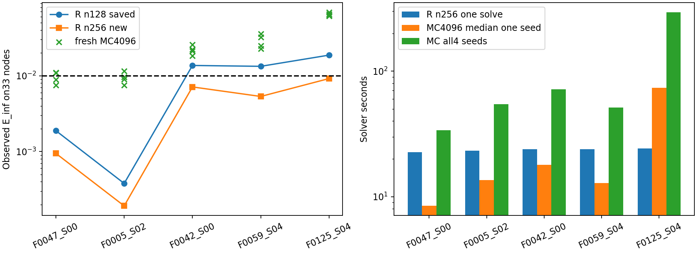

# Заключительная диагностика пяти train-уравнений

Выполнено **25/25** терминальных вызовов, pending **0**.
Статусы: `{'completed': 25}`. Никаких дополнительных уравнений, ML-fit или
подстроек параметров по первым попыткам. Источники и конфигурации проверены
против неизменного proposal. Baseline n128 скопирован побайтово, не пересчитан.

## Точность и полная стоимость

| ID | R128 | R256 | MC_success | MC_E_range | R256_s | MC_all_s |
| --- | --- | --- | --- | --- | --- | --- |
| F0047_S00 | 0.00188261 | 0.000943851 | 2/4 | 0.0074732–0.0110201 | 22.55 | 33.74 |
| F0005_S02 | 0.000379017 | 0.000191493 | 3/4 | 0.00753545–0.0114711 | 23.18 | 54.39 |
| F0042_S00 | 0.0136623 | 0.0071163 | 0/4 | 0.0183232–0.0256965 | 23.94 | 71.61 |
| F0059_S04 | 0.0133103 | 0.00532767 | 0/4 | 0.0227808–0.035563 | 23.83 | 51.38 |
| F0125_S04 | 0.018706 | 0.00917467 | 0/4 | 0.0615813–0.068697 | 24.28 | 293.92 |

R: ChernovSolver.solve,n256,Q513,quadratic,dx.0125,padding12,cubic/zero.
От baseline отличается только n128→256. MC: существующий Numba,M4096 на точку,
chunk1024,h1/128,четыре новых seed202610250440–443. Общая сетка33 узла[-1,1],
общий аналитический T по G,tail_eps1e-4; T одинаков у старого и нового R и MC.
Exact-метрики вычислены после возврата solver, параметры не менялись.

R: успехов 2/5→5/5; E∞ уменьшилась
в 5/5 случаях. Два n не устанавливают порядок сходимости
или строгую границу остатка; другие ошибки схемы остались фиксированными.
MC: наблюдаемых успехов **5/20**.
MC-only наблюдаемых trial-успехов при неуспехе R256: **0**.
Наблюдаемых точных MC-trial, быстрее также точного R256:
**5**. Это отдельно от подтверждения
надёжности; совместный успех с меньшим временем тоже мог бы быть полезен
для выбора, но четыре испытания не доказывают p(success)>=.95.

Активный wall **628.03 с /10.47 мин**, календарный **627.99 с**,
известный solver wall **622.81 с**:
R **117.78 с**, все повторения MC **505.03 с**.
RSS peak **281.91 МиБ**. Один worker,512 МиБ, абсолютный
бюджет1200 с, guardian/owner lease300 с; deadline при resume не продлевается.
Прерывания guardian: `[]`. Каждый результат атомарный immutable;
ресурсный или прерванный статус не является математической неточностью.

## Надёжность и временная ошибка

Для p=вероятность полного33-точечного успеха одного4096-path trial сохранены
точные биномиальные Clopper–Pearson интервалы с семейной поправкой на5 задач
(два хвоста .005). Прежние отобранные seed не включены в подтверждающие четыре.
Проверка H0:p>=.95 — exact binomial при alpha.01 на задачу. Три/четыре провала
из4 отвергают H0; даже4/4 не подтверждают p>=.95. Уверенность в p95 не
получена ни из наблюдаемого успеха, ни из близости одного среднего к exact.

Статистические bands дискретного усечённого среднего: Bonferroni на5 задач ×
5 оценок (4 trial и один pooled) ×33 точки при family alpha=.05.
Нормальные bands асимптотические, дополнительно сохранены консервативные
Hoeffding bands и seed-t диагностика. Raw MCResult CI95 остаются точечными и
не используются как совместный33-точечный CI. Pooled variance включает
межseed-компонент. Mean всех четырёх свежих trial — **16384 пути на точку**,
отдельный диагностический агрегат, а не один4096-path run и не бесплатный ответ.
Если все4 не завершены, такой агрегат не строится. [Все оценки](analysis/statistics.json).

Ни bands, ни аналитический хвост не ограничивают временное смещение EM и
трапеций. Оценка error дискретного среднего относительно exact позволяет
диагностировать фиксированное смещение, но не даёт строгой h-error bound.
У R отдельно не ограничены конечное n, пространство, окно и квадратура.
Здесь не исследовались h или интерполяция и схемы не корректировались.

## Область вывода

Пять train-случаев намеренно выбраны предыдущим исследованием: два удачных
MC-агрегата, два пограничных R-неуспеха и один контроль смещения. Это не
репрезентативная оценка production1000. Отсутствие преимущества MC на них
не является универсальным математическим утверждением о методе.
Новые seed независимы от прежних; baseline и исторические результаты сохранены.

Окончательные решения по900 задачам, увеличению M, R n256 и ML-меткам —
[INTERPRETATION.md](INTERPRETATION.md), на основании завершённых чисел.
Массовые расчёты900, дополнительные эксперименты и новое ML не запускались.

Новые файлы: diagnostics/final_grid5.py, diagnostics/final_grid5_stats.py,
diagnostics/report_final_grid5.py и tests/test_final_grid5.py. Численное ядро,
генератор, данные и старые результаты не редактировались; статус обновляется
в PROJECT_STATUS.md. [План](plan.json), [таблица](analysis/comparison.csv),
[попытки](analysis/attempts.csv), [проверки](verification.json).
