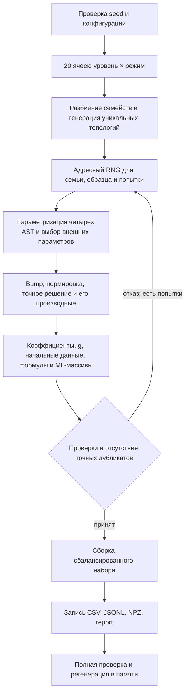

# Аудит действующего генератора дифференциальных уравнений

**Проект № 2488. Дата: 5 ноября 2026 года.** Объект: текущий репозиторий `ode-generator-remizov`, прежде всего `all_methods_v1`. Это исследование реализации и данных, без изменения научного кода, конфигураций, тестов и существующих датасетов. Новые решения ОДУ и новые расчёты Монте-Карло не выполнялись. Повторная генерация для проверки воспроизводимости выполнялась в памяти; исходные файлы не перезаписывались.

## 1. Главный вывод и границы утверждения

**Действующий генератор конструктивно создаёт математически допустимые задачи для сдвиговой формулы Ремизова: для идеальных функций, заданных его AST, предпосылки теоремы 6 обеспечены на всей действительной прямой.** Это относится к обоим специально указанным уравнениям — `AMV1_F0141_S00` и `AMV1_F0180_S04`. Их большие сохранённые численные ошибки не означают нарушения условий теоремы.

Обоснование состоит из двух независимых частей: прочитан первоисточник с точными условиями, а затем проверено, какие свойства следуют из разрешённой грамматики и формул генератора. Сеточные проверки дополняют эту аргументацию, но не доказывают глобальные свойства. Отдельного универсального программного доказателя условий для произвольных переданных пользователем функций в проекте нет.

Основные результаты аудита:

- Категории **Simple, Medium, Hard не используются** в текущем генераторе. Есть уровни **L1–L4**, режимы **constant, slow_varying, moderate_varying, oscillatory, high_contrast**, структурные семейства и разбиение train/validation/test.
- Основной набор содержит **1000 уравнений = 200 семейств × 5 параметризаций**. Дополнительно найдены самостоятельные наборы на 20, 40 и 800 уравнений; они перечислены отдельно в § 9.
- Основной набор получен из **1001 попытки параметризации**, одна отклонена по `near_zero_solution`. Указанные два уравнения приняты с первой попытки. Отбраковки основного набора из-за нарушения глобальных условий Ремизова не зафиксированы.
- Для всех четырёх полных наборов заново пройдена полная валидация, включая воспроизведение канонических байтов из seed/config. Профильные тесты: **44 passed, 619 subtests passed**.
- Пять существующих примеров независимо дифференцированы в SymPy и вычислены с 60 десятичными знаками. Максимальное расхождение с вычисленной генератором правой частью на пяти контрольных точках — **4.6964·10⁻¹⁴**.
- Условие применимости теоремы и точность её дискретной реализации — разные вопросы. Ни категория L4, ни `success=True`, ни нулевая изготовленная невязка не дают гарантии точности численного ответа.

Полные численные свидетельства: [facts.json](facts.json), [examples.json](examples.json), [журнал проверок](checks.log), [pytest](pytest.txt). Полные формулы пяти примеров с промежуточными узлами: [EXAMPLES.md](EXAMPLES.md). Готовый связный текст для НИР: [SCIENTIFIC_DESCRIPTION.md](SCIENTIFIC_DESCRIPTION.md). Команды и исходный текст одноразовой проверочной программы: [AUDIT_PROTOCOL.md](AUDIT_PROTOCOL.md).

## 2. Какие компоненты действительно образуют генератор

| Компонент | Назначение и ключевые места |
|---|---|
| `generate_all_methods_dataset_v1.py` | CLI: разбирает параметры, строит набор, записывает четыре файла, затем полностью проверяет их; `main`, строки 87–133 |
| `src/all_methods_dataset_v1.py` | Конфигурация, топологии, случайные параметры, изготовление уравнения, отбраковка, NPZ/CSV/JSONL, полный валидатор |
| `src/all_methods_expressions.py` | Белый список AST, вычисление функций и двух аналитических производных, bump, структура деревьев и строки формул |
| `all_methods_dataset_loader.py` | Безопасное восстановление функций из AST, согласование обычной и резольвентной постановок |
| `validate_all_methods_dataset_v1.py` | CLI отдельной полной проверки четырёх артефактов |
| `all_methods_bounds.py` | Более поздний дополнительный аналитический сертификат глобальной нормы правой части; **не часть отбора кандидатов v1** |
| `create_remizov_benchmark.py` | Другой конструктор: пять заранее заданных эталонов R1–R5; **не основной случайный генератор** |
| `remizov_solver.py`, `chernov_solver.py` | Численные реализации, которые получают уже созданную задачу; не участвуют в генерации и отбраковке |

Основные точки входа: [конфигурация и версии][G47], [generate_dataset][G1250], [CLI][CLI87], [AST][E42], [загрузчик][LD782]. SHA-256 трёх файлов `unchanged_mathematical_core` совпадает с `MIGRATION_MANIFEST.json`; их математика при аудите не изменялась.

Старый `grammar-v1.1` упомянут в docstring AST-модуля как исторический предшественник. Реализации такого генератора среди действующих исходников этого репозитория не найдено. Из этого упоминания нельзя восстанавливать диапазоны Simple/Medium/Hard или приписывать их текущему алгоритму. Соседний `../generator_DE` в аудит не включался.

## 3. Математическая постановка и полный цикл построения

### 3.1. Обычное уравнение и задача Коши

В датасете хранится

$$
a(x)y''(x)+b(x)y'(x)+c(x)y(x)=g(x),\qquad
x\in[-1,1],\quad y(-1)=y_0,\quad y'(-1)=v_0.
$$

Здесь $x$ — независимая действительная переменная, $y$ — неизвестная функция, штрихи — производные по $x$, $a$ — старший коэффициент, $b$ — коэффициент первой производной, $c$ — коэффициент нулевого порядка, $g$ — правая часть. Интервал $[-1,1]$ — фиксированная область задачи Коши и хранения признаков, **но все функции уравнения определены на всей $\mathbb R$**.

`x0=-1`, `x1=1`; `y0`, `v0` не выбираются независимо. Они вычисляются из заранее построенного точного решения. Никакого численного решения ОДУ для получения `y_exact` генератор не выполняет.

### 3.2. Четыре исходных дерева и внешние оболочки коэффициентов

Сначала создаются четыре дерева функций $T_a,T_b,T_c,T_y$. В коде они называются `a_raw`, `b_raw`, `c_raw`, `y_shape`; `raw` означает выражение **до внешней оболочки**, `shape` — форму решения до умножения на bump и нормировки.

Для выбранных $A_-,A_+,B,C,\delta$ задаются

$$
M=\frac{A_-+A_+}{2},\qquad H=\frac{A_+-A_-}{2},
$$
$$
\boxed{a=M+H\tanh T_a,\quad b=B\tanh T_b,\quad
c_R=C\tanh T_c,\quad\lambda=C+\delta,\quad c=c_R-\lambda.}
$$

$A_-,A_+$ соответствуют `a_lower`, `a_upper`; $M,H$ — `a_mid`, `a_half`; $B,C$ — `b_scale`, `c_scale`; $\delta$ — `gap`. Это конструктивные границы, а не обязательно достигаемые минимум/максимум. В частности, `a_min` в конфигурации — отдельный защитный порог, а не $A_-$.

Из $|\tanh u|\le1$ непосредственно следуют для всех действительных $x$

$$
0<A_-\le a(x)\le A_+,\qquad |b(x)|\le B,\qquad |c_R(x)|\le C,
$$
$$
-(2C+\delta)\le c(x)\le-\delta<0,\qquad
\lambda-\|c_R\|_\infty\ge\lambda-C=\delta>0.
$$

Формулы здесь описывают математическую конструкцию. Параметры и промежуточные значения в программе представлены float64: равенства вроде $\lambda-C=\delta$ и $M-H=A_-$ могут отличаться на единицы последнего разряда. Валидатор учитывает это допусками, а исходные сертификаты коэффициентов не используют направленного округления. Это не интервальное машинно-формальное доказательство точных границ до последнего бита. Положительность a и строгий запас λ сохраняются с большим запасом относительно округления: минимальные параметры имеют порядок 0.5 и 0.12, а не машинного эпсилон.

Таким образом, датасет покрывает специальный класс уравнений со строго отрицательным обычным $c$, положительным равномерно невырожденным $a$ и ограниченными коэффициентами. Это не выборка из всех линейных ОДУ второго порядка. Источник: [_sample_construction_parameters и _coefficient_values][G510].

### 3.3. Компактно поддержанное точное решение

Обозначим

$$
\Phi(z)=\begin{cases}\exp\left(1-\dfrac1{1-z^2}\right),&|z|<1,\\0,&|z|\ge1,\end{cases}
\qquad \beta(x)=\Phi\left(\frac{x-\mu_b}{R}\right).
$$

Генератор выбирает $\mu_b\in[-0.25,0.25]$, $R\in[1.5,3]$, целевую амплитуду $A_y\in[0.5,1.5]$. Параметр $\mu_b$ — центр bump; он отличается от центров отдельных гауссиан и рациональных листьев.

На сетке

$$
\mathcal V=\operatorname{linspace}(-1,1,N_{val})
$$

вычисляются

$$
w(x)=\beta(x)T_y(x),\qquad m=\max_{x\in\mathcal V}|w(x)|.
$$

Если $m<10^{-3}$, кандидат отклоняется. Иначе

$$
s=\frac{A_y}{m}>0,\qquad \boxed{y_{exact}(x)=s\beta(x)T_y(x)}.
$$

`solution_scale=s` нормирует **сеточный максимум на [-1,1]**, а не непрерывную норму и не норму на всей прямой. Граница $m\ge10^{-3}$, $A_y\le1.5$ даёт $s\le1500$ в точной арифметике; обычная фактическая величина зависит от формы дерева. При изменении `validation_grid_size` может измениться $s$, поэтому даже при том же seed уравнение в общем случае изменится.

Имеем

$$
\operatorname{supp}y_{exact}\subset[\mu_b-R,\mu_b+R]\subset[-3.25,3.25].
$$

Этот сертифицированный интервал строго содержит $[-1,1]$: его левый конец не больше $-1.25$, правый — не меньше $1.25$. Все производные bump обращаются в ноль на концах и вне интервала. Поэтому $y_{exact}\in C_c^\infty(\mathbb{R})$.

Термин «аналитическое решение» здесь уместен в смысле **явно заданного точного выражения**. Ненулевая функция с компактным носителем не является вещественно-аналитической на всей прямой; гладкость $C^\infty$ и вещественная аналитичность — разные свойства.

Вычисление: [normalized_bump_jet2][E597], [evaluate_solution][E657], [нормировка][G896]. Маска внутренней ветви применяется до делений на $1-z^2$; когда экспонента округляется к нулю, производные соответствующей ветви в реализации также устанавливаются в ноль. Это машинное приближение к гладкой математической функции.

### 3.4. Производные, правая часть и начальные данные

Генератор аналитически вычисляет

$$
y'=s(\beta'T_y+\beta T_y'),\qquad
y''=s(\beta''T_y+2\beta'T_y'+\beta T_y'').
$$

Затем определяет, а не независимо выбирает,

$$
\boxed{g=ay''+by'+cy,\qquad y_0=y(-1),\quad v_0=y'(-1).}
$$

В частности, $g,g_R=-g\in C_c^\infty(\mathbb{R})$, и вне указанного носителя они равны нулю. Можно записать правую часть без обозначения неизвестного решения:

$$
g=s\{\beta[aT_y''+bT_y'+cT_y]
+\beta'[2aT_y'+bT_y]+\beta''aT_y\}.
\tag{G}
$$

Эта формула вместе с AST и правилами дифференцирования § 5 полностью определяет $g$. В CSV сохраняется её развёрнутая текстовая версия. Источники: [_all_values][G583], [build_problem_formula_strings][G615], [начальные условия и metadata][G966].

### 3.5. Порядок действий алгоритма



Внутри `_candidate_record` параметры деревьев выбираются в порядке `a_raw`, `b_raw`, `c_raw`, `y_shape`; рекурсия `_parameterize_tree` сначала параметризует детей, затем текущий узел. После деревьев выбираются внешние масштабы и bump. Этот порядок потребления RNG влияет на конкретные байты набора. В режиме `constant` решение параметризуется как `moderate_varying`, хотя три коэффициентных дерева остаются константами.

## 4. Классификация: точные критерии

### 4.1. Структурная сложность L1–L4

Пределы относятся **к каждому исходному дереву**, а не к полному выражению $g$, развёрнутым производным, внешнему `tanh` коэффициента или bump. Лист имеет глубину 1. Ветвление не превышает двух детей. Источник: [_COMPLEXITY_SPECS][G76], [_generate_tree_topology][G299], [tree_metrics][E297].

| Уровень | Задано: глубина | Задано: число узлов | Предел $\vert \omega\vert $ | Реализуемые ограничения с учётом бинарности | Фактически в основном наборе* |
|---|---:|---:|---:|---|---|
| L1 | 1–2 | 3–7 | 1.5 | Глубина 2, ровно 3 узла | 2; 3 |
| L2 | 2–3 | 6–12 | 3 | Глубина 3, 6–7 узлов | 3; 6–7 |
| L3 | 3–4 | 10–18 | 5 | Глубина 4, 10–15 узлов | 4; 10–14 |
| L4 | 4–5 | 14–24 | 8 | Глубина 4–5, 14–24 узла; при глубине 4 максимум 15 | 4–5; 14–24 |

\*Исключены три константных коэффициентных дерева режима `constant`; `y_shape` включено.

Причина более узких достижимых диапазонов: дерево глубины $d$ с не более чем двумя детьми имеет не более $2^d-1$ узлов. Так, L1 не может содержать семь узлов при глубине два. Это не ошибка исполнения, а избыточно широкий верхний предел в конфигурации. L1 всегда состоит из одной бинарной операции над двумя листьями; вложенные унарные узлы внутри исходного дерева L1 невозможны. Внешний `tanh` коэффициента и bump присутствуют и на L1.

Генератор **не измеряет трудность численного решения** и не переводит уравнение в другой класс по результату solver. Возрастающая структурная сложность не доказывает возрастания ошибки или времени. Нет научно установленного соответствия «L1 = Simple, L2 = Medium, L3/L4 = Hard».

### 4.2. Режимы

| Режим | Что действительно задаётся | Чего название не гарантирует |
|---|---|---|
| `constant` | `a_raw`, `b_raw`, `c_raw` — одиночные константные листья; $a,b,c_R,c$ постоянны | Правая часть и решение не постоянны; их сложность зависит от $T_y$ |
| `slow_varying` | Низкие диапазоны частот/локализации и более умеренные внешние масштабы | Нет отдельного ограничения на норму производной итогового коэффициента |
| `moderate_varying` | Промежуточные диапазоны параметров | Не определяется порогом измеренной изменчивости |
| `oscillatory` | Повышенные допустимые частоты, иные диапазоны локализации | В конкретном дереве может не быть синуса/косинуса; число осцилляций не проверяется |
| `high_contrast` | Более широкий сертификат для $a$, большие $B,C$, возможный меньший gap | Не требуется измеренный большой контраст $\max a/\min a$; насыщение `tanh` может его уменьшить |

Это **режимы распределения случайных параметров**, а не классы, полученные классификацией готовых функций. `force_nonconstant` требует неконстантного листа на одной ветви топологии; отдельного доказательства, что конкретное выражение не упростится в константу, нет.

### 4.3. Семейства и баланс

Семейство — фиксированные топологии **всех четырёх** деревьев. Пять его образцов имеют одинаковые операции и структуру, но новые числовые параметры, внешние масштабы, bump и нормировку. Сигнатура исключает числа; для `lincomb` и `mul` дети канонически сортируются. Для параметрически свободной топологии перестановка детей не создаёт нового семейства. Ассоциативные и тригонометрические тождества канонизация не учитывает. Источники: [topology_dict/signature][E360], [_generate_families][G439].

В production: 4 уровня × 5 режимов × 10 семейств × 5 образцов. Каждая ячейка — 50 уравнений, каждый уровень — 250, каждый режим — 200. Из них **800 в неконстантных режимах и 200 в constant**. Следовательно, утверждение «все 1000 имеют переменные коэффициенты» неверно.

Нумерация идёт сначала по уровню, затем по режиму в порядке `constant`, `slow_varying`, `moderate_varying`, `oscillatory`, `high_contrast`, затем по локальному семейству. Для production $\lfloor i/10\rfloor$ — индекс ячейки семейства `Fiiii`; уровни занимают F0000–F0049, F0050–F0099, F0100–F0149 и F0150–F0199. Эти границы меняются с `n_families`.

## 5. Полная математическая грамматика и дифференцирование

### 5.1. Все 14 операций

Обозначим $u,v$ уже построенные допустимые подвыражения. Их можно комбинировать рекурсивно в пределах структурных ограничений уровня. Схема узла — `op`, `children`, `params`; арность — число детей. Источник: [_NODE_SPECS][E42], [численные формулы][E455].

| Имя AST | Арность | Формула | Параметры | Глобальные свойства |
|---|---:|---|---|---|
| `constant` | 0 | $k$ | `value=k` | Конечная константа |
| `sin_affine` | 0 | $\sin(\omega x+\varphi)$ | `omega`, `phi` | Модуль ≤ 1 |
| `cos_affine` | 0 | $\cos(\omega x+\varphi)$ | `omega`, `phi` | Модуль ≤ 1 |
| `tanh_affine` | 0 | $\tanh(\omega x+\varphi)$ | `omega`, `phi` | Модуль ≤ 1 |
| `gaussian` | 0 | $\exp[-\alpha(x-\mu)^2]$ | `alpha>0`, `mu` | Значения в (0,1] |
| `lorentz` | 0 | $1/[1+\alpha(x-\mu)^2]$ | `alpha>0`, `mu` | Знаменатель ≥ 1 |
| `saturating` | 0 | $(x-\mu)/\sqrt{1+(x-\mu)^2}$ | `mu` | Модуль < 1, радикал ≥ 1 |
| `sin` | 1 | $\sin u$ | Нет | Ограниченная гладкая композиция |
| `cos` | 1 | $\cos u$ | Нет | То же |
| `tanh` | 1 | $\tanh u$ | Нет | То же |
| `exp_neg_square` | 1 | $e^{-u^2}$ | Нет | Значения в (0,1] |
| `rational_saturate` | 1 | $u/(1+u^2)$ | Нет | Модуль ≤ 1/2 |
| `lincomb` | 2 | $\alpha u+\beta v$ | `alpha`, `beta` | Ограничена конечной суммой границ |
| `mul` | 2 | $uv$ | Нет | Ограничена произведением границ |

`alpha` гауссианы/лоренцевского листа и `alpha` линейной комбинации имеют **разный смысл**. Первое — положительный параметр локализации, второе — знакопеременный вес. `saturating` и `rational_saturate` тоже различны: у первого знаменатель с квадратным корнем, у второго без корня.

Не разрешены произвольные `log`, `sqrt`, `div`, `divide`, `reciprocal`, `exp`, `tan`, `polynomial`, `pow`, `var`, `abs`, `sign`, `min`, `max`, `piecewise`, `Piecewise`; отклоняется также любое другое имя вне whitelist. При этом **специальные безопасные** корень/деление/экспонента внутри `saturating`, `lorentz`, `gaussian`, `exp_neg_square`, `rational_saturate` допустимы. Утверждение «генератор вообще не использует exp, sqrt и деление» было бы ошибочным.

Bump — отдельная фиксированная гладкая конструкция, а не разрешённый произвольный узел `Piecewise` для коэффициентов. Внутри каждого из 14 узлов допускаются только точные имена параметров, правильное число детей, конечные действительные числа; Gaussian/Lorentz дополнительно требуют $\alpha>0$. Булевы значения не считаются числовыми параметрами. Сам `SafeExpressionNode` не накладывает производственные диапазоны частот и глубины; их задаёт генератор и проверяет полный валидатор.

### 5.2. Как возникают вложенные выражения

Например, грамматика допускает

$$
\frac{\sin(\tanh(\omega x+\varphi))\,
 e^{-[\alpha\cos(\nu x+\psi)+\beta/(1+\gamma(x-\mu)^2)]^2}}
 {1+\left[\sin(\tanh(\omega x+\varphi))\,
 e^{-[\alpha\cos(\nu x+\psi)+\beta/(1+\gamma(x-\mu)^2)]^2}\right]^2}.
$$

Это композиция `rational_saturate(mul(sin(tanh_affine), exp_neg_square(lincomb(cos_affine,lorentz))))`; конкретный уровень должен дополнительно допускать глубину и число узлов. Это иллюстрация грамматики, не отдельная строка датасета. Реальные деревья всех уровней приведены в [EXAMPLES.md](EXAMPLES.md).

Топология строится следующим образом:

1. Для неконстантного дерева случайно выбирается целая глубина из диапазона уровня.
2. На глубине больше 1 с вероятностью 0.45 при оставшейся глубине 2, а при большей глубине — 0.58 выбирается бинарный узел; в остальных случаях — унарный.
3. Бинарная операция равновероятно выбирается из `lincomb`, `mul`; унарная — из пяти разрешённых операций. У бинарного узла одна ветвь имеет глубину $d-1$, другая — равномерно выбранную целую глубину от 1 до $d-1$. Расположение глубокой ветви слева/справа случайно.
4. Лист выбирается равновероятно из отсортированного списка разрешённых листьев; на принудительно неконстантной ветви `constant` исключён.
5. Дерево принимается, только если удовлетворяет одновременно числу узлов и глубине. На построение одного дерева выделено до **2000 внутренних попыток**.
6. После сборки четырёх деревьев проверяется уникальность общей сигнатуры. На уникальную топологию семейства выделено до `max_attempts` попыток.

Вероятности из шага 2 — **предложения до фильтра по размеру**, а не конечные частоты операций в принятом наборе. В частности, на L1 фильтр оставляет только бинарный корень. Структурные отказы не включаются в `total_rejections`, считающий попытки параметризации образцов. Источник: [_random_tree_at_depth][G275], [_generate_tree_topology][G299].

В основном наборе реально присутствуют все 14 операций. На 1000×4 исходных деревьях насчитано 31 440 узлов; это счёт с повторением пяти параметризаций одной топологии:

| Операция | Узлов | Операция | Узлов |
|---|---:|---|---:|
| constant | 2225 | lincomb | 5995 |
| sin_affine | 2270 | mul | 5515 |
| cos_affine | 2355 | sin | 880 |
| tanh_affine | 2270 | cos | 890 |
| gaussian | 2010 | tanh | 835 |
| lorentz | 2185 | exp_neg_square | 835 |
| saturating | 2195 | rational_saturate | 980 |

Сведения пересчитаны из metadata, см. `operation_counts` в [facts.json](facts.json). Внешние оболочки коэффициентов, bump и развёрнутые формулы $g$ в этот счёт не входят.

### 5.3. Аналитический jet: правила для всех узлов

`Jet2` — тройка $(u,u',u'')$, `d1` и `d2` — первая и вторая производные. Для линейной комбинации тройки складываются с весами. Для произведения

$$
(uv)'=u'v+uv',\qquad (uv)''=u''v+2u'v'+uv''.
$$

Для композиции $F(u)$

$$
(F(u))'=F'(u)u',\qquad
(F(u))''=F''(u)(u')^2+F'(u)u''.
$$

Используемые производные внешних функций:

| $F(u)$ | $F'(u)$ | $F''(u)$ |
|---|---|---|
| $\sin u$ | $\cos u$ | $-\sin u$ |
| $\cos u$ | $-\sin u$ | $-\cos u$ |
| $\tanh u$ | $1-\tanh^2u$ | $-2\tanh u(1-\tanh^2u)$ |
| $e^{-u^2}$ | $-2ue^{-u^2}$ | $(4u^2-2)e^{-u^2}$ |
| $u/(1+u^2)$ | $(1-u^2)/(1+u^2)^2$ | $2u(u^2-3)/(1+u^2)^3$ |

Для листьев, обозначив $d=x-\mu$, $\theta=\omega x+\varphi$, имеем:

| Лист $u$ | $u'$ | $u''$ |
|---|---|---|
| $k$ | 0 | 0 |
| $\sin\theta$ | $\omega\cos\theta$ | $-\omega^2\sin\theta$ |
| $\cos\theta$ | $-\omega\sin\theta$ | $-\omega^2\cos\theta$ |
| $\tanh\theta$ | $\omega(1-u^2)$ | $-2\omega^2u(1-u^2)$ |
| $e^{-\alpha d^2}$ | $-2\alpha d u$ | $(4\alpha^2d^2-2\alpha)u$ |
| $(1+\alpha d^2)^{-1}$ | $-2\alpha d/(1+\alpha d^2)^2$ | $2\alpha(3\alpha d^2-1)/(1+\alpha d^2)^3$ |
| $d/\sqrt{1+d^2}$ | $(1+d^2)^{-3/2}$ | $-3d(1+d^2)^{-5/2}$ |

Внутри носителя bump положим $z=(x-\mu_b)/R$, $q=1-z^2$. Тогда

$$
\ell_1=-\frac{2z}{Rq^2},\qquad
\ell_2=\frac1{R^2}\left(-\frac2{q^2}-\frac{8z^2}{q^3}\right),
\quad \beta'=\beta\ell_1,\quad\beta''=\beta(\ell_1^2+\ell_2).
$$

На границе и снаружи значения $\beta,\beta',\beta''$ нулевые. Рекурсивный jet не использует разностных шагов и не вызывает SymPy в рабочем генераторе. Независимый SymPy-оракул есть в тестах [tests/test_all_methods_expressions.py:211][TE211] и отдельно применён в настоящем аудите.

## 6. Все параметры генерации и смысл полей

### 6.1. Числовые параметры узлов

Пусть $W=1.5,3,5,8$ для L1,L2,L3,L4 соответственно. `uniform(l,h)` — равномерное вещественное распределение NumPy на полуинтервале $[l,h$); в таблицах для краткости приводятся его граничные значения. Знак в `_sample_signed_scale` выбирается отдельным равновероятным двоичным выбором. Параметры затем условно отбираются проверками кандидата, поэтому принятые значения не являются безусловной независимой равномерной выборкой.

| Параметр | Выбор и влияние |
|---|---|
| `value` константы $k$ | Uniform(-1.5,1.5); постоянная амплитуда листа |
| `omega` $\omega$ | Знак ± с вероятностью 1/2; модуль из таблицы ниже; масштаб изменения аргумента синуса, косинуса или tanh |
| `phi` $\varphi$ | Uniform(-π,π); сдвиг аргумента/фаза, в радианах |
| `alpha` Gaussian/Lorentz | Положительное значение из таблицы ниже; характерная ширина порядка $1/\sqrt{\alpha}$ |
| `mu` локализованных/насыщающего листьев | Uniform(-1.5,1.5); центр вдоль оси $x$ |
| `alpha`, `beta` lincomb | Независимые знаки ±; модули Uniform(0.25,1.6); веса двух ветвей |
| Параметры унарных операций и mul | Отсутствуют; случайность приходит из выбора операции и дочерних выражений |

| Режим параметризации | Диапазон $\vert \omega\vert $ | Диапазон $\alpha$ Gaussian/Lorentz |
|---|---|---|
| slow_varying | [0.12, min(1,W)] = [0.12,1] | [0.08,0.7] |
| moderate_varying | [0.45,min(3,W)] | [0.15,min(4,0.7+W)] |
| oscillatory | [min(1.25,W),W] = [1.25,W] | [0.5,min(8,1+W)] |
| high_contrast | [0.3,min(4,W)] | [0.2,5] |
| Остальная ветвь `_frequency_range` | [0.2,W] | Для Gaussian/Lorentz действует общий else как moderate |

Последняя строка — реальная запасная ветвь функции, но в штатных коэффициентах `constant` частотных листьев нет, а для `y_shape` этого режима явно передаётся `moderate_varying`. Источники: [_sample_signed_scale / _frequency_range][G321], [_parameterize_tree][G342], [_candidate_record][G896].

### 6.2. Параметры внешней конструкции по режимам

Все величины в ячейках выбираются равномерно; условный интервал для $A_+$ зависит от уже выбранного $A_-$.

| Режим | $A_-$ | $A_+$ | $B$ | $C$ | $\delta$ |
|---|---|---|---|---|---|
| constant | [0.7,1.5] | [$A_-+0.3$, min(3,$A_-+1.2$)] | [0.15,1.8] | [0.15,1.8] | [0.2,1.5] |
| slow_varying | [0.8,1.5] | [$A_-+0.3$, min(3,$A_-+1$)] | [0.15,1.2] | [0.15,1.3] | [0.25,1.4] |
| moderate_varying | [0.7,1.5] | [$A_-+0.3$, min(3,$A_-+1.3$)] | [0.3,2] | [0.25,2] | [0.2,1.5] |
| oscillatory | [0.6,1.4] | [$A_-+0.4$, min(3,$A_-+1.5$)] | [0.5,2.8] | [0.4,2.8] | [0.18,1.5] |
| high_contrast | [0.5,0.9] | [max($A_-+0.8$,2),3] | [1.5,5] | [1.5,4] | [0.12,1.8] |

В high_contrast при данном диапазоне $A_-$ нижняя граница для $A_+$ фактически всегда 2. В остальных текущих диапазонах многие `min(3,...)` неактивны, но в таблице сохранена точная формула кода. Разность gap влияет на запас $\lambda-|c_R|$ и на горизонт резольвентного интеграла; это не шаг численной сетки. $\lambda=C+\delta$ не выбирается независимо. Источник: [_sample_construction_parameters][G510].

Общие параметры всех режимов: `bump_mu` ∈ [-0.25,0.25], `bump_radius` ∈ [1.5,3], `target_amplitude` ∈ [0.5,1.5]. $M,H,s$, support_left/right, y0/v0 вычисляются из них и AST. Средняя точка $M$ не является средним значением функции $a(x)$, $H$ — половина ширины сертификата, а не измеренная амплитуда колебаний.

### 6.3. Полная конфигурация `AllMethodsConfig`

| Поле / CLI | По умолчанию | Допустимость и математическое/техническое действие |
|---|---:|---|
| `seed` / `--seed` | 2488 | Неотрицательное целое; корневая энтропия адресных потоков |
| `n_families` / `--n-families` | 200 | Положительное целое, кратное 20; число структурных семейств |
| `samples_per_family` / `--samples-per-family` | 5 | Положительное целое; число принятых параметризаций семьи |
| `ml_grid_size` / `--ml-grid-size` | 256 | Целое ≥2; число точек хранения X, exact/dy_exact, а также сетка feature_hash |
| `validation_grid_size` / `--validation-grid-size` | 2049 | Целое ≥17; сетка нормировки и проверки кандидата |
| `max_attempts` / `--max-attempts` | 100 | Положительное целое; лимит попыток уникальной семейной топологии и отдельно лимит параметризации одного образца |
| `max_abs_safety` / `--max-abs-safety` | $10^6$ | Конечное >0; аварийный порог сеточных значений $a,b,c,g,y,y',y''$ |
| `a_min` / `--a-min` | $10^{-3}$ | Конечное $0<a_{min}\le0.5$; минимально разрешённый сертификат $A_-$; не задаёт распределение $A_-$ |
| `x0`, `x1` | -1,1 | Версия v1 допускает только эти значения; CLI изменения не предоставляет |
| `residual_rtol` / `--residual-rtol` | $10^{-10}$ | Конечное >0; относительный порог невязки с масштабом не меньше 1 |
| CLI `--output-dir` | `data` | Каталог записи; в `AllMethodsConfig` не входит, математику не меняет |

Вычисляемые свойства: `master_seed=seed`, `total_equations=n_families*samples_per_family`, `families_per_cell=n_families/20`. Небольшой набор использует 20×1, ML=32, validation=257. Редактирование параметров здесь не производилось.

Техническая оговорка: ширина записи `F{index:04d}` и `S{index:02d}` в генераторе — минимальная ширина, но загрузчик использует шаблоны ровно четырёх и двух цифр. Конфигурационный валидатор не устанавливает верхние ограничения `n_families<=10000` и `samples_per_family<=100`. Чрезмерные значения способны пройти раннюю проверку и оказаться несовместимыми с загрузчиком. Для всех существующих наборов эта проблема не проявляется. Источники: [конфигурация][G98], [ID образца][G896], [шаблоны загрузчика][LD118].

### 6.4. Обозначения и сокращения в артефактах

| Поле / сокращение | Расшифровка |
|---|---|
| ODE / ОДУ | Ordinary differential equation / обыкновенное дифференциальное уравнение |
| IVP | Initial value problem: задача Коши; здесь для $y,y'$ при $x=-1$ |
| AST | Abstract syntax tree: абстрактное синтаксическое дерево; сериализованные данные о формуле |
| `AMV1_F0141_S00` | Префикс all_methods_v1, семейство с индексом 141, образец с индексом 0; индексы начинаются с нуля |
| `family_seed`, `sample_seed`, `attempt_seed` | uint64-идентификаторы адресных seed-путей; способ получения описан в § 9 |
| `accepted_attempt` | Номер принятой попытки с единицы; входной аргумент `attempt` начинается с нуля |
| `structure_signature` | SHA-256 параметрически свободной канонической топологии четырёх деревьев |
| `serialized_topology` | Та же топология в JSON-структуре без чисел |
| `serialized_ast` | Полные четыре дерева с параметрами плюс `construction` |
| `expression_hash` | SHA-256 канонического JSON списка строк a_expr,b_expr,c_expr,g_expr |
| `feature_hash` | SHA-256 байтов `ml_channels` формы $4,N_ml$, float64 в C-порядке |
| `*_expr` | Описательная строка формулы; не исполняемый код |
| `a_lower_cert`, `a_upper_cert` | Аналитические $A_-,A_+$ |
| `b_abs_cert`, `remizov_c_abs_cert` | Аналитические $B,C$, границы модулей $b,c_R$ |
| `remizov_lambda`, `remizov_gap_cert` | $\lambda$, $\delta=\lambda-C$ |
| `support_left`, `support_right` | Концы сертифицированного интервала носителя $\mu_b-R,\mu_b+R$ |
| `channel_order` | Строго `[a,b,c,g]`; $c_R,g_R$ в X не хранятся |
| `split` | train / validation / test, назначается всему семейству |
| `generation_version` | `all_methods_v1` — версия алгоритма/артефактов |
| `metadata_schema_version` | `all_methods_metadata_v1` — версия схемы JSONL |
| CSV / JSONL / NPZ | Таблица с разделителями / по одному JSON-объекту в строке / ZIP-контейнер NumPy-массивов |
| ML | Machine learning; здесь формат признаков и разбиение, не запуск обучения |
| RNG / PCG64 | Random number generator / используемый 64-битный алгоритм генератора NumPy |
| SHA-256 | Криптографический хеш для проверки идентичности; не математическая мера близости функций |

`tree_metrics.per_tree` содержит: `depth` — максимальную глубину; `nodes` — все узлы; `leaves` — листья; `unary_nodes`, `binary_nodes` — узлы соответствующей арности; `operator_counts` — частоты операций; `nonlinear_nodes` — **только** унарные узлы плюс `mul`; `max_nonlinear_nesting` — максимальную непрерывную цепочку таких узлов. Лист `sin_affine` математически нелинеен по $x$, но в этой технической метрике нелинейным узлом не считается. `lincomb` обрывает непрерывную цепочку. Общие поля `total_nodes`, `max_depth`, `total_nonlinear_nodes` агрегируют четыре дерева. Эти метрики не являются оценкой обусловленности ОДУ.

В `validation`: `max_residual`, `residual_scale`, `max_abs`, `sampled_ranges`, `observed_amplitude`, `support_boundary_smoke_max` — результаты конечных сеточных проверок. В report: `count/min/max/mean/std/q05/median/q95` — размер, экстремумы, среднее, стандартное отклонение NumPy с ddof=0 и квантили; `counts_by_*` — счётчики групп; `npz_shapes`, `npz_dtypes` — формы и типы массивов; `output_sha256` — хеши CSV, JSONL и NPZ; `family_split_leakage` — пересечение семейства между split. `max_ml_tensor_absolute_value` — максимум только в сохранённом X. Название `global_max_residual` означает максимум **по всем записям на validation-сетках**, а не супремум невязки на всей прямой.

## 7. Проверки, отбраковка и возможности пропуска проблем

### 7.1. Что следует из конструкции, а что измеряется

**Математически, на всей прямой:** допустимые функции и все их производные ограничены и гладкие; $a\ge A_->0$; $|b|\le B$, $\|c_R\|_\infty\le C$; $\lambda>C$; $c\le-\delta$; решение и правая часть имеют компактный носитель; изготовленное решение удовлетворяет ОДУ; начальные данные берутся из него. Эти выводы следуют из формы функций и конечных параметров, а не из количества проверочных точек.

**Численно:** конечность машинных значений, аварийный порог $10^6$, совпадение нормировки, начального состояния, формул и записанных массивов; невязка; контроль поведения около носителя; наблюдаемые диапазоны. Сеточные проверки не дают непрерывной границы этих наблюдений.

**Структурно/технически:** whitelist, арность, схемы JSON/CSV/NPZ, топологии и размеры деревьев, seed-пути, количество записей, баланс, split и точные хеши. Полная регенерация дополнительно проверяет, что комплект действительно соответствует заявленному алгоритму, seed и config.

### 7.2. Все именованные причины отбраковки образца

Источники: [validate_record][G667], [_candidate_record][G896], [цикл принятия][G1250].

| `reason` | Условие / смысл | Природа |
|---|---|---|
| `near_zero_solution` | $max_{\mathcal V}\vert \beta T_y\vert <10^{-3}$ до нормировки | Защита от чрезмерной нормировки, не нарушение теоремы |
| `derivative_failure` | Исключение при вычислении решения/производных или `_all_values` в проверке | Машинная вычислимость/реализация |
| `nonfinite_expression` | Нефинитные либо недействительные значения, в том числе сырой максимум решения | Численная проверка |
| `serialization_failure` | Неудача построения/сериализации AST/формул; также общий catch непредвиденного Exception в generate_dataset | Техническая; название может скрывать другую первоначальную причину, см. `detail` |
| `certificate_failure` | Неположительный/несогласованный сертификат, неверный gap/λ, нечисловые параметры или нарушение общих диапазонов | Проверка параметров аналитической конструкции |
| `safety_bound_exceeded` | Максимум модулей $a,b,c,g,y,y',y''$ на validation-сетке больше max_abs_safety | Численный защитный порог |
| `certificate_smoke_failure` | Сеточные коэффициенты выходят за сертификаты с допуском | Контроль реализации формул |
| `residual_failure` | Нарушение знаков/невязки с заданным допуском | Алгебраический и машинный контроль |
| `initial_condition_failure` | Записанные $y_0,v_0$ не совпадают с вычислением | Согласование данных |
| `initial_state_degenerate` | $\sqrt{y_0^2+v_0^2}<10^{-8}$ | Разнообразие/недегенеративность задачи, не условие теоремы |
| `support_failure` | Несогласованный носитель; не покрыт [-1,1]; ненулевые значения вне носителя/около границ выше допусков | Аналитическая конструкция плюс smoke-проверка |
| `normalization_failure` | Сеточная амплитуда не совпадает с target_amplitude | Численная согласованность |
| `duplicate_expression` | Уже был тот же хеш четырёх строк a,b,c,g | Побайтовый дубликат формул, не поиск всех математических тождеств |
| `duplicate_features` | Уже был тот же хеш массива $a,b,c,g$ на ML-сетке | Побайтовый численный дубликат |
| `invalid_validation_grid` | Явно переданная пользовательская сетка не конечная одномерная с ≥2 точками | Контракт API; штатный generate_dataset такую сетку не передаёт |

Некоторые математически допустимые уравнения исключаются из-за слабой амплитуды, начального состояния или повторения данных. Напротив, условие «метод достиг заданной точности за заданное время» вообще не входит в отбор.

### 7.3. Конкретные сетки и допуски

Приём кандидата по умолчанию использует 2049 точек [-1,1]. Сначала сверяются сертификаты и параметры. Для gap используется `math.isclose` с rtol=atol=$2\cdot10^{-15}$; для равенств параметров и начальных данных — $2\cdot10^{-13}$. Общий допуск диапазонов параметров — $2\cdot10^{-13}$.

Допуск сравнения sampled bounds с сертификатами:

$$
5\cdot10^{-13}\max(1,A_+,B,C,\lambda).
$$

Для невязки $r=ay''+by'+cy-g$ задаётся

$$
S=\max\{1,\|ay''\|_{\mathcal V},\|by'\|_{\mathcal V},
\|cy\|_{\mathcal V},\|g\|_{\mathcal V}\},\qquad
\|r\|_{\mathcal V}\le\texttt{residual_rtol}\,S.
$$

Здесь $\|f\|_{\mathcal V}=\max_{x\in\mathcal V}|f(x)|$. Знаковое равенство $g_R=-g$ проверяется точно, для $c=c_R-\lambda$ используется $2\cdot10^{-14}\max(1,C,\lambda)$.

На четырёх точках $l-1,l,r,r+1$, где $l=\mu_b-R,r=\mu_b+R$, проверяется нулевое значение $y,y',y'',g,g_R$ с порогом $10^{-14}$. Дополнительно проверяются $l+\epsilon,l,r,r-\epsilon$, $epsilon=\min(10^{-6},10^{-6}R)$, с порогом $10^{-8}$ для $y,y',y'',g$. При текущем $R\ge1.5$ это $epsilon=10^{-6}$. Совпадение нормировки — rtol=atol=$5\cdot10^{-13}$.

Полный **валидатор артефактов**, уже после записи, добавляет 1025 точек на [-10,10], проверяет конечность, тот же safety-порог, знаки, носитель и невязку. Допуск сертификатов там равен $5\cdot10^{-12}\max(1,A_+,B,C,\lambda)$. Это не этап повторного подбора кандидата: при неудаче полный комплект отклоняется. Источник: [_validate_wide_grid][G1877].

Публичный загрузчик имеет более лёгкую проверку на 17 точках [-1,1], допуск невязки $10^{-12}S$, сертификатов $5\cdot10^{-12}\max(1,|A_-|,|A_+|,B,C)$, сверку начальных данных и двух внешних точек носителя. Его задача — безопасная реконструкция, а не полная аутентификация четырёх файлов и всех производственных диапазонов. Источник: [_validate_numeric_reconstruction][LD699].

### 7.4. Повторные попытки и остановки

После именованного отказа записываются причина, detail, family/sample/attempt и соответствующие seed. Следующая попытка заново выбирает **числовые параметры**, сохраняя семейную топологию. Чужие RNG-потоки не сдвигаются. При исчерпании max_attempts генерация завершается `GenerationError`, не выдавая укороченный успешный набор.

Отдельные фатальные ошибки уровня коллекции: неверная численность, повтор ID/sample_seed, нарушение количества образцов семьи, повтор семейной сигнатуры, несбалансированная ячейка, пересечение split. Кроме того, не менее $max(1,\lceil0.05N\rceil)$ записей должны иметь $|y_0|>10^{-12}$, и столько же — $|v_0|>10^{-12}$, по отдельности. Это не требует обоих ненулевых значений у каждой записи. Источник: [_validate_collection_invariants][G1200].

Детальный список `dataset.rejections` существует в памяти. Канонический report сохраняет только суммы и счётчики причин. Статистика отбраковки деревьев по числу узлов и повторениям топологий отдельно не сохраняется. Поэтому «1001 попытка» ниже относится к параметризациям готовых семейных топологий, а не ко всем случайным деревьям, рассмотренным внутри генератора.

### 7.5. Могут ли пройти неподходящие записи

Ответ зависит от смысла «неподходящие»:

- **Нарушающие аналитические предпосылки теоремы при штатной математической конструкции:** в разрешённой грамматике такого механизма не найдено; доказательство в § 8 покрывает все её конечные деревья.
- **Дающие плохой численный ответ, слишком дорогие для конкретного бюджета, слабо различающиеся или не соответствующие бытовому смыслу названия режима:** могут, поскольку таких критериев нет.
- **С аварийным максимумом между сеточными точками:** сеточная проверка не исключает это; настоящие данные не доказывают непрерывную границу $10^6$.
- **С иными числовыми параметрами при ручном изменении файлов:** лёгкая загрузка не заменяет полную регенерацию. Часть диапазонов, например фаза и детальные режимные диапазоны внешних масштабов, не проверяется отдельными локальными условиями; полный валидатор обнаруживает несоответствие через воспроизведение seed/config.
- **Произвольные callables, переданные прямо в RemizovProblem с подставленными строками `analytic/all_real_x`:** общий solver не способен доказать их свойства; его проверка только доверяет полям и численным ограничениям. Это не путь штатного генератора/загрузчика.

Невязка обычно точно нулевая потому, что $g$ создано той же арифметической последовательностью $ay''+by'+cy$. Она удостоверяет согласованность, но может не выявить общую ошибку реализации производных. Поэтому существенны независимые SymPy-проверки, а не только `global_max_residual=0`.

## 8. Теорема Ремизова: проверка по первоисточнику

### 8.1. Какие именно условия относятся к реализованной формуле

Первоисточник: И. Д. Ремизов, *Chernoff Approximations of the Solution of Linear ODE with Variable Coefficients*, Владикавказский математический журнал, 2025, т. 27, № 4, с. 124–135, **теорема 6, с. 132–133**. Проверена [опубликованная статья по DOI](https://doi.org/10.46698/a3908-1212-5385-q). Здесь используется её сдвиговая формула, а не многократный интеграл другой части статьи.

В обозначениях проекта условия таковы: $a,b,c_R\in UC_b(\mathbb{R})$, они имеют ограниченные производные до третьего порядка; существует $a_0>0$ с $\inf a>a_0$; $\lambda\in\mathbb{R}$, $\lambda>\|c_R\|_\infty$; $g_R\in UC_b(\mathbb{R})$. $UC_b$ — ограниченные равномерно непрерывные функции с sup-нормой. Замыкание $L=a\partial_x^2+b\partial_x+c_R$, исходно определённого на $C_b^\infty$, порождает полугруппу; решение единственно в $UC_b$. Для указанной в статье оценки порядка $1/n$ дополнительно требуется ограниченность производных $g_R$ до пятого порядка. [Теорема 6](https://doi.org/10.46698/a3908-1212-5385-q).

В статье буква $c$ соответствует **проектному $c_R$**, а её правая часть $g$ — **проектному $g_R$**. Подмена обычным $c$ или $g$ меняет оператор/знак задачи.

### 8.2. Независимое обоснование свойств текущего генератора

Это вывод из проверенного кода, а не результат сеточного эксперимента.

1. Каждый лист принадлежит $C_b^\infty(\mathbb{R})$. Производные синуса/косинуса ограничены степенями конечной частоты. Производные tanh — полиномы от tanh с конечными множителями. У гауссианы производные — полиномы, умноженные на убывающую гауссиану. У Lorentz и saturating знаменатели нигде не обращаются в ноль; производные непрерывны и остаются ограниченными при уходе к бесконечности.
2. Конечные линейные комбинации и произведения сохраняют ограниченность всех производных по правилу Лейбница. Разрешённые внешние функции гладкие; для ограниченного аргумента все необходимые внешние производные ограничены на его компактном диапазоне. По правилу дифференцирования композиции это свойство сохраняется во всём дереве.
3. Следовательно, $T_a,T_b,T_c,T_y\in C_b^\infty$. Внешний tanh и конечные масштабы сохраняют это свойство у $a,b,c_R,c$. Ограниченная первая производная даёт глобальную липшицевость и тем самым равномерную непрерывность.
4. Формула оболочки даёт $a\ge A_-\ge0.5$. Для строгой записи $\inf a>a_0$ можно выбрать $a_0=A_-/2>0$. Не требуется доказывать, что $A_-$ достигается.
5. $\lambda=C+\delta$, $\delta>0$, $\|c_R\|_\infty\le C$, поэтому строгое требование к $\lambda$ выполнено с запасом.
6. Стандартный bump гладко склеивается с нулём вместе со всеми производными: экспоненциальное убывание при $q=1-z^2\downarrow0$ сильнее любой степени $q^{-1}$. Поэтому $y\in C_c^\infty$, а $g_R=-ay''-by'-cy\in C_c^\infty$. В частности, существуют и ограничены производные $g_R$ до пятого порядка, хотя рабочий jet явно считает только два порядка производных $y$.
7. Изготовленное $y$ лежит в исходной области $C_b^\infty$, удовлетворяет $(\lambda-L)y=g_R$ и принадлежит $UC_b$. Оно является тем самым единственным резольвентным решением.

Дополнительно все 1860 записей четырёх наборов проверены в точной рациональной арифметике по сохранённым binary64-параметрам: $M-H>0$ и $\lambda-C>0$ выполнены без допуска. Для основного набора минимумы равны приблизительно 0.5004319705061233 и 0.13553143144404034. Максимальные расхождения тождеств $M-H=A_-$, $M+H=A_+$ составляют 2.22·10⁻¹⁶, а $\lambda-C=\delta$ — 4.44·10⁻¹⁶. Эти факты удостоверяют строгие знаки даже при интерпретации сохранённых параметров как точных действительных чисел; исходные границы до последнего бита по-прежнему не следует называть интервальными сертификатами. Сведения: exact_binary64_parameter_inequalities в [facts.json](facts.json).

Формальная система доказательств и численные сертификаты норм $a^{(3)},b^{(3)},c_R^{(3)},g_R^{(5)}$ в генераторе отсутствуют. Однако **существование конечных глобальных норм следует аналитически из грамматики**. Отсутствие числового вычисления третьей производной не означает отсутствие математической гладкости.

### 8.3. Таблица вердиктов

| Проверяемое свойство | Вердикт для штатного all_methods_v1 | Подтверждение / точная граница утверждения |
|---|---|---|
| Действительные глобально определённые коэффициенты | **Гарантируется** | 14 безопасных узлов, конечные параметры, положительные знаменатели; [AST][E42] |
| Равномерная положительность $a$ на всей $\mathbb{R}$ | **Гарантируется** | $a=M+H\tanh T_a\ge A_-\ge0.5$; [конструкция][G510] |
| Глобальные верхние границы $a,\vert b\vert ,\vert c_R\vert $ | **Гарантируется** | $A_+,B,C$ из оболочек; [коэффициенты][G567] |
| $a,b,c_R\in UC_b$ | **Гарантируется** | Ограниченность и ограниченная первая производная, структурное доказательство § 8.2 |
| Ограниченность производных коэффициентов до порядка 3 | **Гарантируется** | Фактически все порядки; отдельные численные границы не сохраняются |
| $g_R\in UC_b$ | **Гарантируется** | $g_R\in C_c^\infty$; [bump][E597], [правая часть][G583] |
| Дополнительная гладкость $g_R$ до порядка 5 | **Гарантируется** | Структурно все порядки; программного jet5 нет |
| Реальная $\lambda>\Vertc_R\Vert_\infty$ | **Гарантируется** | $\lambda=C+\delta$, $\delta>0$; [выбор параметров][G510] |
| Соответствие $c=c_R-\lambda, g_R=-g$ | **Гарантируется** | Общий AST/evaluator для двух постановок; [загрузчик][LD782] |
| Принадлежность точного $y$ глобальному пространству решения | **Гарантируется** | $y\in C_c^\infty\subset C_b^\infty\subset UC_b$ |
| Совпадение с решением данной задачи Коши | **Гарантируется** | Данные взяты из $y$; непрерывная линейная система с $a>0$ имеет единственное решение IVP |
| Гладкость/границы произвольных callables вне штатного загрузчика | **Не обеспечивается** | `_problem_conditions_valid` проверяет поля, не доказывает свойства функций; [solver][RS180] |
| Сеточная амплитуда $A_y$, safety, машинная невязка | **Проверяется численно** | Только выбранные сетки/точки; [validate_record][G667] |
| Совпадение сеточной нормы с непрерывным sup на всей $\mathbb{R}$ | **Не обеспечивается** | Нормировка ограничена validation-сеткой [-1,1] |
| Ограниченность $g_R$ с конкретной численной глобальной границей | **Обеспечивается частично** в исходном формате | Сам факт гарантирован; v1 не сохраняет $G$. Дополнительный `all_methods_bounds.py` умеет аналитически получать $G$, § 8.6 |
| Автоматический выбор $n$, гарантирующего заданную полную ошибку | **Не обеспечивается** | В генераторе вообще нет solver; необходимые константы оценки и ошибки дискретизации не контролируются |
| Сходимость конкретной реализации со сплайнами, окном и taper | **Не установлено** этим аудитом | Теорема об идеальном операторе не доказывает численную схему целиком |
| Корректность вычислений float64 при любом представимом $x$ | **Не обеспечивается** | Промежуточное $x^2$ или $\omega x$ может переполниться; evaluator штатно обнаруживает нефинитность |

### 8.4. Почему резольвента и задача Коши совпадают именно здесь

После деления на $a(x)>0$ задача Коши превращается в систему

$$
\frac d{dx}\begin{pmatrix}y\\v\end{pmatrix}=
\begin{pmatrix}0&1\\-c/a&-b/a\end{pmatrix}
\begin{pmatrix}y\\v\end{pmatrix}+
\begin{pmatrix}0\\g/a\end{pmatrix}.
$$

Её непрерывные ограниченные коэффициенты обеспечивают единственность для начального состояния $(y_0,v_0)$. Изготовленное $y$ удовлетворяет этой системе и данным, а также глобальной резольвентной задаче. Поэтому **точные математические решения совпадают**. Это не утверждение, что приближённые ответы RK4, product integral и Ремизова должны совпадать при конечном шаге.

Если заменить $y_0,v_0$ произвольными значениями, равенство больше не гарантируется: solver Ремизова не принимает эти данные и ищет глобальное ограниченное решение. Компактность носителя — достаточная конструкция данного генератора, но не обязательное требование ко всем правым частям метода. Ненулевые начальные данные и порог $10^{-3}$ также не являются условиями теоремы.

### 8.5. Идеальный оператор и предел не равны численной реализации

В исходном solver реализована формула

$$
(S(\tau)u)(x)=\tfrac14u(x+2\sqrt{a(x)\tau})+
\tfrac14u(x-2\sqrt{a(x)\tau})+
\tfrac12u(x+2b(x)\tau)+\tau c_R(x)u(x).
$$

В ней именно $c_R$; $\lambda$ входит в экспоненциальный вес интеграла. Исходник: [_apply_operator_on_grid][RS350]. В точной функциональной постановке

$$
y=(\lambda-L)^{-1}g_R=
\int_0^\infty e^{-\lambda t}e^{tL}g_R\,dt
=\lim_{n\to\infty}\int_0^\infty e^{-\lambda t}S(t/n)^n g_R\,dt.
$$

Три веса сдвигов неотрицательны и суммируются в единицу. Четвёртый множитель $\tau c_R(x)$ может быть отрицательным; весь оператор не следует автоматически называть положительным. По неравенству треугольника

$$
\|S(\tau)\|\le1+\tau C\le e^{\tau C},\qquad
\|S(t/n)^n\|\le e^{Ct}.
$$

Эту оценку нельзя без доказательства переносить на кубическую интерполяцию и продолжение за конечное окно. Исходный `remizov_solver.py` использует расширяемые рабочие сетки, Gauss–Legendre и уточнения; адаптация `chernov_solver.py`, применённая к основным 1000 задачам, имеет другое устройство окна/квадратуры. Обе реализации отделены от генератора.

Идеальная оценка порядка $1/n$ требует констант, зависящих от коэффициентов и норм производных forcing; генератор их не рассчитывает и не выбирает по ним $n$. Поэтому корректная формулировка: **аналитические предпосылки идеальной аппроксимации выполнены; практический порядок и точность всей дискретной схемы требуют отдельной проверки**.

### 8.6. Норма правой части и усечение интеграла

В `compute_truncation_T` используется [формула][RS229]

$$
T=\max\left(0,\frac{\log[2/(\delta\,\texttt{tail\_eps})]}{\delta}\right).
$$

Она не использует норму forcing. Из только что выведенной операторной оценки независимо получается

$$
\left\|\int_T^\infty e^{-\lambda t}S(t/n)^ng_R\,dt\right\|
\le\frac{\|g_R\|_\infty}{\delta}e^{-\delta T}.
$$

Подстановка используемого $T$ даёт границу не больше $\|g_R\|_\infty\,\texttt{tail\_eps}/2$, а не универсальную абсолютную `tail_eps`. Та же зависимость от масштаба forcing следует просто из линейности. Это ограничение трактовки горизонта, **не нарушение условий допуска уравнения**.

В текущем проекте дополнительно существует `all_methods_bounds.py` с аналитическим расчётом $G\ge\|g_R\|_\infty$. Он распространяет границы модулей AST и двух производных формы, использует

$$
\|\beta\|\le1,\quad\|\beta'\|\le3/R,\quad
\|\beta''\|\le\frac{1809}{64R^2},
$$
$$
Y_0\ge\|y\|,\quad Y_1\ge\|y'\|,\quad Y_2\ge\|y''\|,
\qquad \|g_R\|_\infty\le G,\quad G=A_+Y_2+BY_1+(|\lambda|+C)Y_0.
$$

Модуль также может уточнить коэффициентные границы с учётом AST. Положительная арифметика округляется вверх через точные рациональные сравнения. Это отдельный сертификат `all_methods_forcing_bounds_v1`, подключённый к MC; генератор v1 и его отбраковка его не используют. Источник: [expression_bounds, bump_bounds, solution_bounds, certify_all_methods_forcing][B141].

## 9. Фактические датасеты, версии и воспроизводимость

### 9.1. Полные самостоятельные наборы

Все четыре набора имеют версию `all_methods_v1`, схему `all_methods_metadata_v1` и полный комплект из CSV, JSONL, NPZ, report. В таблице split приведён как train/validation/test; сетки — ML/validation.

| Набор и путь | Seed | Семейств × образцов | Уравнений | Сетки | Split | Попыток / отказов |
|---|---:|---:|---:|---:|---:|---:|
| Малый, `data/generated/` | 2488 | 20×1 | 20 | 32/257 | 0/10/10 | 20/0 |
| **Основной**, `data/all_methods_v1_1000_2026-10-18/` | 2488 | 200×5 | 1000 | 256/2049 | 700/150/150 | 1001/1 |
| Development-пул, `results/ml_development8_2026-10-26/input_pool/` | 2488000901 | 40×1 | 40 | 256/2049 | 20/10/10 | 40/0 |
| Независимый исторический финальный пул, `results/ml_selector_final_2026-10-27/final_experiment/input_pool/` | 2488001001 | 800×1 | 800 | 256/2049 | 560/120/120 | 806/6 |

Сумма размеров — 1860 записей в четырёх самостоятельных конфигурациях. Это **не утверждение о 1860 математически различных уравнениях**: совпадения между наборами глобально не исключались. Например, основной и малый набор имеют общий master seed, но различающиеся сетки и распределение family_index по ячейкам.

Результаты новых полных проверок: [20](validation_20.json), [1000](validation_1000.json), [40](validation_40.json), [800](validation_800.json). Все `valid=true`, `reproducible_from_seed=true`. `wide_grid_max_residual=0.0` во всех четырёх — в смысле проверки изготовленного равенства, пояснённом в § 7.5.

Малый набор не имеет train-записей по реальному правилу округления: при одном семействе на ячейку `floor(0.7)=0`, а оставшееся семейство чередуется между validation и test. Описывать его split как 70/15/15 неверно.

### 9.2. Подвыборки и исторические результаты не являются новыми генераторами

Обнаружены также следующие CSV/JSONL-пары без нового самостоятельного определения распределения:

| Путь под `results/` | Записей | Источник |
|---|---:|---|
| `ml_development8_2026-10-26/training_inputs/` | 8 | Отбор из 40-записного пула, seed 2488000901 |
| `ml_selector_final_2026-10-27/final_experiment/test_inputs/` | 60 | Отбор из 800-записного пула, seed 2488001001 |
| `ml_switch5_r_preflight_2026-10-26/training_inputs/` | 5 | Основной набор, seed 2488 |
| `ml_switch5_r_timing_2026-10-26/training_inputs/` | 5 | Та же сохранённая подвыборка, идентичный JSONL-хеш |
| `ml_train_revision_2026-10-27/training_inputs/` | 103 | Основной набор |
| `ml_train_revision_2026-10-27/audit_replay/training_inputs/` | 103 | Идентичный JSONL-хеш предыдущего набора |
| `ml_selector_final_2026-10-27/training/training_inputs/` | 103 | Ещё одна идентичная сохранённая копия |

В `scientific_report_materials_2026-10-25/SOURCES_SNAPSHOT/` сохранена копия production report, а не ещё один полный независимо сгенерированный датасет. Точные SHA-256 и количества всех найденных metadata-файлов перечислены в `inventory` [facts.json](facts.json). Правила отборов — [prepare_development8.py:116][D116] и [prepare_final_selector_experiment.py:43][F43].

`data/remizov_benchmark.csv` содержит **пять эталонов R1–R5** версии `remizov-verification-v1`; их общее точное решение $e^{-x^2}$, целевой интервал [-2,2], коэффициенты заданы вручную, правая часть выведена SymPy. Они не имеют семейной случайной грамматики, seed-параметризации или L1–L4. Роль — проверка solver, в том числе ручных конечных аппроксимаций. Источник: [build_benchmark_rows][RB40].

Поздние ML-таблицы на 997 доступных задачах, split 697/150/150 и альтернативное 747/100/150 — производные исследовательские разбиения после учёта доступности численных ответов. Они **не изменяют исходный генераторный split 700/150/150**. Три отсутствующих ответа solver не удалены из генераторного датасета. Обработка различий есть в [run_three_method_selector.py:108][ML108]; исходные и поздние роли сохраняются раздельно.

### 9.3. Адресные случайные потоки

Вместо единственного изменяемого глобального RNG используются

```python
np.random.SeedSequence(master_seed, spawn_key=path)
np.random.Generator(np.random.PCG64(sequence))
```

Отдельная `_stable_seed` получает один uint64 через `generate_state(1,dtype=np.uint64)` для метаданных. Важное различие: сохранённый uint64 — идентификатор пути; рабочий RNG инициализируется **самим SeedSequence с полным путём**, а не просто `default_rng(attempt_seed)`.

| Назначение | `spawn_key` |
|---|---|
| Split ячейки | `(2, cell_index)` |
| Сохраняемый family_seed | `(10, family_index)` |
| Топология семейства | `(11, family_index, topology_attempt)` |
| Сохраняемый sample_seed | `(20, family_index, sample_index)` |
| Числа конкретной попытки и attempt_seed | `(21, family_index, sample_index, attempt)` |

Целые 2,10,11,20,21 — разделители пространств потоков, не математические параметры уравнения. `cell_index=level_index*5+regime_index`. Источники: [_stable_seed / _rng][G210], [_generate_families][G439], [_candidate_record][G896].

Отказ одной параметризации не сдвигает случайные числа следующих образцов. Однако это не означает полной независимости всего алгоритма принятия: уникальность выражений/признаков проверяется относительно уже принятых записей. Нет глобального NumPy RNG, `random.Random`, встроенного рандомизированного `hash()` или зависимости seed от времени.

### 9.4. Семейный split

Разбиение назначается до численных образцов. Для десяти семейств ячейки чётные ячейки получают 7/2/1, нечётные — 7/1/2. Метки случайно переставляются RNG ячейки. По 20 ячейкам это 140/30/30 семейств, то есть 700/150/150 записей.

Для другого количества $k$ семейств в ячейке train=$\lfloor0.7k\rfloor$, остаток пополам распределяется между validation/test с чередованием стороны округления. Все члены семьи имеют одну метку; уникальные семейные сигнатуры дополнительно проверяются. Источник: [_cell_split_assignments][G388].

Сигнатура содержит одновременно коэффициенты **и форму точного решения**, поэтому она не исключает совпадения отдельно взятых коэффициентных топологий между разными семьями. Семейный split исключает именно утечку одной и той же семьи; он не доказывает отсутствие любой функциональной близости между train и test.

### 9.5. Запись артефактов и предел воспроизводимости

CSV имеет ровно девять столбцов:

```text
equation_id,a_expr,b_expr,c_expr,g_expr,x0,x1,y0,v0
```

В JSONL — полный AST, construction, точное решение и производные, сертификаты, seeds, split, структура, хеши и validation. NPZ содержит:

| Имя | Форма production | Тип/значение |
|---|---|---|
| `x_grid` | (256,) | float64, linspace(-1,1,256) |
| `X` | (1000,4,256) | float64, каналы a,b,c,g |
| `y_exact`, `dy_exact` | (1000,256) | float64 |
| `y0`, `v0` | (1000,) | float64 |
| `equation_id`, `family_id`, `complexity_level`, `regime`, `split` | (1000,) | Unicode-массивы |
| `channel_order` | (4,) | Unicode, a/b/c/g |

`d2y_exact` в NPZ не хранится, но восстанавливается из AST. Никаких меток лучшего метода, ошибок или времени solver генератор не создаёт. Код полного валидатора даже отклоняет metadata-поля с фрагментами `best_method`, `method_label`, `solver_label`, `target_method`.

Текстовые числа выводятся с `.17g`; ключи JSON сортируются, NaN запрещены. NPZ формируется с сортировкой имён членов, временем ZIP 1980-01-01, фиксированными атрибутами и сжатием; object dtype запрещён, `allow_pickle=False`. Запись атомарна для каждого отдельного файла через временный файл и `os.replace`, **но не является транзакцией всего четырёхфайлового комплекта**. CLI записывает данные до полной итоговой проверки. При неудаче этой проверки файлы уже могут находиться на диске; автоматической переклассификации/повторной генерации после неё нет. Источники: [сериализация и запись][G1344], [main][CLI87].

Полный валидатор восстанавливает все записи и массивы, сверяет схемы, хеши и семейные инварианты, генерирует набор заново в памяти и сравнивает байты/канонический report. Проверяется также совместимость с загрузчиком. Источники: [validate_dataset_artifacts][G1933], [регенерация][G2288].

В аудите воспроизведение подтверждено в локальном окружении Python 3.10.11, NumPy 2.2.6, SymPy 1.14.0. Адресный RNG и каноническая сериализация не являются доказательством побайтового равенства при произвольной смене NumPy, платформенной математической библиотеки или ZIP-реализации. Для идентификации исследования нужны путь набора, config и хеши, а не только `AMV1_F...`.

## 10. Сводная статистика генерации и отказов

### 10.1. Принятые и отклонённые параметризации

| Набор | Принято | Отклонено | Всего попыток | Доля принятия попыток | Максимальный номер принятой попытки |
|---|---:|---:|---:|---:|---:|
| Малый 20 | 20 | 0 | 20 | 100% | 1 |
| Основной 1000 | 1000 | 1 | 1001 | 99.9001% | 2 |
| Development 40 | 40 | 0 | 40 | 100% | 1 |
| Финальный пул 800 | 800 | 6 | 806 | 99.2556% | 5 |

Существующие отчёты сохраняют агрегаты; при аудите все **семь** отказов дополнительно воспроизведены вызовом исходной `_candidate_record` на соответствующем адресном потоке. Подробности в `replayed_rejections` [facts.json](facts.json).

| Набор | ID | Ячейка | Отклонённые попытки и причины | Принят |
|---|---|---|---|---:|
| 1000 | AMV1_F0159_S00 | L4 / constant | №1: `near_zero_solution`, сырой максимум 0.00044554252768507462 | №2 |
| 800 | AMV1_F0522_S00 | L3 / oscillatory | №1: `initial_state_degenerate`; №2: `near_zero_solution`, 1.9445328932149162·10⁻⁵; №3 и №4: `initial_state_degenerate` | №5 |
| 800 | AMV1_F0743_S00 | L4 / oscillatory | №1: `near_zero_solution`, 1.7148169868532241·10⁻⁵; №2: `initial_state_degenerate` | №3 |

Всего в четырёх наборах 1867 попыток параметризации, 1860 принятых записей, 7 отказов: **3 near_zero_solution и 4 initial_state_degenerate**. Это разные конфигурации, их суммирование служит только инвентаризации. Нельзя трактовать такую сумму как оценку вероятности отказа для единого случайного распределения.

Ни одного сохранённого отказа по `certificate_failure`, `certificate_smoke_failure`, `safety_bound_exceeded`, `derivative_failure`, `nonfinite_expression`, duplicate и прочим причинам в этих четырёх полных наборах нет. Нарушения условий теоремы штатная конструкция не предлагает; поэтому отсутствие таких отказов ожидаемо. История всех прежних неудачных запусков и число внутренних отброшенных деревьев не установлены по имеющимся агрегатам.

### 10.2. Распределение основного набора и диапазоны

| Уровень | constant | slow_varying | moderate_varying | oscillatory | high_contrast | Всего |
|---|---:|---:|---:|---:|---:|---:|
| L1 | 50 | 50 | 50 | 50 | 50 | 250 |
| L2 | 50 | 50 | 50 | 50 | 50 | 250 |
| L3 | 50 | 50 | 50 | 50 | 50 | 250 |
| L4 | 50 | 50 | 50 | 50 | 50 | 250 |
| Всего | 200 | 200 | 200 | 200 | 200 | 1000 |

| Сертифицирующий параметр | Минимум по 1000 задачам | Максимум по 1000 задачам |
|---|---:|---:|
| $A_-$ | 0.500431970506 | 1.498758372843 |
| $A_+$ | 1.013245543304 | 2.995558015536 |
| $B$ | 0.152799835592 | 4.985607109911 |
| $C$ | 0.151157347926 | 3.993346364288 |
| $\lambda$ | 0.415903884138 | 5.710209091049 |
| $\delta$ | 0.135531431444 | 1.799160412054 |

Эта таблица — разброс параметров сертификата, не точные экстремумы соответствующих функций. Например, фактически на validation-сетках по набору наблюдаются $a\in[0.563513158300,2.875534377575]$, $b\in[-4.633940965575,4.828873449528]$, $c\in[-9.115415933145,-0.224169248341]$, $g\in[-306.487243685953,328.537209538396]$.

Начальные данные: $y_0\in[-1.499123575377,1.491119304505]$, среднее 0.0112250340622, std 0.631025703126; $v_0\in[-7.241446833507,7.129156659316]$, среднее 0.0125158100406, std 1.283645985666. Это результаты генерации, а не априорно установленные отдельные диапазоны y0/v0. Дубликатов точных строк и ML-тензоров — 0; уникальных семейных сигнатур — 200. Источник: [production report][PReport], независимо сверенный полным валидатором.

### 10.3. Отказы solver учитываются отдельно

Сохранённая серия Chern на основных 1000 задачах дала 997 конечных ответов и три `worker_exception`: F0134/S03, F0136/S01, F0139/S00. Это статусы вычислительной оболочки, а не отказы генерации. В исторической серии на 33 точках при пороге 0.01: 871 задача достигла порога, 126 конечных ответов его не достигли, 3 ответа отсутствуют. Такие данные не меняют численность исходного набора.

Источник статусов: [missing_remizov.csv][MissingR], исходная сводка [PROJECT_STATUS, раздел завершения solve][Status3772]. Для новых исследований используются и иные пороги (например 0.05), их результаты нельзя смешивать с историческим порогом 0.01. Сам аудит solver не запускал.

## 11. Реальные примеры всех уровней

Все примеры этого раздела относятся **к основному набору на 1000**, а не к малому набору с пересекающимися ID. В [EXAMPLES.md](EXAMPLES.md) для каждого приведены все узлы четырёх деревьев с параметрами без сокращения, внешние формулы коэффициентов, решение, начальные условия и результаты проверок; [examples.json](examples.json) сохраняет полные исходные строки формул, включая развёрнутое g_expr.

| ID | Уровень / режим | Split | Узлы a/b/c/y | Глубины a/b/c/y | Принятая попытка |
|---|---|---|---|---|---:|
| AMV1_F0000_S00 | L1 / constant | validation | 1/1/1/3 | 1/1/1/2 | 1 |
| AMV1_F0010_S00 | L1 / slow_varying | train | 3/3/3/3 | 2/2/2/2 | 1 |
| AMV1_F0060_S00 | L2 / slow_varying | train | 6/6/6/6 | 3/3/3/3 | 1 |
| AMV1_F0141_S00 | L3 / high_contrast | train | 12/10/13/10 | 4/4/4/4 | 1 |
| AMV1_F0180_S04 | L4 / oscillatory | test | 15/16/14/15 | 5/5/5/5 | 1 |

В F0000 коэффициенты постоянные, но точное решение — bump, умноженный на нетривиальную форму. В F0060 встречаются композиции cos, rational_saturate, произведения и линейные комбинации; это уже не простая сумма гармоник. F0141 использует локализованные гауссианы, saturating, вложенные sin/cos/tanh, рациональное насыщение и exp_neg_square. F0180 содержит несколько уровней нелинейных композиций и произведений. Ни один пример не использует запрещённую операцию AST.

### 11.1. Полный разбор AMV1_F0010_S00

**Происхождение.** Основной config: seed=2488, 200×5, validation=2049, ML=256. Семейство с индексом 10 — первая семья ячейки L1/slow_varying. Split заранее назначен train. Сохранены:

```text
family_seed = 13093660960600765483
sample_seed = 12035887288041800026
attempt_seed = 10199136776763311009
sample_index = 0
accepted_attempt = 1
structure_signature = c75d15b6216062e1cbf85381b3d7d85da7e233a7fcaa182404a65068900e658a
```

Числа параметризации получены через SeedSequence(2488, spawn_key=(21,10,0,0)), PCG64. Топология получается по пути (11,10,topology_attempt), с правилами § 5.2; её сохранённая структура и результат параметризации полностью воспроизведены в аудите. Сохранённый `family_seed` относится к отдельному идентификационному пути (10,10), не к рабочему генератору параметров.

Для удобства точной записи определим четыре дерева:

$$
T_a(x)=\tanh(0.76224265070337738x+1.2094744450217174)
\cos(0.9985884529121728x-1.836305309038619),
$$
$$
T_b(x)=\frac{\tanh(0.74776099150781183x+2.8271444865573518)}
 {1+0.55295356609532786(x-0.85899454553254129)^2},
$$
$$
T_c(x)=\sin(0.95673338932476548x-0.49459593296793292)
\cos(0.72182229289250233x-0.055113612231510831),
$$
$$
T_y(x)=\cos(-0.83442993732536763x-1.9710947459031738)
\exp[-0.38718230732931547(x-0.13072793430441654)^2].
$$

Каждое дерево — `mul` двух листьев, глубина 2 и 3 узла. Запись $T_b$ как дроби — математическое раскрытие произведения `lorentz*tanh_affine`, а не использование запрещённого `div`.

Внешние параметры, восстановленные из metadata:

$$
\begin{aligned}
A_-&=0.8934097184773079,& A_+&=1.8764792127698038,\\
M&=1.3849444656235559,& H&=0.49153474714624795,\\
B&=0.9909892172657687,& C&=0.7173584947761272,\\
\delta&=1.2838988318144715,&\lambda&=2.001257326590599,\\
\mu_b&=0.1864962372197313,&R&=2.3134832667773604,\\
A_y&=1.2695397674456625,&s&=1.8159510097535847.
\end{aligned}
$$

Сырой максимум $m$ на 2049 точках равен приблизительно 0.6991046347764264; он больше $10^{-3}$. Используется $s=A_y/m$. Значение m здесь восстановлено как A_y/s; независимое повторение кандидата подтвердило исходную нормировку и всю metadata.

Готовые коэффициенты:

$$
a(x)=1.3849444656235559+0.49153474714624795\tanh T_a(x),
$$
$$
b(x)=0.9909892172657687\tanh T_b(x),
$$
$$
c_R(x)=0.7173584947761272\tanh T_c(x),\qquad
c(x)=c_R(x)-2.001257326590599.
$$

Точное решение:

$$
y(x)=1.8159510097535847\,
\Phi\left(\frac{x-0.1864962372197313}{2.3134832667773604}\right)T_y(x).
$$

Чтобы дать полную правую часть без длинной повторяющейся строки, введём конечный набор явно определённых величин:

$$
k=-0.83442993732536763,\quad p=-1.9710947459031738,
\quad\alpha=0.38718230732931547,\quad\mu_y=0.13072793430441654,
$$
$$
d=x-\mu_y,\quad\theta=kx+p,\quad E=e^{-\alpha d^2},
\quad z=(x-\mu_b)/R,\quad q=1-z^2,
$$
$$
\ell_1=-\frac{2z}{Rq^2},\quad
\ell_2=\frac1{R^2}\left(-\frac2{q^2}-\frac{8z^2}{q^3}\right),
\quad h=\ell_1-2\alpha d,\quad j=\ell_2-2\alpha.
$$

Внутри $|z|<1$:

$$
y'=s\beta E(h\cos\theta-k\sin\theta),
$$
$$
y''=s\beta E[(h^2+j-k^2)\cos\theta-2kh\sin\theta],
$$
$$
\boxed{g(x)=s\beta E\{[a(x)(h^2+j-k^2)+b(x)h+c(x)]\cos\theta
-[2a(x)kh+b(x)k]\sin\theta\}.}
$$

При $|z|\ge1$ полагается $y=y'=y''=g=0$. Вся правая часть выражена через перечисленные числа и элементарные функции; неизвестное решение в её определении больше не участвует.

Полная задача:

$$
a(x)y''+b(x)y'+c(x)y=g(x),\quad -1\le x\le1,
$$
$$
y(-1)=0.3258423546427012,\qquad y'(-1)=-0.0351440826322077.
$$

Сертифицированный носитель: [-2.126987029557629, 2.499979503997092]. Глобально $a\ge0.8934097184773079>0$, $|b|\le0.9909892172657687$, $|c_R|\le0.7173584947761272$, $\lambda-C=1.2838988318144715>0$.

**Результаты проверок.** Сеточный максимум |y|=1.2695397674456625; max\|g\|=6.996314991787412; max\|y′\|=1.5489457362676586; max\|y″\|=2.962427210262631. Невязка и boundary smoke — 0. В независимой 60-значной проверке максимум расхождения g на пяти точках — 1.9094·10⁻¹⁵. Дополнительный аналитический глобальный сертификат forcing: G=49.311100499698135, это верхняя оценка, а не наблюдаемый максимум.

**Переход к строке данных.** CSV-строка №52 содержит ID, четыре канонические строки формул, -1,1 и два начальных значения; JSONL-строка №51 содержит соответствующий AST, certificates и validation. В NPZ это индекс 50. Полная исходная CSV-строка приведена в приложении [EXAMPLES.md](EXAMPLES.md), раздел F0010; её `g_expr` имеет 2530 символов. `bump`, `bump_d1`, `bump_d2` — описательные токены, определённые выше; загружать их через `eval` не требуется и нельзя. `_candidate_record` заново воспроизвёл CSV и metadata (до добавления двух хешей) **точно**, затем полный валидатор подтвердил хеши и байты набора.

### 11.2. Специальная проверка AMV1_F0141_S00 и AMV1_F0180_S04

| Параметр | F0141/S00 | F0180/S04 |
|---|---:|---:|
| Уровень / режим | L3 / high_contrast | L4 / oscillatory |
| Индекс семьи / образца / attempt | 141 / 0 / 0 | 180 / 4 / 0 |
| Сохранённый family_seed | 16364830166219222605 | 3094769782954977816 |
| sample_seed | 11691931144540573447 | 8961948514999931472 |
| attempt_seed | 8125693812503222015 | 14519318977465663143 |
| $A_-$ | 0.5513166730384147 | 1.1257698964604215 |
| $A_+$ | 2.4145913125064125 | 1.8948022759892227 |
| $B$ | 3.080947668051386 | 2.775102947734737 |
| $C$ | 2.489281642862333 | 1.3911221140693 |
| $\lambda$ | 3.472884579195582 | 2.4125425443182413 |
| $\delta$ | 0.9836029363332485 | 1.0214204302489416 |
| $\mu_b$ | 0.2399703682172788 | -0.1287626822073799 |
| $R$ | 2.458883121894573 | 2.9723608242642494 |
| $s$ | 3.5327910789685952 | 4.367411318833283 |
| Целевая амплитуда | 1.3136285325331272 | 0.9195793601695293 |
| Сырой максимум до нормировки* | 0.3718387255769009 | 0.21055478704377842 |
| $y_0$ | -0.3650351674146684 | 0.1813696460619186 |
| $v_0$ | -0.05650194700600286 | 3.6359193234159544 |
| Сертифицированный носитель | [-2.218912753677294,2.6988534901118517] | [-3.1011235064716294,2.8435981420568694] |
| Сеточный max\|g\| на 2049 точках | 64.7106913213418 | 178.3490011048332 |
| Сеточный max\|y′\| | 5.621443035805191 | 9.110002224749133 |
| Сеточный max\|y″\| | 37.57981532212392 | 138.53177083102003 |
| Невязка / boundary smoke | 0 / 0 | 0 / 0 |
| Независимое расхождение g на пяти точках | 4.3270·10⁻¹⁵ | 4.6964·10⁻¹⁴ |
| Дополнительный глобальный сертификат G | 1718.7864728364482 | 3681.551522321694 |

\*Восстановлен из A_y/s; точная нормировка дополнительно проверена повторением кандидата. Все модули в строках `max` — сеточные наблюдения, G — отдельная аналитическая верхняя оценка.

**Почему они допущены:** оба сырьевых максимума намного больше $10^{-3}$; начальные состояния не вырождены; машинные значения конечны и ниже $10^6$ на проверочных сетках; положительность a и запас λ подтверждены конструкцией; носитель корректен; формулы, AST, split, хеши и нормы согласованы; точных дубликатов не найдено. Обе записи приняты со стартовой попытки, никакого индивидуального ослабления критериев нет. Повторное вычисление по `(21,141,0,0)` и `(21,180,4,0)` точно восстановило их CSV/metadata.

Формулы всех четырёх деревьев каждого уравнения приведены без пропусков в [EXAMPLES.md](EXAMPLES.md); полные исходные metadata находятся в JSONL на строках **706 и 905**, CSV — **707 и 906**. Совокупность их операций подпадает под доказательство § 8.2. **Вердикт: предпосылки теоремы на всей прямой обеспечены; ошибку численного расчёта нельзя объяснять недоказанной гладкостью или отсутствием глобальной положительности a.**

### 11.3. Что уже известно о численных выбросах — без подмены метрик

Сохранённые большие ошибки относятся к разным метрикам:

| ID | Ошибка только в x=0, $E_0$ | Максимум на 33 точках [-1,1], $E_{33}$ |
|---|---:|---:|
| F0141/S00 | 842.0865810144144 | 19704.50191093058 |
| F0180/S04 | 248.32307672784063 | 19134.405186775984 |

Источник $E_0$: [сохранённые predictions][Predictions]. Источник $E_{33}$: [grid33_all1000.csv][Grid33], строки 707 и 906. Эти величины нельзя называть одной и той же ошибкой или непрерывной sup-нормой.

В уже выполненной граничной диагностике 24 октября при фиксированных n=128, dx=0.0125, padding=12, 513 узлах временной квадратуры и тех же входных задачах изменение **только** `cubic/taper → cubic/zero` дало:

| ID | E33 cubic/taper | E33 cubic/zero |
|---|---:|---:|
| F0141/S00 | 19704.50191093058 | 0.01871927854087696 |
| F0180/S04 | 19134.405186775984 | 0.07045188951985172 |

Исходные массивы и воспроизведение baseline проверены в той серии; сохранены трассы нарушения оценки нормы дискретного шага. Это **контролируемое численное свидетельство влияния граничного продолжения на катастрофический выброс при данной схеме и бюджете**. Оно не доказывает глобальную точность cubic/zero и не разделяет все причины оставшейся ошибки. Источники: [comparison.csv][BoundaryCSV], [отчёт диагностики, причинные выводы][Boundary64].

Позднее для F0180/S04 увеличение окна padding=12→24 при cubic/zero дало разность около 1.08·10⁻¹³; удвоение числа узлов 513→1025 дало разность 1.3549834263548721·10⁻⁴, E33=0.070449357969122245. Это наблюдения чувствительности, а не строгие верхние границы ошибок окна/квадратуры. Приписывать остаток исключительно конечному n нельзя: пространственная ошибка не исключена. Источники: [контроль окна][Window34], [контроль квадратуры][Quad55]. Новых solver-вызовов для этих выводов не было.

## 12. Расхождения документации, кода и возможных формулировок отчёта

| Формулировка / источник | Что установлено аудитом | Как корректно писать |
|---|---|---|
| «Simple, Medium, Hard» применительно к нынешнему набору | В актуальном коде и metadata таких категорий нет | Указывать L1–L4 и отдельный режим; не придумывать соответствие |
| Табличные верхние размеры L1=7, L2=12, L3=18 | С учётом максимальной глубины бинарного дерева они недостижимы | Приводить одновременно заданные и достижимые пределы (§ 4.1) |
| «1000 ОДУ с переменными коэффициентами» | 200 записей относятся к constant | «1000 тестовых ОДУ, включая 800 задач неконстантных режимов и 200 с постоянными коэффициентами» |
| «Точные условия теоремы не сверены» в `.claude/rules/remizov.md:28` | Историческая оговорка; в этом аудите первоисточник и условия сверены | Ссылаться на настоящий аудит; файл правил не редактировался |
| «Numerical solution accuracy ... is not measured», `data/.../README.md:34` | Это состояние на момент подготовки 18 октября; позже выполнены серии решений | Не использовать README набора как текущую сводку solver-результатов |
| «existing defaults still select the old dataset», тот же README:36 | Основной loader и CLI генератора по умолчанию указывают `data/`, малый набор лежит `data/generated/` | Всегда указывать конкретный каталог; defaults разных CLI различаются |
| «all three implemented methods» в docstring loader | Историческое описание не инвентаризует нынешний проект: добавлен MC, присутствуют отдельные RK4/PI | Описывать генератор как поставщик задачи, а solver-компоненты перечислять по текущим файлам |
| «Нормировка max\|y\| к target_amplitude» без указания области | Нормируется сеточный максимум на [-1,1] | Явно указывать сетку и не называть это глобальной нормой |
| «exact_symbolic_duplicates=0» | Проверяются точные строки, а не все алгебраические эквивалентности | «Нет побайтовых дубликатов канонических формул» |
| «global_max_residual=0» | Максимум на конечных сетках; g и невязка используют общий jet | Разделять согласованность и независимую проверку производных |
| «Неотрицательные веса» для всего S | Только три веса сдвигов неотрицательны; τc_R может быть отрицателен | Оценку нормы выводить треугольным неравенством |
| «success означает применимость теоремы и точное решение» | Неверно: условия задаются входом, статус относится к конкретным численным проверкам | Применимость, вычислительный статус и фактическую ошибку сообщать отдельно |

Ссылки на исходные формулировки: [правила Ремизова:28][Rules28], [README набора:28][Readme28], [defaults loader:36][LD36], [CLI defaults:54][CLI54], [docstring loader:1][LD1]. Исторические файлы сохранены.

## 13. Ограничения и неподтверждённые предположения

1. **Ограниченный математический класс.** Глобально ограниченные гладкие коэффициенты, a≥0.5, строго отрицательное обычное c, компактно поддержанное изготовленное решение/forcing. Выводы не переносятся на произвольные ОДУ, сингулярные коэффициенты или произвольные начальные условия.
2. **Сложность структурная.** Ни L4, ни oscillatory/high_contrast не гарантируют численной трудности, заданной нормы производных или определённого числа осцилляций.
3. **Нормировка и safety сеточные.** Они не ограничивают непрерывную норму на всей прямой заданным целевым значением и не исключают узкие экстремумы между точками.
4. **Сертификаты не оптимальны.** B,C,A± — достаточные границы; реальный gap может быть значительно больше сохранённого. Консервативность способна увеличивать вычислительную стоимость, но её вклад в конкретную ошибку этим фактом не доказан.
5. **Невязка имеет общий источник с g.** Нулевая невязка не заменяет независимого дифференцирования. Нынешние тесты и аудит дают сильную численную проверку jet, но не формальную верификацию всей программы.
6. **Гладкость доказана структурно, а не набором численных сертификатов высоких производных.** Нет вычисления констант идеальной оценки ошибки и автоматического выбора n по ней.
7. **Хвост требует масштаба forcing.** Старый T не использует G; универсальная абсолютная трактовка tail_eps необоснованна. Дополнительный модуль G существует, но не меняет старый solver автоматически.
8. **Дискретизация требует отдельного анализа.** Сплайны, границы, конечный n, квадратура и окно создают ошибки, не охваченные проверкой генератора. Доказательство их общей устойчивости/сходимости здесь не выполнено.
9. **Неизвестны все внутренние отказы топологий и история неудачных запусков.** Канонические отчёты показывают принятие параметризаций в успешно сохранённых комплектах. Полного исторического журнала генератора нет.
10. **Хеши проверяют конкретное представление.** Они не обнаруживают все эквивалентные выражения и не измеряют близость функций. ID не уникален между разными seed/config.
11. **Лёгкий loader и полный validator имеют разную силу.** Без полного комплекта нельзя проверять происхождение всех байтов и все параметры производства. Строки `analytic/all_real_x` у произвольного RemizovProblem сами по себе доказательством не являются.
12. **Ограничения реализации общего API.** Очень большие числа семейств/образцов не согласованы с шириной ID в loader; математически безопасные выражения могут переполняться в промежуточной float64-арифметике при огромном x.
13. **Запись не транзакционна на уровне комплекта.** Неверный/неполностью прошедший итоговую проверку комплект может остаться после записи. Для текущих четырёх наборов полная проверка пройдена; это потенциальное свойство workflow, не обнаруженное повреждение данных.
14. **Порядок 1/n нельзя объявлять измеренным для production solver только по ссылке на теорему.** Теоретическая оценка относится к идеальным операторам при соответствующей гладкости; проверка сходимости фактической схемы — отдельная задача.

Из перечисленного не следует необходимость удалять два сложных уравнения или изменять их генерацию. Основания для такого изменения этот аудит не устанавливает. Реализация, тесты и данные оставлены в исходном состоянии.

## 14. Выполненные проверки и проверяемость отчёта

- Прочитаны текущие два модуля генератора/AST, CLI, загрузчик, относящиеся к допуску и оператору части solver, модуль G, проектные правила, тесты и документация. Исторические данные отделены от текущего кода.
- Для наборов 20/1000/40/800 выполнен `validate_dataset_artifacts` с чтением исходных комплектов; он регенерирует данные **в памяти**. Проверены все записи, реконструкция NPZ, семейные ограничения, хеши и каноническое воспроизведение.
- Повторены все семь сохранённых отказов параметризации. Они дали те же причины; ни один не указывает на нарушение предпосылок теоремы.
- Все 1000 production-записей дополнительно загружены публичным loader для выбора примеров. Пять выбранных кандидатов независимо воспроизведены по адресным потокам; их CSV и metadata до двух добавляемых хешей совпали точно.
- Для пяти примеров AST преобразован в независимые SymPy-выражения, параметры заданы точными рациональными значениями исходных binary64-чисел. Символически получены y′ и y″, вычисления выполнены mpmath с 60 знаками на x=-1,-0.37,0,0.43,1. Проверены y,y′,y″ и g; отдельные тесты покрывают все 14 операций. Это независимая численная сверка, не доказательство по сетке на всей прямой.
- Для этих же примеров проверены solver-условия и нулевые значения снаружи носителя; отдельно рассчитан аналитический G без решения ОДУ.
- Запущены только профильные тесты AST/генератора/загрузчика: **44 passed, 619 subtests passed, 3.55 s**; одно существующее DeprecationWarning про `\i` в docstring. Тесты не исправлялись.
- Сверены SHA-256 защищённого математического ядра с MIGRATION_MANIFEST. Контроль сохранности исходников, тестов, документации, датасетов и учтённых входов: [integrity.json](integrity.json). До дополнения статуса сохранён [PROJECT_STATUS.before.md](PROJECT_STATUS.before.md).

Результат можно использовать для НИР с разделением трёх уровней утверждений: **аналитически доказанные свойства конструкции**, **воспроизведённые программные/численные проверки**, **неустановленные свойства дискретного метода**. Готовый связный вариант научного описания вынесен в [SCIENTIFIC_DESCRIPTION.md](SCIENTIFIC_DESCRIPTION.md).


## Навигация по первичным источникам

Ссылки ведут к конкретным строкам текущего исходного кода. G — src/all_methods_dataset_v1.py; E — src/all_methods_expressions.py; LD — all_methods_dataset_loader.py; RS — remizov_solver.py. Нумерация исходников сохранена. Историческая сводка ссылается на побайтовую копию статуса до аудита.

[B141]: </Users/mikti/Documents/vsc projects/ode-generator-remizov/all_methods_bounds.py:141>
[Boundary64]: </Users/mikti/Documents/vsc projects/ode-generator-remizov/results/chernov_boundary_diagnosis_2026-10-24/REPORT.md:64>
[BoundaryCSV]: </Users/mikti/Documents/vsc projects/ode-generator-remizov/results/chernov_boundary_diagnosis_2026-10-24/comparison.csv:1>
[CLI54]: </Users/mikti/Documents/vsc projects/ode-generator-remizov/generate_all_methods_dataset_v1.py:54>
[CLI87]: </Users/mikti/Documents/vsc projects/ode-generator-remizov/generate_all_methods_dataset_v1.py:87>
[D116]: </Users/mikti/Documents/vsc projects/ode-generator-remizov/diagnostics/prepare_development8.py:116>
[E297]: </Users/mikti/Documents/vsc projects/ode-generator-remizov/src/all_methods_expressions.py:297>
[E360]: </Users/mikti/Documents/vsc projects/ode-generator-remizov/src/all_methods_expressions.py:360>
[E42]: </Users/mikti/Documents/vsc projects/ode-generator-remizov/src/all_methods_expressions.py:42>
[E455]: </Users/mikti/Documents/vsc projects/ode-generator-remizov/src/all_methods_expressions.py:455>
[E597]: </Users/mikti/Documents/vsc projects/ode-generator-remizov/src/all_methods_expressions.py:597>
[E657]: </Users/mikti/Documents/vsc projects/ode-generator-remizov/src/all_methods_expressions.py:657>
[F43]: </Users/mikti/Documents/vsc projects/ode-generator-remizov/diagnostics/prepare_final_selector_experiment.py:43>
[G1200]: </Users/mikti/Documents/vsc projects/ode-generator-remizov/src/all_methods_dataset_v1.py:1200>
[G1250]: </Users/mikti/Documents/vsc projects/ode-generator-remizov/src/all_methods_dataset_v1.py:1250>
[G1344]: </Users/mikti/Documents/vsc projects/ode-generator-remizov/src/all_methods_dataset_v1.py:1344>
[G1877]: </Users/mikti/Documents/vsc projects/ode-generator-remizov/src/all_methods_dataset_v1.py:1877>
[G1933]: </Users/mikti/Documents/vsc projects/ode-generator-remizov/src/all_methods_dataset_v1.py:1933>
[G210]: </Users/mikti/Documents/vsc projects/ode-generator-remizov/src/all_methods_dataset_v1.py:210>
[G2288]: </Users/mikti/Documents/vsc projects/ode-generator-remizov/src/all_methods_dataset_v1.py:2288>
[G275]: </Users/mikti/Documents/vsc projects/ode-generator-remizov/src/all_methods_dataset_v1.py:275>
[G299]: </Users/mikti/Documents/vsc projects/ode-generator-remizov/src/all_methods_dataset_v1.py:299>
[G321]: </Users/mikti/Documents/vsc projects/ode-generator-remizov/src/all_methods_dataset_v1.py:321>
[G342]: </Users/mikti/Documents/vsc projects/ode-generator-remizov/src/all_methods_dataset_v1.py:342>
[G388]: </Users/mikti/Documents/vsc projects/ode-generator-remizov/src/all_methods_dataset_v1.py:388>
[G439]: </Users/mikti/Documents/vsc projects/ode-generator-remizov/src/all_methods_dataset_v1.py:439>
[G47]: </Users/mikti/Documents/vsc projects/ode-generator-remizov/src/all_methods_dataset_v1.py:47>
[G510]: </Users/mikti/Documents/vsc projects/ode-generator-remizov/src/all_methods_dataset_v1.py:510>
[G567]: </Users/mikti/Documents/vsc projects/ode-generator-remizov/src/all_methods_dataset_v1.py:567>
[G583]: </Users/mikti/Documents/vsc projects/ode-generator-remizov/src/all_methods_dataset_v1.py:583>
[G615]: </Users/mikti/Documents/vsc projects/ode-generator-remizov/src/all_methods_dataset_v1.py:615>
[G667]: </Users/mikti/Documents/vsc projects/ode-generator-remizov/src/all_methods_dataset_v1.py:667>
[G76]: </Users/mikti/Documents/vsc projects/ode-generator-remizov/src/all_methods_dataset_v1.py:76>
[G896]: </Users/mikti/Documents/vsc projects/ode-generator-remizov/src/all_methods_dataset_v1.py:896>
[G966]: </Users/mikti/Documents/vsc projects/ode-generator-remizov/src/all_methods_dataset_v1.py:966>
[G98]: </Users/mikti/Documents/vsc projects/ode-generator-remizov/src/all_methods_dataset_v1.py:98>
[Grid33]: </Users/mikti/Documents/vsc projects/ode-generator-remizov/results/saved_grid33_1000_2026-11-04/grid33_all1000.csv:1>
[LD1]: </Users/mikti/Documents/vsc projects/ode-generator-remizov/all_methods_dataset_loader.py:1>
[LD118]: </Users/mikti/Documents/vsc projects/ode-generator-remizov/all_methods_dataset_loader.py:118>
[LD36]: </Users/mikti/Documents/vsc projects/ode-generator-remizov/all_methods_dataset_loader.py:36>
[LD699]: </Users/mikti/Documents/vsc projects/ode-generator-remizov/all_methods_dataset_loader.py:699>
[LD782]: </Users/mikti/Documents/vsc projects/ode-generator-remizov/all_methods_dataset_loader.py:782>
[ML108]: </Users/mikti/Documents/vsc projects/ode-generator-remizov/diagnostics/run_three_method_selector.py:108>
[MissingR]: </Users/mikti/Documents/vsc projects/ode-generator-remizov/results/saved_grid33_1000_2026-11-04/missing_remizov.csv:1>
[PReport]: </Users/mikti/Documents/vsc projects/ode-generator-remizov/data/all_methods_v1_1000_2026-10-18/all_methods_equations_v1_report.json:1>
[Predictions]: </Users/mikti/Documents/vsc projects/ode-generator-remizov/results/ml_mean_mc_selector_2026-10-31/run/predictions.csv:1>
[Quad55]: </Users/mikti/Documents/vsc projects/ode-generator-remizov/results/chernov_time_quadrature1025_2026-10-24/REPORT.md:55>
[RB40]: </Users/mikti/Documents/vsc projects/ode-generator-remizov/create_remizov_benchmark.py:40>
[RS180]: </Users/mikti/Documents/vsc projects/ode-generator-remizov/remizov_solver.py:180>
[RS229]: </Users/mikti/Documents/vsc projects/ode-generator-remizov/remizov_solver.py:229>
[RS350]: </Users/mikti/Documents/vsc projects/ode-generator-remizov/remizov_solver.py:350>
[Readme28]: </Users/mikti/Documents/vsc projects/ode-generator-remizov/data/all_methods_v1_1000_2026-10-18/README.md:28>
[Rules28]: </Users/mikti/Documents/vsc projects/ode-generator-remizov/.claude/rules/remizov.md:28>
[Status3772]: </Users/mikti/Documents/vsc projects/ode-generator-remizov/results/generator_audit_2026-11-05/PROJECT_STATUS.before.md:3772>
[TE211]: </Users/mikti/Documents/vsc projects/ode-generator-remizov/tests/test_all_methods_expressions.py:211>
[Window34]: </Users/mikti/Documents/vsc projects/ode-generator-remizov/results/chernov_window_padding24_2026-10-24/REPORT.md:34>
