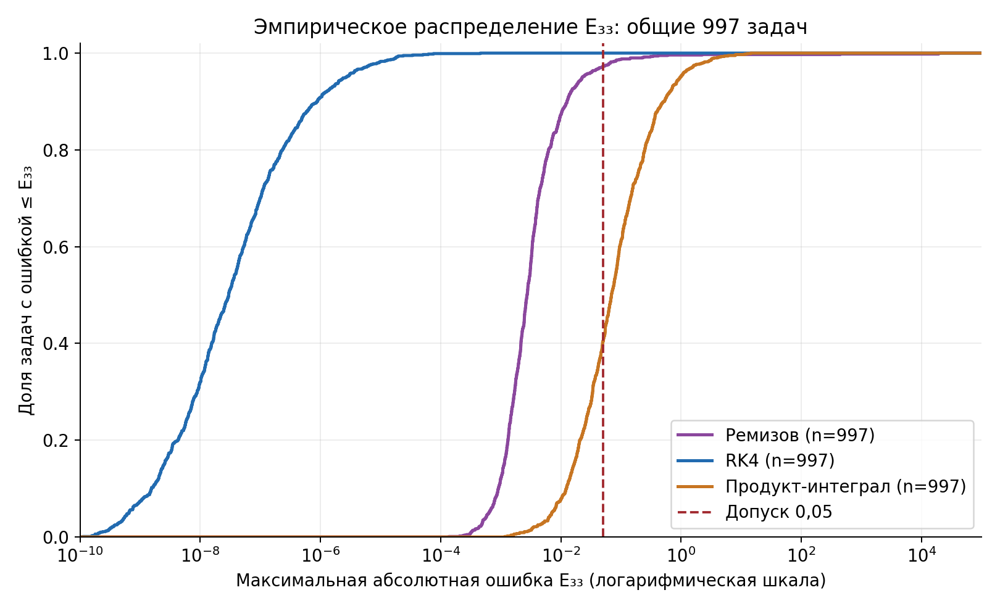
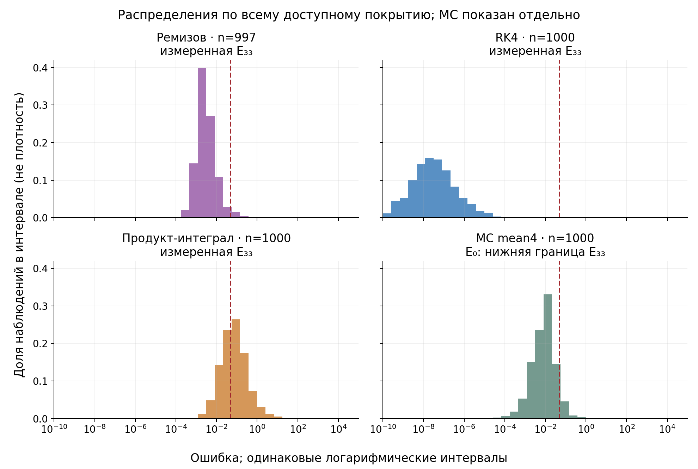
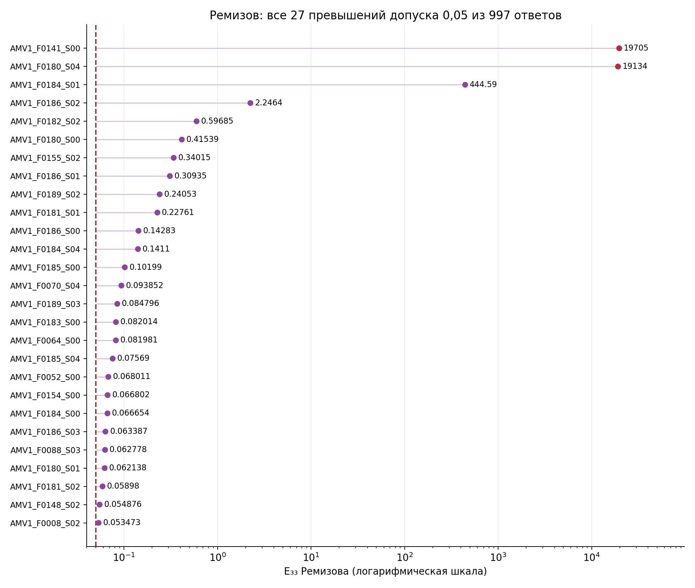
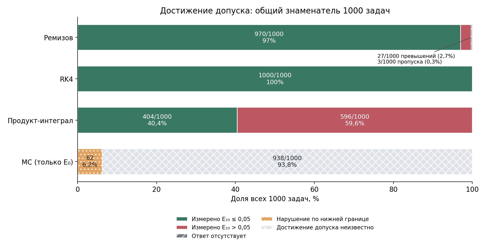

# Максимальная ошибка сохранённых численных решений на общей контрольной сетке

## Методика

Рассматриваются 1000 изготовленных линейных ОДУ второго порядка проекта №2488.
Сравнение выполнено по сохранённым ответам при фиксированных конфигурациях.
Определим G33 = {xₖ = −1+k/16: k=0,…,32} и
**Eₘ,33 = maxₓₖ∈G33 |yₘ(xₖ) − y_exact(xₖ)|**. Допуск выполнен при Eₘ,33≤0,05,
включая равенство. Это дискретная максимальная абсолютная ошибка; она не
сертифицирует максимум на непрерывном интервале. Производные в эту метрику не входят.

R означает сохранённый массовый профиль `ChernovSolver.solve`: n=128,
513 временных узлов, dx=0,0125, кубический сплайн, продолжение taper и padding=12.
Это фиксированная реализация аппроксимации Ремизова, а не новая серия адаптивного решателя.
RK4 и продукт-интеграл используют 128 шагов h=1/64 на [−1,1]. Их 129 сохранённых
узлов содержат G33: взят каждый четвёртый, без интерполяции. Exact-массивы
уже сохранены и ранее сверены; новое оценивание точного решения не выполнялось.
MC — арифметическое среднее четырёх сохранённых MC1024-ответов только в нуле,
с запрошенным верхним шагом 1/128 и tail_eps=10⁻⁴. Реальный шаг подстраивался под
горизонт; это не гарантированно точное равенство Δt=1/128. Времена из разных
исторических серий здесь не используются для вывода об эффективности.

### Постановка и входные условия

В обычной форме уравнение записано как a y″+b y′+c y=g, где c=c_R−λ,
g=−g_R. R/MC приближают ограниченное на всей ℝ решение (λ−L)y=g_R,
L=a∂²+b∂+c_R, и не получают произвольных начальных условий.
RK4/PI решают задачу Коши на [−1,1] и получают точные y(−1), y′(−1),
извлечённые при изготовлении задачи. Благодаря компактному носителю exact,
гладкости, равномерной эллиптичности, λ>‖c_R‖∞ и согласованным начальным
условиям целевая функция общая. При этом объём предоставленной информации
различается: результат RK4/PI условен доступностью точных НУ.
Для нового уравнения такие НУ не возникают бесплатно. Здесь сравниваются
конкретные реализации с разными бюджетами и входами, а не одинаковые
информационные и вычислительные условия.

## Результаты

### Полное доступное покрытие

| Метод | Величина | n | Среднее | Медиана | Q₀,₉₅ | Максимум | Допуск E33≤0,05 |
|---|---|---:|---:|---:|---:|---:|---|
| Ремизов | E33 | 997 | 39.4119 | 0.00274797 | 0.0227066 | 19704.5 | 970/997 (97.2919%) |
| RK4 | E33 | 1000 | 1.20494e-06 | 2.98453e-08 | 2.61641e-06 | 0.000457805 | 1000/1000 (100.0000%) |
| Продукт-интеграл | E33 | 1000 | 0.273512 | 0.0694232 | 0.960409 | 14.3836 | 404/1000 (40.4000%) |
| MC mean4 | E₀, нижняя граница E33 | 1000 | 0.0180639 | 0.00918753 | 0.0581636 | 0.569764 | ≥62 нарушений; 938 неизвестных |

Статистики в строках относятся к указанной величине: для MC это **E₀**, а не E33.
Числа в таблице округлены для чтения; comparison.csv содержит полные float-значения.
Q₀,₉₅ — линейно интерполированный эмпирический квантиль.
У Ремизова точны 970/997=97.2919% доступных ответов. Если знаменатель —
все 1000 задач, подтверждённо точных 97%, с измеренным превышением 2,7%,
с отсутствующим ответом 0,3%. Отсутствие ответа не является измеренной ошибкой.

### Общее пересечение

| Метод | Величина | n | Среднее | Медиана | Q₀,₉₅ | Максимум | Допуск E33≤0,05 |
|---|---|---:|---:|---:|---:|---:|---|
| Ремизов | E33 | 997 | 39.4119 | 0.00274797 | 0.0227066 | 19704.5 | 970/997 (97.2919%) |
| RK4 | E33 | 997 | 1.20778e-06 | 2.98417e-08 | 2.62867e-06 | 0.000457805 | 997/997 (100.0000%) |
| Продукт-интеграл | E33 | 997 | 0.273965 | 0.0695059 | 0.960674 | 14.3836 | 402/997 (40.3210%) |
| MC mean4 | E₀, нижняя граница E33 | 997 | 0.0180834 | 0.00919246 | 0.058284 | 0.569764 | ≥62 нарушений; 935 неизвестных |

В первой таблице PI точен на 404/1000, на пересечении — 402/997.
Это разные покрытия. Все сравнения между измеренными распределениями на
рисунке 1 используют те же общие 997 задач.

### MC: нижняя граница и область вывода

Обозначим E_MC,0=|mean(f₀,f₁,f₂,f₃)−y_exact(0)|. Это ошибка среднего ответа,
а не среднее или медиана четырёх абсолютных ошибок.
Если дополнить **тот же** сохранённый mean4-ответ другими узлами G33,
сохраняя значение в нуле, то E_MC,33≥E_MC,0, поскольку 0∈G33.
На всех общих 997 задачах проверено строгое неокруглённое неравенство
E_RK4,33 < min(E_R,33,E_PI,33,E_MC,0). Минимальные положительные запасы:

- R: 0.00013741837764269516, `AMV1_F0100_S02`.
- PI: 0.001166666239436398, `AMV1_F0064_S04`.
- MC: 2.6073122595920983e-05, `AMV1_F0014_S01`.

Следовательно, RK4 — единственный победитель по E33 на этих 997 задачах
для сохранённых R/PI и любого дополнения указанного MC-ответа.
По всему покрытию RK4 строго меньше PI E33 и MC E0 на 1000 задачах;
для трёх отсутствующих R четырёхметодный вывод не установлен.
Нижняя граница MC уже превышает 0,05 на 62 задачах; у остальных 938
достижение сеточного допуска неизвестно. **938/1000 не является долей
сеточно точных MC-решений.** Среднее, медиану, максимум полной MC E33
и точную долю её выполнения допуска по этим данным определить нельзя.
Вывод не переносится на новую случайную реализацию или математическое ожидание MC.

### Большие ошибки Ремизова и пропуски

- `AMV1_F0141_S00`: E33=19704.5019109.
- `AMV1_F0180_S04`: E33=19134.4051868.
- `AMV1_F0184_S01`: E33=444.589254639.

Всего 27 из 997 ответов превышают 0,05, из них
4 имеют E33>1. Два крупнейших дают
98.8426% суммы R E33. Поэтому среднее
39,4119 и медиана 0,00274797 описывают разные стороны распределения.
Это описательная концентрация суммы ошибок, не доказательство причины
выбросов или нарушения условий теоремы. Историческая диагностика
продолжения сплайна обсуждалась в прежнем отчёте; её ответы здесь
не подставляются вместо исходного cubic/taper. Все 27 превышений
перечислены в remizov_exceedances.csv и показаны без удаления из статистик.

Отсутствуют ответы `AMV1_F0134_S03`, `AMV1_F0136_S01`,
`AMV1_F0139_S00`: прежний статус worker_exception, не численный
результат с большой ошибкой. Их ошибки R и четырёхметодные winner пусты;
доступные RK4/PI и MC E0 сохранены в missing_remizov.csv.

## Графические материалы

**Рисунок 1.** Общие 997 задач; логарифмическая ось ошибок, линейная накопленная доля. MC не показан, поскольку E33 неизвестна.

**Рисунок 2.** Равные интервалы по log10 ошибки, доля в каждом интервале. MC-панель показывает только E0 как нижнюю границу E33; её нельзя читать как распределение MC E33. Все наблюдения сохранены.

**Рисунок 3.** Показаны все ответы Ремизова с E33>0,05, без удаления из основных статистик. Два крупнейших выделены цветом; «выброс» здесь описательное слово, не результат статистического теста.

**Рисунок 4.** Доли от всех 1000 задач: пропуски R не считаются численными нарушениями. У MC нет измерений E33: 62 нарушения следуют из E0, для 938 достижение допуска неизвестно; условие — тот же ответ MC в нуле.

## Интерпретация и ограничения

Распределения подтверждают малую измеренную ошибку RK4 при данном бюджете
и точных НУ. PI существенно чаще превышает допуск на сетке, чем можно
было заключить по одной точке. У R большая часть ответов точна, но редкие
экстремальные значения резко увеличивают среднюю ошибку. Ни одна из этих
закономерностей не объясняет причин автоматически.

Контрольная сетка и параметры не уточнялись: порядок или скорость сходимости
не оценивались. Низкая ошибка в одной конфигурации не означает более быстрого
схождения по шагу или лучшей стоимости достижения заданной точности.
Увеличение плотности контрольной сетки само по себе не является теоремой о
непрерывной норме. Уравнения из одного семейства зависимы; показанные доли —
описательные доли фиксированного набора. Доверительные интервалы популяционной
успешности из предположения о 1000 независимых задачах не строились.

Исторические ML-модели и показатели относятся к E0. Этот раздел их не
переоценивает и не доказывает полезность селектора по E33. На всех 997
имеющихся четырёхметодных метках победитель один — RK4; обучение такого
селектора не добавило бы содержательной проверки выбора. Для сравнения без
RK4 нужны полные сопоставимые сеточные MC-данные. Перенос на новые семейства,
другие бюджеты, неточные НУ и иной класс ОДУ остаётся отдельным вопросом.

## Выводы

1. Сохранённых ответов достаточно для воспроизводимого сравнения E33 у R/RK4/PI
   без повторного решения ОДУ: 970/997, 1000/1000 и 404/1000 выполнений допуска.
2. Строгая победа RK4 доказана для фиксированных ответов на общих 997 задачах;
   для MC используется нижняя граница с явным условием сохранения mean4 в нуле.
3. Полная MC E33, три R-ответа, непрерывная норма и асимптотическая сходимость
   этим сравнением не установлены. Универсальное превосходство RK4 не утверждается.
4. Прежние E0/ML и историческое требование «быстрейший при 0,01» остаются
   отдельными постановками. Реестр закрытых и открытых требований — REQUIREMENTS.md.

Источники: `results/saved_grid33_1000_2026-11-04/grid33_all1000.csv`, его summary,
verification и config; `results/scientific_report_revision_2026-11-04/report.tex`,
разделы «Математическая постановка», «Отдельная проверка…», «Заключение».
Все новые численные методы/MC/fit/inference-вызовы: 0. Выполнена только
обработка сохранённых скалярных ошибок, оформление и проверка соответствия CSV.
