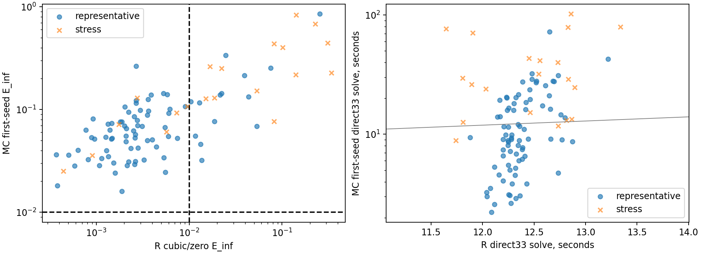
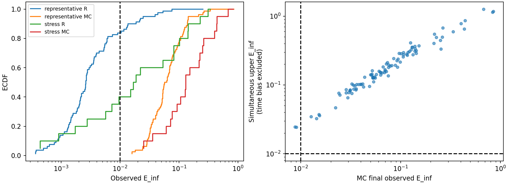
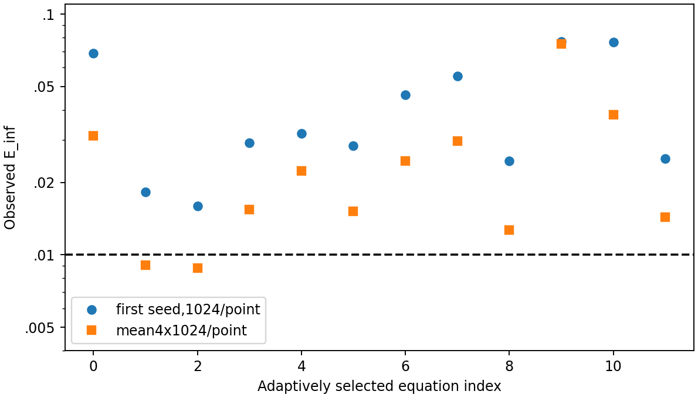

# Общий33-точечный pilot:100 train-уравнений

Выполнено **100/100** полных пар,
терминальных записей **240**. Все исходы:
`{'completed': 240, 'interrupted': 1}`. Pending: `{'adaptive_decision_pending': False, 'keys': [], 'reason': None}`.

## Выбор и зафиксированные профили

80 representative: по4 из20 complexity×regime ячеек, случайно4 из7 train-семейств
и1 из5 образцов семейства; seed202610250333. Вероятность включения строки4/35,
вес8.75,80 разных семейств. 20 stress:10 наибольших исторических train R33
ошибок,5 дорогих по прежним train MCx0,5 сложных AST без повторения ID.
Стресс-часть намеренно обогащена отказами/стоимостью; общая доля100 не является
оценкой качества на700 train или1000 production. Исходный семейный split
сохранён, все выбранные строки train; validation/test не участвовали в отборе,
контролях или адаптации. [Выбор и план](plan.json).

Основная сетка linspace(-1,1,33), допуск E∞<=.01. R: именно ChernovSolver.solve,
n128,Q513,quadratic,dx.0125,padding12,cubic/zero. MC: существующий Numba backend,
M1024 на точку,h1/128,chunk1024. Общий T из аналитического G для tail1e-4;
MC вычисляет его через T=None, R получает то же явное T. Это новый профиль,
который не смешивается с историческим cubic/taper/legacyT. Численные схемы,
генератор и датасеты не менялись. Exact используется после solve для метрик.

Перед pilot проверены два известных train-выброса (F0141/S00,F0184/S01).
Контроли taper/zero воспроизводят сохранённые ответы при неизменном legacyT,
после чего основной pilot идёт с отдельным общим T. Изменён только способ
продолжения при контроле, не правые части или квадратура. Это исправляет
известный механизм роста краевой производной taper, но не доказывает .01
или устойчивость cubic/zero для всех функций.

| ID | boundary | E_inf | max_difference_saved | seconds |
| --- | --- | --- | --- | --- |
| AMV1_F0184_S01 | zero | 0.05356807321592094 | 0.0 | 11.987323208944872 |
| AMV1_F0141_S00 | zero | 0.01871927854087696 | 0.0 | 11.998031832976267 |
| AMV1_F0184_S01 | taper | 444.58925463912163 | 0.0 | 14.739118000026792 |
| AMV1_F0141_S00 | taper | 19704.50191093058 | 0.0 | 14.63492099987343 |

## Ресурсы и прямое сравнение

Один worker/BLAS1, RSS<=512 МиБ, общий абсолютный дедлайн14400 с с сохранением
при resume. MC watchdog=max(180,6*33*прежний train p95 x0+15),
R watchdog=max(120,6*прежний task wall). Это оценки для33 узлов, не старые60 с.
Контрольные R-запуски имеют180 с. Один независимый guardian с heartbeat и
owner lease300 с, атомарные immutable records, interrupted остаётся pending.

Активный wall **3561.57 с / 59.36 мин**;
календарный **11406.99 с / 190.12 мин**;
solver wall суммарно **3474.70 с**,
peak RSS **286.39 МиБ**. Полная стоимость всех дополнительных
seed включена в MC_all_seconds;4 контрольных R-расчёта учитываются отдельно.
Защитные прерывания guardian: `['owner_lease_expired']`. Во время паузы истёк owner
lease; worker безопасно остановлен. После команды продолжить восстановлены
только pending при прежнем абсолютном дедлайне, готовые записи не повторялись.
Это операторская остановка, не математический или ресурсный отказ solver.
Частичные solver-счётчики прерванного вызова недоступны; его известные wall/RSS
сохранены в events, время входит в session wall. Сумма solver wall относится
к возвращённым ответам. Начальная сборка выбора/плана выполнена до numerical
budget и не включена во время solve.
Повторы не трактуются как бесплатные. Первые seed имеют одинаковое M1024;
агрегат4 seed — другой статистический бюджет, не оптимальное время до .01.

| cohort | n | R_pass | MC_first_pass | MC_final_pass | R_seconds | MC_first_seconds | MC_all_seconds |
| --- | --- | --- | --- | --- | --- | --- | --- |
| representative | 80 | 66 | 0 | 2 | 989.60 | 1060.42 | 1338.39 |
| stress | 20 | 7 | 0 | 0 | 248.74 | 773.46 | 844.62 |

[Полная сравнительная таблица](analysis/comparison.csv),
[все попытки и конфигурации](analysis/attempts.csv),
[сводка](analysis/summary.json). Время обоих методов теперь измерено прямо на33
узлах в одном окружении, с чередованием очередности. Это позволяет сравнить
стоимость фиксированных профилей; она не является минимумом времени достижения
допуска. Подготовка/общий JIT сохранены отдельно в worker/result, входят в wall.

## Исходы и статистическая неопределённость

Наблюдаемые категории primary и final приведены отдельно по когортам:
`[{"cohort": "representative", "primary": {"R_only": 66, "neither_pass": 14}, "final": {"R_only": 64, "neither_pass": 14, "both_pass": 2}}, {"cohort": "stress", "primary": {"neither_pass": 13, "R_only": 7}, "final": {"neither_pass": 13, "R_only": 7}}]`.
both_pass/R_only/MC_only/neither_pass означают только E∞ возвращённых ответов.
Final относится к адаптивному профилю: один seed на88 случаях и среднее4
на12 выбранных, а не к100 одинаковым4096-path расчётам.
unavailable — отсутствие корректной пары; ресурсный отказ не математическая
неточность. Статистическая неопределённость — отдельная колонка, она не
заменяется наблюдаемым успехом одного seed.

Одновременная нормальная полуширина z*stderr: Bonferroni на33 координаты и2
заранее разрешённых просмотра (first и final), alpha=.05 на уравнение.
Сырые pointwise CI95 из MCResult сохранены, но не используются как сеточный
интервал. Дополнительно сохранена консервативная Hoeffding-оценка для
дискретных вкладов |Z|<=G*(T+h), в идеальной вещественной арифметике;
её ширина может быть непрактичной. Нормальные bands асимптотические, не
точные finite-sample. Покрытие95% не заявляется одновременно для всех100
уравнений. Полную погрешность округления эти bands не сертифицируют.

Ни нормальная, ни Hoeffding-оценка не ограничивает EM/трапециевое временное
смещение. Bounds ошибки mean относительно exact диагностируют фиксированное
дискретное ожидание; добавленный continuous tail не заменяет оценку h-bias.
R n/space/window/quadrature ошибки также не сертифицированы. Итоговые
training_eligible_winner=false и reliable_fastest_label=unconfirmed сохранены.
Четыре seed не подтверждают p(success)>=.95: даже4/4 дают нижнюю95% границу.473.

После первых100 пар по замороженному правилу выбраны до12 неразрешённых
уравнений: сначала до6 с неточным R, затем с наименьшей верхней границей
MC-ошибки. Добавлены ровно3 независимых seed; M,h,T не менялись. Первый seed
сохраняется и входит в стоимость; repeat-часть намеренно смещена. Эта
адаптация и два просмотра учтены в Bonferroni. [Решение](adaptive_selection.json).
Повторены **12** уравнений; MC вызовов
**137** (полных **136**, остальное прерывание),
R вызовов с контролями **104**.
Pooled дисперсия включает межseed-компонент; seed-t bands сохранены отдельно.
Если повторная тройка не завершена полностью, итоговым статистическим просмотром
остаётся первый seed; незапланированные n=2/3 в итоговый band не подставляются.
Стоимость незавершённых/неуспешных попыток при этом сохраняется отдельно.

## Информативность для ML и решение

Это train-only диагностический набор, а не новый train/validation/test split.
80 representative дают начальную оценку частот по train при семейной
зависимости;20 stress нужны для обнаружения ограничений. Их смешивание без
признака когорты/весов создаёт смещение. Повторно отобранные случаи особенно
не репрезентативны. Историческая ML для taper не переносится на новый zero
профиль автоматически. Новые данные не добавлялись к прежним моделям.

**Дополнительные900 автоматически не запускать.** Сначала оценить баланс
наблюдаемых исходов и статистически разрешённых MC-результатов. Если MC
почти нигде не достигает .01, такой фиксированный профиль даёт вырожденную
задачу выбора; расширение объёма повторяет её, а не создаёт надёжные метки.
При широких bands увеличение M не назначается автоматически: для следующего
эксперимента сначала выделить небольшой train-набор потенциальных MC-преимуществ
с провалом zero и малым статистическим шумом, затем заранее зафиксировать
профиль/критерий успеха и выполнить независимую подтверждающую серию.
Конкретный следующий состав и бюджет уточняются в INTERPRETATION.md по
завершённым числам; новых расчётов для него здесь нет. ML не переобучалась.

Проверка источников/очистки и регрессии — verification.json, pytest.log.
Исторические результаты и защищённое математическое ядро сохранены;
PROJECT_STATUS.md обновлён после расчётов.

## Проверки и воспроизведение

Регрессия: `373 passed, 1 deselected, 2 warnings, 679 subtests passed in 44.39s`.

Новые файлы: diagnostics/joint_grid100.py, diagnostics/grid100_statistics.py, diagnostics/report_joint_grid100.py, diagnostics/verify_joint_grid100.py, tests/test_joint_grid100.py; обновлён PROJECT_STATUS.md с сохранением прежней версии. Проверены16379 прежних файлов, изменений нет. Ядро из MIGRATION_MANIFEST не редактировалось.

[Интерпретация и решение](INTERPRETATION.md), [воспроизведение](REPRODUCE.md), [resume-проверка](resume_check.json), [манифест](artifact_manifest.json).
