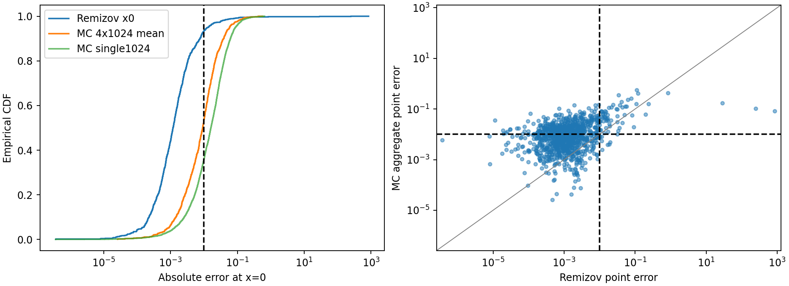
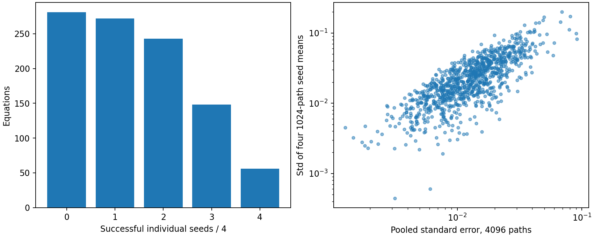
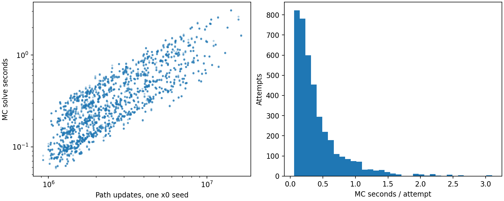
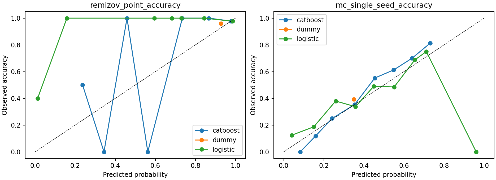

# MC1000 в x=0 и первая модель сравнительного качества

Датасет: production `data/all_methods_v1_1000_2026-10-18/`.
Реальная серия: **4000/4000 терминальных попыток**, pending **0**.
Уравнений со всеми четырьмя seed: **1000**.
Корректных пар с историческим Chernov x=0: **997**.

## Протокол и ресурсы

Один Numba-worker, 50 последовательных партий по 20 уравнений, x=0,
4 независимых seed×1024, h=1/128, T=None: исходный auto_T по аналитическому G,
tail_eps=1e-4. Индивидуальной подстройки нет. Нормальные потоки PCG64 адресуются
по задаче/точке/seed. Формула, EM и обе трапеции не изменены. Exact-метрика
вызывается после возврата solver; стандартная безопасная загрузка отдельно
проверяет конструкцию датасета, а y-jet нужен для самой заданной RHS.

Жёсткие лимиты: 60 с на попытку, 14400 с на серию, 512 МиБ RSS,
один вычислительный worker. Общий абсолютный дедлайн сохраняется при resume.
Независимый guardian проверяет controller heartbeat и owner lease300 с;
владелец продлевал lease во время наблюдения. Атомарный immutable result
на попытку, requests/events и progress; прерванное остаётся pending,
ресурсный терминальный отказ автоматически не повторяется. Завершённые
результаты пропускаются по ключу и проверяются по plan SHA/профилю/AST hash.
Старый pilot не возобновлялся. [План](plan.json), [smoke](smoke/verification.json).

Фактический активный wall массовых сессий **1716.77 с / 28.61 мин**,
календарный wall от первого старта с учётом пауз **1875.67 с / 31.26 мин**,
сумма solver wall **1633.25 с**,
пиковый worker RSS **285.06 МиБ**.
Обновлений в завершённых результатах **12,138,684,416**. Частичная работа
прерванного запроса не имеет итоговых solver-счётчиков и дополнительно сюда
не включена; его известные wall/RSS сохранены в interrupted event.
Загрузка/JIT/IO/monitoring входят в session
wall, отдельно сохранены в worker/startup и result. Два smoke-ответа не
включены в 4000. Ресурсные статусы не являются математической неточностью.

Защитных прерываний guardian: **1**;
причины: `['owner_lease_expired']`.
Owner lease истёк во время подготовки кода анализа: guardian завершил
worker и освободил вычислительный слот. Сохранённые терминальные записи
не пересчитывались; незавершённый запрос остался pending и был выполнен
после возобновления. Общий дедлайн и все лимиты сохранены. Это операторская
остановка, а не ресурсная неудача solver или признак математической неточности.

| status | attempts |
| --- | --- |
| completed | 4000 |


## Точность и статистическая устойчивость

Доля успешных по допуску отдельных завершённых MC seed: **35.65%**.
Доля успехов среднего четырёх seed (4096 путей): **53.50%**.
Сохранённый Ремизов в x=0: **93.28%**.
Это разные профили: успех одного 1024-path ответа не заменяется успехом
среднего4096. Полностью успешных 4/4: **56**,
хотя бы один успешный seed: **719**.

| metric | median | p90 | p99 | maximum |
| --- | --- | --- | --- | --- |
| mc_aggregate_error | 0.00918753 | 0.0389002 | 0.149596 | 0.569764 |
| remizov_error0 | 0.00118625 | 0.00760808 | 0.0829244 | 842.087 |


Ремизов чаще достигает допуска, но имеет редкие очень большие выбросы
данного исторического профиля. Они не исправлялись и не удалялись:

| ID | split | R_error | MC_mean_error |
| --- | --- | --- | --- |
| AMV1_F0141_S00 | train | 842.087 | 0.0824008 |
| AMV1_F0180_S04 | test | 248.323 | 0.103081 |
| AMV1_F0184_S01 | train | 28.3943 | 0.169523 |
| AMV1_F0186_S02 | train | 0.842502 | 0.420876 |
| AMV1_F0189_S02 | validation | 0.235886 | 0.160885 |


Средняя ошибка и raw-error regression MAE чувствительны к этим случаям;
поэтому отдельно показаны медиана, квантили и log10-error regression.

На парных данных разность наблюдаемых accuracy (MC aggregate−Ремизов)
**-0.3982**; family-bootstrap95
**[-0.4271, -0.3638]**.
Это интервал по семействам при зафиксированных наблюдённых seed, а не
гарантия вероятности успеха новой реализации. Таблица совместных успехов:
`{"R0_MC0": 60, "R0_MC1": 7, "R1_MC0": 404, "R1_MC1": 526}`.

Сохранены внутренние stderr1024, pooled stderr4096 (с межгрупповой частью
дисперсии), sd четырёх seed-средних и t95 при df=3. Сертификат хвоста
контролирует непрерывное усечение; статистические интервалы не контролируют
временное смещение EM/трапеций. Смещение оценивается как mean−exact,
а его t95 — только статистическая неопределённость. n=4 мало для проверки
нормальности и надёжной оценки хвостов. Даже 4/4 успеха дают одностороннюю
95% нижнюю границу вероятности всего **0.4729**, не .95.
Нет выводов о порядке сходимости или оптимальном времени достижения .01.





## Идентичность и область сравнения

Проверены production SHA и исторические input SHA, implementation
ChernovSolver.solve, expression_hash, target_x==result.x и наличие ровно
одного x=0. Для 997 корректных старых ответов
извлечён узел16, а не прежний E∞33. Exact в этой точке совпадает с MC.
Три старых worker_exception остаются без R-целей. Профили T у методов
различаются: MC использует G-сертификат, исторический Chernov — legacy T;
они сохранены как разные фиксированные численные настройки.

**MC-время в одной точке не сравнивается как равнозначное с историческим
временем Chernov на 33 точках.** Таблица содержит отдельное поле
historical_remizov33_seconds только для аудита. Метки «самый быстрый метод»
не создаются. [Все уравнения](analysis/equations.csv),
[все4000 задания со статусами](analysis/attempts.csv), [группы](analysis/groups.csv).

## Первая экспериментальная ML-модель

Обучены quality-surrogates на **253** признаках, доступных до решения:
только заданные coefficient-каналы a,b,c,g, коэффициентные сертификаты и
AST a/b/c. Exact/y-shape/его производные/решения/ошибки/seed/ID/split не
попадают в X. y-shape в численном backend является частью определения RHS,
но исключён из ML-признаков. Прежний whitelist использован без изменений.
Train/validation/test сохранены700/150/150,140/30/30 семейств; seed-реплики
никогда не разделяются между subsets. Scaler/fit только train, stopping и
model selection по validation, test оценён после обучения. Исторический test
ранее изучался в численных аудитах; prospective независимость не заявляется.

Цели: Remizov accuracy в x=0, MC вероятность успеха одного1024-path seed,
а также log10 point-error Ремизова и среднего4096 MC (floor1e-12).
Ресурсные отказы и pending цензурированы, а не помечены как inaccurate.
Dummy, Logistic/Ridge и CatBoost обучены с одним заранее сохранённым
набором параметров; нет поиска по test. Время pipeline **13.81 с**.

| target | model | test_n | AUC | logloss | Brier | balanced_accuracy |
| --- | --- | --- | --- | --- | --- | --- |
| mc_single_seed_accuracy | catboost | 600 | 0.7350 | 0.5863 | 0.2015 | 0.6295 |
| mc_single_seed_accuracy | dummy | 600 | 0.5000 | 0.6743 | 0.2405 | 0.5000 |
| mc_single_seed_accuracy | logistic | 600 | 0.6557 | 0.6790 | 0.2293 | 0.5816 |
| remizov_point_accuracy | catboost | 150 | 0.8947 | 0.1182 | 0.0296 | 0.6597 |
| remizov_point_accuracy | dummy | 150 | 0.5000 | 0.1775 | 0.0395 | 0.5000 |
| remizov_point_accuracy | logistic | 150 | 0.7442 | 0.2185 | 0.0473 | 0.7361 |


600 test-меток MC — это четыре seed150 уравнений из30 семейств, а не600
независимых уравнений. У Ремизова в test только6 неточных ответов: ROC-AUC
и recall неточности чувствительны к нескольким случаям. Одинаковая accuracy
.96 у CatBoost и Dummy не означает одинаковые вероятностные прогнозы.
Family-bootstrap95 разности test logloss CatBoost−Dummy:
MC **[-0.1251,-0.0515]**, Ремизов **[-0.1219,-0.0184]**.
Оба интервала ниже0, что поддерживает улучшение относительно постоянной
базы в этих данных; превосходство над всеми другими моделями не заявляется.

Важные признаки CatBoost MC: `gR_std, gR_rms, gR_min, gR_total_variation, cert_remizov_lambda`;
Ремизова: `a_d2_rms, cert_remizov_lambda, b_d1_absmax, gR_sample_20, gR_sample_12`.
Для MC доминируют масштаб и изменчивость заданной RHS; для Ремизова заметна
кривизна a и lambda. Это важность внутри обученных моделей, не причинное
объяснение ошибки и не математический критерий применимости.

| target | model | test_n | MAE_log10 | MAE_error |
| --- | --- | --- | --- | --- |
| mc_aggregate_log_error | catboost | 150 | 0.3624 | 0.01163 |
| mc_aggregate_log_error | dummy | 150 | 0.4121 | 0.01305 |
| mc_aggregate_log_error | ridge | 150 | 0.3992 | 0.01901 |
| remizov_point_log_error | catboost | 150 | 0.3579 | 1.65801 |
| remizov_point_log_error | dummy | 150 | 0.4844 | 1.65847 |
| remizov_point_log_error | ridge | 150 | 0.3618 | 1.59872 |


На редком test-выбросе AMV1_F0180_S04 сохранённая R-ошибка248.323.
CatBoost-классификатор дал p(success)≈.242, то есть отклонил профиль при
пороге .5, но регрессор предсказал ошибку лишь≈.0368. Он не воспроизводит
масштаб этого выброса. Raw-error MAE≈1.658 здесь мало характеризует типичную
задачу; selection регрессоров заранее шёл по MAE log10-error на validation.
Ridge имеет меньший test raw-error MAE, но это не повод менять выбранную
после validation модель по test.

Гейт сравнительной модели: `{"gate": {"test": {"mc": 1, "n": 8, "remizov": 7}, "train": {"mc": 5, "n": 49, "remizov": 44}, "validation": {"mc": 1, "n": 10, "remizov": 9}}, "limitation": "Exploratory fixed-profile mean-error label, approximate t95 from 4 seeds; no fastest-method or 95%-reliability certificate", "reason": "insufficient separated labels/classes; separate quality models are primary", "trained": false}`.
Сравнительные метки опираются на приблизительный seed-t95 интервал
дискретного усечённого среднего плюс tail bound и margin .0025 относительно
ошибки Ремизова. При пересечении диапазонов ставится uncertain. Эти
pointwise интервалы не скорректированы на1000 сравнений и не доказывают
95% надёжность выбора. Разделённых меток: `{"mc_mean_closer_exploratory": 7, "remizov_closer_exploratory": 60, "uncertain": 930}`.
Основной практический выход — отдельные предварительные модели качества;
при наличии comparative classifier он также явно экспериментальный.

[Метрики и family-bootstrap](ml/metrics.json), [предсказания](ml/predictions.csv),
[модели](ml/models/), [schema](ml/feature_schema.json),
[важность признаков](ml/), [ошибки test](ml/largest_test_prediction_errors.csv).
Bootstrap условен по этим seed-меткам; он не устраняет шум всего четырёх
seed и временное смещение. Модели не сертификаты точности.

Рабочий reload/serving, без численного решения:

```bash
.venv/bin/python -B diagnostics/predict_mc1000_quality.py \
  --models results/mc1000_x0_2026-10-25/ml \
  --ids AMV1_F0000_S00 AMV1_F0180_S04
```

Ответ содержит вероятность успеха каждого фиксированного профиля и
прогноз log10 ошибки. Выбор самого быстрого solver не производится.



## Вывод и следующий шаг

Подтверждённые факты — покрытие, фиксированные профили, наблюдённые ошибки,
ресурсная стоимость и измеренное качество моделей на семейном split.
Статистическая надёжность будущего seed, отделение временного смещения и
быстрейший метод достижения .01 остаются ограничениями этих данных.

Следующий шаг к33 точкам: отдельный заранее фиксированный общий сеточный
профиль обоих методов с одинаковой областью метрики и одновременной
статистической политикой. Нельзя умножением точечного успеха получить
E∞33 или вероятность успеха всей сетки. Время33 MC ориентировочно растёт
с числом точек, но фактическую дисперсию/смещение каждой точки нужно
контролировать. Массовая33-точечная серия в эту задачу не запускалась.

Математические схемы, защищённое ядро, генератор, исходные данные и прежние
результаты сохранены. SHA-проверка, очистка worker/locks и воспроизводимые
источники перечислены в verification.json; PROJECT_STATUS.md обновлён.

## Проверки и новые файлы

Регрессия: `369 passed, 1 deselected, 2 warnings, 679 subtests passed in 44.65s`. Исключён только длительный R1.

Новые файлы кода: diagnostics/mc_production_x0.py,
diagnostics/analyze_mc1000_x0.py, diagnostics/train_mc1000_quality.py,
diagnostics/predict_mc1000_quality.py, diagnostics/report_mc1000_x0.py,
diagnostics/verify_mc1000_x0.py; тесты tests/test_mc_production_x0.py и
tests/test_mc1000_quality.py. Из существующих документов обновлён только
PROJECT_STATUS.md; его исходная версия сохранена в PROJECT_STATUS.before.md.

Проверены8205 прежних файлов: изменений нет. Математические файлы из
MIGRATION_MANIFEST не редактировались. Модели повторно загружены; метрики
и serving сверены с сохранёнными ответами на всех1000 строках.
RuntimeWarning matmul в sklearn повторились; все прогнозы конечны,
logistic и Ridge дополнительно проверены независимым einsum.
Причина предупреждений не установлена; результаты не подгонялись.
[Проверка сохранности и моделей](verification.json),
[проверка resume](resume_check.json), [лог тестов](pytest.log),
[serving-проверка](ml/serving_verification.json),
[воспроизведение](REPRODUCE.md), [окружение](requirements-lock.txt).
