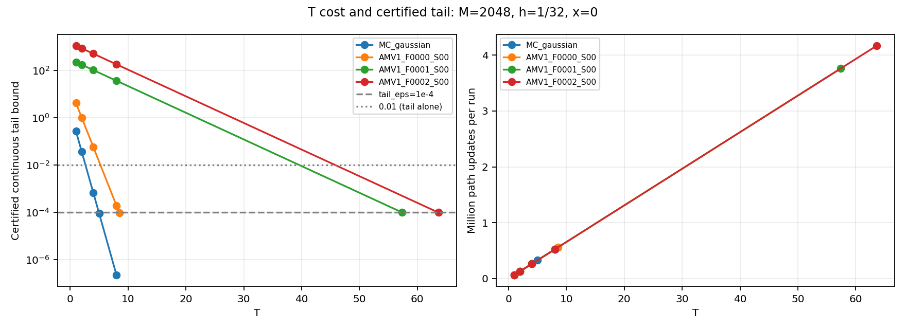
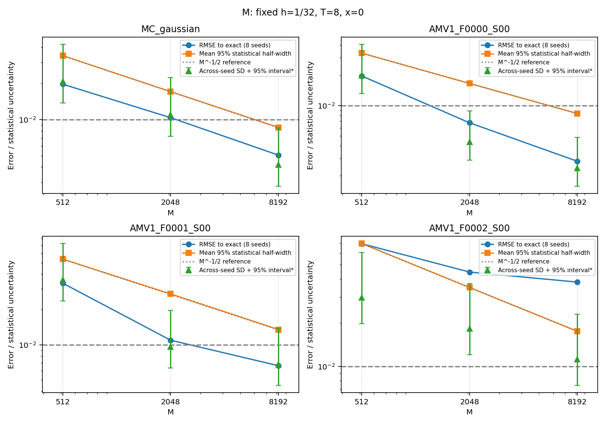
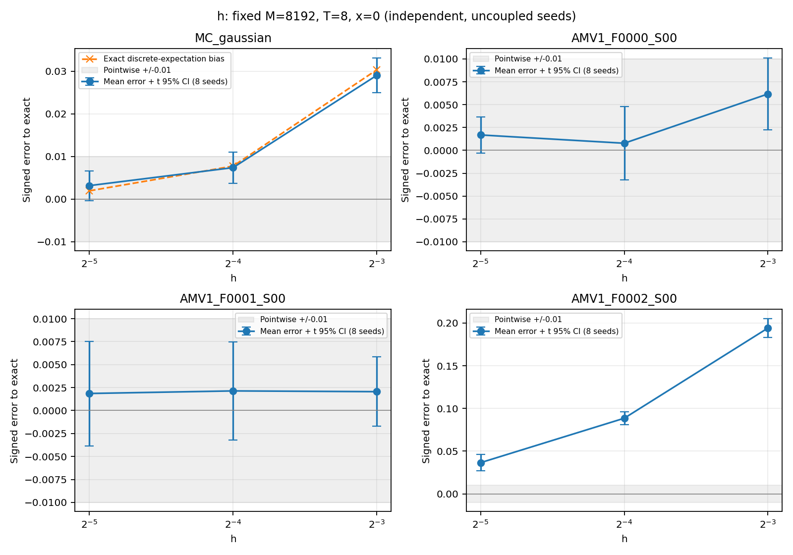
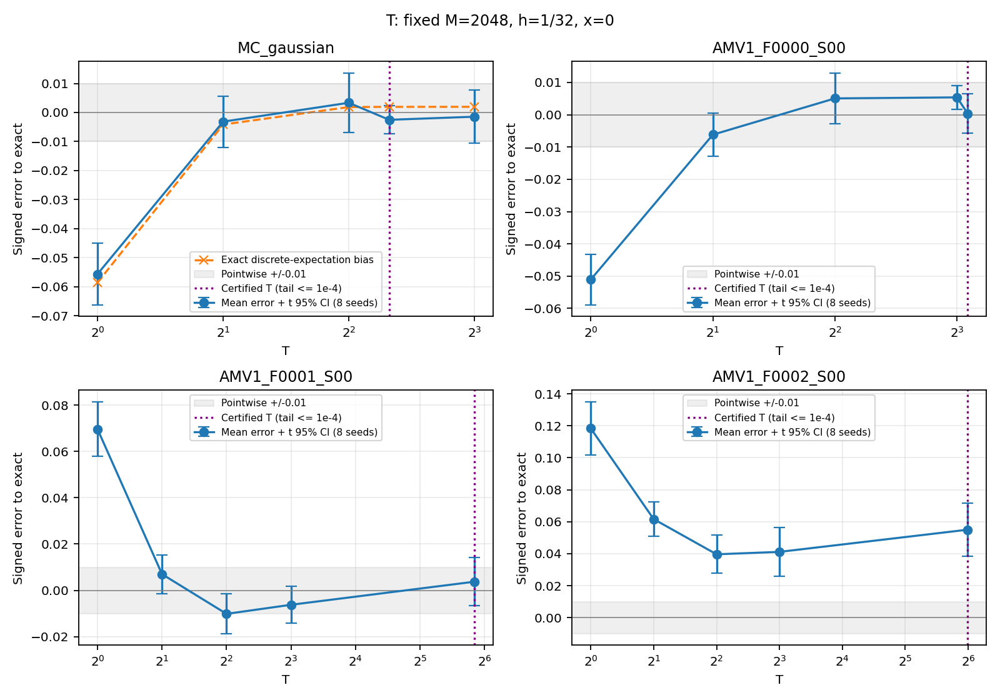
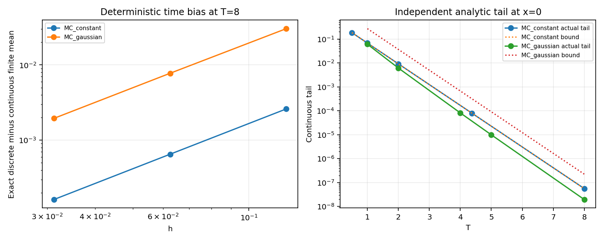

# Контролируемое исследование Монте-Карло — 2026-10-24

Только x=0: абсолютные ошибки в этой точке, без утверждений о пространственном E∞.
EM, обе трапеции, RNG и solver не менялись. Использован существующий малый датасет; exact вычислялся после возврата solver.
Выполнено 295/295 попыток; статусы: {'success': 295}. Обновлений 223,610,232; время solver 43.342 с, всей серии 45.603 с; максимальный RSS 98.9 МиБ.
Один worker, BLAS=1. До запуска зафиксированы бюджет 250 млн обновлений / 360 с / 384 МиБ, все конфигурации и seeds. Все попытки успешны; повторов или отбора по ошибке не было.
Источники: [план](plan.json), [окружение](environment.json), [все попытки CSV](attempts.csv), [агрегаты CSV](aggregates.csv), [полные агрегаты и оракулы](aggregates.json), [ответы MCResult](records/), [ресурсы worker](worker_events.json), [сохранность SHA](verification.json).

## Протокол и смысл интервалов

Для Gaussian и каждой F0000–F0002 — 8 независимых seed на конфигурацию. M=512/2048/8192 при h=1/32,T=8; h=1/8,1/16,1/32 при M=8192,T=8; T=1,2,4,8,Tсертификат при M=2048,h=1/32. Общие baseline решены один раз. Порядок запусков перемешан внутри задачи независимо от потоков MC; chunk=8192 фиксирован. Броуновского сопряжения между шагами нет. Постоянный пример: M=2 и один детерминированный запуск на уровень.
Индивидуальный CI = f±1.96·stderr для μ(h,T). В таблицах ± — 95% Student-t интервал для μ(h,T)−y по 8 независимым запускам; ± отражает только неопределённость оценки этого смещения, а не полную ошибку одного ответа. SD-интервалы на графике M — chi-square при приближённой нормальности средних. Все интервалы точечные; для значимости 24 разностей h/T дополнительно применена поправка Holm (все исходные и скорректированные p сохранены). 8 повторов недостаточно для точной проверки покрытия 95% или вероятности достижения 0.01.
Разложение: f−y=(f−μ(h,T))+(μ(h,T)−y_T)+(y_T−y). Первое — статистика, второе — EM/трапеции, третье — непрерывный хвост. G контролирует только третий член.

## Сертифицированные горизонты

| Задача | G | λ−C | T* для 1e-4 | T в опыте | Граница при T=8 |
| --- | --- | --- | --- | --- | --- |
| MC_constant | 1 | 2 | 4.2586 | 4.375 | 5.62676e-08 |
| MC_gaussian | 4 | 2 | 4.95174 | 5 | 2.2507e-07 |
| AMV1_F0000_S00 | 25.1183 | 1.42732 | 8.46208 | 8.5 | 0.000193391 |
| AMV1_F0001_S00 | 77.3156 | 0.260017 | 57.3242 | 57.375 | 37.1428 |
| AMV1_F0002_S00 | 381 | 0.259624 | 63.5599 | 63.625 | 183.888 |

Горизонт округлён вверх до кратного 1/8; это сохраняет сертификат и один и тот же фактический h при изменении T. Более короткий T имеет аналитическую верхнюю границу, но **не сертифицирован к tail_eps=1e-4**, если tail_tolerance_met=False. Наблюдаемое малое отклонение короткого T не заменяет сертификат.

## Влияние M

RMSE считается по всем 8 ошибкам к exact; рост M уменьшает шум, но не устраняет смещение.

| Задача | M | RMSE | Средняя половина индивидуального CI | SD между seed | Среднее смещение ± t95 | Медиана, с |
| --- | --- | --- | --- | --- | --- | --- |
| MC_gaussian | 512 | 0.0197236 | 0.0341573 | 0.02086 | 0.0028761 ± 0.0174394 | 0.00926908 |
| MC_gaussian | 2048 | 0.0103589 | 0.0170906 | 0.0109637 | -0.00145936 ± 0.00916591 | 0.014844 |
| MC_gaussian | 8192 | 0.00503544 | 0.00857573 | 0.00418243 | 0.0031701 ± 0.0034966 | 0.0360605 |
| AMV1_F0000_S00 | 512 | 0.0197313 | 0.0332741 | 0.019984 | 0.00631538 ± 0.0167071 | 0.0426503 |
| AMV1_F0000_S00 | 2048 | 0.00674169 | 0.0165961 | 0.00434725 | 0.00537719 ± 0.00363439 | 0.065485 |
| AMV1_F0000_S00 | 8192 | 0.00279041 | 0.00833701 | 0.00237774 | 0.00168507 ± 0.00198784 | 0.152464 |
| AMV1_F0001_S00 | 512 | 0.0334148 | 0.0535246 | 0.0357219 | -7.90511e-05 ± 0.0298642 | 0.0900163 |
| AMV1_F0001_S00 | 2048 | 0.0109245 | 0.0270714 | 0.00959297 | -0.00623079 ± 0.00801992 | 0.151921 |
| AMV1_F0001_S00 | 8192 | 0.00662838 | 0.0134615 | 0.00680246 | 0.0018564 ± 0.005687 | 0.394956 |
| AMV1_F0002_S00 | 512 | 0.0698097 | 0.0700018 | 0.0297587 | 0.0640196 ± 0.0248789 | 0.095038 |
| AMV1_F0002_S00 | 2048 | 0.0445764 | 0.0349026 | 0.0182791 | 0.0411667 ± 0.0152817 | 0.173596 |
| AMV1_F0002_S00 | 8192 | 0.0380318 | 0.01745 | 0.0112165 | 0.0365559 ± 0.0093772 | 0.486195 |

## Влияние h

T=8, M=8192. Разности независимых средних, Welch-интервалы и поправка Holm сохранены в [differences.json](differences.json).

| Задача | h | Среднее смещение ± t95 | RMSE | CI одного запуска, половина | Медиана, с |
| --- | --- | --- | --- | --- | --- |
| MC_gaussian | 0.03125 | 0.0031701 ± 0.0034966 | 0.00503544 | 0.00857573 | 0.0360605 |
| MC_gaussian | 0.0625 | 0.00739276 ± 0.00367226 | 0.00845787 | 0.00860328 | 0.0181768 |
| MC_gaussian | 0.125 | 0.0290486 ± 0.00408028 | 0.0294052 | 0.00868847 | 0.0092799 |
| AMV1_F0000_S00 | 0.03125 | 0.00168507 ± 0.00198784 | 0.00279041 | 0.00833701 | 0.152464 |
| AMV1_F0000_S00 | 0.0625 | 0.000778744 ± 0.00402505 | 0.00457041 | 0.00843445 | 0.0772808 |
| AMV1_F0000_S00 | 0.125 | 0.00617077 ± 0.00394068 | 0.00758414 | 0.00867905 | 0.039321 |
| AMV1_F0001_S00 | 0.03125 | 0.0018564 ± 0.005687 | 0.00662838 | 0.0134615 | 0.394956 |
| AMV1_F0001_S00 | 0.0625 | 0.00213559 ± 0.00534888 | 0.00635442 | 0.0137107 | 0.200885 |
| AMV1_F0001_S00 | 0.125 | 0.00205335 ± 0.00377759 | 0.00469907 | 0.0144444 | 0.100479 |
| AMV1_F0002_S00 | 0.03125 | 0.0365559 ± 0.0093772 | 0.0380318 | 0.01745 | 0.486195 |
| AMV1_F0002_S00 | 0.0625 | 0.0885643 ± 0.00747931 | 0.0889588 | 0.01907 | 0.246843 |
| AMV1_F0002_S00 | 0.125 | 0.194122 ± 0.0110166 | 0.194513 | 0.0225657 | 0.12329 |

## Влияние T

M=2048, h=1/32. Граница хвоста глобальная; ошибки и интервалы только в x=0.

| Задача | T | Среднее смещение ± t95 | RMSE | Хвост ≤ | Серт. 1e-4 | Обновлений/запуск | Медиана, с |
| --- | --- | --- | --- | --- | --- | --- | --- |
| MC_gaussian | 1 | -0.0556692 ± 0.0106227 | 0.0569239 | 0.270671 | нет | 65536 | 0.00217469 |
| MC_gaussian | 2 | -0.00316241 ± 0.00882683 | 0.0103702 | 0.0366313 | нет | 131072 | 0.00395529 |
| MC_gaussian | 4 | 0.00333966 ± 0.0102297 | 0.0119232 | 0.000670925 | нет | 262144 | 0.00754135 |
| MC_gaussian | 5 | -0.00252942 ± 0.00482176 | 0.00595853 | 9.07999e-05 | да | 327680 | 0.00937433 |
| MC_gaussian | 8 | -0.00145936 ± 0.00916591 | 0.0103589 | 2.2507e-07 | да | 524288 | 0.014844 |
| AMV1_F0000_S00 | 1 | -0.0510611 ± 0.00784682 | 0.0518104 | 4.22269 | нет | 65536 | 0.00859248 |
| AMV1_F0000_S00 | 2 | -0.00618202 ± 0.00670263 | 0.00971904 | 1.01323 | нет | 131072 | 0.0167115 |
| AMV1_F0000_S00 | 4 | 0.0050545 ± 0.00784613 | 0.01013 | 0.0583381 | нет | 262144 | 0.0331684 |
| AMV1_F0000_S00 | 8 | 0.00537719 ± 0.00363439 | 0.00674169 | 0.000193391 | нет | 524288 | 0.065485 |
| AMV1_F0000_S00 | 8.5 | 0.000373142 ± 0.00605863 | 0.0067892 | 9.47319e-05 | да | 557056 | 0.0694446 |
| AMV1_F0001_S00 | 1 | 0.0696418 ± 0.0117861 | 0.0708793 | 229.267 | нет | 65536 | 0.0193183 |
| AMV1_F0001_S00 | 2 | 0.00698784 ± 0.00835303 | 0.0116696 | 176.774 | нет | 131072 | 0.0383945 |
| AMV1_F0001_S00 | 4 | -0.0101605 ± 0.00857247 | 0.0139727 | 105.092 | нет | 262144 | 0.0759588 |
| AMV1_F0001_S00 | 8 | -0.00623079 ± 0.00801992 | 0.0109245 | 37.1428 | нет | 524288 | 0.151921 |
| AMV1_F0001_S00 | 57.375 | 0.00373041 ± 0.0103779 | 0.0121962 | 9.86871e-05 | да | 3760128 | 1.06444 |
| AMV1_F0002_S00 | 1 | 0.118367 ± 0.0165764 | 0.119811 | 1131.95 | нет | 65536 | 0.0222402 |
| AMV1_F0002_S00 | 2 | 0.0616513 ± 0.0108949 | 0.0628449 | 873.119 | нет | 131072 | 0.0443745 |
| AMV1_F0002_S00 | 4 | 0.0396506 ± 0.0119412 | 0.0418412 | 519.478 | нет | 262144 | 0.0876919 |
| AMV1_F0002_S00 | 8 | 0.0411667 ± 0.0152817 | 0.0445764 | 183.888 | нет | 524288 | 0.173596 |
| AMV1_F0002_S00 | 63.625 | 0.055031 ± 0.0167772 | 0.0581446 | 9.83233e-05 | да | 4169728 | 1.36919 |

## Независимая аналитическая проверка

Для y=1/2: y_T=(1−exp(−2T))/2; μ(h,T) — трапеции exp(−2t). Траектории не влияют на интеграл, поэтому нулевой статистический CI корректен для μ(h,T), но не для y. Для Gaussian: y_T(x)=exp(−x²)−exp(−2T−x²/(1+4T))/sqrt(1+4T). Heat-kernel интегранд равен exp(−2t)(2+2/A−4x²/A²)exp(−x²/A)/sqrt(A), A=1+4t. Его трапеции дают точное ожидание используемой схемы при постоянных коэффициентах.

| Пример | h | Временное смещение μ−y_T | Хвост y−y_T | Полное смещение μ−y | CI покрывают μ / запуски |
| --- | --- | --- | --- | --- | --- |
| MC_constant | 0.03125 | 0.00016275 | 5.62676e-08 | 0.000162694 | 1/1 |
| MC_constant | 0.0625 | 0.000650872 | 5.62676e-08 | 0.000650816 | 1/1 |
| MC_constant | 0.125 | 0.00260146 | 5.62676e-08 | 0.0026014 | 1/1 |
| MC_gaussian | 0.03125 | 0.00194918 | 1.95899e-08 | 0.00194916 | 8/8 |
| MC_gaussian | 0.0625 | 0.00775087 | 1.95899e-08 | 0.00775085 | 8/8 |
| MC_gaussian | 0.125 | 0.030345 | 1.95899e-08 | 0.0303449 | 7/8 |

## Ориентиры для точности 0.01

Планирование статистики: σ²≈M·mean(stderr²) по 8 запускам M=2048,h=1/32 с длинным сертифицированным T каждой задачи. M ниже — предварительное число путей для индивидуальной половины CI 0.005; оставляет место для хвоста и временного смещения, но само по себе не гарантирует 0.01. При другом h/T дисперсию следует проверить заново. Время — грубая линейная экстраполяция от измеренного длинного T; мелкие M, AST и фиксированная стоимость цикла нарушают линейность.

| Задача | σ pilot | M для CI±0.005 | T для хвоста≤0.001 | T для хвоста≤1e-4 | Обновлений при h=1/32 | Оценка секунд/точку |
| --- | --- | --- | --- | --- | --- | --- |
| MC_gaussian | 0.397323 | 24259 | 3.80045 | 5 | 3881440 | 0.111041 |
| AMV1_F0000_S00 | 0.380983 | 22305 | 6.84887 | 8.5 | 6066960 | 0.75633 |
| AMV1_F0001_S00 | 0.618062 | 58700 | 48.4686 | 57.375 | 107773200 | 30.5091 |
| AMV1_F0002_S00 | 0.803591 | 99230 | 54.6909 | 63.625 | 202032280 | 66.3401 |

Таблица стоимости при h=1/32 служит ориентиром статистического бюджета; **для F0002 этот шаг уже оказался недостаточен**. Персональные рекомендации и стоимость более мелких шагов — в [INTERPRETATION.md](INTERPRETATION.md). Для F0000/F0001 h=1/32 — только кандидат для следующей независимой проверки, не сертифицированный шаг. Для контроля смещения уточнять h в фиксированной точке при том же длинном T и существенно меньшем шуме разности; общий порядок EM по этим трём задачам не переносится на весь датасет. Короткий T=4/8 допустим как явно экспериментальный pilot с сохранением tail_bound, но не как сертифицированная настройка, если граница больше выделенного допуска.
Перед 33 точками сначала проверить несколько заранее выбранных точек, затем оценить бюджет K·M·ceil(T/h). Точечный 95% CI не даёт одновременного 95% покрытия сетки. Для статистического контроля 33 точек Bonferroni требует большего квантиля, а временная ошибка остаётся отдельной.

## Достоверность и ограничения

Численные выводы и различимость разностей см. [INTERPRETATION.md](INTERPRETATION.md). Все raw значения, seeds, конфигурации, ошибки, CI, время и стоимость сохранены. Нет пространственного исследования, строгой границы EM/трапеций на датасете, массового benchmark, сравнения с Ремизовым или обучения ML.
Проверки: основная регрессия [pytest.txt](pytest.txt) — 268 passed, 1 deselected, 679 subtests; после добавления поправки Holm [pytest_analysis_final.txt](pytest_analysis_final.txt) — 7 passed. Прежние два escape-warning сохранены. Данные, генератор, solver и прежние результаты сверены побайтово; [verification.json](verification.json).
