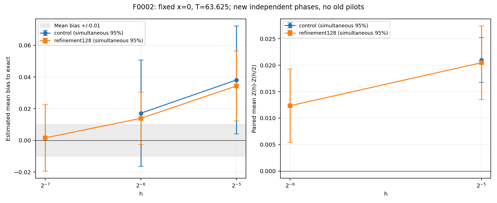
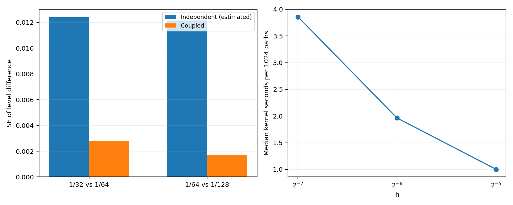
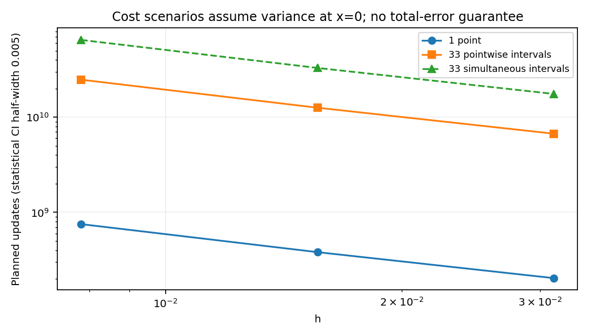

# F0002: завершение ограниченного временного контроля — 2026-10-24/25

Каталог датирован началом расчётов 24 октября; отчёт завершён 25 октября.

Только x=0, фиксированный сертифицированный T=63.625. G=380.9995262, непрерывный хвост ≤9.83233256e-05. Production EM и обе трапеции неизменны; использован прежний диагностический CoupledNormals и то же production-ядро.
Новые independent control и refinement128 используют непересекающиеся seed. Прежний четырёхповторный пилот, старый M/h/T обзор и две новые фазы не объединяются в одну статистическую выборку. Для тройки заново считаются все три связанных уровня, поскольку поток зависит от самого мелкого h.

## Протокол

[Политика до первого запуска](policy.json), [план контроля](control/plan.json), [решение о переходе](gate.json). [Отдельный план тройки, записанный после перехода и до её запуска](refinement128/plan.json).
Контроль — ровно 8 новых seed×1024 пути на h=1/32,1/64. Порог перехода сохранён: относительная t95-полуширина парной разности ≤0.5 и оценённый выигрыш в дисперсии ≥2. При успехе — отдельная тройка h=1/32,1/64,1/128 на других 8 seed×1024. Никакого увеличения M/числа повторов, перезапуска отказов или h<1/128.
Решение: criteria_passed; относительная полуширина 0.20234149208955562, выигрыш 19.3916533746514.
Общий предельный бюджет 170 млн обновлений / 240 с / 384 МиБ, плановый максимум 166,789,120 обновлений. Один worker/BLAS=1; 20 с cooperative на связанный повтор, внешний watchdog.
Факт: статусы {'success': 16}, 166,789,120 обновлений, 266,862,592 нормальных значений с replay; ядра 77.243 с, серия 77.987 с, RSS 81.50 МиБ. Replay повторяет поток и требует O(M) памяти.
Источники: [окружение](environment.json), [все статусы и ресурсы](run_summary.json), [CI и ошибки каждого запуска CSV](attempt_levels.csv), [агрегаты/ковариации](aggregates.json), [планы/ответы контроля](control/), [планы/ответы тройки](refinement128/), [сохранность](verification.json). В каждой выполненной фазе сохранены NPZ с интегралами всех путей, полные config, stdout и rss.jsonl.

## Смещение и статистическая неопределённость

±t95 — точечный интервал для μ(h,T)−y_exact по независимым seed-средним. Он оценивает неопределённость среднего смещения, не полную ошибку нового запуска. Одновременные Bonferroni-интервалы по h и CI отдельных запусков сохранены отдельно. Чистое временное смещение μ(h,T)−y_T отличается не более чем на границу хвоста; в разности уровней общий непрерывный хвост сокращается. Разделения вклада EM и трапеций нет.

| Фаза | h | f среднее | Смещение ±t95 | Одновр.95 половина | RMSE 8 запусков | CI запуска, половина | Медиана, с |
| --- | --- | --- | --- | --- | --- | --- | --- |
| control | 0.03125 | -0.3489889 | 0.03813323 ± 0.02836254 | 0.03407936 | 0.04961072 | 0.04998809 | 0.9545922 |
| control | 0.015625 | -0.3699829 | 0.0171392 ± 0.02789838 | 0.03352165 | 0.03561095 | 0.04834225 | 1.877862 |
| refinement128 | 0.03125 | -0.3527648 | 0.03435729 ± 0.01668438 | 0.02206746 | 0.03910135 | 0.04938132 | 1.001156 |
| refinement128 | 0.015625 | -0.3732293 | 0.01389283 ± 0.01246747 | 0.01649001 | 0.01968769 | 0.04782743 | 1.963144 |
| refinement128 | 0.0078125 | -0.385568 | 0.001554095 ± 0.0158502 | 0.02096415 | 0.01780257 | 0.04746731 | 3.858044 |

## Связанные разности

| Фаза | h→h/2 | Разность ±t95 | Одновр.95 половина | Корреляция | Var reduction |
| --- | --- | --- | --- | --- | --- |
| control | 1/32→1/64 | 0.02099403 ± 0.004247964 | 0.004247964 | 0.9489622 | 19.39165 |
| refinement128 | 1/32→1/64 | 0.02046446 ± 0.005769003 | 0.006931819 | 0.949784 | 19.72221 |
| refinement128 | 1/64→1/128 | 0.01233874 ± 0.005749846 | 0.006908801 | 0.9809503 | 52.41864 |

Связывание уменьшает шум разностей, не абсолютную дисперсию каждого уровня. Интервалы приближённые: нормальность seed-средних и покрытие по 8 повторам не доказаны.

## Порядок и точность 0.01

[Проверка точности среднего смещения](accuracy_assessment.json), [условная диагностика отношения разностей](order_diagnostic.json). Два уровня не дают порядка. Три успешных уровня допускают только наблюдаемое отношение; без различимых соседних разностей оно не вычисляется. Даже узкий bootstrap-интервал по трём уровням не устанавливает асимптотический порядок.
Наблюдаемое p=0.72993, bootstrap95=[0.12175010639480621, 1.5600986253662434]; допустимая доля bootstrap 0.9812. Это условный индикатор степенной модели; широкий интервал не позволяет выбрать надёжный показатель. Асимптотический порядок не установлен. Экстраполированные модельные остатки не используются для подтверждения 0.01 или замены EM-ответов.
h=0.03125: одновременный 95% интервал смещения [0.012289826024263366, 0.056424749882778076]; весь внутри ±0.01: False; целиком вне ±0.01: True.
h=0.015625: одновременный 95% интервал смещения [-0.0025971746265129013, 0.030382835854728698]; весь внутри ±0.01: False; целиком вне ±0.01: False.
h=0.0078125: одновременный 95% интервал смещения [-0.01941005142914766, 0.022518240593221286]; весь внутри ±0.01: False; целиком вне ±0.01: False.
На самом мелком h наблюдаемая ошибка среднего всех 8192 путей равна 0.0015540946. Это известная ошибка конкретной реализации в x=0. Малое наблюдаемое значение не доказывает малость систематического смещения или вероятность повторного достижения допуска.

## Стоимость допуска: одна точка и сетка 33

Таблица выделяет статистике CI-полуширину 0.005, оставляя часть общего допуска для временного смещения и хвоста. Это **оценка статистической стоимости, не подтверждённая стоимость достижения полной ошибки 0.01**. В CSV/JSON также есть вариант 0.01 целиком на статистику; он не оставляет запаса на смещение.
M=ceil((z·sigma/0.005)^2), sigma измерена только в x=0 на последней фазе. Столбцы сетки предполагают такую же дисперсию во всех точках. Одновременный вариант использует z=Phi^-1(1−0.05/(2·33)); pointwise×33 не контролирует максимум ошибки сетки. Регулярность ошибки между точками не исследовалась.

| h | Режим | M/точку | Обновлений | Оценка секунд, chunk=1024 |
| --- | --- | --- | --- | --- |
| 0.03125 | 1 точка | 99878 | 203351608 | 98.11332 |
| 0.03125 | 33, точечные CI | 99878 | 6710603064 | 3237.74 |
| 0.03125 | 33, совместный CI | 261554 | 17573290152 | 8457.769 |
| 0.015625 | 1 точка | 93673 | 381436456 | 180.6093 |
| 0.015625 | 33, точечные CI | 93673 | 12587403048 | 5960.106 |
| 0.015625 | 33, совместный CI | 245303 | 32962835928 | 15548.1 |
| 0.0078125 | 1 точка | 92282 | 751544608 | 351.082 |
| 0.0078125 | 33, точечные CI | 92282 | 24800972064 | 11585.71 |
| 0.0078125 | 33, совместный CI | 241661 | 64946877072 | 30046.45 |

Полные сценарии: [cost_scenarios.csv](cost_scenarios.csv), [JSON](cost_scenarios.json). Время экстраполировано по медиане ядра на 1024 пути, последовательно теми же пакетами; округление числа пакетов учтено. Иной chunk, нагрев, загрузка, подготовка и дисперсия в других точках меняют время. Для крупных h измерение включает replay мелких нормальных приращений; самостоятельный production-уровень может быть быстрее. На самом мелком h фактор replay=1. Это не измерение работы на сетке.

## Научный вывод и ограничения для будущего сравнения

[Краткая интерпретация](INTERPRETATION.md) отделяет установленные факты от гипотез. Если интервалы смещения не помещаются в допустимый бюджет или статистическая стоимость превышает исходный профиль, точность фиксируется как неподтверждённая. Дополнительные вычисления ради успешного результата не запускаются. Наблюдаемую точность конкретного ответа в x=0 хранить отдельно от подтверждения воспроизводимого профиля и точности сетки; эти два подтверждения для ML здесь отсутствуют. Сравнение методов должно учитывать стоимость, фиксированный бюджет и недостигнутый допуск; победитель по этой одной задаче не установлен.
Проверки: [pytest.txt](pytest.txt), [финальная верификация](final_verification.json). Production MC, Ремизов, генератор, датасеты и прежние результаты сохранены; ML и массовых расчётов нет.
