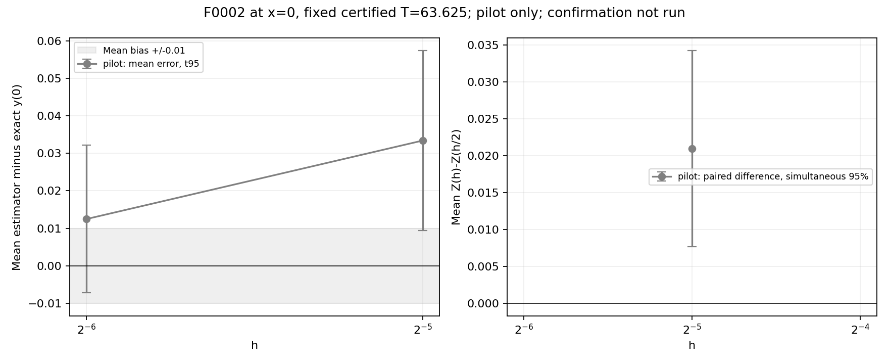
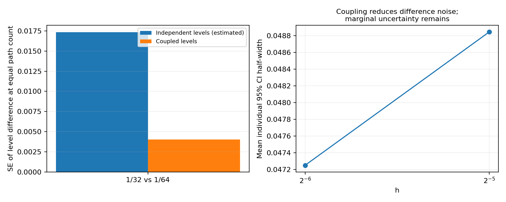
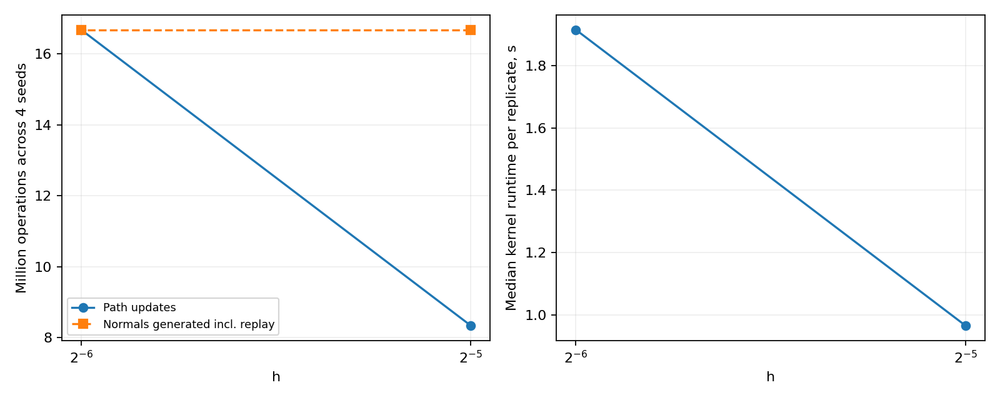

# F0002: связанное временное уточнение — 2026-10-24

Исследуется только AMV1_F0002_S00 в x=0 при фиксированном T=63.625. Сертификат G=380.9995262, минимальный T*=63.55987156, непрерывный хвост ≤9.832332564e-05.
Использован без изменений `_path_contributions` из mc_solver.py: старое положение в Эйлере–Маруяме, трапеции потенциала и forcing, c_R−lambda в весе. Диагностический CoupledNormals передаёт нормальные величины в то же ядро. Coarse normal = (z1+…+zq)/sqrt(q), q=1,2,4, где zj независимы N(0,1). Блоки не пересекаются, поэтому все маргинальные уровни имеют исходный закон EM, а sqrt(h)·normal совпадает с суммой мелких броуновских приращений до округления.
Поток PCG64 воспроизводится на каждом уровне: добавочное генерирование нормальных чисел учтено в стоимости, память O(M), матрица всех временных приращений не хранится. Сохранены только интегралы всех отдельных путей, их парность не теряется.

## План и выполнение

План заморожен до MC: [plan.json](plan.json). Пилот — 4 seed×1024 пути на паре 1/32,1/64. Подтверждение — независимые 8 seed×2048 путей; 1/128 добавляется, если пилот не позволяет поместить смещение 1/64 в ±0.01. Переход разрешён только при относительной t95-полуширине парной разности ≤0.5 и оценённом снижении дисперсии ≥2. Пилот не объединяется с подтверждением.
Решение: insufficient_paired_resolution; подтверждение не запускалось. Выбранные h: [].
Максимальный предварительный бюджет: 258,523,136 обновлений, 433,651,712 нормальных значений с replay; 300 с / 384 МиБ / один worker / BLAS=1; внутренний предел 20 с на связанный повтор.
Реально: 4 успешных связанных попыток; not_run=8, отказов=0. 25,018,368 обновлений, 33,357,824 нормальных значений с replay; сумма времён уровней 11.513 с, общее время 12.318 с, пик RSS 79.72 МиБ.
Все статусы: [run_summary.json](run_summary.json); все ответы и O(M)-интегралы путей: [records/](records/); телеметрия каждого выполненного этапа — *.rss.jsonl. [Окружение](environment.json), [ошибки и CI каждого уровня CSV](attempt_levels.csv), [полные агрегаты и ковариации](aggregates.json).

## Смещение относительно exact

Каждая строка — среднее независимых повторов. ±t95 — неопределённость оценки μ(h,T)−y_exact по seed; она не является границей ошибки одного запуска. В aggregates.json дополнительно сохранены одновременные Bonferroni-интервалы по уровням каждой выполненной серии и интервалы отдельных запусков. Непрерывный хвост мал, но строгой границы временного смещения нет.

| Серия | seed | M/seed | h | f среднее | Смещение ±t95 | RMSE повторов | Средняя CI-половина запуска | Ошибок≤0.01 |
| --- | --- | --- | --- | --- | --- | --- | --- | --- |
| pilot | 4 | 1024 | 0.03125 | -0.353695 | 0.03342713 ± 0.02399206 | 0.035887 | 0.04884304 | 0 |
| pilot | 4 | 1024 | 0.015625 | -0.3746502 | 0.01247185 ± 0.01971025 | 0.01645061 | 0.04725162 | 1 |

Прежний независимый baseline того же T,h=1/32,M=2048: 0.05503101 ± 0.01677719, 8 seed. Он не объединён с новой серией.

## Парные разности и уменьшение шума

Разность считается непосредственно по двум интегралам одной броуновской траектории. Индикатор смещения не вычитается из ошибки и не превращается в сертификат. Статистические выводы относятся только к выполненной серии; независимое подтверждение не подменяется пилотом. Для нескольких разностей предусмотрен Bonferroni95. Var reduction = (Var Z_h+Var Z_h/2)/Var(Z_h−Z_h/2), то есть оценка выигрыша относительно независимых уровней при одинаковом числе путей.

| Серия | h | h/2 | Разность ±t95 | Одновр.95 половина | Корреляция | Var reduction |
| --- | --- | --- | --- | --- | --- | --- |
| pilot | 0.03125 | 0.015625 | 0.02095528 ± 0.01329021 | 0.01329021 | 0.9463429 | 18.45814 |

## Остановка, стоимость и точность 0.01

Парный t95-интервал исключает ноль, однако относительная полуширина 0.634218 превышает заранее зафиксированный порог 0.5. Это остановка по более строгому критерию точности разности, а не заявление об отсутствии обнаружимого эффекта. Порог после просмотра данных не менялся; 8 подтверждающих попыток отмечены not_run, h=1/128 не запускался. Программных или ресурсных отказов нет.

На h=1/64 среднее смещение 0.012471847, t95 [-0.00723840540436033, 0.032182100054868046]. Одновременный интервал по двум уровням: [-0.01339522141832479, 0.03833891606883251]. Он включает как значения внутри ±0.01, так и значения выше 0.01. Практический шаг для достижения цели пока выбрать нельзя. Два уровня также не позволяют оценить временной порядок. Более мелкий шаг остаётся гипотезой для дальнейшей проверки, а не рекомендацией с гарантией.
Для одной статистической полуширины 0.005 на h=1/64 пилотная оценка M=91,410, стоимость 372,221,520 обновлений на точку. Большой расчёт не запускался. Он сам по себе не ограничивает смещение схемы.

Более экономичный следующий контроль — сначала точнее измерить ту же пару на новых независимых seed, сохранив T: ориентир 8×1024 путей, 50,036,736 обновлений; прогноз t95-полуширины разности 0.00674551. Это только оценка для нового плана, не выполненная серия и не гарантия. Переход к трём уровням должен сохранять парность и отдельный предварительный бюджет.

| h | Обновлений, все seed | Нормальных значений с replay | Медиана секунд/seed |
| --- | --- | --- | --- |
| 0.03125 | 8339456 | 16678912 | 0.9657136 |
| 0.015625 | 16678912 | 16678912 | 1.914921 |

## Достоверность, ограничения и проверки

Содержательные выводы, сопоставление с прежней серией и следующий шаг: [INTERPRETATION.md](INTERPRETATION.md). Все попытки, включая не выполненные при остановке, остаются в протоколе. Пилот не служит подтверждающей выборкой. Точечные интервалы предполагают приблизительную нормальность средних; покрытие и вероятность достижения точности не оценены по столь малому числу seed.
Проверки coupling и регрессия: [pytest.txt](pytest.txt). Независимый пересчёт статистики: [decision_recheck.json](decision_recheck.json); предупреждения первого матричного расчёта сохранены в driver.log. Сохранность: [verification.json](verification.json), [final_verification.json](final_verification.json). Старые данные, результаты, production MC, Ремизов и генератор не менялись. Нет пространственного benchmark и ML.
