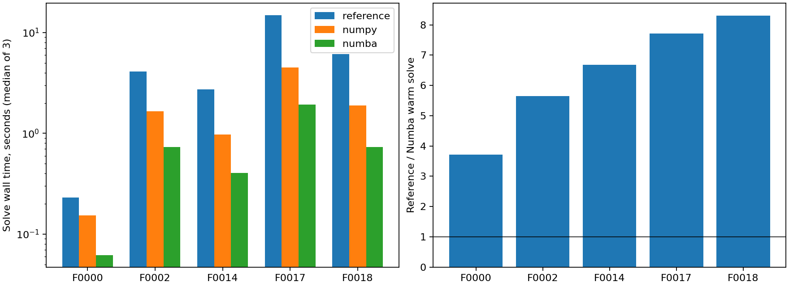
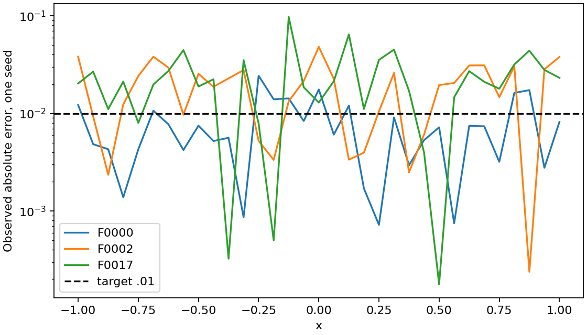

# Оптимизированный backend MC — 2026-10-25

Реализован отдельный backend точного вычисления AST: **ускорение 3.71–8.31×**
относительно исходного MC на пяти уравнениях, при совпадении траекторных
вкладов до 4.0e-15. Эйлер–Маруяма, трапеции потенциала и интеграла,
усреднение и адресные потоки PCG64 сохранены. Интерполяции коэффициентов нет.
Исходный `mc_solver.py`, генератор, загрузчик, сертификаты, Ремизов, датасеты
и исторические результаты не изменены.

Это проверка backend и его стоимости, не новый профиль достижения .01.
Массовые MC1000 и ML не запускались. Для 1000 уравнений выполнены только
аналитическая сертификация и подсчёт работы, без численных решений.

## Что изменено

- [mc_optimized.py](../../mc_optimized.py): безопасная подготовка из metadata,
  постфиксная AST, value-only NumPy, объединённое вычисление коэффициентов,
  общий `MCConfig`/`RemizovProblem` и расширенный `MCResult`.
- [mc_ast_kernels.py](../../mc_ast_kernels.py): последовательные Numba kernels,
  `fastmath=False`, без RNG внутри JIT и без параллельных редукций.
- [документация API](../../docs/MC_OPTIMIZED.md),
  [optional-зависимости](../../requirements-mc-optimized.txt),
  [38 новых тестов](../../tests/test_mc_optimized.py).
- Драйверы: [профилирование](../../diagnostics/profile_mc_reference.py),
  [ограниченный benchmark](../../diagnostics/benchmark_mc_optimized.py),
  [аналитический preflight](../../diagnostics/preflight_mc_optimized.py),
  [анализ сохранённых файлов](../../diagnostics/report_mc_optimized.py).

Для a,b,c_R вычисляются только значения деревьев; аналитический jet y_shape
сохранён, поскольку определяет заданную g_R. Это не использование exact для
выбора параметров: функция g_R уже задана именно этой конструкцией датасета.
В одном узле траектории a,b,c_R,g_R вычисляются совместно, a,b переходят на
следующий шаг. Начальное одинаковое x обрабатывается один раз на chunk.
В compiled цикле переиспользуются scratch-массивы AST. Компактный носитель
не используется для обрезания траекторий или изменения коэффициентов.

## Профиль исходной реализации

[Короткая серия](profiling/summary.json): x=0, M=256, T=2, h=1/128,
seed=2026102503. T=2 здесь диагностический и не сертифицирует хвост 1e-4.
Доля inclusive времени `evaluate_jet2` в profiled wall: F0000 **39.4%**,
F0002 **69.3%**, F0014 **86.9%**, F0017 **90.8%**. Внутри RHS повторяются
a/b/c, а value-only coefficient callbacks рассчитывают ненужные jets.
Inclusive доли вложенных функций не складываются. Выигрыш ниже измерен
без профилировщика; profiled времена не использованы как baseline.

## Честный замер времени

[Протокол](protocol.json) и [исполняемый план](execution_plan.json)
зафиксированы до измерений. Пять различных AST, три независимых seed
2026102504–2026102506 на задачу, M=1024, chunk=1024, h=1/128, x=0.
Парные reference / NumPy / Numba с одинаковыми RNG и чередующимся порядком.
T общий, из аналитического G для хвоста 1e-4, округление вверх до 1/8.
Никакого выбора по exact во время расчёта. Exact используется после возврата
solver только для сохранения ошибок.

| Задача | T | Узлы AST a/b/c + y | Подготовка, мс | Эталон, с | Fused NumPy, с | Numba, с | Эталон / Numba |
| --- | ---: | ---: | ---: | ---: | ---: | ---: | ---: |
| F0000 | 8.5 | 3 + 3 | 0.379 | 0.2301 | 0.1535 | 0.0620 | 3.71× |
| F0002 | 63.625 | 9 + 3 | 0.499 | 4.1259 | 1.6486 | 0.7304 | 5.65× |
| F0014 | 18.25 | 31 + 12 | 1.174 | 2.7180 | 0.9773 | 0.4065 | 6.69× |
| F0017 | 61.75 | 53 + 14 | 1.781 | 14.9279 | 4.5060 | 1.9351 | 7.71× |
| F0018 | 27.25 | 48 + 15 | 1.767 | 6.1021 | 1.8862 | 0.7345 | 8.31× |

Время решения — медиана трёх полных вызовов, без записи результатов на диск,
AST-preparation и общей первой компиляции. Индивидуальные времена, min/max,
RNG и kernel time: [timing_summary.csv](timing_summary.csv),
полные результаты и конфигурации: [measurements](measurements/).
Разброс Numba: F0000 0.06201–0.06260 с, F0002 0.72867–0.73658 с,
F0014 0.40420–0.41167 с, F0017 1.91263–2.01061 с,
F0018 0.73359–0.74341 с. Три замера не дают переносимого доверительного
интервала ускорения на других машинах/AST.

Без компиляции value-only/fusion дают **1.50–3.31×**. Numba дополнительно
ускоряет эту версию примерно в 2.3–2.6 раза. После оптимизации RNG занимает
около 2–7% solve wall; основная оставшаяся стоимость — точная scalar AST.

[Первый запуск](compilation.json): импорт Numba/модуля **0.12985 с**,
JIT общих сигнатур **0.81707 с**, всего **0.94692 с**. Прогрев не решает ОДУ
и не расходует RNG. Сигнатуры общие для всех уравнений в одном процессе.
На одиночной простой F0000 холодный вызов будет медленнее эталона;
амортизация примерно после шести таких вызовов. AST-preparation включает
декодирование/валидацию и G; загрузка малого датасета отдельно **0.06176 с**.
Для полного cold cost складывать подготовку, импорт/JIT и solve. Первый
JIT включён также в runtime-budget API; он не считается бесплатным.



## Эквивалентность и аналитические проверки

Допуски заморожены **до** измерений: коэффициенты 1e-12, jets 1e-11,
траекторные вклады/средние/stderr 1e-8, абсолютные, без ослабления по итогам.
Проверены все 14 операций, все 20 задач малого набора на [-5,5] и границах
носителя, общая статистика, повторяемость, инвариантность к размеру блока
и добавлению пространственных точек, отказы и auto_T.

Для пяти задач проведён отдельный replay 64 траекторий при **полном** T:
одни normal-массивы у исходного, NumPy и Numba backend. Сохранены seed,
SHA normal-массива и все индивидуальные вклады в [replay](replay/).
Максимумы по сохранённым проверкам: коэффициенты **4.27e-14**,
траекторный вклад **4.00e-15**, среднее **2.23e-16**, stderr **6.94e-18**.
Это проверка равенства реализации на этих случаях; побитового совпадения
libm/NumPy на любой платформе не обещается.
[Все расхождения](equivalence_summary.csv).

Независимые аналитические ожидания, без подгонки параметров:

| Пример, x=0 | M, h, T | Получено | Exact | Наблюдаемая ошибка | Статистический CI95 ± |
| --- | --- | ---: | ---: | ---: | ---: |
| a=1, b=c_R=0, lambda=2, g_R=1 | 8192, 1/128, 8 | 0.5000101162 | 0.5 | 0.0000101162 | 0 |
| Gaussian, g_R=(4−4x²)e^(−x²) | 8192, 1/32, 4 | 1.0041035557 | 1 | 0.0041035557 | 0.0085257244 |

Для constant вклад детерминирован, M>=2: нулевая статистическая дисперсия
корректна и не означает нулевой полной ошибки. Точный ответ дискретных
трапеций `h/2*coth(h)*(1−exp(−2T))` совпадает с MC до 2.3e-16.
Хвост сертифицирован границей 5.63e-8; остаток — временная квадратура.

Для Gaussian EM при постоянных коэффициентах точно воспроизводит закон
диффузии в узлах. Дискретное ожидание независимо вычислено трапециями от
`4*exp(−2t)*(1+2t)/(1+4t)^(3/2)` и равно **1.0018677841**.
Расхождение MC с этим ожиданием **0.00223577**, около **0.514 stderr**.
Комбинированное смещение трапеций/усечения **+0.0018677841** отделено от
статистического шума. Для этого отдельного аналитического smoke T=4
сертифицированная граница хвоста **0.0006709253**, больше tail_eps=1e-4;
это явно сохранено как `tail_tolerance_met=false`. Полный E∞<=.01
статистическим интервалом не сертифицируется. [Полные записи](analytics.json).

Регрессия: **363 passed, 1 deselected, 679 subtests passed**, 46.51 с.
Команда по правилам проекта исключает только длительный R1:

```bash
PYTHONDONTWRITEBYTECODE=1 OMP_NUM_THREADS=1 OPENBLAS_NUM_THREADS=1 \
MKL_NUM_THREADS=1 VECLIB_MAXIMUM_THREADS=1 NUMEXPR_NUM_THREADS=1 \
.venv/bin/python -B -m pytest -q -p no:cacheprovider tests \
  -k 'not test_r1_finite_chernoff_approximations_converge_toward_exact'
```

[Лог](pytest.log). Два прежних DeprecationWarning об escape `\i`;
ошибок/падений нет. Новый набор содержит 38 тестов, включая NumPy без compiler,
неверные входы/bounds, a<=0, nonfinite, budget/timeout, T=0 и underflow.

## Проверка настоящей сетки

Три отдельные сетки `linspace(-1,1,33)`, M=1024 **на точку**, seed=2026102520,
h=1/128 и те же T. Это одиночные замеры стоимости и наблюдаемой ошибки,
не статистическое исследование надёжности. Сетка не выводилась из одного x=0.

| Задача | Numba 33 точки, с | / время x=0 | E∞ | max точечного CI95 ± |
| --- | ---: | ---: | ---: | ---: |
| F0000 | 2.1323 | 34.38 | 0.024330 | 0.032303 |
| F0002 | 24.6395 | 33.73 | 0.048094 | 0.049405 |
| F0017 | 63.9414 | 33.04 | 0.097524 | 0.109079 |

Все завершились; **ни одна сетка не достигла наблюдаемого допуска .01**.
Точечные CI не являются одновременными интервалами для сетки и не включают
временное смещение. По одному seed разложить наблюдаемую ошибку на шум и
смещение невозможно. Ускорение сохраняет прежнюю точность/ограничения,
не превращает такой профиль в подтверждённый solver достижения .01.
[Сеточные записи](grid_summary.csv).



## Прогноз MC1000 × 33 без массового решения

[Аналитический preflight всех 1000 metadata](preflight_1000.json) занял
1.09 с, суммарная подготовка фабрики — 0.824 с. Dataset SHA сохранён,
исходное семейное разбиение прочитано без изменений. Численных решений: **0**.
Для M=1024, h=1/128, одного seed и сертифицированного хвоста 1e-4:

- **100 395 761 664** обновления траекторий; median T=16.5625,
  max T=125.375, max N=16048.
- По крайним наблюдаемым стоимостям обновления: **1.55–6.67 часа**.
- Сценарий с весом `nodes(a,b,c)+3*nodes(y)` и медианной измеренной ценой
  такого AST-веса: **3.63 часа**, чувствительность к пяти измеренным
  коэффициентам **3.16–6.96 часа**.
- Для 4 seed при M=1024 центральный сценарий **14.5 часа**;
  для 8 seed при M=2048 — **58.0 часа**, при приближённо линейном росте работы.
  Эти множители ничего не гарантируют о точности .01.
- 345 задач превышают штатные 100 млн `max_path_steps` на 33 точках;
  все укладываются в штатный `max_steps=100000`. Будущий профиль обязан
  заранее выставить и сохранить обоснованные индивидуальные бюджеты.

Это **сценарии, не доверительные интервалы и не верхние ресурсные границы**.
Использованы лишь пять AST и три сеточных замера на Apple arm64/Python3.10.
Opcode mix, пространственные траектории, более длинные T и нагрев меняют
скорость. У 75 задач weighted AST сложнее максимума измеренных случаев
(128 против 95); для них экстраполяция особенно предварительна.
Модель веса AST — арифметический прогноз, не обучение ML.
[Все числа и определения](forecast_1000.json).

Общий JIT около секунды оплачивается один раз в постоянном worker.
Повторять cold процесс на каждую точку нецелесообразно. Память не растёт
как число шагов/точек: хранятся состояния текущего chunk и блок 64×1024
нормалей, а не все траектории. Наблюдаемый **process peak 202.34 МиБ**
включает JIT, shared imports и replay; это не изолированная оценка RSS
каждого backend или гарантия для всех1000. Отдельно останутся затраты
загрузки, телеметрии, записи результатов и расширения статистики.

Прежняя связанная проверка F0002 не отменяется: на h=1/128 полная .01
ещё не была подтверждена, для статистического CI±.005 оценено 751.54 млн
обновлений на точку. Применение текущей измеренной скорости F0002 даёт
примерно **66 с на точку и 37 мин на 33 точки** для точечных CI, около
**97 мин** при прежней Bonferroni-оценке. Это экстраполяция стоимости;
она не контролирует временное смещение и не доказывает достижение допуска.

## Контроль ресурсов, сохранность и вывод

Серия: **50 полных solver-вызовов** (45 точечных + 3 сеточных + 2 аналитических),
15 низкоуровневых replay, всего **804 504 576** обновлений.
Один worker, BLAS threads=1, block=64, guardian с owner lease=300 с,
контролем памяти 768 МиБ и актуальности телеметрии; никаких произвольных
60-секундных ограничений попытки. Остановка по потере владельца/контроллера,
ресурсному нарушению, ошибке или явному stop. Автоматических повторов нет.
Фактический wall серии **238.16 с**; worker завершён, cleanup_success=true,
compute lock освобождён. [Итог guardian](run_summary.json).

[Проверены 8071 прежних файлов](protected_verification.json): изменений нет.
Файлы `unchanged_mathematical_core` не редактировались: обновление
`MIGRATION_MANIFEST.json` не требуется. Исходный MC и исходники зависимостей
сохранены отдельно в [reference](reference/); environment и exact requirements
в [environment.json](environment.json) и [requirements-lock.txt](requirements-lock.txt).
NumPy2.2.6/SciPy1.15.3 прежние; optional Numba0.65.1/llvmlite0.47.0 добавлены.
Точная версия, импортированная в измерениях: [sources_executed](sources_executed/).
Мелкие последующие изменения проверки входа/подписи диагностики/защиты файла
плана перечислены в [source_revision_note.txt](source_revision_note.txt);
вычислительное ядро и результаты ими не изменены. Финальные исходники
сохранены отдельно в sources, SHA — в verification.json.

**Подтверждено:** отдельный backend работает, математическая схема и RNG
на проверенных случаях эквивалентны, измеренный выигрыш существенен.
**Предварительно:** время массового расчёта и перенос на более сложные AST.
**Не установлено:** универсальный профиль достижения E∞<=.01 и надёжные
ML-метки выбора метода на 1000 задачах. Инфраструктура ускорения готова к
следующему контролируемому pilot с явно выбранным backend и статистической
политикой; дорогую серию1000 нельзя считать готовой только по ускорению.
