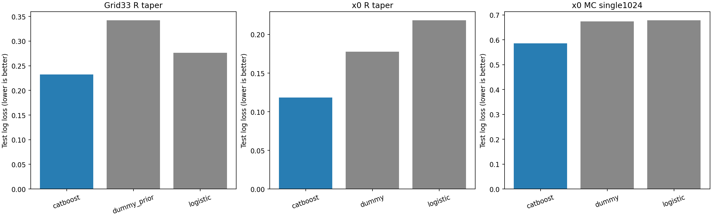
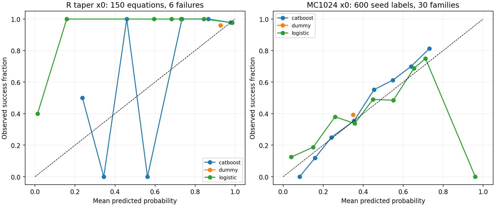
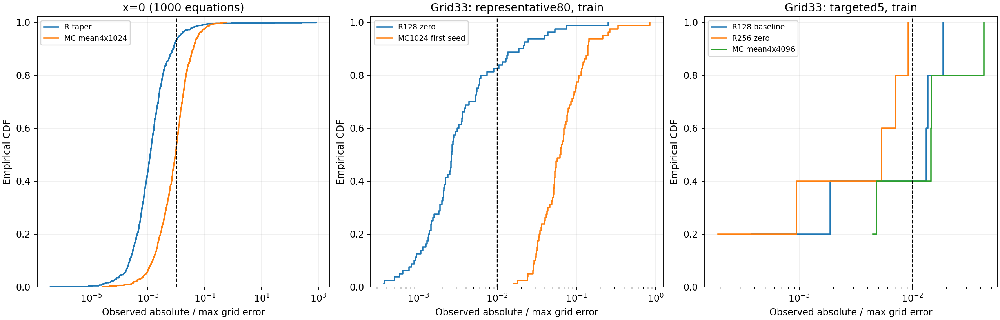
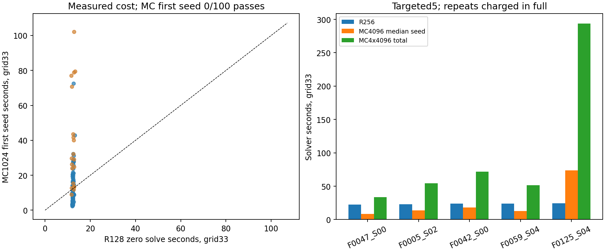

# Завершение текущего ML-этапа — 2026-10-25

Получен единый **прототип прогнозирования качества фиксированных профилей**.
Новые решения ОДУ/MC, оптимизация параметров и переобучение не выполнялись.
Первоначальная цель — выбор самого быстрого надёжного решателя при E∞≤0.01 —
пока не достигнута. Метод не рекомендуется на основании сравнения несопоставимых
вероятностей, бюджетов и времён. API всегда возвращает `method_selection.status=uncertain`.

## Что умеет прототип

- `remizov_taper_grid33`: вероятность точности исторического R128/Q513,
  dx=.0125,padding12,cubic/taper,legacyT,tail1e-8. Порог риска .07705429175
  зафиксирован прежним validation. Прогноз wall — выбранная по validation
  медиана отдельно для планировавшихся 1/8 внешних workers. Это не CPU-время,
  не counterfactual single-worker оценка и не время достижения точности.
- `remizov_taper_x0`: вероятность .01 и log10 абсолютной ошибки узла x=0
  того же исторического33-точечного решения. Отдельного времени x=0 нет.
- `mc_x0_single1024`: вероятность наблюдаемого успеха одного Numba MC1024
  seed,h1/128,аналитический G-T,tail1e-4. Это не доверительная нижняя граница
  вероятности и не сертификат 95%-надёжности.
- `mc_x0_mean4x1024`: log10 ошибки среднего четырёх независимых seed,
  то есть4096 путей в одной точке. У него нет обученного классификатора успеха
  и модели времени. `10**prediction` — точечная оценка ошибки, не upper bound
  и не условное среднее абсолютной ошибки.
- R cubic/zero n128/n256 и MC grid33 с1024/4096/mean16384 возвращают
  `unsupported_no_trained_model` с пустыми предсказаниями. x0 не переносится
  на33 узла, taper не переносится наzero, бюджет single не заменяется mean4.

Реестр `registry.json` содержит полный scope/параметры, SHA моделей и feature-code.
Он использует только ранее выбранные CatBoost и context-median, без новой
переоценки выбора на test. Совпадение x0 при разных T/профилях само по себе
не делает численные методы сравнимыми по стоимости. Отсутствующие CI прогноза,
OOD-проверка и temporal-bias certificate явно помечены как отсутствующие.

## Аудит утечек, разбиений и воспроизводимости

253 входа восстановлены только из заданных a,b,c,g на исходной256-точечной
сетке, глобальных сертификатов и AST a_raw/b_raw/c_raw. c_R=c+lambda,g_R=-g.
Разности/спектры коэффициентов — признаки, не новые решения уравнений.
g допустим как заданная правая часть, хотя manufactured generator создавал
его из exact. Его связь с решением не является утечкой, если g известен до solve.
Exact, y0/v0, производные решения, y_shape, support/scale, ID/seed/hash,
семейство/split, результаты/time/error не входят в X. planned_workers —
единственный дополнительный предрешательный контекст модели времени.
Признак pre_T вычисляется по прежней legacy-формуле при tail1e-8 и служит
предрешательным дескриптором; он не подменяет фактический сертифицированный
MC-горизонт из конфигурации. Его смысл сохранён ради совместимости весов.

Проверены все1000 feature-строк против обоих сохранённых NPZ; на1000 строках
удаление/порча всей неразрешённой metadata не меняет признаков. NPZ MC содержит
object-dtype feature_names: этот элемент не unpickle-ился, использован JSON schema.
Остальные массивы читаются с allow_pickle=False. Модели joblib локальные,
доверенные и закреплены SHA; загружать произвольные внешние joblib нельзя.

Сохранены700/150/150 уравнений,140/30/30 семейств; пересечений family и topology нет.
Все четыре seed остаются внутри уравнения/семейства.600 MC test-меток — это
150 уравнений из30 семейств, не600 независимых задач.3 R worker_exception
остаются неизвестными целями, не отрицательным классом. Пересчитаны997
исходных R grid/point ошибок и4000 MC seed ошибок; проверены идентичности
AST, источники и хеши. Все21 сохранённых предиктора, включая baseline и
контекстную медиану, повторно загружены; предсказания и метрики пересчитаны.
Для7 scaler-пайплайнов mean/variance/count сверены только с train, включая
повторённые MC seed-строки. Исходники обучения совпали с архивными версиями;
early stopping/threshold/model selection проверены по прежнему validation.
Аудит исходников/артефактов поддерживает отсутствие утечки; это не абсолютное
ретроспективное доказательство каждого внутреннего действия при обучении.

Прежний test уже просматривался в численных аудитах. Поэтому метрики —
описательная оценка сохранённого семейного holdout, не нетронутая prospective
проверка политики выбора solver. В этой задаче test не использовался для
переобучения, смены модели, порогов или признаков.

## ML-метрики

Полный `ml_metrics.csv` содержит baseline,Logistic/Ridge,CatBoost, все splits.
Выбранные ранее модели на test (единицы целей различаются):

| scope | task | model | roc_auc | logloss | mae_seconds | mae_log10 | mae_error |
| --- | --- | --- | --- | --- | --- | --- | --- |
| historical_taper_grid33 | accuracy | catboost | 0.8801305970149254 | 0.2321717644852711 | — | — | — |
| historical_taper_grid33 | runtime | dummy_context | — | — | 0.6766552816641828 | — | — |
| x0 | mc_single_seed_accuracy | catboost | 0.735006518904824 | 0.5863061267258461 | — | — | — |
| x0 | remizov_point_accuracy | catboost | 0.894675925925926 | 0.1182398369508233 | — | — | — |
| x0 | mc_aggregate_log_error | catboost | — | — | — | 0.3624367066930853 | 0.0116346751543741 |
| x0 | remizov_point_log_error | catboost | — | — | — | 0.3579417528329333 | 1.658010491712017 |

R grid33 CatBoost AUC=.8801, Logistic=.8839, dummy=.5; выбранный порог
даёт balanced accuracy=.8106, на test пропущены2/16 неточных и отклонены34
точных. Разность AUC CB−Logistic family-bootstrap95 [-.0427,.0448] не доказывает
превосходства CB. Runtime context-median MAE=.6767с; CB context=.6519с,
но по validation выбрана медиана; парный95% CI CB−median [-.0906,.0399] включает0.

В x0 CatBoost R AUC=.8947, logloss=.1182 противdummy .1775; accuracy=.96
у обоих, поэтому одна accuracy скрывает разницу вероятностных прогнозов.
Всего6 неуспехов в test. MC single1024 CB AUC=.7350, logloss=.5863 противdummy
.6743 (Logistic .6790); family-bootstrap95 разности CB−dummy logloss
[-.1251,-.0515], условно на наблюдённых seed. Для R соответствующий интервал
[-.1219,-.0184]. Это поддержка качества вероятностных surrogate против
constant baseline, не подтверждение надёжности solver.

MAE log10 error: R .3579 противdummy .4844; MC mean4 .3624 противdummy .4121.
Но raw-error MAE R=1.658 чувствителен к историческим taper-катастрофам;
log-прогноз сглаживает редкие выбросы и не защищает от них. Значимость
преимущества регрессоров отдельно не доказана. Важности сохранены в прежних
отчётах: R-classifier lambda, производные a, вариация g; runtime context CB
81.05% важности planned_workers; важность не означает причинный эффект.
В MC-classifier важнее всего gR_std6.25%,gR_rms5.31%,gR_min4.24%;
в R-point a_d2_rms8.30%,lambda3.59%,b_d1_absmax2.76%. Это ассоциации
в текущем manufactured distribution. Сохранённый список крупнейших test-ошибок
MC — [largest_test_prediction_errors.csv](../mc1000_x0_2026-10-25/ml/largest_test_prediction_errors.csv),
R-grid — [test_error_analysis.csv](../remizov_ml_v1_2026-10-25/test_error_analysis.csv).
На этих ошибках модели не перенастраивались.
В исходном sklearn обучении и новом baseline replay были BLAS RuntimeWarning;
независимый einsum пересчёт всех7 линейных пайплайнов повторил конечные
прогнозы в допуске проверки. Причина предупреждений не установлена;
лог и max-differences сохранены, переобучение не выполнялось.




## Сопоставление основных завершённых экспериментов

Доли наблюдаемые, не сертификаты. Строки средних используют те же raw runs:
их стоимость нельзя суммировать повторно. Исторический R x0 извлечён из
grid33; время одной точки не измерялось.100 и5 целевых train-случаев
не являются независимым test новых профилей. Стресс20 анализируются отдельно.

| experiment | cohort | method | profile | points | observations | observed_pass | solver_seconds |
| --- | --- | --- | --- | --- | --- | --- | --- |
| historical1000 | all original splits | R | n128/taper/legacyT | 33 | 997 | 871 | 16620.74014193064 |
| mc1000_x0 | same 997 paired | R | node of historical grid33 | 1 | 997 | 930 | не измерено |
| mc1000_x0 | all original splits | MC | 1x1024,h1/128,G-T | 1 | 4000 | 1426 | 1633.2469729075674 |
| mc1000_x0 | all original splits | MC | mean4x1024,h1/128,G-T | 1 | 1000 | 535 | 1633.2469729075674 |
| grid100 | representative | R | n128/zero/commonG-T | 33 | 80 | 66 | 989.596228960203 |
| grid100 | representative | MC | 1x1024,h1/128,commonG-T | 33 | 80 | 0 | 1060.4238079534844 |
| grid100 | representative | MC | adaptive mean1or4x1024 | 33 | 80 | 2 | 1338.3869686617982 |
| grid100 | stress | R | n128/zero/commonG-T | 33 | 20 | 7 | 248.73512387415394 |
| grid100 | stress | MC | 1x1024,h1/128,commonG-T | 33 | 20 | 0 | 773.4555867486633 |
| grid100 | stress | MC | adaptive mean1or4x1024 | 33 | 20 | 0 | 844.6215409135912 |
| final_grid5 | five targeted train | R | n128/zero baseline | 33 | 5 | 2 | 60.940680666361004 |
| final_grid5 | five targeted train | R | n256/zero/commonG-T | 33 | 5 | 5 | 117.78475867002271 |
| final_grid5 | five targeted train | MC | 1x4096,h1/128,commonG-T | 33 | 20 | 5 | 505.0287347068079 |
| final_grid5 | five targeted train | MC | mean4x4096=16384 | 33 | 5 | 2 | 505.0287347068079 |

Подробные оговорки и единицы: `experiments.csv`. В grid100 дополнительно были
4 boundary-контроля (53.36с) и1 прерванный запрос; всего240 полных результатов,
активный wall3561.57с, solver3474.70с,RSS286.39МиБ. Новые5 дали25/25 ответов,
active628.03с,solver622.81с,RSS281.91МиБ. MC1000:4000/4000,solver1633.25с,
RSS285.06МиБ; частичные guardian-работы учитываются отдельно в исходных
отчётах, а не выдаются за завершённый solve.




## Предшествующие проверки и их роль

Это последовательные исследования разных вопросов, не дополнительные
сравнительные ML-наблюдения. Сводный индекс всех сохранённых research-отчётов
и их первых тезисов находится в `research_index.csv`; планы помечены отдельно.

- [Интеграция MC](../monte_carlo_integration_2026-10-24/REPORT.md): EM,
  трапеции, статистика и аналитические тесты; малые проверки не доказывали
  достижение .01 на production.
- [Сертификат G](../forcing_bounds_2026-10-24/survey/REPORT.md): глобальная
  аналитическая граница, а не сеточный максимум; гарантирует хвост, не h-ошибку.
- [M/h/T](../mc_convergence_2026-10-24/REPORT.md): независимые seed;
  уменьшение шума и временное смещение разделены, короткий T экспериментален.
- [Связанный F0002](../mc_f0002_coupled_h_2026-10-24/INTERPRETATION.md):
  4x1024, T63.625,x0; ошибка среднего .03343→.01247 при1/32→1/64,
  общий порядок и практическая надёжность не установлены.
- [Независимый контроль F0002](../mc_f0002_confirmation_2026-10-24/INTERPRETATION.md):
  8x1024 контроль и отдельные8x1024 тройки; обе связанные разности положительны,
  ошибка среднего на1/128 .001554, но2/8 отдельных запусков точны;
  одновременный CI bias [-.01941,.02252] не подтверждает полную .01.
- [Частичный старый pilot](../joint_pilot_2026-10-25/):236 полных
  логических ответов,25 неначатых; не считать выполненным и не смешивать
  с joint_grid100. Он сохранён, не возобновлялся.
- [Numba backend](../mc_optimized_backend_2026-10-25/REPORT.md): эквивалентность
  на одинаковых приращениях; ускорения x0 3.71–21.93x на разных AST,
  подготовка/JIT отдельно; ускорение не исправляет шум и смещение.
- [Boundary](../chernov_boundary_diagnosis_2026-10-24/REPORT.md) и последующие
  train-контроли: исправление taper→zero убрало известные катастрофы
  19704.50→.01872 и444.589→.05357, но само по себе не обеспечило .01.

## Научный итог и решение

**Удалось:** воспроизводимо прогнозировать риск/ошибку отдельных фиксированных
профилей лучше простых констант; реализовать безопасную инфраструктуру,
аналитический хвост и ускоренный эквивалентный MC; показать прямым grid33
сравнением практические ограничения. R256 уменьшил ошибки на всех5,
наблюдаемые успехи2/5→5/5. MC4096 уменьшил stderr примерно вдвое относительно
1024, но дал5/20 точных trial только там, где R уже точен. Отдельные точные
MC-trial быстрее R256; это наблюдение сохраняется, но не доказывает надёжный
выигрыш. Mean16384 всё ещё неточен на3/5, а на2/5 стоит дороже R256.

**Не удалось:** получить уверенные метки самого быстрого надёжного solver.
В x0 лишь67 разделённых exploratory quality-меток (60 R,7 MC; train44/5),
и это не метки скорости. В grid100 и финальной пятёрке надёжные MC-only
случаи не получены; temporal bias не ограничен. Нельзя считать отсутствие
преимущества MC универсальным математическим результатом. Нет модели
cubic/zero grid33 или подтверждённого минимального времени до допуска.

**Текущий ML-этап завершён как prototype качества с abstention.** Не запускать
MC900, не увеличивать M автоматически и не переобучать winner-модель на
однообразных/неопределённых метках. Дальнейшее обучение cubic/zero на нынешних
100 train-случаях не даст независимой validation/test оценки.

Для первоначальной цели в будущем нужны: (1) единые замороженные профили и
прямые стоимости на одной grid33/оборудовании с полным учётом повторов;
(2) конкурентный MC с контролем временного смещения и одновременной
статистической ошибкой, достаточными независимыми seed для объявленной
надёжности; (3) достаточные оба класса воспроизводимых успехов/неуспехов,
включая случаи выгодного MC; (4) семейные calibration/holdout данные
исправленного cubic/zero, а для итоговой проверки политики — новый нетронутый
семейный prospective test. Старые split не менять. Эти требования — перечень
недостающих данных, не разрешение на новые расчёты в текущем этапе.

## Воспроизведение

Из корня проекта, локальная .venv (версии закреплены в environment.json):

```bash
PYTHONDONTWRITEBYTECODE=1 .venv/bin/python -B diagnostics/predict_quality.py \
  --ids AMV1_F0000_S00 --planned-workers 1
PYTHONDONTWRITEBYTECODE=1 .venv/bin/python -B diagnostics/predict_quality.py \
  --ids AMV1_F0047_S00 --profiles remizov_zero_grid33_n256 mc_grid33_single4096
PYTHONDONTWRITEBYTECODE=1 .venv/bin/python -B diagnostics/close_ml_research.py \
  --out results/ml_closure_reproduction
```

Python API: `QualityPrototype(registry).predict(values,x_grid,metadata)`;
CLI `--input-json` принимает coefficients[4,256],x_grid,metadata с глобальными
коэффициентными сертификатами и AST a/b/c. Exact/ID/outputs не нужны.
API проверяет схему, но не доказывает глобальные сертификаты произвольного
пользовательского уравнения и не определяет принадлежность training distribution.
Воспроизведение запускает inference/аудит/графики; методов solve/fit в нём нет.
Старые каталоги и веса не изменяются. `model_audit.json` и `verification.json`
содержат проверки; `artifact_manifest.json` закрепляет новые артефакты.
