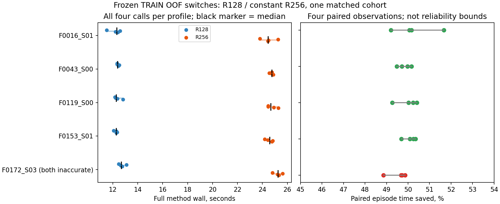

# R40 завершён: стоимость пяти зафиксированных train-OOF переключений

Дата:2026-10-26. **40/40 вызовов завершены**:5 исходных train-задач,4 R128+4 R256 на каждую. **Локальная экономия подтверждена**, точность относительно constant_R256 сохранена. ML-модели/политика/численные методы не изменены, MC/ML/benchmark1000/validation/test не запускались.

Сумма median4 method wall для пяти действий: **61.992 с R128 против 123.789 с R256**, выигрыш **61.797 с (49.92%, ускорение×1.997)**. Это5 доставок по медианам, а не время всей40-call исследовательской серии и не полная online-стоимость селектора.

## Точность и известный неточный контроль

Все40 векторов результата совпали с каноническими сохранёнными референсами побитово. Все40 E_grid независимо пересчитаны на33 узлах [-1,1]; ни один solver failure, timeout или interrupted вызов не скрыт/не заменён. Оба профиля точны на4/5 задачах: 16/20 вызовов каждого профиля удовлетворяют E_grid≤.01. Повторные детерминированные ответы не увеличивают число независимых accuracy-задач.

| Задача | E R128 | E R256 | Точность обоих | Классификация |
|---|---:|---:|---|---|
| AMV1_F0016_S01 | 0.000769398 | 0.000392902 | True | R128_accurate_speedup |
| AMV1_F0043_S00 | 0.002588503 | 0.001295674 | True | R128_accurate_speedup |
| AMV1_F0119_S00 | 0.002753221 | 0.001364610 | True | R128_accurate_speedup |
| AMV1_F0153_S01 | 0.003560052 | 0.001782676 | True | R128_accurate_speedup |
| AMV1_F0172_S03 | 0.043583985 | 0.021515666 | False | neither_profile_accurate |

**F0172/S03:** R128 E=.04358398499447341, R256 E=.021515665631340275. Оба неточны во всех4 повторах, как было известно до запуска. Более быстрый R128 здесь не объявляется точным winner. Случай сохранён в raw/cost статистике, а в анализе четырёх точных задач отделён. На4 baseline-correct задачах нет потерянной доставки. Это80% наблюдаемой точности каждого профиля на данном наборе, не95% гарантия, несмотря на q=.95 в исходной ML-политике.

## Сопоставимое время и разброс

| Задача | R128 median [min,max],с | R256 median [min,max],с | Экономия | MAD/median R128 / R256 |
|---|---:|---:|---:|---:|
| F0016_S01 | 12.321 [11.507,12.590] | 24.464 [23.803,25.262] | 49.64% | 1.46% / 1.40% |
| F0043_S00 | 12.397 [12.344,12.515] | 24.771 [24.552,24.883] | 49.95% | 0.42% / 0.23% |
| F0119_S00 | 12.290 [12.170,12.828] | 24.689 [24.456,25.284] | 50.22% | 0.77% / 0.94% |
| F0153_S01 | 12.293 [12.074,12.350] | 24.598 [24.193,24.824] | 50.02% | 0.24% / 0.79% |
| F0172_S03 | 12.691 [12.471,13.104] | 25.267 [24.806,25.624] | 49.77% | 1.08% / 0.82% |

На всех5 задачах max(t_R128)<min(t_R256), median_R128≤.9 median_R256; максимальный MAD/median всего **1.46%**, ниже заранее заданных20%. Все20 пар episode показывают положительную экономию; диапазон **48.86–51.66%**. На4 точных задачах выполнены все заранее заданные условия устойчивого timing-преимущества. На F0172 условия скорости также выполнены, но точности нет. Не отбрасывались первые/крайние замеры, не добавлялись повторы и не подбирался порог/состав задач. Четыре измерения дают описательную устойчивость в этом окружении, не сильное статистическое доказательство для новых машин/семейств.

Полные raw времена, IQR/MAD и разности каждой пары episodes — [analysis.json](analysis.json); все40 попыток, ошибки и SHA — [attempts.csv](attempts.csv).

## Стоимость и смысл для ML-политики

| Область | R128,с | R256,с | Сэкономлено,с | Экономия | Точных доставок обоих |
|---|---:|---:|---:|---:|---:|
| Все5, включая неточный ответ | 61.992 | 123.789 | 61.797 | 49.92% | 4 |
| Только4 точные задачи | 49.301 | 98.522 | 49.221 | 49.96% | 4 |

Стоимость на точную доставку с оплатой также неточного ответа: **15.498 с R128 против 30.947 с R256** (total method cost на5 задачах /4 точных). Если рассматривать только4 точные задачи: 12.325 против 24.630 с на доставку.

Закрыт ранее отсутствовавший full-wall R128 на5 OOF-switch задачах: локальное численное основание для выбора R128 вместо R256 подтверждено. Исходные ML timing-targets не перезаписаны и модели не переобучены; новые наблюдения остаются отдельным cohort. Все5 решений — frozen outer-fold1 из train-OOF, а не independent held-family результат и не решения финального refit/production API. Сам выбор пяти сделан до timing и не менялся по результатам.

В общей OOF40-таблице можно указать локальную добавочную экономию пяти переключений **61.797 с**; остальные35 действий не меняются. Полная измеренная процентная экономия/стоимость40 задач пока неизвестна: остаются4 других R256 missing-cost и нет единого сопоставимого полного cohort для всех40. Прежний прогноз6.25% не заменяется локальными49.92%. ML feature/inference overhead в этом опыте не измерялся и не включён; общие imports/load/scoring/serialization тоже не являются частью method wall. Полную online-экономию этим опытом не заявляем.

Для дальнейшего селектора это подтверждение стоимости локальных R-переключений, но не калибровки вероятностей, безопасности на новых семействах или способности выбирать MC. Production research_only/abstain сохранён. Нужна отдельная заранее замороженная оценка на новых семействах, где политика действительно переключается, с явным coverage; прежние20 предложенных входов при q=.95 не дают переключений текущего финального refit. MC-поддержка всё ещё требует собственных реальных success/failure данных, а не переименования R-only опыта в завершённый двухметодный benchmark.

## Контракт, бюджет и ресурсы

Пользователь явно утвердил1766 с и максимум40 calls. Новый execution plan [plan.json](plan.json) с authorization сохранён отдельно; старый preflight с approved=false остаётся историческим. Exact jobs/order/configs совпали с approved preflight. Canonical expression/family/train identities, аналитические G/T, reference hashes и параметры проверены до старта и после серии.

Профили неизменны: ChernovSolver.solve n128/n256,513 quadratic time nodes, cubic/zero,dx=.0125,padding12,2081 work nodes [-13,13],33 target nodes. Seed=None, RNG/MC/JIT/численных warmups нет. Один persistent worker, fresh constructor на каждый вызов, BLAS/compute threads=1. Чередование пар и циклический порядок задач точно соблюдены. perf_counter_ns включает certify_G/auto_T/config/constructor/solve; exact/scoring/reference/serialization после таймера. Все4 повтора сохранены.

- Controller wall **744.650 с (12.41 мин)** <1766 с; method wall sum 743.202 с. Оба первоначальных epoch/monotonic deadline соблюдены и не сбрасывались.
- Пик RSS **84.266 MiB**≤512, 2920 RSS-сэмплов; 73 thermal-сэмпла, все state=0 nominal. Это thermal pressure, не°C.
- Guardian cleanup_success=true; compute/controller locks освобождены. 40 уникальных requests/40 результатов,0 retries/interruptions/failures/pending; completed-resume вернул new_calls=0,worker_started=false.
- S-применений 3,932,160; spline builds3,932,200; общие imports/load сохранены в workers/*.setup.json, extra_solver_calls=JIT_calls=MC_calls=0.
- Настройки питания неизменны=True, источник питания неизменен=True; снимки до/после сохранены.

Независимо проверены40 канонических E_grid/векторов,40 request/config/timer records, порядок исполнения, медианы/экономия/стоимость точной доставки; [independent_verification.json](independent_verification.json). 19 unit/mock/planning/report-тестов passed; [tests.json](tests.json). Сохранность численного ядра, моделей/политики и прежних данных, резервные копии статуса и SHA-256 — [final_verification.json](final_verification.json), [artifact_sha256.json](artifact_sha256.json).

Новый код: diagnostics/run_switch5_r_timing.py,report_switch5_r_timing.py, verify_switch5_r_timing.py,summarize_switch5_r_timing.py; tests/test_run_switch5_r_timing.py,test_switch5_r_timing_report.py. Изменён только status среди прежних проектных файлов, все новые результаты сохранены в отдельном каталоге.
