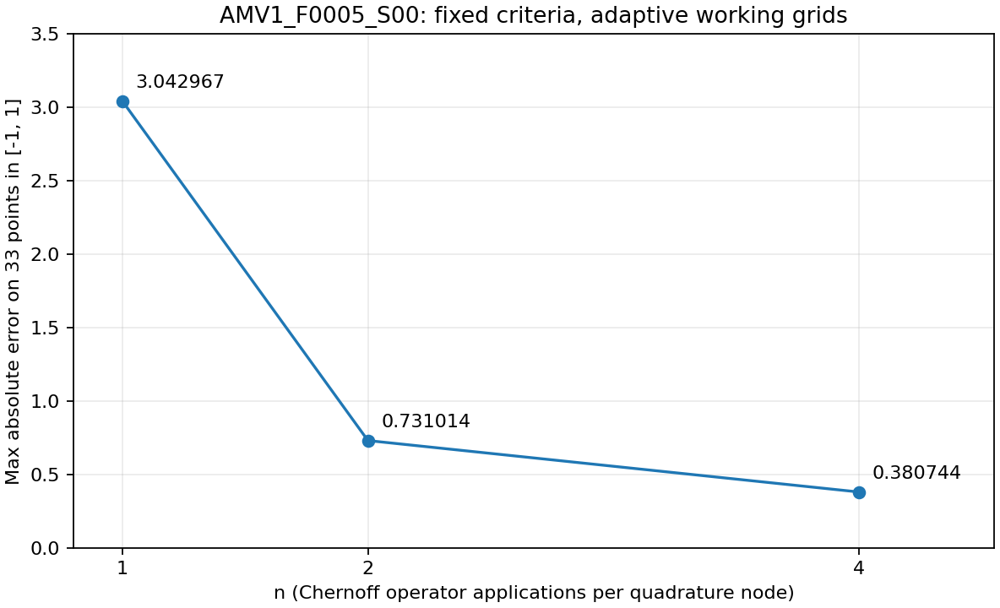

# Продолжение исследования: независимые запуски n=4

Дата исследования по контексту пользователя: 2026-10-12. Результаты сохранены отдельно от датасета и предыдущего исследования. Новые вызовы: F0005 без инструментализации; F0000 с cProfile и наблюдением стадий. Никаких повторов общей серии или изменений математической реализации не было.

## Подтверждённые настройки и оценка стоимости до запуска

Перед вызовом конфигурация `make_verification_config(4)` проверялась на полное равенство требуемым значениям:

```json
{
  "dx_initial": 0.05,
  "max_quadrature_refinements": 8,
  "max_spatial_refinements": 5,
  "max_work_grid_points": 100000,
  "n": 4,
  "nt_initial": 8,
  "quadrature_atol": 1e-09,
  "quadrature_rtol": 1e-07,
  "spatial_atol": 1e-09,
  "spatial_rtol": 1e-07,
  "tail_eps": 1e-08
}
```

Целевая сетка `np.linspace(-1,1,33)`, точное решение `equation.y_exact(result.x)`. Материалы сравнения n=1,2 взяты из прежнего JSON без повторного вычисления. Сетка результатов проверена на точное равенство заданной.

Прежнее время F0005: 8.89 с при n=1 и 21.14 с при n=2; n=2 обработал 64 624 136 пространственных точек. Простая экстраполяция пропорционально n даёт 42.28 с при n=4, но это не граница стоимости: при n=4 три промежуточные рабочие сетки вместо одной, а адаптивные Nt/dx могут остановиться на других уровнях. Верхняя оценка числа применений S — 98 112, размер исходной сетки на самом мелком разрешённом dx — 99 707 точек при лимите 100 000. Завершение за 45 с заранее не гарантировалось.

Каждый процесс независимо ограничен 45 с wall time от старта процесса и 512 МиБ наблюдаемого RSS. Запуски последовательные. Память опрашивается через ps с паузой 0.25 с: пик наблюдаемый, не гарантированный мгновенный максимум. При превышении отправляется SIGTERM; до 2 с предусмотрено только на сохранение диагностики, после чего SIGKILL. Это не дополнительный бюджет решения. Все thread limits сохранены равными 1. После timeout F0005 независимая диагностическая задача F0000 всё равно была бы выполнена; при memory limit/неожиданном исключении оболочка останавливается. Повторов и автоматического увеличения бюджетов нет.

Окружение:

```json
{
  "executable": "/Users/mikti/Documents/vsc projects/ode-generator-remizov/.venv/bin/python",
  "platform": "macOS-26.6.2-arm64-arm-64bit",
  "python": "3.10.11 (v3.10.11:7d4cc5aa85, Apr  4 2023, 19:05:19) [Clang 13.0.0 (clang-1300.0.29.30)]",
  "thread_environment": {
    "MKL_NUM_THREADS": "1",
    "NUMEXPR_NUM_THREADS": "1",
    "OMP_NUM_THREADS": "1",
    "OPENBLAS_NUM_THREADS": "1",
    "VECLIB_MAXIMUM_THREADS": "1"
  },
  "versions": {
    "matplotlib": "3.9.4",
    "numpy": "2.2.6",
    "scipy": "1.15.3",
    "sympy": "1.14.0"
  }
}
```

## Наблюдения: F0005, n=1,2,4

| n | status | max_abs_error | время решателя, с | время процесса, с | наблюдаемый RSS, МиБ |
|---:|---|---:|---:|---:|---:|
| 1 | success | 3.042966835 | 8.891003625 | 9.568314958 | 237.02 |
| 2 | success | 0.7310141012 | 21.14037262 | 21.71978683 | 266.59 |
| 4 | success | 0.3807441844 | 30.43478104 | 30.94624833 | 261.09 |

n=1,2 относятся к 2026-10-11; n=4 — к текущему запуску. Время зависит от загрузки компьютера, поэтому отношение времён не является чистым измерением сложности. Настройки, версии вычислительных библиотек и ограничения потоков совпадают.



Ошибка убывает на всех трёх исследованных n. Отношения E1/E2 и E2/E4 равны 4.162665 и 1.919961. Это подтверждение эмпирического уменьшения ошибки на n=1,2,4 для одной задачи, а не доказательство предела n→∞, порядка сходимости или поведения остальных уравнений.

Диагностика успешных расчётов:

| n | final dx | final Nt | quad разность / порог | spatial разность / порог | узлов | применений S | обработано пространственных точек | пиковая рабочая сетка |
|---:|---:|---:|---|---|---:|---:|---:|---:|
| 1 | 0.00625 | 512 | 9.964738368e-09 / 2.630958452e-07 | 3.081570799e-08 / 2.630958452e-07 | 10208 | 10208 | 336864 | 24928 |
| 2 | 0.003125 | 512 | 8.346692448e-09 / 9.268952072e-08 | 1.391646437e-08 / 9.268952072e-08 | 11224 | 22448 | 64624136 | 49854 |
| 4 | 0.003125 | 512 | 3.38141142e-09 / 6.061181653e-08 | 7.287720552e-09 / 6.061181653e-08 | 9176 | 36704 | 173666416 | 49854 |

При n=4 T=25.25671098, gap=0.767271047, tail_eps=1e-8. Успешный статус означает прохождение внутренних сравнений, а не сертифицированную малую ошибку относительно точного y. Финальные разности квадратуры/пространства порядка 1e-9 намного меньше полной ошибки 0.3807, но не являются независимыми гарантированными составляющими этой ошибки.

F0005 n=4 потребовал меньше квадратурных узлов, чем прежний n=2 (9176 против 11224), при том же final dx=0.003125; число применений S и обработанных пространственных точек выросло. Поэтому простая линейная оценка времени по n была неточной.

Полная новая история пространственного уточнения:

```json
{
  "spatial_dx_levels": [
    0.05,
    0.025,
    0.0125,
    0.00625,
    0.003125
  ],
  "spatial_error_history": [
    4.516583297947685e-05,
    1.8704477382502915e-06,
    1.2919275638179073e-07,
    7.28772055202942e-09
  ],
  "spatial_convergence_thresholds": [
    6.061161586743614e-08,
    6.061180291220996e-08,
    6.06118158314856e-08,
    6.061181652784994e-08
  ]
}
```

| dx | Nt уровни | quad разности | quad пороги |
|---:|---|---|---|
| 0.05 | 8, 16, 32, 64, 128, 256, 512, 1024, 2048 | 0.4186831614, 0.5420152307, 0.1906027854, 0.0006999725844, 9.188200956e-06, 4.840048112e-07, 1.704752664e-07, 4.305556789e-09 | 4.742133117e-08, 5.682358445e-08, 6.057694701e-08, 6.060797579e-08, 6.060725304e-08, 6.060728073e-08, 6.060728429e-08, 6.060728449e-08 |
| 0.025 | 8, 16, 32, 64, 128, 256, 512, 1024 | 0.4187795378, 0.5420625643, 0.1906229843, 0.0006976699689, 1.048969507e-06, 5.570055412e-07, 3.661718937e-08 | 4.742607479e-08, 5.682726359e-08, 6.058106445e-08, 6.061162448e-08, 6.061159976e-08, 6.061161385e-08, 6.061161587e-08 |
| 0.0125 | 8, 16, 32, 64, 128, 256, 512 | 0.4187876546, 0.542067301, 0.1906258975, 0.0006979208172, 7.91567143e-07, 4.275218654e-08 | 4.742657123e-08, 5.682753946e-08, 6.05812533e-08, 6.061182079e-08, 6.061180359e-08, 6.061180291e-08 |
| 0.00625 | 8, 16, 32, 64, 128, 256, 512 | 0.4187879589, 0.5420675392, 0.1906260116, 0.000697910737, 7.830398949e-07, 3.581424464e-09 | 4.742659622e-08, 5.682754443e-08, 6.058127329e-08, 6.061183085e-08, 6.061181567e-08, 6.061181583e-08 |
| 0.003125 | 8, 16, 32, 64, 128, 256, 512 | 0.4187879828, 0.5420675552, 0.1906260195, 0.0006979108957, 7.831107368e-07, 3.38141142e-09 | 4.742659775e-08, 5.682754489e-08, 6.058127396e-08, 6.06118316e-08, 6.061181645e-08, 6.061181653e-08 |

## Метод диагностики F0000: вычисления сохранены

Отдельный модуль `diagnostics/remizov_n4_followup.py` временно оборачивает оригинальные функции `_converge_spatial`, `_converge_quadrature`, `_integrate_fixed_nt`, `_compute_chernoff_at_t`, `_apply_operator_on_grid` и `numpy.polynomial.legendre.leggauss`. Каждый исходный вызов выполняется один раз с теми же аргументами и возвращает свой исходный результат; исключения не перехватываются для подбора параметров. CubicSpline и его результаты не заменяются. cProfile наблюдает вызовы SciPy напрямую.

Протокол сохраняется на границах квадратурных стадий и примерно раз в секунду внутри вычислений. SIGTERM инициирует отдельное сохранение частичной диагностики и профиля, затем процесс завершается. Последний сохранённый event — external_SIGTERM. В файл записываются существующие диагностические dataclass решателя и стек наблюдаемых стадий; промежуточный вектор не объявляется решением.

Перед запуском инструментализация проверена на малом вычислении штатного интеграла R1: n=4, Nt=8, T=1, dx=0.05, три целевые точки. Векторы без/с наблюдателем побитово равны, все штатные счётчики равны. Это проверка прозрачности обёртки, не новая серия сходимости. Сравнение не включает математическую перепроверку всей реализации, уже выполненную в предыдущем этапе.

Профилирование и обёртки изменяют время исполнения. Полная величина этого влияния не измерена. Суммарное явно измеренное время завершённых операций сохранения наблюдателя — 0.133263 с; оно не включает все расходы cProfile, вызовов обёрток и последнего сохранения. Отнимать только его и считать остаток временем обычного решателя нельзя.

Для сохранения снимков cProfile временно отключается и включается вновь. Поэтому cumulative time долгоживущих внешних функций (`_converge_spatial`, `_converge_quadrature`, `_integrate_fixed_nt`) неполон и не используется для определения длительности стадий. Для стадий используются отдельные wall-clock метки событий; для внутренних коротких функций — профиль. У активных при остановке вызовов время также может быть неполным. Inclusive/cumulative строки вложены друг в друга, их нельзя складывать.

## Подтверждённая стадия остановки F0000, n=4

Статус `external_time_limit`. SIGTERM запрошен на 45.005494 с от старта процесса; процесс завершился на 45.014001 с. Наблюдаемый RSS 235.28 МиБ. Математическая ошибка не определена: RemizovResult не возвращён. Это не штатный отказ quadrature_not_converged/spatial_not_converged.

Последний снимок относится к 44.616600 с наблюдаемого решателя; время процесса дополнительно содержит импорт и загрузку. На момент сигнала выполнялась квадратура Nt=2048 при dx=0.003125, внутри вычисления S(t/n)^4. Узел t≈11.9396459615, tau≈2.9849114904; текущий оператор использовал исходную сетку 13166 точек и сетку назначения 10035 точек. Это место остановки в данном запуске, а не доказательство того же места в предыдущем запуске.

Четыре квадратурных стадии завершились успешно; на каждой понадобились все Nt до 2048:

| dx | состояние | время стадии, с | последний quad error / threshold |
|---:|---|---:|---|
| 0.05 | принята | 5.774977 | 3.667826753e-08 / 7.077652475e-08 |
| 0.025 | принята | 6.668609 | 3.194628839e-08 / 7.077054629e-08 |
| 0.0125 | принята | 7.929843 | 6.195458646e-08 / 7.077088559e-08 |
| 0.00625 | принята | 10.160834 | 2.700930057e-08 / 7.077089274e-08 |
| 0.003125 | прервана извне | 14.078493 | 1.279826175e-06 / 7.07708953e-08 (последнее завершённое сравнение 512→1024; Nt=2048 ещё выполняется) |

Сравнения пространства:

| новый dx | spatial error | threshold | принят? |
|---:|---:|---:|---|
| 0.025 | 0.0003640177387 | 7.077054629e-08 | нет |
| 0.0125 | 8.812628588e-06 | 7.077088559e-08 | нет |
| 0.00625 | 1.011460737e-06 | 7.077089274e-08 | нет |

Для dx=0.003125 пространственное сравнение ещё не было выполнено. Не следует трактовать `converged=false` у активной квадратурной истории как завершённый отказ: сравнение Nt=2048 отсутствует. После текущей стадии остаётся ещё допустимый dx=0.0015625, но необходимость его использования и итоговый статус неизвестны.

Частичные штатные счётчики на момент SIGTERM:

```json
{
  "n_interpolated_values": 625841436,
  "n_interpolation_calls": 320624,
  "n_operator_applications": 80157,
  "n_quadrature_node_evaluations": 20040,
  "n_spline_builds": 80157,
  "spatial_grid_points_peak": 13166,
  "spatial_grid_points_total_processed": 156470394,
  "work_domain_left_min": -20.57000921916463,
  "work_domain_right_max": 20.57000921916463,
  "work_domain_width_max": 41.14001843832926,
  "work_grid_points_required_max": 13166
}
```

Счётчики отражают начатую работу; завершённых Chernoff-узлов 20039, завершённых S-вызовов 80156. Нельзя считать текущий незавершённый узел/оператор завершённым. T=13.142092786567558, gap=1.4273241529715541, tail_eps=1e-8; параметры усечения не менялись.

## Наблюдения профиля: где тратится время

| операция | число вызовов в снимке | inclusive/cumulative, с |
|---|---:|---:|
| Применение S, включая вложенные операции | 80157 | 34.709041 |
| Построение CubicSpline | 80157 | 9.778497 |
| Вызовы сплайна | 320624 | 9.154428 |
| Коэффициенты и проверка сертификатов внутри S | 80157 | 9.295275 |
| Проверка границ сдвигов внутри S | 80157 | 2.912899 |
| Forcing g_R на исходной сетке | 20040 | 5.242693 |
| Построение рабочих сеток | 80158 | 0.883955 |
| Построение узлов Gauss–Legendre | 45 | 2.539884 |

Строки таблицы вложены: применение S включает построение и вызовы сплайна, коэффициенты и проверку границ. Их суммы не являются полной длительностью. Независимые обёртки зафиксировали 41.836780 с в завершённых Chernoff-узлах, из них 34.949938 с в завершённых применениях S. Построение квадратурных узлов по этим меткам занимает 2.542084 с.

Подтверждённый основной источник затрат в профилируемой попытке — последовательная обработка многих Chernoff-узлов и пространственных сеток. Построение/использование сплайнов и вычисление/проверка коэффициентов — существенные вложенные затраты. Построение квадратурных узлов занимает заметно меньше времени; одно его кэширование не устранит основную стоимость. Прямое сравнение пространственных векторов мало; цена уточнения — повторное выполнение полной квадратуры на более мелкой сетке.

## Математические, численные и вычислительные препятствия

**Подтверждённые наблюдения.** F0005 проходит внутренние критерии при всех n=1,2,4, но сохраняет заметную ошибку относительно точного решения. F0000 при n=4 удовлетворяет критерию квадратуры на первых четырёх dx, однако все три завершённых пространственных сравнения не приняты. Текущий запуск остановлен по времени; память и размер рабочей сетки не исчерпали свои ограничения.

**Математическая гипотеза.** Конечное n существенно влияет на ошибку F0005; монотонное уменьшение согласуется с этой гипотезой. Вклад конечного n не измерен независимо от квадратуры, сплайнов и хвоста, поэтому ошибка 0.3807 не объявляется чистой ошибкой Chernoff-аппроксимации. Из новой диагностики не следует математическая несовместимость F0000 с методом.

**Численные ограничения.** При текущих критериях пространственная разность F0000 ещё превышает порог; квадратура на каждой завершённой стадии требует максимальный Nt. Это необходимость уточнения и расход численного бюджета, а не доказательство невозможности сходимости. Прежний отказ F0000 n=1,2 на начальном dx не повторяется при n=4: причина более долгого расчёта здесь включает дальнейшее пространственное уточнение.

**Вычислительное препятствие.** Повторные сериализованные операторы на расширенных сетках с реконструкцией сплайнов на каждом шаге и полным пересчётом квадратуры при каждом dx расходуют доступные 45 с. Инструментализация также замедляет запуск; её полная стоимость отдельно неизвестна. Нельзя утверждать, что обычный запуск имеет те же проценты затрат или завершился бы в то же время.

**Ограничение математической интерпретации хвоста.** Сохранена прежняя формула T. Она не использует глобальную норму g_R, поэтому tail_eps не интерпретируется как универсальная абсолютная граница всей ошибки. Ни усечение, ни формулы сертификатов здесь не пересматривались.

## Обоснованный следующий шаг

Следующее исследование следует ограничить одним F0000 n=4 с теми же 45 с/512 МиБ и более лёгким внешним сэмплированием (без cProfile и частых Python-обёрток). Это позволит проверить штатное завершение, не увеличивая бюджет и не принимая профилируемое время за обычное. При повторной внешней остановке результат остаётся неопределённым; скрытых повторов быть не должно.

Если затем потребуется работа над производительностью, она должна идти отдельным согласованным этапом с проверкой эквивалентности численных результатов и истории критериев. Профиль указывает на сплайны и повторную обработку рабочих сеток/коэффициентов; кэширование неизменной геометрии/значений можно сначала оценить как возможность, но в этом этапе ничего не кэшировалось и решатель не изменялся. Простое увеличение n или бюджетов сейчас увеличит стоимость и не решит установленное вычислительное препятствие.

Для количественного разделения ошибок F0005 после этого нужен контролируемый эксперимент при фиксированном n и T с одним численным параметром либо независимый эталон конечного n. Новые n=8,16,32 не нужны для нынешнего вывода и не выполнялись. Рекомендованные следующие запуски сейчас не выполнялись.

## Воспроизводимость и сохранённые файлы

Диагностические модули:

- `diagnostics/remizov_n4_followup.py` — два независимых ограниченных вызова, наблюдатель и ресурсный контроль;
- `diagnostics/report_remizov_n4_followup.py` — читает сохранённые файлы, строит сравнение, график и этот отчёт; решатель не вызывает.

Новый каталог содержит summary, JSON результатов, resource samples, лог событий стадий, частичный профиль pstats, табличный профиль, машинный анализ профиля, сравнение F0005 CSV/JSON и PNG/SVG графика. Полные истории F0005 находятся в `F0005_n4/solver_return.json`; неполные истории F0000 — в `F0000_n4_profile/progress.json`.

```bash
.venv/bin/python -B diagnostics/remizov_n4_followup.py --output-dir results/remizov_n4_followup_repeat
.venv/bin/python -B diagnostics/report_remizov_n4_followup.py results/remizov_n4_followup_repeat
```

Команды только для воспроизводимости: повторный запуск требует нового каталога, существующие результаты не перезаписываются.

Контроль неизменности: SHA-256 математических файлов совпадают с миграционным манифестом; старые результаты проверены отдельным полным набором SHA-256. Исходный датасет и предсуществующий код не изменены. Сверка исходного проекта исключает .venv, .git, caches, results и .DS_Store; границы сверки явно сохранены. Новых зависимостей не установлено. Commit/push не выполнялись.
