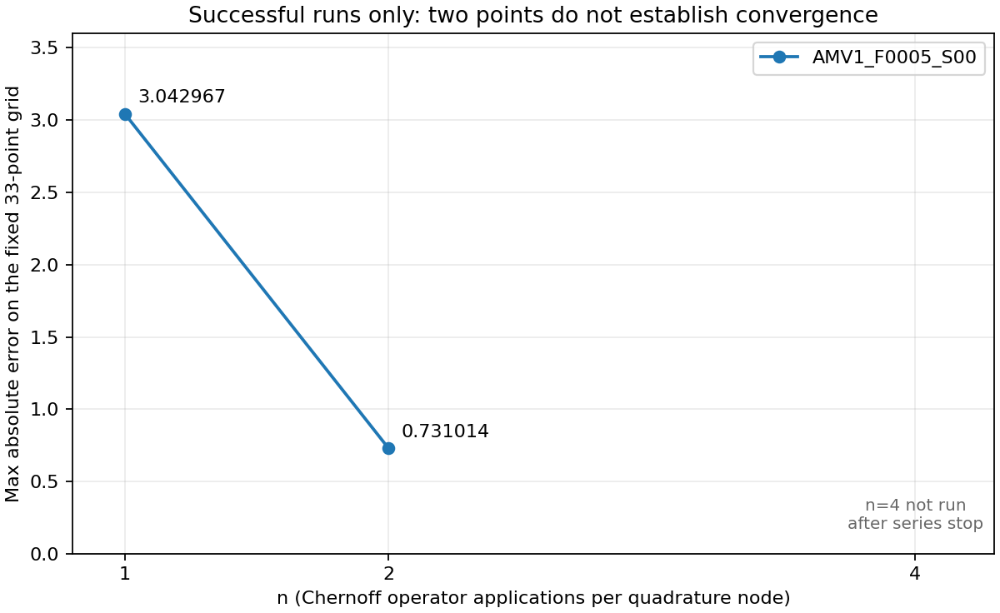

# Исследование существующего метода Ремизова: n=1,2,4

Датасет: `data/generated/`, seed 2488, 20 семейств; рассмотрены только `AMV1_F0000_S00` и `AMV1_F0005_S00`. Расчёты не изменяют генератор, решатель, уравнения, точное решение или бюджеты уточнения. Неуспешные результаты не используются как решения. Исходные CSV/JSONL/NPZ/отчёт не перезаписаны.

Выполнены четыре расчёта до штатного возврата решателя и одна внешне остановленная попытка. Шестой запуск не выполнялся. Параметры не подбирались и повторных попыток не было.

## Подтверждённые факты: код и постановка

Источники: [решатель](../../remizov_solver.py), [загрузчик](../../all_methods_dataset_loader.py), [проверочная конфигурация](../../verify_remizov_solver.py), [прежний отчёт](../../docs/LOCAL_VERIFICATION.md), [прежние параметры/результаты JSON](../../docs/local_verification_results.json).

Положим A=a(x)∂²+b(x)∂+c_R(x). Генератор и загрузчик используют `c=c_R−λ`, `g=a y″+b y′+c y`, `g_R=−g`. Следовательно, `(λ−A)y=g_R`. Решатель строит глобальное резольвентное приближение, а не интегрирует задачу Коши. В `RemizovProblem` нет y0/v0; они остаются данными альтернативного представления и проверки реконструкции.

Фактически вычисляется

```text
S(τ)u(x) = ¼u(x+2√(a(x)τ)) + ¼u(x−2√(a(x)τ))
           + ½u(x+2b(x)τ) + τc_R(x)u(x)
f_(n,T)(x) ≈ ∫₀ᵀ exp(−λt) S(t/n)^n g_R(x) dt.
```

`n` — число последовательных применений S в каждом узле интеграла; τ=t/n. Это не число узлов квадратуры и не число точек целевой сетки. Параметр λ участвует в экспоненте интеграла, а не в S. Знак сдвига дрейфа положительный.

В `_integrate_fixed_nt` (строка 465) используется Gauss–Legendre; узлы вычисляются заново для каждого Nt, каждый узел обрабатывается последовательно. В `_apply_operator_on_grid` (350) строится `CubicSpline(extrapolate=False)` и выполняются четыре векторизованных интерполяции. Последний оператор вычисляется непосредственно на целевых x; промежуточные операторы используют равномерные рабочие сетки.

`_converge_quadrature` (501) сравнивает два последовательных Nt:

```text
max|F_(2Nt,dx)−F_(Nt,dx)| ≤ quadrature_atol + quadrature_rtol·max|F_(2Nt,dx)|.
```

`_converge_spatial` (545) сначала требует сходимость квадратуры на текущем dx, потом делит dx пополам, снова полностью выполняет квадратуру и сравнивает:

```text
max|F_(dx/2)−F_(dx)| ≤ spatial_atol + spatial_rtol·max|F_(dx/2)|.
```

Эти разности — внутренние индикаторы уточнения, а не доказанные верхние границы полной ошибки. Spatial comparison также содержит оставшуюся ошибку квадратуры.

## Подтверждённые параметры и ресурсы

Прежние оба запуска содержат одинаковые полные config в `docs/local_verification_results.json`; текущие вызовы используют `make_verification_config(n)` с той же конфигурацией. Библиотечные значения лимитов уточнений равны 4/4; прежний и текущий проверочные бюджеты равны 8/5. Это разные существующие конфигурации; библиотечные значения не менялись.

| Параметр | Значение для всех запусков |
|---|---|
| `dx_initial` | `0.05` |
| `max_quadrature_refinements` | `8` |
| `max_spatial_refinements` | `5` |
| `max_work_grid_points` | `100000` |
| `nt_initial` | `8` |
| `quadrature_atol` | `1e-09` |
| `quadrature_rtol` | `1e-07` |
| `spatial_atol` | `1e-09` |
| `spatial_rtol` | `1e-07` |
| `tail_eps` | `1e-08` |

Фиксированная сетка сравнения: `np.linspace(-1,1,33)`, шаг 0.0625. Сравнение выполняется с `equation.y_exact(result.x)`, восстановленным из того же проверенного CSV/JSONL. NPZ, интерполяция его каналов, начальные условия как способ интегрирования и масштабирование решения при сравнении не используются.

Максимально разрешены Nt=8,16,32,64,128,256,512,1024,2048; 4088 узлов суммарно на один dx. Разрешены dx=0.05,0.025,0.0125,0.00625,0.003125,0.0015625; не более шести квадратурных запусков и 24528 узлов за один вызов. На успешно завершённых стадиях число применений оператора равно n×число узлов; при отказе посреди узла это равенство может не выполняться.

Решатель не имеет штатного ограничения wall time, RSS, суммарного числа интерполируемых значений либо верхнего предела n. Есть ограничения числа уточнений и числа точек отдельной рабочей сетки. Это не эквивалент ограничению общей памяти: сетки, коэффициенты, сплайны и массивы квадратуры также требуют памяти. Ресурсные счётчики накопительные и не являются лимитами.

Внешняя оболочка запускает один процесс за раз, ограничивает каждый процесс 45 секундами wall time (включая импорт/загрузку) и наблюдаемым RSS 512 МиБ. RSS опрашивается через `ps` с паузой 0.25 с; это наблюдаемый пик, а не строгий мгновенный лимит. При превышении процесс прекращается и серия останавливается без увеличения бюджетов. Все OMP/OpenBLAS/MKL/Accelerate/NumExpr thread limits установлены в 1. Время решателя и время процесса записаны раздельно.

Рабочая область зависит от T и n, а не от фактического t узла:

```text
d_max = max(2√(a_upper T/n), 2 B_abs T/n)
I_level = [x_min−(n−level)d_max, x_max+(n−level)d_max].
```

Сетка имеет `max(3,ceil(width/dx))+1` точек. Предварительная оценка:

| equation_id | n | максимальная ширина области | точки при dx=0.05 | точки при dx=0.0015625 | максимальное число применений S |
|---|---:|---:|---:|---:|---:|
| AMV1_F0000_S00 | 1 | 21.57000922 | 433 | 13806 | 24528 |
| AMV1_F0000_S00 | 2 | 29.67617245 | 595 | 18994 | 49056 |
| AMV1_F0000_S00 | 4 | 41.14001844 | 824 | 26331 | 98112 |
| AMV1_F0005_S00 | 1 | 155.79018629 | 3117 | 99707 | 24528 |
| AMV1_F0005_S00 | 2 | 155.79018629 | 3117 | 99707 | 49056 |
| AMV1_F0005_S00 | 4 | 155.79018629 | 3117 | 99707 | 98112 |

Оценка сетки F0005 при самом мелком dx близка к пределу 100000, но ниже него. Она не предсказывает время. Прежние n=1 занимали примерно 1.57 и 7.85–7.98 с; поэтому исследование начато с n=1 и снабжено внешним watchdog.

Окружение расчётов:

```json
{
  "cpu_count": 12,
  "executable": "/Users/mikti/Documents/vsc projects/ode-generator-remizov/.venv/bin/python",
  "machine": "arm64",
  "platform": "macOS-26.6.2-arm64-arm-64bit",
  "python": "3.10.11 (v3.10.11:7d4cc5aa85, Apr  4 2023, 19:05:19) [Clang 13.0.0 (clang-1300.0.29.30)]",
  "thread_environment": {
    "MKL_NUM_THREADS": "1",
    "NUMEXPR_NUM_THREADS": "1",
    "OMP_NUM_THREADS": "1",
    "OPENBLAS_NUM_THREADS": "1",
    "VECLIB_MAXIMUM_THREADS": "1"
  },
  "versions": {
    "numpy": "2.2.6",
    "pytest": "9.1.1",
    "scipy": "1.15.3",
    "sympy": "1.14.0"
  }
}
```

Matplotlib 3.9.4 установлен только в новом `.venv` для графика. NumPy/SciPy/SymPy при установке не обновлялись; полные версии после установки находятся в `plotting_environment.json`. `pip check`: конфликтов нет.

## Усечение интеграла

В `compute_truncation_T` (229) gap=λ−C_abs и `T=max(0,(log(2)−log(gap)−log(tail_eps))/gap)`. T не меняется с n. Сертификаты применяются на всей вещественной прямой.

| equation_id | λ | C_abs | gap | T | tail_eps |
|---|---:|---:|---:|---:|---:|
| AMV1_F0000_S00 | 1.761795882 | 0.3344717293 | 1.427324153 | 13.14209279 | 1e-8 |
| AMV1_F0005_S00 | 1.665076012 | 0.8978049649 | 0.767271047 | 25.25671098 | 1e-8 |

Математическая оговорка: из формулы S и ограниченности c_R следует `||S(t/n)^n||∞ ≤ (1+t C_abs/n)^n ≤ exp(t C_abs)`. Поэтому хвост конечного n ограничивается `||g_R||∞ exp(−gap T)/gap`, что при T>0 для заданной формулы равно `||g_R||∞ tail_eps/2`. Норма g_R не входит в вычисление T и не сертифицирована отдельным глобальным числом в решателе. Следовательно, tail_eps нельзя автоматически считать абсолютной верхней границей ошибки решения. Это вывод из реализованной формулы, а не утверждение о содержании внешней теоремы; внешний текст теоремы здесь не проверялся.

## Экспериментальные наблюдения: итоговая таблица

| equation_id | n | status | max_abs_error | runtime, с | failure_reason |
|---|---:|---|---:|---:|---|
| AMV1_F0000_S00 | 1 | quadrature_not_converged | не определено | 1.627280166 | quadrature_not_converged |
| AMV1_F0005_S00 | 1 | success | 3.042966835 | 8.891003625 | — |
| AMV1_F0000_S00 | 2 | quadrature_not_converged | не определено | 2.548290625 | quadrature_not_converged |
| AMV1_F0005_S00 | 2 | success | 0.7310141012 | 21.14037262 | — |
| AMV1_F0000_S00 | 4 | external_time_limit | не определено | 45.262741 (внешнее) | external_time_limit |
| AMV1_F0005_S00 | 4 | not_run | не определено | — | серия остановлена после внешнего лимита |

Runtime успешных/штатно неуспешных строк — время внутри `solve_remizov`. Для внешне остановленного n=4 время решателя неизвестно; указано время процесса. `external_time_limit` и `not_run` не являются статусами решателя. После принудительной остановки `RemizovResult` отсутствует; стадия остановки и незавершённые истории из публичного API недоступны. Нельзя приписывать этой попытке `quadrature_not_converged` либо `spatial_not_converged`.



График содержит только успешные результаты F0005 при n=1,2. Соединительная линия показывает два наблюдения; не является экстраполяцией или доказательством сходимости. F0000 не имеет пригодных для сравнения результатов.

## Диагностика всех вернувшихся результатов

| equation_id | n | final dx | final Nt | последняя quad разность / порог | последняя spatial разность / порог | число узлов | применений S | пиковая сетка | наблюдаемый RSS, МиБ |
|---|---:|---:|---:|---|---|---:|---:|---:|---:|
| AMV1_F0000_S00 | 1 | 0.05 | 2048 | 4.04371499e-07 / 9.304393462e-08 | не определено / не определено | 4088 | 4088 | 433 | 192.33 |
| AMV1_F0005_S00 | 1 | 0.00625 | 512 | 9.964738368e-09 / 2.630958452e-07 | 3.081570799e-08 / 2.630958452e-07 | 10208 | 10208 | 24928 | 237.02 |
| AMV1_F0000_S00 | 2 | 0.05 | 2048 | 9.02688102e-08 / 7.746699415e-08 | не определено / не определено | 4088 | 8176 | 595 | 195.53 |
| AMV1_F0005_S00 | 2 | 0.003125 | 512 | 8.346692448e-09 / 9.268952072e-08 | 1.391646437e-08 / 9.268952072e-08 | 11224 | 22448 | 49854 | 266.59 |

### AMV1_F0000_S00, n=1

Spatial dx: 0.05.

Spatial разности: нет.

Spatial пороги: нет.

| dx | Nt уровни | разности соседних Nt | пороги, попарно | converged |
|---:|---|---|---|---|
| 0.05 | 8 → 16 → 32 → 64 → 128 → 256 → 512 → 1024 → 2048 | 0.8587186342 → 0.3951098037 → 0.1116490378 → 0.01906836229 → 0.001467791332 → 2.964861704e-05 → 6.040991651e-06 → 4.04371499e-07 | 1.028812596e-07 → 9.957668873e-08 → 9.441993235e-08 → 9.304137423e-08 → 9.304281662e-08 → 9.304368015e-08 → 9.304390762e-08 → 9.304393462e-08 | False |

### AMV1_F0005_S00, n=1

Spatial dx: 0.05 → 0.025 → 0.0125 → 0.00625.

Spatial разности: 7.514334554e-05 → 4.715647976e-06 → 3.081570799e-08.

Spatial пороги: 2.630954028e-07 → 2.630958443e-07 → 2.630958452e-07.

| dx | Nt уровни | разности соседних Nt | пороги, попарно | converged |
|---:|---|---|---|---|
| 0.05 | 8 → 16 → 32 → 64 → 128 → 256 → 512 → 1024 → 2048 | 4.577924518 → 1.757624649 → 0.7192839441 → 0.001346642373 → 1.271177211e-05 → 8.603782664e-06 → 5.667332881e-06 → 2.494668659e-07 | 2.883926021e-07 → 2.579350907e-07 → 2.630834873e-07 → 2.6309265e-07 → 2.630923151e-07 → 2.630915768e-07 → 2.630915769e-07 → 2.630915757e-07 | True |
| 0.025 | 8 → 16 → 32 → 64 → 128 → 256 → 512 → 1024 → 2048 | 4.577972054 → 1.757673755 → 0.719324669 → 0.001345331892 → 3.495119132e-07 → 5.579207999e-07 → 4.627757995e-07 → 2.287873931e-07 | 2.884040155e-07 → 2.579381287e-07 → 2.63087351e-07 → 2.630953862e-07 → 2.630954132e-07 → 2.630953787e-07 → 2.630954039e-07 → 2.630954028e-07 | True |
| 0.0125 | 8 → 16 → 32 → 64 → 128 → 256 → 512 | 4.577973465 → 1.757675789 → 0.7193261461 → 0.001345323548 → 2.942291473e-07 → 6.03471097e-08 | 2.884039811e-07 → 2.579387003e-07 → 2.630878565e-07 → 2.630958388e-07 → 2.630958503e-07 → 2.630958443e-07 | True |
| 0.00625 | 8 → 16 → 32 → 64 → 128 → 256 → 512 | 4.577973784 → 1.757675881 → 0.7193262167 → 0.001345311471 → 2.634432661e-07 → 9.964738368e-09 | 2.884039839e-07 → 2.579387077e-07 → 2.630878596e-07 → 2.630958355e-07 → 2.630958462e-07 → 2.630958452e-07 | True |

### AMV1_F0000_S00, n=2

Spatial dx: 0.05.

Spatial разности: нет.

Spatial пороги: нет.

| dx | Nt уровни | разности соседних Nt | пороги, попарно | converged |
|---:|---|---|---|---|
| 0.05 | 8 → 16 → 32 → 64 → 128 → 256 → 512 → 1024 → 2048 | 0.8180540017 → 0.3123102517 → 0.07407316828 → 0.01393917206 → 0.001020309175 → 3.638673687e-05 → 1.55392034e-06 → 9.02688102e-08 | 9.047351889e-08 → 8.320945032e-08 → 7.786838702e-08 → 7.752891275e-08 → 7.746792007e-08 → 7.746704689e-08 → 7.746699627e-08 → 7.746699415e-08 | False |

### AMV1_F0005_S00, n=2

Spatial dx: 0.05 → 0.025 → 0.0125 → 0.00625 → 0.003125.

Spatial разности: 5.46193565e-05 → 3.268387856e-06 → 2.270813965e-07 → 1.391646437e-08.

Spatial пороги: 9.26893653e-08 → 9.268951116e-08 → 9.268952016e-08 → 9.268952072e-08.

| dx | Nt уровни | разности соседних Nt | пороги, попарно | converged |
|---:|---|---|---|---|
| 0.05 | 8 → 16 → 32 → 64 → 128 → 256 → 512 → 1024 → 2048 | 2.543906681 → 1.491108516 → 0.6212993406 → 0.000680094134 → 1.375818638e-05 → 1.592171411e-05 → 8.525203644e-07 → 3.435064776e-08 | 1.191576751e-07 → 1.00173446e-07 → 9.268569123e-08 → 9.268714536e-08 → 9.268700343e-08 → 9.268732169e-08 → 9.2687321e-08 → 9.268732178e-08 | True |
| 0.025 | 8 → 16 → 32 → 64 → 128 → 256 → 512 → 1024 → 2048 | 2.544001995 → 1.491203395 → 0.6213695813 → 0.0006803364904 → 1.987508825e-06 → 4.587692374e-07 → 8.121136749e-07 → 3.940099483e-08 | 1.191607367e-07 → 1.001783472e-07 → 9.268730443e-08 → 9.26893513e-08 → 9.26893641e-08 → 9.268936376e-08 → 9.268936429e-08 → 9.26893653e-08 | True |
| 0.0125 | 8 → 16 → 32 → 64 → 128 → 256 → 512 | 2.544003158 → 1.491209361 → 0.6213727681 → 0.0006801087248 → 1.158265642e-06 → 9.2618549e-08 | 1.191607615e-07 → 1.001786765e-07 → 9.268745169e-08 → 9.268949862e-08 → 9.268951152e-08 → 9.268951116e-08 | True |
| 0.00625 | 8 → 16 → 32 → 64 → 128 → 256 → 512 | 2.544003294 → 1.491209722 → 0.6213730036 → 0.0006800835486 → 1.113098085e-06 → 8.279758212e-09 | 1.191607611e-07 → 1.001787015e-07 → 9.268746026e-08 → 9.268950535e-08 → 9.268951952e-08 → 9.268952016e-08 | True |
| 0.003125 | 8 → 16 → 32 → 64 → 128 → 256 → 512 | 2.544003316 → 1.491209743 → 0.6213730154 → 0.0006800838325 → 1.113039606e-06 → 8.346692448e-09 | 1.191607619e-07 → 1.001787026e-07 → 9.268746084e-08 → 9.268950592e-08 → 9.268952008e-08 → 9.268952072e-08 | True |

Полные `RemizovResult` сохранены в отдельных JSON каждого вернувшегося запуска и в `summary.json`, включая x,f, точное решение, точечные ошибки, n,T,tail_eps,λ,gap,final_dx,final_nt, оценки и количества уточнений, все квадратурные истории с порогами, все пространственные сравнения с порогами, количество узлов/операторов/сплайнов/интерполяций/значений, пиковую и суммарно обработанную сетку, требуемый размер сетки, минимальный левый/максимальный правый край рабочей области и её максимальную ширину.

## Разбор F0000: подтверждённая стадия отказа

При n=1 и n=2 отказ возникает в `_converge_quadrature`, вызываемой для начальной пространственной сетки dx=0.05, ещё до первого пространственного уточнения и сравнения. Использованы все Nt от 8 до 2048 (8 уточнений; 4088 узлов). При n=1 последняя разность 4.0437149895e-7 больше порога 9.3043934619e-8 примерно в 4.346 раза; при n=2 9.0268810204e-8 больше 7.7466994148e-8 примерно в 1.165 раза. Итоговый f пуст, ошибка относительно y не определена. Предварительные квадратурные векторы наружу не возвращаются и не были использованы как решение.

Внутренняя разность в основном уменьшается с Nt; это само по себе не доказывает, что следующий уровень удовлетворит критерию. У n=4 установлен только факт внешнего ограничения времени. Причину его более долгого вычисления и точную стадию нельзя восстановить из отсутствующего результата. Не делается предположение, что это тот же отказ.

Дополнительная диагностика получена без изменения алгоритма: взяты существующие `quadrature_history`, `spatial_dx_levels`, счётчики и парные пороги, которые прежний короткий CLI не печатал. Для внешне остановленных вызовов дальнейшая информация потребует внешнего профилирования или отдельно согласованного наблюдаемого запуска; сейчас такого запуска нет.

## Знаки, нормировка и сравнение: независимые проверки

Оба режима — constant (F0000=L1, F0005=L2). Реальные коэффициенты:

| equation_id | a | b | c_R |
|---|---:|---:|---:|
| AMV1_F0000_S00 | 0.9694023912 | 0.08287825739 | 0.1357308286 |
| AMV1_F0005_S00 | 1.320468928 | 0.9421955585 | -0.4591191383 |

Точная форма y из сериализованного AST построена отдельно через существующий SymPy-интерпретатор теста `_sympy_expression`. Использован нормированный bump `exp(1−1/(1−z²))` внутри поддержки с z=(x−μ)/R; SymPy самостоятельно вычислил производные. Проверено 513 точек внутри 95% радиуса поддержки (границы поддержки исключены). Это конечная проверочная сетка, не глобальный сертификат.

| equation_id | max Δy | max Δy′ | max Δy″ | max Δg_R | амплитуда на 257 x / метаданные |
|---|---:|---:|---:|---:|---|
| AMV1_F0000_S00 | 4.440892099e-16 | 1.387778781e-15 | 2.042810365e-14 | 1.953992523e-14 | 0.7306495444 / 0.7306495444 |
| AMV1_F0005_S00 | 9.992007222e-16 | 3.108624469e-15 | 2.842170943e-14 | 3.730349363e-14 | 0.6639157276 / 0.6639157276 |

Для обеих задач разности `c−(c_R−λ)`, `g+g_R`, `y_exact(-1)−y0` и `dy_exact(-1)−v0` равны 0. Исходный тест оператора отдельно подтверждает веса, знак дрейфа и отсутствие λ в S; ручные эталоны R1 подтверждают значения конечного n 1.48 (n=1) и 1.1728395061728395 (n=2), а не точное значение 1.

Сейчас повторно выполнено:

```bash
.venv/bin/python -B -m pytest -q -p no:cacheprovider \
  tests/test_remizov_solver.py tests/test_remizov_verification.py \
  tests/test_remizov_loader.py tests/test_all_methods_expressions.py \
  -k 'not test_r1_finite_chernoff_approximations_converge_toward_exact'
```

Результат: **36 passed, 1 deselected, 106 subtests passed**, 4.31 с. Единственное предупреждение — сохранённая escape-последовательность в docstring исходного математического модуля. Действительные вызовы n=8,16,32 не выполнялись; тесты с mock не являются численными исследованиями.

Признаков ошибки знака, нормировки, восстановления производных или выбора точного решения в этих проверках не обнаружено. Это не исключает другие возможные ошибки реализации и не доказывает математическую теорему.

## F0005: наблюдение и математическая гипотеза

Наблюдение: E1=3.0429668353311623, E2=0.731014101169212; ошибка уменьшилась в 4.162665 раза. При n=1 финальные внутренние разности q≈9.965e-9 и s≈3.082e-8; при n=2 q≈8.347e-9 и s≈1.392e-8. Они намного меньше полной ошибки, но не являются её независимыми гарантированными составляющими.

Математическая гипотеза: конечное n существенно влияет на ошибку. Для постоянного c_R при n=1 подынтегральная функция содержит неперенесённую часть `(1/2+t c_R)g_R(x)`. Её интегральный коэффициент равен `(1−exp(−λT))/(2λ) + c_R[1−(1+λT)exp(−λT)]/λ²`. У F0005 этот коэффициент около 0.13469; при малом n приближение сохраняет непосредственный вклад forcing, содержащего вторую производную компактного решения. Поэтому большая ошибка при n=1 математически возможна без ошибки знака. Наблюдаемое уменьшение при n=2 согласуется с этой гипотезой, но не устанавливает её как единственную причину.

Для строгого разделения можно записать `y−f_num = (y−f_n,∞) + (f_n,∞−f_n,T) + (f_n,T−f_n,T,dx) + (f_n,T,dx−f_num)`. Эти величины здесь отдельно не измерены. Макс-норма суммы не равна сумме макс-норм частей. Нельзя вычесть q+s из E и назвать остаток точной ошибкой конечного n. Между n=1 и n=2 фактический final dx также изменился (0.00625→0.003125), хотя критерии и бюджеты одинаковы.

Для разделения нужны независимый эталон конечного n и/или контролируемое исследование одного численного параметра при фиксированных n,T; отдельное подтверждение пространственного и квадратурного пределов и сертифицированная норма g_R для хвоста. В текущем исследовании параметры ради этого не менялись.

## Выводы и рекомендации

1. **Наблюдение:** уменьшение ошибки есть только для F0005 между n=1 и n=2. Для F0000 численную ошибку оценить нельзя.
2. **Ограничение вывода:** двух успешных значений одной задачи недостаточно для вывода о сходимости, её порядке или поведении всей генерации. n=4 для F0005 отсутствует; никакой экстраполяции не делается.
3. **Подтверждённые препятствия:** F0000 n=1,2 исчерпывает бюджет квадратуры на начальном dx; F0000 n=4 исчерпал внешний предел времени. В последних нет данных, позволяющих утверждать исчерпание памяти либо штатного лимита рабочей сетки.
4. **Результат проверок:** обнаруженного дефекта знаков/нормировки/сравнения нет. Малое n остаётся обоснованной гипотезой большой ошибки F0005, а не установленной количественной декомпозицией погрешности.
5. **Следующий необходимый шаг:** сначала внешнее профилирование F0000 n=4 под тем же ограниченным бюджетом или на доступной выделенной машине, чтобы установить дорогую стадию. Затем отдельно согласованный запуск F0005 n=4 с заранее установленным ресурсным бюджетом; без этого серия по n неполна. n=8,16,32 пока не требуются.
6. **Затем, после согласования:** исследовать контроль квадратуры/сетки при фиксированных n,T и только одном изменяемом параметре; для хвоста получить глобальную норму forcing или иную математически обоснованную оценку. Для F0000 полезно проверить зависимость квадратурной разности от интерполированного forcing: дифференцированный bump и сплайны могут влиять на регулярность по t. Это гипотеза, не установленная причина текущего отказа.
7. **Настройки:** сейчас нет оснований менять штатные настройки решателя или ослаблять критерии. Установлено, что текущего квадратурного бюджета F0000 n=1,2 недостаточно для его действующего критерия; это не обосновывает автоматическое увеличение Nt. Следующий бюджет следует назначить заранее после оценки стоимости и качества контрольных индикаторов.

## Статусы отказа: смысл по коду

| Штатный статус | Смысл |
|---|---|
| invalid_remizov_conditions | Не выполнены аналитическая/global сертификация, положительность a, корректные границы/интервал или λ>C_abs; часть некорректного API вместо статуса вызывает ValueError. |
| nonfinite_coefficient | a,b,c_R дали нечисловое, не приводимое к сетке, не конечное значение либо исключение при вычислении. |
| certified_bound_violation | Вычисленный коэффициент нарушил сертификат с установленным допуском, либо a≤0. |
| nonfinite_state | Ошибка/неконечность forcing, применения S, накопления квадратуры или её результата. |
| interpolation_failure | Непригодные сетки/формы, исключение построения/вызова сплайна либо неконечные значения интерполяции. |
| interpolation_out_of_bounds | Запрошенные сдвинутые координаты выходят за доступную исходную сетку или неконечны. Проверка отдельная от сплайна; экстраполяция выключена. |
| work_domain_too_large | Нефинитная/непредставимая область либо требуемая сетка превышает max_work_grid_points. |
| quadrature_not_converged | Все разрешённые удвоения Nt не дали принятого сравнения на текущем dx. |
| spatial_not_converged | Квадратура принималась, но все разрешённые половинные dx не дали принятого пространственного сравнения. |

Неверная конфигурация и неверный target_x вызывают ValueError. Другие неожиданные исключения могут выйти наружу; оболочка отдельно помечает их worker_exception. Внешние resource limits не добавлены в решатель и не смешиваются с его failure_reason.

## Файлы, воспроизводимость и неизменность

Созданы отдельные диагностические файлы:

- `diagnostics/remizov_n_study.py` — вызывает существующий solver, сохраняет публичную диагностику, проверяет входные формы и контролирует ресурсы;
- `diagnostics/plot_remizov_n_study.py` — строит график только по сохранённым данным;
- `diagnostics/requirements-plot.txt` — дополнительная локальная зависимость Matplotlib;
- `results/remizov_n_study_2026-10-11/` — summary JSON, JSON отдельных попыток, CSV, журналы, PNG/SVG, версии пакетов и этот отчёт.

Повторный запуск должен иметь новый каталог результатов: скрипт откажется использовать существующий каталог. Например:

```bash
.venv/bin/python -B diagnostics/remizov_n_study.py \
  --output-dir results/remizov_n_study_repeat
.venv/bin/python -m pip install -r diagnostics/requirements-plot.txt
.venv/bin/python -B diagnostics/plot_remizov_n_study.py \
  results/remizov_n_study_repeat
```

Эти команды приведены для воспроизводимости; повторная серия сейчас не выполнялась. Порядок вызовов n=1 F0000/F0005, n=2 F0000/F0005, n=4 F0000/F0005; любой внешний отказ останавливает всю серию.

Снимки SHA-256 в `summary.json` подтверждают отсутствие изменений предсуществующего кода и датасета нового проекта и отсутствие изменений проверенных файлов оригинального `generator_DE` за время исследования. Из сверки исключены `.venv`, `.git`, caches, результаты и `.DS_Store`; это не проверка неизменности каждого байта окружения. Математические файлы дополнительно совпадают с исходными хешами миграционного манифеста. Новые зависимости установлены только в `.venv` нового проекта. Git commit/push и обработка остальных задач не выполнялись.

Итоговая повторная сверка: 36 файлов до исследования нового проекта и 168 файлов исходного проекта; изменённых/удалённых нет. Добавлены только диагностические файлы и результаты; исходная `.venv` не проверялась и не использовалась. Машинный итог тестов и сверки: [verification.json](verification.json).
