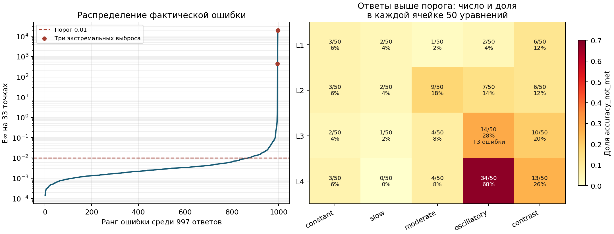

# Метод Ремизова: реализация, вычислительная стоимость и результаты на 1000 уравнениях

**Научно-технический отчёт. Дата анализа: 20 октября 2026 г.**

Объект — существующие реализации `remizov_solver.py`, `chernov_solver.py` и сохранённые эксперименты проекта `ode-generator-remizov`. Все численные результаты ниже получены в прежних сериях. При подготовке отчёта решатели не запускались: выполнены чтение кода, сверка файлов, пересчёт метрик по сохранённым массивам и построение рисунка. Численные методы, датасет и прежние результаты не изменялись.

## 1. Основные результаты и границы выводов

1. **Ускорение новой реализации подтверждено на четырёх сопоставляемых задачах**, по три повтора каждого варианта: `solve()` быстрее старого решателя в 1.30–34.63 раза при фактическом E∞≤0.01. Это совместный эффект фиксированной существенно меньшей пространственной сетки, другой квадратуры и отказа от повторных адаптивных расчётов, а также предварительного вычисления коэффициентов и геометрии сдвигов. Измерений с последовательным включением отдельных оптимизаций нет; распределить выигрыш в процентах между этими факторами нельзя. Для `solve_streaming()` получены 5.27–138.13 раза относительно старого решателя, но это **другая численная схема**, а не только способ хранения промежуточных значений.
2. В полной серии имеются **1000 терминальных записей: 997 конечных ответов, 871 с E∞≤0.01, 126 выше порога и 3 `worker_exception`**. Порог достигнут в 87.1% всех задач, или 87.36% задач с численным ответом. Из 126 превышений 113 не превышают 0.1, а три экстремальных значения — примерно 19704.5, 19134.4 и 444.6 — дают 99.9741% суммы ошибок всех 997 ответов. Группа L4/oscillatory наиболее проблемна: 34 превышения из 50. Это наблюдаемая зависимость, а не установленный механизм ошибки.
3. **Единую причину 126 превышений имеющиеся результаты не устанавливают.** Для этих задач сохранён один набор параметров, без независимых уточнений n, квадратуры, шага и окна. Большие промежуточные значения и обращения за рабочее окно требуют проверки, но встречаются и у ответов, достигших порога. Глобальные аналитические сертификаты исходного ОДУ не являются сертификатом устойчивости реализации с интерполяцией и внешним продолжением.
4. Для трёх `worker_exception` установлен уровень возникновения статуса: **старый контроллер увидел выход worker до появления файла результата и сам сформировал запись отказа**. Это не сохранённый Python traceback и не `failure_reason` метода. Конкретная причина выхода — сигнал, нативный сбой, внешнее завершение, память или иное — не восстанавливается из доступных журналов. Коды возврата и сигналы не записаны.

Ниже «подтверждено» означает факт кода, сохранённых массивов или журналов; «интерпретация» и «гипотеза» отмечаются отдельно. Полная причина погрешности и точный вклад отдельных оптимизаций не подменяются предположением.

## 2. Источники, версии и воспроизводимость

### 2.1. Проверенные первичные материалы

| Источник | Содержание и роль |
| --- | --- |
| [AGENTS.md](../../AGENTS.md), [PROJECT_STATUS.md](../../PROJECT_STATUS.md), [правила решателя](../../.claude/rules/remizov.md), [правила генератора](../../.claude/rules/generator.md), [experiment/SKILL.md](../../.claude/skills/experiment/SKILL.md) | Постановка, ограничения интерпретации метрик, порядок работы с экспериментами |
| [remizov_solver.py](../../remizov_solver.py) | Старая реализация с вложенным уточнением квадратуры и пространственной сетки |
| [chernov_solver.py](../../chernov_solver.py) | Действующие `ChernovSolver.solve()` и `solve_streaming()` |
| [comparison_inputs/Chern.py](../../comparison_inputs/Chern.py), [example.ipynb](../../comparison_inputs/example.ipynb) | Предоставленный исходный вариант и пример; активный массовый запуск использует адаптацию, а не эти файлы |
| [all_methods_dataset_loader.py](../../all_methods_dataset_loader.py), [all_methods_expressions.py](../../src/all_methods_expressions.py) | Сертификаты, вычисление коэффициентов, правой части и точного решения через безопасный AST |
| [chernov_integration_2026-10-18/final/summary.json](../chernov_integration_2026-10-18/final/summary.json), [comparison.json](../chernov_integration_2026-10-18/comparison.json), [controls.json](../chernov_integration_2026-10-18/controls.json) | Сравнение трёх вариантов, 36 финальных запусков, отдельные контрольные уточнения |
| [chernov_dataset20_2026-10-18/](../chernov_dataset20_2026-10-18/) | Проверка общих параметров обеих новых схем на малом наборе: 20/20 и 18/20 |
| [F0000_profile_analysis.json](../remizov_n4_followup_2026-10-12/F0000_profile_analysis.json) | Сохранённый частичный профиль старой реализации; новых измерений профилировщиком не проводилось |
| [production-датасет](../../data/all_methods_v1_1000_2026-10-18/), [метаданные](../../data/all_methods_v1_1000_2026-10-18/all_methods_equations_v1_metadata.jsonl) | 1000 задач, семейства, сложность, режим, глобальные сертификаты |
| [plan.json](../chernov_solve1000_2026-10-18/plan.json), [preflight.json](../chernov_solve1000_2026-10-18/preflight.json), [solutions/](../chernov_solve1000_2026-10-18/solutions/), [attempts/](../chernov_solve1000_2026-10-18/attempts/), [workers/](../chernov_solve1000_2026-10-18/workers/) | План, все итоговые записи, первичные попытки, состояния и журналы worker |
| [итог управляемого завершения](../chernov_managed_completion_2026-10-18/final/REPORT.md), [statistics.json](../chernov_managed_completion_2026-10-18/final/statistics.json) | Независимая прежняя сводка 1000 задач, параметры надзора и последние 300 задач |
| [архив старого контроллера](../chernov_batch_safety_2026-10-18/before/diagnostics/run_chernov_batch.py) | Версия, сформировавшая три исторических отказа; новый код не используется для ретроспективного объяснения старых событий |

Ссылки ведут к файлам относительно этого отчёта; диапазоны строк ниже относятся к проверенному снимку кода. SHA-256 источников и входных данных сохранены в [analysis/verification.json](analysis/verification.json). Ключевые значения:

| Источник | SHA-256 |
| --- | --- |
| `remizov_solver.py` | `a25af37adbb9d357047f52f04d19e6b439df253c114b64b86a83a6620f0b0754` |
| `chernov_solver.py` | `bb18147c01aefebbb248696533557e4e7d73355bf64ef39ca83dccd910404ae0` |
| `all_methods_dataset_loader.py` | `318245bd5822d9ac33b07833ad3472e13da0261654ae9f9ee9890eaf7cd71601` |
| `data/all_methods_v1_1000_2026-10-18/all_methods_equations_v1.csv` | `940d6c10a8cdd0933bb5c663c681efd39bac5ed450ea37cbb95be1ca481136ad` |
| `data/all_methods_v1_1000_2026-10-18/all_methods_equations_v1_metadata.jsonl` | `e464e289af2bf98dc1e6e49a1211ae2d5bf78838cee59b13c22df7bd01be0a79` |

Хеши действующих решателей и загрузчика совпадают с сохранёнными хешами финального сравнительного эксперимента и production-плана. Архивный `run_chernov_batch.py` совпадает с его хешем в исходном production-плане; текущий контроллер позднее менялся и для реконструкции старых отказов не подставлялся вместо архива.

У совпадающих ID в малом и полном наборах могут быть **разные выражения**. Для `AMV1_F0005_S00`, `AMV1_F0006_S00`, `AMV1_F0007_S00` проверено различие `expression_hash` между первым сравнением и production-набором. Их времена и ошибки из разных наборов нельзя объединять как повторные измерения одного уравнения.

### 2.2. Что проверено заново без решения ОДУ

Скрипт [analyze_remizov_saved_results.py](../../diagnostics/analyze_remizov_saved_results.py) проверил уникальность 1000 ID, идентичность `plan_sha256`, конфигурации и реализации, побайтовое совпадение каждой итоговой записи с её `attempts/.../result.json`. По массивам f и y_exact для всех 997 ответов заново вычислены абсолютная и относительная ошибки и классификация по порогу. Проверены конечность значений, сетка, счётчики и отсутствие сертификата полной ошибки. Для сравнения трёх вариантов сверены все 36 запусков; внутри каждого из трёх повторов численные массивы совпадают. Это проверка согласованности сохранённых артефактов, **не независимое повторное решение или новая аналитическая проверка y_exact**. Происхождение и аналитическая валидация датасета отражены в [предыдущих проверках набора](../dataset1000_2026-10-18/).

## 3. Математическая постановка и общий оператор

### 3.1. Задача на всей прямой

Коэффициенты датасета приведены к виду

\[
a(x)y''+b(x)y'+c(x)y=g(x),\qquad c=c_R-\lambda,\qquad g_R=-g.
\]

При

\[
Lu=a u''+b u'+c_Ru
\]

решается уравнение \((\lambda-L)y=g_R\) для ограниченного на всей \(\mathbb R\) решения. Начальные условия, присутствующие для других методов в датасете, здесь не задают искомое решение задачи Коши. В оператор Чернова входит именно **c_R**, а экспоненциальный множитель содержит λ.

Объект [RemizovProblem, строки 23–37](../../remizov_solver.py) передаёт функции коэффициентов и g_R, λ, глобальные границы a и b, C для \(\|c_R\|_\infty\), целевой интервал и признак сертификатов на всей прямой. Новая реализация импортирует общие проверки и `compute_truncation_T` из старого модуля ([chernov_solver.py, строки 20–23](../../chernov_solver.py)).

Точное решение является изготовленным эталоном датасета. Загрузчик строит правую часть из аналитического jet точного решения и коэффициентов ([all_methods_dataset_loader.py, строки 394–424](../../all_methods_dataset_loader.py)); это способ задания исходной задачи, а не подстановка значений y_exact в итерации решателя. В массовом драйвере сравнение результата с y_exact выполняется **после** вызова `solve()`; историческая версия — [строки 250–263](../chernov_batch_safety_2026-10-18/before/diagnostics/run_chernov_batch.py).

### 3.2. Аппроксимация Чернова

Обе реализации используют одну локальную формулу до пространственной интерполяции:

\[
\begin{aligned}
(S(\tau)u)(x)={}&\tfrac14u(x+2\sqrt{a(x)\tau})+
\tfrac14u(x-2\sqrt{a(x)\tau})\\
&+\tfrac12u(x+2b(x)\tau)+\tau c_R(x)u(x).
\end{aligned}
\]

См. [старый `_apply_operator_on_grid`, строки 350–410](../../remizov_solver.py) и [новый `_geometry`/`_apply`, строки 140–175](../../chernov_solver.py). Для гладкой u формальное разложение Тейлора даёт \(S(\tau)u=u+\tau Lu+O(\tau^2)\), если производные и коэффициенты позволяют оценить остаток. Это алгебраическое свойство формулы; **оно не доказывает универсальный порядок или константу полной ошибки конечной сеточной программы**.

Основной конечный интеграл двух `solve` имеет вид

\[
f_{n,T}=\int_0^T e^{-\lambda t}S(t/n)^n g_R\,dt.
\]

Переход от этого выражения к резольвенте на бесконечном интервале — математическая основа метода. В отчёте не приписывается всей дискретной реализации теорема с конкретным порядком сходимости: библиографический первоисточник и его точные условия в рамках этой проверки не верифицировались. Комментарии предоставленного `Chern.py` о теореме или ожидаемом ускорении сами по себе не являются измерением либо доказательством.

### 3.3. Усечение времени и смысл tail_eps

При \(\delta=\lambda-C>0\) общий код выбирает

\[
T=\max\left(0,\frac{\log2-\log\delta-\log(\mathtt{tail\_eps})}{\delta}\right).
\]

Источник — [compute_truncation_T, строки 229–245](../../remizov_solver.py). Для идеального непрерывного оператора положительные веса сдвигов дают \(\|S(\tau)\|\le1+C\tau\), откуда естественная оценка отброшенного хвоста имеет множитель

\[
\|g_R\|_\infty\frac{e^{-\delta T}}{\delta}.
\]

При положительном T выбранная формула делает этот множитель равным \(\|g_R\|_\infty\,\mathtt{tail\_eps}/2\). Норма g_R **не входит** в вычисление T. Следовательно, `tail_eps=1e-8` не означает абсолютную полную ошибку ≤1e-8 или ≤0.01. Кроме хвоста остаются конечное n, квадратура, интерполяция, окно и округление; для кубического интерполянта с продолжением за окно указанная операторная оценка автоматически не переносится.

## 4. Как устроены три реализации

### 4.1. Старая `solve_remizov()`

Последовательность вызовов:

```text
solve_remizov (remizov_solver.py:633–708)
  → проверки постановки, compute_truncation_T
  → _converge_spatial (:545–579), h, h/2, ...
      → _converge_quadrature (:501–542), Nt=8,16,32,...
          → _integrate_fixed_nt (:465–498), leggauss(Nt)
              → каждый узел t: _compute_chernoff_at_t (:413–462)
                  → g_R на расширенной исходной сетке
                  → n раз: новая сетка, _apply_operator_on_grid (:350–410)
                      → CubicSpline, коэффициенты/проверки, 4 интерполяции
```

Для контроля области зависимости берётся

\[
d=\max\{2\sqrt{a_{\rm upper}T/n},\;2BT/n\},
\quad I_j=[x_{\min}-(n-j)d,\;x_{\max}+(n-j)d].
\]

Здесь используется **T, а не текущий узел t**. Исходная сетка покрывает I₀; после каждого применения оператора интервал сужается, а на последнем шаге вычисление идёт прямо на целевой сетке. Код проверяет, что запросы попадают в исходную сетку; внешнее taper-продолжение здесь не вводится. Эта консервативная геометрия имеет вычислительную цену.

Квадратура — Gauss–Legendre. При удвоении Nt значения **всех** узлов вычисляются заново; узлы не вложенные, кэш прошлых интегралов/состояний не используется. При уменьшении h весь цикл квадратуры запускается снова. Разности двух приближений сравниваются с `atol+rtol*max|current|`. Эти разности — индикаторы сходимости по выбранным компонентам, а не сертификат общей ошибки. n при этом фиксировано: автоматического уточнения n нет.

### 4.2. Новая `ChernovSolver.solve()`

Последовательность вызовов:

```text
ChernovSolver(problem, config).solve(target_x) (chernov_solver.py:210–217)
  → _run (:223–310), общие проверки и T
  → одна фиксированная сетка, a,b,c_R,g_R на ней (:246–258)
  → t_j и _simpson_weights (:260–264)
  → каждый t_j: _at_t (:178–186)
      → один расчёт геометрии запросов для τ=t_j/n
      → n раз _apply (:145–175): новый сплайн и 3 сдвига
  → накопление взвешенного интеграла (:265–270)
  → финальная проекция на target_x (:294–300)
```

Рабочий интервал фиксирован:

\[
I=[x_{\min}-p,x_{\max}+p],\qquad M=\max(3,\lceil |I|/h\rceil)+1.
\]

Массивы коэффициентов и g_R готовятся на M точках при единственной подготовке, затем переиспользуются: `_evaluate_coefficients` и функция g_R вызываются по одному разу на вызов solve. Внутри функции g_R загрузчик дополнительно оценивает коэффициенты для изготовления правой части, поэтому это не утверждение о ровно одном обходе AST каждого коэффициента за весь вызов. Для данного t геометрия сдвигов вычисляется один раз и используется n раз. Значение u(x) в потенциальном члене уже есть в векторе, поэтому четвёртая векторная интерполяция старого кода не нужна.

**Что не кэшируется:** коэффициенты CubicSpline для изменяющегося u. Новый сплайн строится при каждом применении S. Неверно объяснять ускорение «единственным сплайном на весь расчёт». Переиспользуются массивы коэффициентов ОДУ, g_R и геометрии запросов, но не меняющиеся состояния и не готовые сплайны между итерациями.

Загрузчик оценивает коэффициенты через безопасное дерево выражений. Более того, [evaluate_expression, строки 577–588](../../src/all_methods_expressions.py) обращается к `evaluate_jet2(...).value`: цена вычисления функции не сводится к одному NumPy-сложению. Устранение повторных обходов AST подтверждается кодом; отдельный коэффициент ускорения именно от этого изменения не измерен.

#### Квадратура новой схемы

В production m=513, узлы \(t_j=T(j/(m-1))^2\). На каждой паре промежутков с \(h_0=t_{2i+1}-t_{2i}\), \(h_1=t_{2i+2}-t_{2i+1}\), \(H=h_0+h_1\) используются веса

\[
w_0=\frac H6(2-h_1/h_0),\quad
w_1=\frac {H^3}{6h_0h_1},\quad
w_2=\frac H6(2-h_0/h_1).
\]

Источник — [_simpson_weights, строки 125–137](../../chernov_solver.py). Это составной Simpson на неравномерной сетке; веса соседних панелей суммируются. На первой панели квадратичной сетки h₁=3h₀ и первый вес **отрицателен**, \(w_0=-2h_0/3\). Нельзя переносить свойства положительной квадратуры Gauss или без оговорок заявлять стандартную оценку Simpson для равномерной сетки. Сам знак веса не доказывает причину какого-либо выброса.

Для t=0 возвращается g_R без S, остальные m−1 узлов требуют n применений: \(N_S=(m-1)n\). Интеграл накапливается сразу, без хранения таблицы m×M. Старый решатель также накапливает интеграл, а не сохраняет все состояния всех узлов: экономия такой таблицы относительно исходного предоставленного Chern не является доказанным главным отличием от `remizov_solver.py`.

#### Внешнее продолжение и изменение численной задачи

Внутри окна используется CubicSpline. Для запроса на расстоянии d за край окна при `boundary='taper'` код берёт линейное продолжение по значению и производной сплайна на краю, умноженное на

\[
s^2(3-2s),\qquad s=\operatorname{clip}(1-d/w,0,1).
\]

См. [строки 154–169](../../chernov_solver.py). Это применяется **к каждому промежуточному состоянию u**, не только к исходному g_R. В production w=0.1·26=2.6. При `boundary='zero'` внешнее значение обнуляется. Такое продолжение и фиксированное окно изменяют пространственную дискретизацию; их нельзя считать лишь программной оптимизацией старой реализации.

### 4.3. `solve_streaming()` — отдельная схема

См. [строки 219–221 и 279–289](../../chernov_solver.py). Для чётного K (`n_steps`) берётся постоянное \(\tau=T/K\):

\[
u_0=g_R,\quad u_{k+1}=S(\tau)u_k,\qquad
f^{\rm str}_{K,T}=\frac\tau3\sum_{k=0}^K\omega_k e^{-\lambda k\tau}u_k,
\]

где веса ω — 1,4,2,…,4,1. Требуется K применений S вместо независимых n-шаговых цепочек в узлах t. Для \(t=k\tau\) здесь \(u_k=S(\tau)^kg_R\), тогда как в `solve()` — \(S(t/n)^ng_R\). Поэтому это разные конечные аппроксимации. В streaming параметры n, num_t, t_grading не управляют цепочкой; её точность нельзя обсуждать только по n. Изменение T при фиксированном K меняет и τ.

В массовой серии 1000 использовался только **`solve()`**. Сохранённое `n_steps=32768` в общей конфигурации на этот расчёт не влияет. Результаты streaming на 1000 отсутствуют. На малом наборе единая конфигурация дала solve 20/20, streaming 18/20 по порогу; эти данные не подтверждают готовность streaming ко всем production-задачам.

### 4.4. Изменения алгоритма и программные оптимизации

| Изменение | Тип | Подтверждённый эффект и ограничение |
| --- | --- | --- |
| Расширенная сужающаяся область → фиксированное окно+taper | Численная дискретизация | Меньше точек, но появляется отдельная ошибка окна/продолжения |
| Адаптивный Gauss с повторными расчётами → заданный Simpson на квадратичных узлах | Квадратура и политика бюджета | Исчезают полные повторные интегрирования; точность заранее не контролируется |
| Уточнение h по индикатору → единственный заданный h | Политика точности/бюджета | Меньше работы, отсутствует независимая проверка пространственной ошибки в каждом ответе |
| Кэш a,b,c_R,g_R на фиксированной сетке | Программная оптимизация на новой геометрии | Устранены повторные вычисления AST и проверки на каждом S |
| Геометрия запросов один раз на узел t | Программная оптимизация | Корни и сдвиги не повторяются n раз при неизменном τ |
| Прямой доступ к u(x), 3 векторные интерполяции вместо 4 | Программная оптимизация на фиксированной сетке | Снижение работы одного S; сплайн всё равно строится заново |
| Одна цепочка streaming | Изменение численной схемы | K применений вместо (m−1)n, но другой дискретный интеграл |
| Параллельные worker | Организация вычислений | В финальном сравнении n_jobs=1; ускорение таблицы ниже не получено увеличением числа ядер |

Исходный [Chern.py, строки 146–155](../../comparison_inputs/Chern.py) также предварительно считает коэффициенты, но использует собственные настройки и сеточную оценку c_sup по умолчанию. Адаптация сохраняет аналитические сертификаты проекта и общий выбор T. Поэтому свойства предоставленного прототипа и действующего `chernov_solver.py` необходимо различать.

## 5. Оценка вычислительной работы

Обозначим ширину целевого интервала L, шаг h, размер фиксированной сетки M. Для старой геометрии размер исходной сетки уровня j приблизительно

\[
M_j\simeq 1+\frac{L+2(n-j)d}{h}.
\]

Суммарный объём построения сплайнов на одном узле t имеет геометрическую оценку

\[
\sum_{j=0}^{n-1}M_j\simeq n(1+L/h)+n(n+1)d/h.
\]

Если построение локального кубического сплайна и векторную обработку считать приблизительно линейными по числу точек, основной масштаб старого расчёта —

\[
W_{\rm old}\sim\sum_{\text{уровни }h}\sum_{\text{уровни }N_t}
N_t\left(nL/h+n^2d/h\right),
\]

с дополнительной ценой AST, проверок, создания сеток и `leggauss`. Это **модель объёма работы**, не доказанная точная формула времени: поиск интервалов интерполяции, распределение размеров, реализация SciPy и выделения памяти влияют на константы и масштабирование. Для фиксированного T диффузионный d∼n⁻¹ᐟ² даёт геометрический член n³ᐟ²/h; при доминировании дрейфа d∼n⁻¹ — n/h. Общий бюджет также зависит от числа адаптивных уровней.

Для нового последовательного `solve()`:

\[
W_{\rm new}\sim (m-1)nM,\qquad N_{\rm spline}=(m-1)n+1,
\]

плюс однократное вычисление входных массивов и геометрия каждого узла. Для streaming — примерно KM и K+1 сплайнов. Рабочая память обеих новых схем при n_jobs=1 — O(M) для фиксированного числа векторов; старый метод хранит текущую исходную/целевую сетку и узлы квадратуры, порядка O(M_max+Nt), без учёта внутренних буферов библиотек. Пиковая память не обязана быть пропорциональна суммарному числу S.

**Операции S не являются равными единицами CPU-стоимости:** старые S обрабатывают меняющиеся, часто существенно большие сетки и заново вычисляют функции. Счётчик `spatial_grid_points_total_processed` старого решателя ([строки 66–74, 361](../../remizov_solver.py)) учитывает точки назначения, а не весь объём исходных сеток сплайнов. Его нельзя выдавать за точное число арифметических операций. В отчёте приводятся реальные счётчики и оценки, а не вымышленные FLOP.

## 6. Измеренное ускорение и его объяснение

### 6.1. Протокол сравнения

Источник — [36 сохранённых финальных запусков](../chernov_integration_2026-10-18/final/summary.json). Каждая из четырёх задач решалась тремя способами по три раза в отдельных последовательных процессах, n_jobs=1 и BLAS-потоки=1. Используется медиана `runtime_seconds` самого решателя, включающая его подготовку и конечную проекцию, но не запуск Python и загрузку всего датасета. Окружение: Python 3.10.11, NumPy 2.2.6, SciPy 1.15.3, SymPy 1.14.0, macOS arm64. R1 проверялся на 257 точках [−2,2], задачи малого датасета — на 33 точках [−1,1].

Старая конфигурация: `nt_initial=8`, `dx_initial=.05`, rtol квадратуры/пространства=1e-3, atol=1e-6, максимум уточнений 7/4, `max_work_grid_points=200000`, `tail_eps=1e-8`. Это **не** строгие значения по умолчанию rtol=1e-7, atol=1e-9.

Новая конфигурация: `num_t=257`, quadratic, `dx=.025`, `padding=8`, cubic/taper, `taper_width=null` (автоматически 10% окна), `n_jobs=1`, `tail_eps=1e-8`, `max_work_grid_points=100000`. n одинаково у старого и нового solve для каждой задачи; K streaming выбран отдельно. Предшествующий подбор бюджетов и попытки сохранены в [selection.json](../chernov_integration_2026-10-18/selection.json), [планах](../chernov_integration_2026-10-18/final_plan.json) и [all_attempts.csv](../chernov_integration_2026-10-18/all_attempts.csv). Это подобранные четыре успешных случая, а не непредвзятая оценка ускорения на всей тысяче.

### 6.2. Время и фактическая ошибка

F0005/F0006/F0007 в этой таблице обозначают **малый набор**, полный префикс ID — `AMV1_`, суффикс — `_S00`. Ускорение — медиана времени старого решателя, делённая на медиану нового.

| Задача | Метод | Параметр цепочки | E∞ | Медиана, с | Ускорение |
| --- | --- | --- | --- | --- | --- |
| R1 | remizov | n=8 | 0.0094915471 | 0.347756 | 1× |
| R1 | solve | n=8 | 0.0094916331 | 0.267609 | 1.2995× |
| R1 | streaming | K=512 | 0.0099016088 | 0.0659493 | 5.2731× |
| F0005 | remizov | n=32 | 0.0078100829 | 5.79227 | 1× |
| F0005 | solve | n=32 | 0.0078252601 | 1.03667 | 5.5874× |
| F0005 | streaming | K=8192 | 0.0094436607 | 1.05647 | 5.4827× |
| F0006 | remizov | n=64 | 0.0054659576 | 10.841 | 1× |
| F0006 | solve | n=64 | 0.0053555276 | 2.11534 | 5.1249× |
| F0006 | streaming | K=4096 | 0.0040273818 | 0.533315 | 20.328× |
| F0007 | remizov | n=32 | 0.0064627379 | 39.328 | 1× |
| F0007 | solve | n=32 | 0.0064570442 | 1.13569 | 34.629× |
| F0007 | streaming | K=2048 | 0.00729074 | 0.284726 | 138.13× |

Все 12 комбинаций задача/метод достигли порога; массивы внутри трёх повторов совпали. Диапазоны времени повторов и ссылки на индивидуальные JSON находятся в [analysis.json, comparison](analysis/analysis.json). Например, F0007: старый 39.141–39.737 с, новый solve 1.110–1.149 с. Совпадение времени не требуется для сравнения, но согласованность повторов подтверждает устойчивость наблюдаемого большого выигрыша на этой задаче.

### 6.3. Счётчики, объясняющие неодинаковое ускорение

| Задача | Q_old | final_Nt old | S old | S solve | S streaming | M_peak old | M new | h old |
| --- | --- | --- | --- | --- | --- | --- | --- | --- |
| R1 | 240 | 64 | 1920 | 2048 | 512 | 2140 | 801 | 0.05, 0.025 |
| F0005 | 496 | 128 | 15872 | 8192 | 8192 | 6256 | 721 | 0.05, 0.025 |
| F0006 | 240 | 64 | 15360 | 16384 | 4096 | 6136 | 721 | 0.05, 0.025 |
| F0007 | 1512 | 256 | 48384 | 8192 | 2048 | 9633 | 721 | 0.05, 0.025, 0.0125 |

`Q_old` — сумма **всех** узлов на всех уровнях квадратуры и h, а не final_Nt. Новые 257 узлов включают t=0 без S. Пиковые сетки старого метода — реально сохранённые значения; M новой сетки постоянно в пределах одной задачи. Количество сплайнов: старый — N_S, новый — N_S+1.

Для F0007 старый метод прошёл Nt=8,16,32,64,128,256 на каждом из трёх h=.05,.025,.0125: Q_old=3·504=1512. Новый solve использовал 256 ненулевых узлов и одну сетку. Здесь уменьшаются и число цепочек, и размер сетки, и цена шага. Для F0006 новый solve сделал **16384 S против 15360**, но оказался быстрее в 5.12 раза: объяснение только уменьшением числа S противоречит данным. Код указывает на меньшую сетку и устранённую повторную подготовку каждого S. На R1, где размеры и бюджеты скромнее, выигрыш только 1.30 раза.

Дополнительный сопоставимый счётчик — число значений, запрашиваемых при основных векторных интерполяциях внутри S. Для старого метода оно сохранено как `n_interpolated_values` (четыре вектора на S); для нового вычисляется из кода как 3·N_S·M. Здесь не учитываются отдельные запросы производной на краях taper и конечная проекция, поэтому это не число всех вызовов SciPy или точная стоимость.

| Задача | Старый, значений | Новый solve, значений | Отношение old/new |
| --- | ---: | ---: | ---: |
| R1 | 6048480 | 4921344 | 1.229 |
| F0005 | 146251552 | 17719296 | 8.254 |
| F0006 | 141060480 | 35438592 | 3.980 |
| F0007 | 535852800 | 17719296 | 30.241 |

Эти числа показывают, почему близкое число S может означать резко разный объём обработки сеток. Они не учитывают отдельную экономию вычислений AST, стоимость построения сплайнов и прочие накладные расходы.

### 6.4. Сохранённый профиль старой реализации

Для F0000 при n=4 в прежней серии сохранён частичный профиль, прерванный 45-секундным watchdog; активное время решателя около 44.617 с. Параметры строже сравнительных: квадратура 1e-7/1e-9, бюджет уточнений 8/5. Источники — [профиль и разбор](../remizov_n4_followup_2026-10-12/F0000_profile_analysis.json), [profile_top.txt](../remizov_n4_followup_2026-10-12/F0000_n4_profile/profile_top.txt).

| Операция | Вызовов | Cumulative, с |
| --- | --- | --- |
| Применение S, включая вложенные операции | 80157 | 34.709 |
| Построение CubicSpline | 80157 | 9.7785 |
| Вызовы сплайна | 320624 | 9.15443 |
| Коэффициенты и проверка сертификатов внутри S | 80157 | 9.29527 |
| Проверка границ сдвигов внутри S | 80157 | 2.9129 |
| Forcing g_R на исходной сетке | 20040 | 5.24269 |
| Построение рабочих сеток | 80158 | 0.883955 |
| Построение узлов Gauss–Legendre | 45 | 2.53988 |

Время cumulative включает вложенные вызовы; **строки нельзя суммировать**. Частичный профиль не является решением, профилирование и контроль добавляют накладные расходы, величина которых отдельно не измерена. Тем не менее он прямо подтверждает многократные дорогие действия, устранённые или сокращённые новой организацией вычислений. Нельзя переносить его доли времени на все уравнения или приписывать каждому фактору фиксированную долю ускорения.

### 6.5. Контроль точности и предел обобщения

В [controls.json](../chernov_integration_2026-10-18/controls.json) для четырёх задач сохранены отдельные уточнения. Для нового solve максимальные изменения ответа: при dx/2 — около 7.24·10⁻⁵, при удвоении padding — 9.37·10⁻¹⁰, при уточнении временной сетки — 3.16·10⁻⁵, при уточнении tail_eps — 3.46·10⁻⁵. Это наблюдаемые разности, не строгие границы полной ошибки. При удвоении padding автоматически менялась и ширина taper; такой контроль не изолирует только размер окна. Изменение tail_eps меняет T и узлы квадратуры, а для streaming с фиксированным K ещё и τ; в серии были отдельные [контроли с сохранением приблизительно того же τ](../chernov_integration_2026-10-18/tail_fixed_tau_plan.json).

**Эти уточнения не выполнялись для 126 production-превышений.** Нет сопоставимого прогона старого решателя на всех 1000 с n=128, нет измеренного универсального коэффициента ускорения, нет раздельного теста каждого изменения при одинаковой дискретизации. Корректная формулировка для научной работы: ускорение наблюдается у **сочетания иной дискретизации, бюджета и организации вычислений** при сопоставимой достигнутой точности на четырёх сохранённых задачах.

## 7. Полная серия: протокол и распределение ошибок

### 7.1. Единые параметры и учёт результатов

Полный набор содержит 200 семейств по 5 уравнений, по 250 задач каждого L1–L4, по 200 каждого режима; в каждой паре сложность/режим по 50. Разделение по семействам: train=700, validation=150, test=150. Анализ использует метки датасета; сложность не подменяется независимо измеренной численной обусловленностью.

Одна заранее зафиксированная конфигурация [plan.json](../chernov_solve1000_2026-10-18/plan.json):

```json
{"n":128,"num_t":513,"t_grading":"quadratic","dx":0.0125,
 "padding":12.0,"T":null,"tail_eps":1e-8,"interp":"cubic",
 "boundary":"taper","taper_width":null,"n_jobs":1,
 "start_method":"spawn","max_work_grid_points":100000,"n_steps":32768}
```

Для всех 997 возвратов подтверждены рабочее окно [−13,13], M=2081, фактический h=.0125, 513 узлов, 65536 применений S и 65537 построений сплайна. T различается по глобальным сертификатам, а не выбирается по y_exact. Точное решение используется для итоговой оценки. `n_steps` здесь неактивен.

Метрика

\[
E_\infty^{(33)}=\max_{x\in\{-1,-15/16,\ldots,1\}}|f(x)-y_{\rm exact}(x)|
\]

является максимумом на **33 фиксированных точках**, не доказанной супремум-нормой по непрерывному интервалу или всей прямой. В таблицах для краткости используется E∞. Относительная ошибка — E∞/max|y_exact| на этой же сетке.

Во всех конечных возвратах `success=true`, `refinement_controls_performed=false`, `total_error_certified=false`. `accuracy_not_met` формируется оболочкой после сравнения с эталоном. Даже экстремальный, но конечный ответ не вызывает отказ `nonfinite_state` и остаётся вычислительным success.

### 7.2. Общая статистика

| Исход | Число | Доля всех 1000 |
| --- | ---: | ---: |
| E∞≤0.01 | 871 | 87.1% |
| Конечный ответ, E∞>0.01 | 126 | 12.6% |
| `worker_exception`, численного ответа нет | 3 | 0.3% |
| Ожидают расчёта | 0 | 0% |

| Статистика (997 ответов) | Абсолютная E∞ | Относительная ошибка |
| --- | --- | --- |
| Минимум | 0.000137418537 | 0.000226813598 |
| Медиана | 0.00274796941 | 0.00261950816 |
| Среднее | 39.411918 | 36.5326981 |
| p90 | 0.0126056099 | 0.0124128854 |
| p95 | 0.0227065806 | 0.0245237963 |
| p99 | 0.146221917 | 0.195591826 |
| Максимум | 19704.5019 | 21039.5009 |

Средняя ошибка 39.4119 почти полностью определяется тремя выбросами. После их исключения остаются 994 ответа со средней .0102474, медианой .00272269, максимумом 2.24644. Исключение показано только для описания тяжёлого хвоста; исходный итог 871/126/3 и полная средняя не заменяются очищенной статистикой. Три выброса не связаны просто с малой нормой точного решения: их max|y_exact| около 0.91–1.31, относительные ошибки также огромны.

| Интервал E∞ | Количество |
| --- | --- |
| <=0.001 | 121 |
| (0.001,0.01] | 750 |
| (0.01,0.02] | 68 |
| (0.02,0.1] | 45 |
| (0.1,1] | 9 |
| (1,10] | 1 |
| >10 | 3 |

Среди 126 превышений 68 лежат между .01 и .02, ещё 45 — между .02 и .1. Таким образом, 113/126 имеют E∞≤.1; 13 превышают .1, из них 3 превышают 10. Одной причиной объяснять близкие к порогу ответы и катастрофические выбросы без проверки нельзя.



**Рисунок 1.** Слева ошибки отсортированы, логарифмическая ось; справа число конечных ответов выше порога делится на все 50 задач ячейки. Три отсутствующих ответа отдельно отмечены в L3/oscillatory и не включены в число превышений.

Сокращения на рисунке и в тексте: slow = `slow_varying`, moderate = `moderate_varying`, contrast = `high_contrast`; полные метки сохранены в таблицах и CSV.

### 7.3. Сложность и режим

| Сложность | Всего | ≤.01 | >.01 | Ошибка worker | Достигли / все | Медиана E∞ | Максимум E∞ |
| --- | --- | --- | --- | --- | --- | --- | --- |
| L1 | 250 | 236 | 14 | 0 | 94.4% | 0.00207457 | 0.053472777 |
| L2 | 250 | 223 | 27 | 0 | 89.2% | 0.00296928 | 0.093851849 |
| L3 | 250 | 216 | 31 | 3 | 86.4% | 0.00297094 | 19704.502 |
| L4 | 250 | 196 | 54 | 0 | 78.4% | 0.00338877 | 19134.405 |

| Режим | Всего | ≤.01 | >.01 | Ошибка worker | Достигли / все | Медиана E∞ | Максимум E∞ |
| --- | --- | --- | --- | --- | --- | --- | --- |
| constant | 200 | 189 | 11 | 0 | 94.5% | 0.00249957 | 0.3401519 |
| high_contrast | 200 | 165 | 35 | 0 | 82.5% | 0.00374173 | 19704.502 |
| moderate_varying | 200 | 182 | 18 | 0 | 91% | 0.0028337 | 0.093851849 |
| oscillatory | 200 | 140 | 57 | 3 | 70% | 0.00441928 | 19134.405 |
| slow_varying | 200 | 195 | 5 | 0 | 97.5% | 0.0014621 | 0.081980594 |

По сложности доля достигших порога снижается от 94.4% у L1 до 78.4% у L4. У L3 три отсутствующих ответа: из 247 конечных 216 достигли порога. По режимам oscillatory имеет 57 превышений и 3 отказа; high_contrast — 35 превышений. В совокупности эти два режима дают 92/126=73.0% превышений. Однако частоты не показывают, какой именно компонент дискретизации создаёт ошибку.

| Сложность/режим | Всего | ≤.01 | >.01 | Ошибка worker | Достигли / все | Медиана E∞ | Максимум E∞ |
| --- | --- | --- | --- | --- | --- | --- | --- |
| L1/constant | 50 | 47 | 3 | 0 | 94% | 0.00182176 | 0.053472777 |
| L1/high_contrast | 50 | 44 | 6 | 0 | 88% | 0.00310582 | 0.049555225 |
| L1/moderate_varying | 50 | 49 | 1 | 0 | 98% | 0.00214107 | 0.010487589 |
| L1/oscillatory | 50 | 48 | 2 | 0 | 96% | 0.00216975 | 0.014560816 |
| L1/slow_varying | 50 | 48 | 2 | 0 | 96% | 0.00135729 | 0.022634339 |
| L2/constant | 50 | 47 | 3 | 0 | 94% | 0.00321072 | 0.068011073 |
| L2/high_contrast | 50 | 44 | 6 | 0 | 88% | 0.00323375 | 0.019644355 |
| L2/moderate_varying | 50 | 41 | 9 | 0 | 82% | 0.00338962 | 0.093851849 |
| L2/oscillatory | 50 | 43 | 7 | 0 | 86% | 0.00329044 | 0.06277764 |
| L2/slow_varying | 50 | 48 | 2 | 0 | 96% | 0.00173725 | 0.081980594 |
| L3/constant | 50 | 48 | 2 | 0 | 96% | 0.00285255 | 0.026040919 |
| L3/high_contrast | 50 | 40 | 10 | 0 | 80% | 0.00364409 | 19704.502 |
| L3/moderate_varying | 50 | 46 | 4 | 0 | 92% | 0.00286309 | 0.024589329 |
| L3/oscillatory | 50 | 33 | 14 | 3 | 66% | 0.00532223 | 0.04308879 |
| L3/slow_varying | 50 | 49 | 1 | 0 | 98% | 0.00141075 | 0.017783508 |
| L4/constant | 50 | 47 | 3 | 0 | 94% | 0.00232913 | 0.3401519 |
| L4/high_contrast | 50 | 37 | 13 | 0 | 74% | 0.00467864 | 0.032331586 |
| L4/moderate_varying | 50 | 46 | 4 | 0 | 92% | 0.00334917 | 0.04358343 |
| L4/oscillatory | 50 | 16 | 34 | 0 | 32% | 0.0186801 | 19134.405 |
| L4/slow_varying | 50 | 50 | 0 | 0 | 100% | 0.00149841 | 0.007462746 |

Наиболее выраженная ячейка L4/oscillatory: 34/50=68% выше порога, медиана .0186801. Контрпример обобщению «все сложные задачи не решаются»: L4/slow — 50/50 достигли порога. В выборке по пять родственных уравнений на семейство; отдельные строки не следует автоматически считать независимыми наблюдениями для статистического вывода о причинах.

| Split | Всего | ≤.01 | >.01 | Ошибка worker | Достигли / все | Медиана E∞ | Максимум E∞ |
| --- | --- | --- | --- | --- | --- | --- | --- |
| test | 150 | 134 | 16 | 0 | 89.33% | 0.0022412 | 19134.405 |
| train | 700 | 605 | 92 | 3 | 86.43% | 0.0028005 | 19704.502 |
| validation | 150 | 132 | 18 | 0 | 88% | 0.00286468 | 0.59685155 |

Разделение train/validation/test приводится как описание уже существующего набора. ML не обучалась. Средние ошибки по split особенно чувствительны к распределению трёх выбросов; сравнение медиан устойчивее, но не заменяет анализа причин.

### 7.4. Время массовой серии и ограничения его сравнения

По 997 ответам сохранённое время решателя: минимум 13.295 с, медиана 17.040 с, среднее 16.671 с, p90=18.742 с, p95=19.143 с, p99=20.083 с, максимум 22.426 с. Сумма времён решателей 16620.740 с — **не длительность серии по часам**, поскольку первая часть исполнялась с внешними параллельными worker. Это смешанные условия нагрузки; сравнивать их как чистое масштабирование метода нельзя.

Последние 300 задач выполнены управляемой последовательной серией: 15 партий по 20, 14 пауз суммарно 845.484 с, полная длительность 5292.375 с (88.21 мин); среднее время их решателя 14.458 с. Во всех 2572 сэмплах macOS thermalState=nominal, наблюдался максимум один вычислительный worker, CPU до 100.2% одного ядра, RSS до 179.5 МиБ. Температура в °C не измерялась. Источник — [statistics.json](../chernov_managed_completion_2026-10-18/final/statistics.json) и [verification.json](../chernov_managed_completion_2026-10-18/final/verification.json).

Разница времени между ранней и поздней частями зависит от внешней конкуренции и набора задач; она не является отдельным доказательством ускорения численного алгоритма. Контроллер, guardian, lease и паузы обеспечивают безопасность выполнения, а не повышают точность численного ответа.

## 8. Что известно о 126 превышениях

### 8.1. Наиболее крупные ошибки

| ID | L/режим | E∞ | Относительная | T | boundary max |
| --- | --- | --- | --- | --- | --- |
| [AMV1_F0141_S00](../chernov_solve1000_2026-10-18/solutions/AMV1_F0141_S00.json) | L3/high_contrast | 19704.50191 | 15015.27 | 19.44927 | 1.7358e+45 |
| [AMV1_F0180_S04](../chernov_solve1000_2026-10-18/solutions/AMV1_F0180_S04.json) | L4/oscillatory | 19134.40519 | 21039.5 | 18.69224 | 4.9334e+37 |
| [AMV1_F0184_S01](../chernov_solve1000_2026-10-18/solutions/AMV1_F0184_S01.json) | L4/oscillatory | 444.5892546 | 358.621 | 14.31677 | 2.7675e+31 |
| [AMV1_F0186_S02](../chernov_solve1000_2026-10-18/solutions/AMV1_F0186_S02.json) | L4/oscillatory | 2.246444158 | 1.612353 | 36.42782 | 7.7971e+16 |
| [AMV1_F0182_S02](../chernov_solve1000_2026-10-18/solutions/AMV1_F0182_S02.json) | L4/oscillatory | 0.5968515482 | 0.4069777 | 32.75446 | 3.7621e+11 |
| [AMV1_F0180_S00](../chernov_solve1000_2026-10-18/solutions/AMV1_F0180_S00.json) | L4/oscillatory | 0.4153864482 | 0.3275276 | 64.77935 | 3.8934e+07 |
| [AMV1_F0155_S02](../chernov_solve1000_2026-10-18/solutions/AMV1_F0155_S02.json) | L4/constant | 0.3401518994 | 0.5190153 | 99.59022 | 1203 |
| [AMV1_F0186_S01](../chernov_solve1000_2026-10-18/solutions/AMV1_F0186_S01.json) | L4/oscillatory | 0.3093512628 | 0.2167252 | 15.90126 | 5.1585e+05 |
| [AMV1_F0189_S02](../chernov_solve1000_2026-10-18/solutions/AMV1_F0189_S02.json) | L4/oscillatory | 0.24052931 | 0.1953941 | 35.39618 | 5.0988e+24 |
| [AMV1_F0181_S01](../chernov_solve1000_2026-10-18/solutions/AMV1_F0181_S01.json) | L4/oscillatory | 0.227611122 | 0.2003363 | 45.82986 | 5.0769e+17 |
| [AMV1_F0186_S00](../chernov_solve1000_2026-10-18/solutions/AMV1_F0186_S00.json) | L4/oscillatory | 0.1428306997 | 0.1345707 | 35.33496 | 14516 |
| [AMV1_F0184_S04](../chernov_solve1000_2026-10-18/solutions/AMV1_F0184_S04.json) | L4/oscillatory | 0.1411008138 | 0.2286823 | 44.42553 | 2.4531e+05 |
| [AMV1_F0185_S00](../chernov_solve1000_2026-10-18/solutions/AMV1_F0185_S00.json) | L4/oscillatory | 0.1019921787 | 0.08931939 | 31.88025 | 0.027673 |
| [AMV1_F0070_S04](../chernov_solve1000_2026-10-18/solutions/AMV1_F0070_S04.json) | L2/moderate_varying | 0.09385184933 | 0.07486042 | 102.7332 | 4.9734e+36 |
| [AMV1_F0189_S03](../chernov_solve1000_2026-10-18/solutions/AMV1_F0189_S03.json) | L4/oscillatory | 0.08479559347 | 0.0813117 | 26.73958 | 5.8952 |

Полные 20 строк — [outliers_top20.csv](analysis/outliers_top20.csv); все 126 — [accuracy_not_met_126.csv](analysis/accuracy_not_met_126.csv). ID в таблице кликабельны и ведут к первичному JSON.

`boundary_state_max_abs` — максимум модулей значений **невзвешенного** u на двух краях рабочей сетки, снимаемый перед S, дополненный краями конечного интеграла ([chernov_solver.py, строки 148 и 290–291](../../chernov_solver.py)). Время t и номер шага, на которых найден максимум, не сохранены. Не сохранена и величина производной на границе, хотя taper её использует. Экспонента e⁻λt умножает цепочку только в конце `_at_t` (строка 186). Поэтому огромный boundary не равен огромной ошибке в целевом интервале и его нельзя корректно «взвесить» просто умножением на e⁻λT: максимум мог возникнуть при другом t.

Для трёх наибольших ошибок:

| ID | max\|y_exact\| | max\|f\| | x максимальной ошибки на целевой сетке | Поддержка исходной правой части по метаданным |
| --- | ---: | ---: | ---: | --- |
| AMV1_F0141_S00 | 1.31230 | 19704.86695 | −1 | [−2.21891, 2.69885] |
| AMV1_F0180_S04 | .90945 | 19134.64664 | .9375 | [−3.10112, 2.84360] |
| AMV1_F0184_S01 | 1.23972 | 444.69844 | 1 | [−1.80386, 1.60928] |

Точки ±1 — края **целевого интервала**, а не рабочей сетки с краями ±13. Первоначальная поддержка находится внутри рабочего окна, но последующие S переносят значения: из компактности исходной правой части не следует нулевое промежуточное состояние за окном.

Три выброса имеют T≈19.45,18.69,14.32 и положительные δ≈.984,1.021,1.316. Это не задачи с максимальным T или минимальным gap. Сводить выбросы к «слишком длинному интегрированию» либо «почти нулевому λ−C» имеющиеся значения не позволяют.

### 8.2. Проверка простых объяснений на сохранённых контрпримерах

| Признак | 871 достигший порога | 126 выше порога |
| --- | ---: | ---: |
| Ненулевое число внешних запросов | 871 | 126 |
| boundary>1 | 521 | 102 |
| boundary>10²⁰ | 43 | 20 |
| Медиана boundary | 12.041 | 57887.165 |
| Максимум boundary | 1.859·10⁶³ | 2.506·10⁷⁷ |
| Медиана T | 21.338 | 29.178 |
| Медиана λ−C | .90068 | .66886 |

Данные — [analysis.json, feature_summaries](analysis/analysis.json). Ошибки чаще сопровождаются большим boundary и меньшим gap, но ни один из этих признаков не является достаточным объяснением. В частности, десятки ответов с boundary>10²⁰ достигли порога.

Внутрисемейные примеры особенно показательны:

| ID | E∞ | T | boundary max |
| --- | --- | --- | --- |
| [AMV1_F0141_S00](../chernov_solve1000_2026-10-18/solutions/AMV1_F0141_S00.json) | 19704.502 | 19.4493 | 1.7358e+45 |
| [AMV1_F0141_S01](../chernov_solve1000_2026-10-18/solutions/AMV1_F0141_S01.json) | 0.0038767988 | 21.0611 | 9.5842e+11 |
| [AMV1_F0141_S02](../chernov_solve1000_2026-10-18/solutions/AMV1_F0141_S02.json) | 0.001767834 | 11.5984 | 165.76 |
| [AMV1_F0141_S03](../chernov_solve1000_2026-10-18/solutions/AMV1_F0141_S03.json) | 0.0040646342 | 38.5668 | 5.3996 |
| [AMV1_F0141_S04](../chernov_solve1000_2026-10-18/solutions/AMV1_F0141_S04.json) | 0.0070063432 | 50.4067 | 6.9475e+17 |
| [AMV1_F0180_S00](../chernov_solve1000_2026-10-18/solutions/AMV1_F0180_S00.json) | 0.41538645 | 64.7794 | 3.8934e+07 |
| [AMV1_F0180_S01](../chernov_solve1000_2026-10-18/solutions/AMV1_F0180_S01.json) | 0.062137514 | 51.8931 | 2.5234e+16 |
| [AMV1_F0180_S02](../chernov_solve1000_2026-10-18/solutions/AMV1_F0180_S02.json) | 0.033100892 | 35.3726 | 3.7624e+08 |
| [AMV1_F0180_S03](../chernov_solve1000_2026-10-18/solutions/AMV1_F0180_S03.json) | 0.0071826603 | 77.4322 | 1.3111e+27 |
| [AMV1_F0180_S04](../chernov_solve1000_2026-10-18/solutions/AMV1_F0180_S04.json) | 19134.405 | 18.6922 | 4.9334e+37 |
| [AMV1_F0184_S00](../chernov_solve1000_2026-10-18/solutions/AMV1_F0184_S00.json) | 0.066654478 | 19.4018 | 5.9788e+07 |
| [AMV1_F0184_S01](../chernov_solve1000_2026-10-18/solutions/AMV1_F0184_S01.json) | 444.58925 | 14.3168 | 2.7675e+31 |
| [AMV1_F0184_S02](../chernov_solve1000_2026-10-18/solutions/AMV1_F0184_S02.json) | 0.0012623949 | 26.3208 | 32656 |
| [AMV1_F0184_S03](../chernov_solve1000_2026-10-18/solutions/AMV1_F0184_S03.json) | 0.012144157 | 30.129 | 3.6849e+16 |
| [AMV1_F0184_S04](../chernov_solve1000_2026-10-18/solutions/AMV1_F0184_S04.json) | 0.14110081 | 44.4255 | 2.4531e+05 |

В F0141 четыре остальных экземпляра достигли порога при огромном выбросе S00. В F0180 экземпляр S03 достиг порога при boundary≈1.31·10²⁷ и T≈77.43, а S04 дал огромную ошибку при T≈18.69. В F0184 экземпляр S02 достиг порога. Значит, одного названия семейства/режима и факта большого промежуточного роста для установления причины недостаточно.

### 8.3. Окно и консервативная область зависимости

Из сертификатов всех 1000 задач можно без решения вычислить прежний геометрический запас n·d при n=128. Минимум 86.65, медиана 150.00, максимум 1412.29 — **во всех случаях больше padding=12**. При h=.0125 исходная сетка старой геометрии имела бы от 14025 до 226129 точек, медиану 24161.5; 10 задач превысили бы 100000. Это расчёт размеров, а не выполненный старым методом production-прогон. Сводка — [analysis.json, old_geometric_grid_estimate/conservative_half_padding](analysis/analysis.json).

Следствие: новый фиксированный интервал не удовлетворяет прежнему консервативному требованию полного охвата всех последовательностей сдвигов. Это подтверждённое **различие дискретизаций**, объясняющее существенную экономию. Однако запас старой схемы может быть избыточен для фактического вклада далёких путей. Его превышение само по себе не доказывает, что именно окно испортило какой-либо из 126 ответов: 871 ответ на том же окне достиг порога.

Каждый production-solve делает 3·65536·2081=409141248 запросов значений в сдвинутых точках (не отдельных Python-вызовов). Счётчик `outside_query_values` суммирует запросы за окно, а не уникальные x или амплитуду ошибки. У трёх выбросов он равен соответственно 7850880, 5698944, 4684672. Во всех 997 ответах он ненулевой; это диагностический индикатор использования продолжения, а не самостоятельный критерий неуспеха.

### 8.4. Какие причины подтверждены, а какие ещё нет

Удобно формально разделить разность точного ответа и результата телескопической вставкой промежуточных приближений:

\[
y-f_{\rm code}=
(y-f_{\infty,T})+(f_{\infty,T}-f_{n,T})+
(f_{n,T}-f_{n,T,Q})+(f_{n,T,Q}-f_{n,T,Q,h,I})+
(f_{n,T,Q,h,I}-f_{\rm code}).
\]

Слагаемые соответствуют хвосту, конечному n, квадратуре, пространству/окну/продолжению и машинной арифметике. Это схема разложения, не вычисленные оценки; возможны усиление и компенсация ошибок.

Здесь f∞,T означает интеграл до T с точной непрерывной полугруппой, f_n,T — его конечную черновскую замену, Q — временную квадратуру, h,I — пространственную аппроксимацию в окне с выбранным продолжением. Обозначения вводятся только для разделения источников погрешности; соответствующие промежуточные функции в production-архиве не сохранены.

| Возможное объяснение | Что уже подтверждено | Чего нет для причинного вывода |
| --- | --- | --- |
| Недостаточное n=128 | Конечное n фиксировано; старые серии показывали заметную ошибку при малом n даже после внутренних уточнений | Парных n=128/256 для production-превышений |
| Недостаточная временная квадратура | 513 квадратичных узлов, нет контроля уточнения; T различается | Парных 513/1025 на том же T и том же n |
| Ошибка h и интерполяции | На каждом S строится кубический интерполянт; рост может усиливаться при многократном применении | Парных h и h/2, истории норм и независимой оценки устойчивости |
| Влияние окна и taper | Консервативная область старой схемы шире; внешние запросы есть у всех | Контроля увеличения окна при неизменной явной ширине taper, логов вклада по t |
| Усиление промежуточных состояний | Огромные конечные boundary сохранены, особенно у выбросов | Где и когда возник рост, взвешенные нормы, производные краёв, спектральная/нормовая оценка сеточного оператора |
| Усечение хвоста | Формула T и сертификаты известны; tail_eps не полная оценка | Контроля хвоста, не смешанного с изменением всей временной сетки; абсолютной нормы g_R для общей границы |
| Необычно малая амплитуда эталона | Для трёх крупнейших max\|y_exact\|≈1 | Такое объяснение этих выбросов данными не поддерживается |
| Некорректная генерация/другие уравнения в метрике | Метаданные и записи сверены; прежняя проверка датасета существует | Нового доказательства отсутствия всех возможных ошибок данных этот отчёт не даёт |

**Вывод:** установлены превышение бюджета точности на 126 задачах и концентрация в определённых группах. Уникальная численная причина каждого превышения и общая причина трёх катастрофических выбросов пока не установлены. В первую очередь оправдана проверка взаимодействия пространственной аппроксимации/продолжения с многократным S и конечных n/квадратуры, но это диагностический приоритет, а не доказанный вердикт.

## 9. Три `worker_exception`: реконструкция событий

### 9.1. Какие записи сохранились

Все три относятся к L3/oscillatory и первоначальной сессии `2026-10-18T080113558750+0000_596389`, когда внешних worker было восемь. Общая конфигурация численного solve n_jobs=1 не предотвращала существование восьми внешних worker. Их запуск виден в [сессии](../chernov_solve1000_2026-10-18/sessions/2026-10-18T080113558750+0000_596389.json) и [архиве контроллера, строки 342–359, 415–420](../chernov_batch_safety_2026-10-18/before/diagnostics/run_chernov_batch.py).

| ID | PID / слот | Request UTC | Итог UTC / MSK | Task wall, с | RSS, МиБ |
| --- | --- | --- | --- | --- | --- |
| [AMV1_F0134_S03](../chernov_solve1000_2026-10-18/solutions/AMV1_F0134_S03.json) | 23392 / 2 | 08:25:55.325458+00:00 | 08:26:11.336832+00:00 / 11:26:11.336832+03:00 | 16.010349 | 177.20312 |
| [AMV1_F0136_S01](../chernov_solve1000_2026-10-18/solutions/AMV1_F0136_S01.json) | 23397 / 6 | 08:26:11.848574+00:00 | 08:26:22.256586+00:00 / 11:26:22.256586+03:00 | 10.407067 | 175.54688 |
| [AMV1_F0139_S00](../chernov_solve1000_2026-10-18/solutions/AMV1_F0139_S00.json) | 23395 / 4 | 08:26:48.518972+00:00 | 08:26:51.069749+00:00 / 11:26:51.069749+03:00 | 2.5496453 | 174.35938 |

RSS — доступный контроллеру накопленный максимум из состояния процесса, не гарантированный полный пик до последней инструкции. Время — `task_wall_seconds`, а не время решателя, которое отсутствует. Три записи завершения помещаются в интервал 39.733 с. Между UTC и MSK разница +3 ч.

Подробный реестр, включая request, последний сэмпл, предыдущий результат, смену PID и пути всех журналов: [exceptions_evidence.json](analysis/exceptions_evidence.json).

| ID | Состояние | Последний ресурсный сэмпл | stdout/stderr |
| --- | --- | --- | --- |
| AMV1_F0134_S03 | [worker.json](../../results/chernov_solve1000_2026-10-18/workers/2026-10-18T080113558750+0000_596389_w2_ff5c80.json) | [rss.jsonl, строка 1487](../../results/chernov_solve1000_2026-10-18/workers/2026-10-18T080113558750+0000_596389_w2_ff5c80.rss.jsonl) | [worker.log](../../results/chernov_solve1000_2026-10-18/workers/2026-10-18T080113558750+0000_596389_w2_ff5c80.log), 0 байт |
| AMV1_F0136_S01 | [worker.json](../../results/chernov_solve1000_2026-10-18/workers/2026-10-18T080113558750+0000_596389_w6_b419b2.json) | [rss.jsonl, строка 1498](../../results/chernov_solve1000_2026-10-18/workers/2026-10-18T080113558750+0000_596389_w6_b419b2.rss.jsonl) | [worker.log](../../results/chernov_solve1000_2026-10-18/workers/2026-10-18T080113558750+0000_596389_w6_b419b2.log), 0 байт |
| AMV1_F0139_S00 | [worker.json](../../results/chernov_solve1000_2026-10-18/workers/2026-10-18T080113558750+0000_596389_w4_a45d1d.json) | [rss.jsonl, строка 1526](../../results/chernov_solve1000_2026-10-18/workers/2026-10-18T080113558750+0000_596389_w4_a45d1d.rss.jsonl) | [worker.log](../../results/chernov_solve1000_2026-10-18/workers/2026-10-18T080113558750+0000_596389_w4_a45d1d.log), 0 байт |

Последние состояния и ресурсные сэмплы показывают фазу `solving`; stdout/stderr всех трёх worker — пустые файлы. Перед соответствующим запросом каждый worker уже успешно решал другие задачи: последние сохранённые ответы были F0133_S00, F0134_S02 и F0137_S02 соответственно. После каждого выхода контроллер создал замену в том же слоте; PID замен 26585, 26608, 26670, время готовности примерно 4.58,4.57,4.32 с. Это не отказ первичной загрузки датасета на старте worker.

### 9.2. Почему статус не равен доказанному Python-исключению

Исторический worker оборачивает вычисление в `try/except Exception`: [строки 250–270](../chernov_batch_safety_2026-10-18/before/diagnostics/run_chernov_batch.py). При перехваченном Python-исключении он записал бы `traceback=traceback.format_exc()` вместе с результатом. Во всех трёх итогах `traceback` отсутствует; отсутствуют и некоторые поля worker-ветки, в частности `dataset_load_seconds_once`.

В старом `wait_for_result` [строки 285–302](../chernov_batch_safety_2026-10-18/before/diagnostics/run_chernov_batch.py):

```python
if child.poll() is not None:
    reason = 'worker_exception'
```

После этого контроллер создаёт синтетическую запись [строки 384–392](../chernov_batch_safety_2026-10-18/before/diagnostics/run_chernov_batch.py), в которой именно такой набор полей, как у трёх исторических отказов: `result=None`, `y_exact=None`, `solver_seconds=None`, без traceback и кода выхода. Совпадение ветки подтверждается сохранённой структурой записей и наблюдением выхода процесса.

**Подтверждённый механизм классификации:** процесс перестал работать до появления долговечного результата. **Не установлена первичная причина выхода.** Неперехватываемый сигнал, сбой нативной библиотеки, исключение вне защищённой секции, внешнее завершение или системное давление памяти могли оставить сходные следы. Обычное перехваченное исключение непосредственно внутри `solve()` не подтверждено. Классификацию `worker_exception` нельзя называть доказанной ошибкой формулы Ремизова.

### 9.3. Пределы диагностики по времени и памяти

У всех трёх доступное время 2.55–16.01 с, RSS≈174–177 МиБ ниже лимитов той серии 120 с и 512 МиБ. Таким образом, в сохранённых значениях **нет свидетельства достижения собственных порогов времени или RSS**. Но старый код проверки выхода мог перезаписать уже выбранную причину лимита (`reason='worker_exception'` после остальных проверок), а сэмплирование не фиксирует каждый мгновенный пик. Поэтому строго исключить все варианты сигналов/памяти по этим данным нельзя.

Факт прежней конкуренции восьми процессов подтверждён, но суммарная нехватка памяти или пользовательский kill именно этих PID не доказаны. Близость трёх выходов по времени — наблюдение, не достаточное основание отождествлять их с последующей принудительной остановкой всей серии.

### 9.4. Проверка системных журналов и недостающие данные

Просмотрен перечень файлов `/Users/mikti/Library/Logs/DiagnosticReports` и `/Library/Logs/DiagnosticReports` с фильтром имён Python/memory/jetsam/Codex. Подходящий по имени и моменту Python crash report не найден; найденные Codex/Jetsam относятся к другим моментам и не дают данных об этих worker. Это ограниченный поиск, не доказательство отсутствия всех системных событий.

Адресный запрос `/usr/bin/log show` по трём PID и их упоминаниям за **18.10.2026 11:25:45–11:27:10 MSK** после разрешённого чтения системного журнала завершился кодом 0 и массивом `[]`. Команда, предикат и ответ сохранены в [os_log_lookup_direct.json](os_log_lookup_direct.json); первоначальная sandbox-ошибка — в [os_log_lookup.json](os_log_lookup.json). Пустой результат не исключает события, не попавшие в доступный журнал или выбранный предикат.

Для установления первичной причины недостаёт:

- `Popen.returncode` и декодированного сигнала, зафиксированных в момент выхода;
- traceback/faulthandler для нативного сбоя, содержимого stderr перед смертью;
- подтверждённого события watchdog/guardian/внешнего kill с PID и временем;
- соответствующего системного crash/OOM/memory-pressure события или достоверной непрерывной истории ресурсов.

Новый надзор не восстанавливает эти сведения задним числом. Три исторических отказа не повторялись в этой задаче; их статус и исходные записи сохранены.

## 10. Предлагаемый небольшой диагностический план — отдельно от выполненного анализа

**Этот раздел — предложение; ни один из перечисленных запусков не выполнен.** Он требует следующей отдельной задачи. Цель — различить источники ошибки с ограниченным числом запусков, а не пересчитать 1000 или менять численную схему.

### 10.1. Три задачи и четыре независимых контроля

Выбрать `AMV1_F0141_S00` (самый большой выброс, L3/high_contrast), `AMV1_F0180_S04` (выброс L4/oscillatory) и `AMV1_F0070_S04` (обычное превышение .09385, L2/moderate). Уже сохранённый baseline использовать без пересчёта. Для каждой задачи провести четыре изменения по одному:

| Контроль | Изменение относительно baseline | Проверяемый источник |
| --- | --- | --- |
| N | n:128→256 | Ошибка конечной аппроксимации Чернова |
| Q | num_t:513→1025 | Недостаточная временная квадратура при том же T |
| H | dx:.0125→.00625 | Пространственная аппроксимация и интерполяция |
| W | padding:12→24 | Влияние конечного окна |

Всего до 12 расчётов. Во всех фиксировать **T равным сохранённому baseline**, прочие параметры, целевые 33 точки, BLAS=1, n_jobs=1. **Явно установить `taper_width=2.6` и сохранить его при всех контролях:** автоматические 10% окна иначе смешивают изменение padding с изменением продолжения. При H получится 4161 точка; при W — окно [−25,25] и 4001 точка. y_exact применять только после расчёта, не для выбора параметров внутри итераций.

Плановый предел ресурсов для этой диагностики: один внешний worker, до 120 с и 512 МиБ на попытку, действующий 120-секундный lease с живым контроллером, guardian, остановка при thermalState≠nominal, пауза не менее 60 с после каждой группы. Это предлагаемый бюджет именно диагностической серии, не универсальный лимит метода. По прежним временам удвоение одного размера может давать порядок 30–40 с на запуск, но такой прогноз не гарантирует завершения и не обосновывает автоматическое снятие ограничений. При ресурсном отказе сохранить его и остановить соответствующий контроль.

Сохранять config, SHA, время, RSS, результат, E∞ и разность с baseline. Сильное изменение при одном контроле покажет чувствительность к нему; отсутствие изменения на одном удвоении не является доказательством сходимости или отсутствия ошибки. Для оценки порядка нужны как минимум три успешных уровня с контролем остальных компонент.

### 10.2. Минимальная дополнительная телеметрия

Без изменения вычисляемых u добавить в отдельном диагностическом режиме журналы по узлам t: нормы конечного e⁻λt u, нормы/края на выбранных промежуточных k, локально взвешенные нормы e⁻λkτu_k, производные краёв и точные t,k максимума. Это позволит отличить сильный невзвешенный рост на поздних t от вклада в итоговый интеграл и сопоставить его с taper. Сбор логов не должен подменять непротоколированный профиль: накладные расходы отмечать, время с логированием не смешивать с прежними чистыми измерениями.

Если контроль окна доминирует при фиксированной ширине taper, гипотеза влияния окна усилится. Если улучшение идёт при h/2 или n×2, это поддержит соответствующую чувствительность, но взаимное влияние компонент останется. Отдельный тест хвоста делать только при необходимости и с сохранением квадратуры на [0,T] и добавлением новых панелей; простое изменение tail_eps при фиксированном количестве узлов смешивает хвост с изменением всей квадратуры. Streaming в эту диагностику solve не включать.

### 10.3. Исторические worker-отказы

Только отдельным явным решением разрешить до одной повторной попытки для каждого из трёх ID, в новом каталоге, с сохранением исторического отказа. До попытки предусмотреть запись сырого кода возврата/сигнала в контроллере, faulthandler, stderr и событий завершения; контролировать один worker и ресурсы существующим надзором. Успешный повтор покажет воспроизводимость выполнения в новых условиях, но не установит причину исторического выхода; повторный сбой с сигналом/traceback позволит локализовать её. В текущей работе эти попытки не запускались.

## 11. Артефакты отчёта и итог для научной работы

| Файл | Содержание |
| --- | --- |
| [REPORT.md](REPORT.md) | Единый научно-технический текст |
| [analysis/all_1000.csv](analysis/all_1000.csv) | Все 1000 исходов с ошибками, сертификатами, T, группами и диагностическими признаками |
| [analysis/accuracy_not_met_126.csv](analysis/accuracy_not_met_126.csv) | Все 126 превышений, отсортированные по ошибке |
| [analysis/outliers_top20.csv](analysis/outliers_top20.csv) | 20 крупнейших ошибок |
| [analysis/analysis.json](analysis/analysis.json) | Полные распределения, группы, сравнение, профиль и оценка геометрии |
| [analysis/exceptions_evidence.json](analysis/exceptions_evidence.json) | Реестр доказательств по трём отказам |
| [analysis/verification.json](analysis/verification.json) | Проверки массивов/записей и SHA источников |
| [errors_overview.png](errors_overview.png), [errors_overview.svg](errors_overview.svg) | Рисунок для отчёта и дальнейшего экспорта |
| [before_sha256.json](before_sha256.json), [verification_final.json](verification_final.json) | Контроль сохранности прежних материалов и итоговая проверка отчёта |

Воспроизведение анализа в **новом** каталоге (первый скрипт отказывается перезаписывать существующий output-dir):

```bash
PYTHONDONTWRITEBYTECODE=1 .venv/bin/python -B diagnostics/analyze_remizov_saved_results.py \
  --output-dir results/<новый_каталог>/analysis
PYTHONDONTWRITEBYTECODE=1 .venv/bin/python -B diagnostics/plot_remizov_saved_analysis.py \
  --report-dir results/<новый_каталог>
```

Оба скрипта обрабатывают только сохранённые материалы. pytest, новые профилировщики и численные эксперименты для подготовки отчёта не запускались. Рисунок проверен визуально; новые таблицы сверены с первичными массивами. Прежний `PROJECT_STATUS.md` сохранён как [PROJECT_STATUS.before.md](PROJECT_STATUS.before.md) перед добавлением итогов этой работы.

Для научного текста обоснованы следующие формулировки: новая реализация существенно сокращает вычислительную работу за счёт сочетания другой сеточной организации/квадратуры с переиспользованием неизменных данных; измеренное ускорение относится к указанным четырём задачам и бюджетам. Production-серия с общей конфигурацией достигла целевой точности в 871 из 1000 случаев, но не обеспечивает её автоматически и допускает редкие крайне большие конечные ответы. Исторические три выхода worker относятся к инфраструктурной классификации с потерянной первичной диагностикой. Причины точечных ошибок требуют перечисленных отдельных контролей; утверждать их уже установленными по текущему архиву нельзя.
