# Доказательная база: ML выбора метода и сравнение четырёх численных схем

Дата среза: **2026-11-01**, проект `ode-generator-remizov`. Это сбор и проверка материалов, а не окончательный научный отчёт. Описываются существующие артефакты, включая отрицательные результаты. Ни одна модель не обучалась заново, решатели и генератор не запускались.

## 0. Как читать документ и что проверено

**Факт** ниже означает значение, подтверждённое исходником, сохранённой записью или пересчётом её арифметики. **Наблюдение** — описание данного набора. **Гипотеза** — объяснение или перенос за его пределы, для которого нет достаточного подтверждения. Средние, квантили, таблицы ошибок и графики вновь вычислены только из уже сохранённых данных. Это не новые численные эксперименты.

Три результата, которые нельзя смешивать:

- Исторический ML качества/стоимости решал задачу достижения **E_grid33 ≤ 0.01** фиксированными профилями R128/R256/MC1. Его вероятность успеха, порог риска q и время относятся к конкретному профилю.
- Новый ML двух методов предсказывает, у кого **меньше абсолютная ошибка в x=0**, сравнивая исторический R128 и среднее четырёх MC1024. Здесь **ε=0.05** — отдельная оценка приемлемости, а не правило winner.
- Сравнение четырёх методов добавляет RK4 и левый экспоненциальный Product Integral при **N=128 по x**. Историческое `n=128` Ремизова и MC `dt=1/128` имеют другой смысл и другой бюджет.

Числа в обзорных таблицах округлены только для чтения. Полные float64-значения сохранены в CSV; разметка и проверки использовали неокруглённые значения. Пропуск результата не заменяется нулём, бесконечностью или отрицательным классом.

| Проверка в этой работе | Объём | Доказательство |
|---|---|---|
| Инвентаризация прежнего дерева | 24897 файлов с SHA-256; архивные копии выделены | [repository_inventory.csv](repository_inventory.csv), [before_sha256.json](before_sha256.json) |
| Индекс активного Python-кода | 249 файлов; 2006 AST-символов; ошибок разбора 0 | [code_index.csv](code_index.csv), [checks/inventory.json](checks/inventory.json) |
| Восстановление 258 признаков | 997 × 258 = 257226 значений, побитовое равенство | [checks/feature_values.json](checks/feature_values.json) |
| Повторное чтение сохранённых CBM | 96 моделей; 96 predict; fit=0 | [checks/model_scores.json](checks/model_scores.json) |
| Метрики основных политик | 844 × 3 split; сверено 1688 прежних Val/Test строк | [checks/metrics.json](checks/metrics.json), [полные 2532 строки](tables/model_policy_metrics_all.csv) |
| Сохранённый family-CV | 110 fold-метрик и 22 pooled-политики | [checks/cv_saved_arithmetic.json](checks/cv_saved_arithmetic.json) |
| Первичные численные записи | 2000 новых IVP-записей, 1000 R-записей, 4000 MC-записей | [checks/raw_saved_records.json](checks/raw_saved_records.json) |
| Графики | 14 PNG + 14 PDF; визуальная проверка контактных листов | [figure_manifest.json](figure_manifest.json), [checks/visual_qa.json](checks/visual_qa.json) |

Train-метрики 96 сохранённых моделей получены **сейчас только посредством inference** на их собственном Train, без обучения. Они являются in-sample и не заменяют OOF. Для Validation и Test scores сохранённых CBM в точности совпали с прежними scores; метрики независимо сверены. Для более старых ML-этапов ниже используются сохранённые таблицы/аудиты; их полное повторное обучение не выполнялось.

Структура всего репозитория проиндексирована; смысловая проверка сосредоточена на действующих источниках данных, математических контрактах и цепочке ML-артефактов. Архивы `before/`, `sources/`, резервные копии и рисунки не считаются отдельными экспериментами. Индекс не означает независимого доказательства каждой строки всех архивных реализаций.

## 1. Репозиторий, постановка и реальный датасет

| Компонент | Назначение и проверяемый источник |
|---|---|
| Контекст/правила | [AGENTS.md](../../AGENTS.md); [PROJECT_STATUS.md](../../PROJECT_STATUS.md); [MIGRATION_MANIFEST.json](../../MIGRATION_MANIFEST.json) |
| Генератор all_methods_v1 | [AllMethodsConfig / generate_dataset / validate_record](../../src/all_methods_dataset_v1.py#L99) |
| Безопасные выражения и exact | [SafeExpressionNode / evaluate_solution](../../src/all_methods_expressions.py#L657) |
| Загрузка | [AllMethodsEquation / load_all_methods_equations](../../all_methods_dataset_loader.py#L144); [CauchyProblem](../../src/problem_types.py#L10) |
| Ремизов/Чернов | [remizov_solver.py](../../remizov_solver.py); [chernov_solver.py](../../chernov_solver.py) |
| MC | [mc_solver.py](../../mc_solver.py); [mc_optimized.py](../../mc_optimized.py) |
| RK4 / Product Integral | [solve_rk4](../../src/numerical_methods/rk4_solver.py#L35); [solve_product_integral_left_exponential](../../src/numerical_methods/product_integral_solver.py#L262) |
| ML-входы/метрики/политики | [ml/remizov_features.py](../../ml/remizov_features.py); [ml/selector_research_features.py](../../ml/selector_research_features.py); [ml/accuracy_selector.py](../../ml/accuracy_selector.py); [ml/selector_hypotheses.py](../../ml/selector_hypotheses.py) |
| Экспериментальные драйверы | [code_index.csv](code_index.csv), строки diagnostics/; [diagnostics/run_selector_hypotheses.py](../../diagnostics/run_selector_hypotheses.py); [diagnostics/run_rk4_product_integral_mass.py](../../diagnostics/run_rk4_product_integral_mass.py) |
| Сохранённые исследования | [report_index.json](report_index.json) — 59 текущих отчётов/README; [historical_sources.json](historical_sources.json) |

### 1.1. Уравнения и точное решение

Реально хранящаяся задача: `a(x)y'' + b(x)y' + c(x)y = g(x)` на рабочем интервале **[-1,1]**. Сырые безопасные AST `a_raw`, `b_raw`, `c_raw` параметризуются в семействах; затем `a=A_mid+A_half*tanh(a_raw)`, `b=B*tanh(b_raw)`, `c_R=C*tanh(c_raw)`, `λ=C+gap`, `c=c_R−λ`, `g_R=−g`. В частности `a≥A_minus>0`, `λ−C>0`, `q=−c>0` на всей прямой по конструкции, а не только на сетке.

Генератор сначала задаёт известное точное решение `y_exact=scale*bump(mu,radius)*y_shape`. Нормированный bump гладок, имеет компактный носитель; носитель строго покрывает рабочий [-1,1]. Правая часть производится как `g=a*y_exact''+b*y_exact'+c*y_exact`. Аналитические производные вычисляются безопасным jet2. Начальные `y0=y_exact(-1)` и `v0=y_exact'(-1)` **сохранены**. Их не требуется повторно получать для RK4/PI. Источники: [_coefficient_values / _all_values](../../src/all_methods_dataset_v1.py#L567), [normalized_bump_jet2 / evaluate_solution](../../src/all_methods_expressions.py#L597), [_validate_numeric_reconstruction](../../all_methods_dataset_loader.py#L699).

Глобальные R/MC решают ограниченную резольвентную задачу `(λ−L)y=g_R` на ℝ, где `L=a*d²/dx²+b*d/dx+c_R`. RK4/PI решают задачу Коши по сохранённым НУ. На manufactured-наборе эти постановки задают одно и то же известное решение; для произвольного нового уравнения глобальная ограниченность сама по себе не поставляет начальные условия. Для будущего выбора между четырьмя методами нужны корректные доступные НУ либо отдельно обоснованный способ их задания. Использование сохранённых НУ здесь допустимо, но является существенным условием эксперимента.

Безопасный загрузчик восстанавливает scalar/vector callable из whitelist AST, проверяет форму метаданных, конечность, сертификаты, остаток и согласованность НУ. Формульные строки CSV не исполняются через произвольный eval. Сохранённый report сообщает `global_max_residual=0.0` на проверочной сетке 2049 узлов: это согласованность manufactured-вычисления, **не независимое доказательство точности решателя** и не замена аналитических сертификатов. Источники: [all_methods_dataset_loader.py](../../all_methods_dataset_loader.py), [data/all_methods_v1_1000_2026-10-18/all_methods_equations_v1_report.json](../../data/all_methods_v1_1000_2026-10-18/all_methods_equations_v1_report.json).

| Параметр/артефакт | Фактическое значение |
|---|---|
| Версия / seed | all_methods_v1 / 2488 |
| Объём | 1000 уравнений = 200 структурных семейств × 5 параметризаций |
| Сложности | L1/L2/L3/L4: по 250; в каждой из 20 ячеек сложность × режим по 50 |
| Режимы | constant, slow_varying, moderate_varying, oscillatory, high_contrast: по 200 |
| Первичный split | Train700 / Validation150 / Test150; семьи140/30/30 |
| CSV | [data/all_methods_v1_1000_2026-10-18/all_methods_equations_v1.csv](../../data/all_methods_v1_1000_2026-10-18/all_methods_equations_v1.csv): equation_id,a_expr,b_expr,c_expr,g_expr,x0,x1,y0,v0 |
| JSONL | [data/all_methods_v1_1000_2026-10-18/all_methods_equations_v1_metadata.jsonl](../../data/all_methods_v1_1000_2026-10-18/all_methods_equations_v1_metadata.jsonl): AST, construction, exact/derivatives, certificates, identity, topology, regime, complexity, split, НУ |
| NPZ | [data/all_methods_v1_1000_2026-10-18/all_methods_equations_v1_ml.npz](../../data/all_methods_v1_1000_2026-10-18/all_methods_equations_v1_ml.npz): X[1000,4,256], channel_order=[a,b,c,g], x_grid; дополнительные exact/метаданные не являются ML-входами |
| ML-сетка | 256 узлов [-1,1]; x=0 отсутствует. Нельзя считать соседний отсчёт exact(0) или численным решением в нуле |
| CSV SHA-256 | 940d6c10a8cdd0933bb5c663c681efd39bac5ed450ea37cbb95be1ca481136ad |
| Минимальный a_lower_cert по 1000 | 0.500431971 |
| Минимальный gap по 1000 | 0.135531431 |

Источники всей таблицы: [data/all_methods_v1_1000_2026-10-18/all_methods_equations_v1_report.json](../../data/all_methods_v1_1000_2026-10-18/all_methods_equations_v1_report.json), [data/all_methods_v1_1000_2026-10-18/README.md](../../data/all_methods_v1_1000_2026-10-18/README.md), [results/dataset1000_2026-10-18/REPORT.md](../../results/dataset1000_2026-10-18/REPORT.md). Реальные поля проверены по файлам, а не предположены по названию.

**Почему 997:** у трёх прежних R-записей `AMV1_F0134_S03`, `AMV1_F0136_S01`, `AMV1_F0139_S00` статус `worker_exception`, пригодного ответа нет. Это не математический отрицательный класс. MC и оба новых метода имеют ответы на всех 1000, но метки двух-/четырёхметодного сравнения требуют общего покрытия. Исключаются только эти три строки; сами задачи не удалены. Источник: [results/four_method_accuracy_1000_2026-11-01/release/incomplete_coverage.csv](../../results/four_method_accuracy_1000_2026-11-01/release/incomplete_coverage.csv). Причину конкретных worker exceptions этот набор не позволяет превращать в доказательство неприменимости R к уравнению.

## 2. История ML: разные цели, проверенные улучшения и отрицательные результаты

### 2.1. 25 октября: качество Ремизова и прогноз времени

Изначальная идея — до решения предсказать точность фиксированного профиля Ремизова и его стоимость, затем выбирать быстрый надёжный метод. Это ещё не classifier «R или MC». Для R на 33 узлах при допуске .01 известны 997 целей: 871 успешная и 126 неточных; три ресурсные/worker-записи неизвестны. Используются 253 входа и семейный split 697/150/150. Проверены Dummy, LogisticRegression (C=.1, StandardScaler), Ridge (α=100 для log-времени), CatBoost (максимум1200, depth4, lr=.03, l2=10, seed20261025, один поток, early stopping80 по Validation). Фактическое число деревьев CB: classifier262; time coefficients220; time with context109.

Модели выбирались по Validation; порог вероятности **неуспеха** .07705429174905876 максимизировал Validation balanced accuracy с развязкой по failure recall. Это другой знак/смысл score, чем MC probability ниже. На Test CB ROC-AUC=.880130597, failure AP≈.56745; при .5 CM=[[132,2],[11,5]] (good,bad), при выбранном пороге CM=[[100,34],[2,14]], balanced accuracy=.810634328, accuracy=.76: найдены14/16 плохих, два ложных допуска и34 ложных отказа. Logistic Test AUC≈.8839 не является основанием выбрать его после просмотра Test. Сохранённый family-bootstrap CI разности CB−Logistic AUC включает ноль.

По времени проверялись coefficient-only и дополнительный предрешательный контекст `planned_external_workers` (1/8), константные медианы и ML. По Validation выбрана context-median: MAE≈.5553с против CB-context≈.5608с; на Test CB-context≈.6519с и median≈.6767с. Эта стоимость зависит от исторической нагрузки, не является CPU-временем или честным временем отдельного x=0. У контекстного CB planned_workers имеет≈81.05% важности. В текущие 258 признаков он не входит.

Источники: [results/remizov_ml_v1_2026-10-25/REPORT.md](../../results/remizov_ml_v1_2026-10-25/REPORT.md); [results/remizov_ml_v1_2026-10-25/metrics.json](../../results/remizov_ml_v1_2026-10-25/metrics.json); [results/remizov_ml_v1_2026-10-25/training_protocol.json](../../results/remizov_ml_v1_2026-10-25/training_protocol.json); [choose_threshold / main](../../diagnostics/train_remizov_ml.py#L108). Полные Train/Val/Test всех этих сохранённых вариантов приведены в приложении B.

### 2.2. 25 октября: quality-surrogates R и MC в x=0

Существующая серия MC1000 содержит 4000 завершённых запусков: четыре независимых seed по1024 пути, EM dt=1/128, auto-T по аналитической границе forcing G, tail_eps=1e-4. Эти же ответы используются во всех последующих mean4-таблицах; повторно считать их независимыми экспериментами нельзя. Исторический R cubic/taper использует другой T/tail_eps и ранее вычислен на 33 узлах. x=0 извлекается как узел16.

При историческом допуске .01 точны1426/4000 отдельных MC (35.65%),535/1000 средних четырёх (53.5%),930/997 R в нуле. Это **не** доли при нынешнем ε=.05. Обучены отдельные модели вероятности успеха single-MC1024 и R-point, а также регрессии log10(point-error) R и mean4MC с floor1e-12. Проверены Dummy, Logistic/Ridge и CatBoost; scaler/fit на Train, early stopping и выбор по Validation. Каталог моделей и точные параметры находятся в исходном protocol. На Test600 seed-меток MC соответствуют лишь150 уравнениям из30 семейств.

Test MC: CB AUC=.735006519, logloss=.586306127, Brier≈.2015; Dummy .5/.6743/.2405; Logistic AUC≈.6557, logloss≈.6790. Test R-point: CB AUC=.894675926, logloss=.118239837 против Dummy .1775; оба имеют accuracy=.96, потому что неуспехов лишь6. MAE log10 R: CB .357941753 против Dummy≈.4844; MC mean4: .362436707 против Dummy≈.4121. Raw-error MAE R≈1.65801 остаётся большой из-за редких выбросов, хотя log-loss регрессии выглядит умеренным.

Сравнительные интервальные метки были экспериментальными:7 «MC mean closer»,60 «R closer»,930 uncertain. Полноценный comparative classifier не обучен из-за gate недостатка разделённых целей. Семейный bootstrap условен на четырёх наблюдённых seed, не ограничивает временное смещение и не гарантирует точность нового seed. Регистрированный API этапа closure возвращал `method_selection.status=uncertain`; неподдержанные профили не подменялись похожими моделями.

Источники: [results/mc1000_x0_2026-10-25/REPORT.md](../../results/mc1000_x0_2026-10-25/REPORT.md); [results/mc1000_x0_2026-10-25/ml/metrics.json](../../results/mc1000_x0_2026-10-25/ml/metrics.json); [results/mc1000_x0_2026-10-25/plan.json](../../results/mc1000_x0_2026-10-25/plan.json); [results/mc1000_x0_2026-10-25/analysis_protocol.json](../../results/mc1000_x0_2026-10-25/analysis_protocol.json); [diagnostics/train_mc1000_quality.py](../../diagnostics/train_mc1000_quality.py); [results/ml_research_closure_2026-10-25/REPORT.md](../../results/ml_research_closure_2026-10-25/REPORT.md); [results/ml_research_closure_2026-10-25/registry.json](../../results/ml_research_closure_2026-10-25/registry.json).

Точная CB-конфигурация quality-surrogates x0 из analysis_protocol.models.catboost: максимум1200 деревьев, depth4, lr=.03, l2=10, seed2026102502, thread_count1, early_stopping_rounds80 по Validation; Logistic C=.1/max_iter3000, Ridge α100, Dummy prior/median. Она отличается от seed первой R-grid модели и от120-tree моделей позднего selector.

### 2.3. 26 октября: observed-fastest и вероятностный селектор

Для цели «самый быстрый точный на 33 узлах при .01» сопоставимые observed labels имелись лишь на36 Train-задачах:22 R и14 none, **MC-побед 0**;964 неизвестны. Диагностический CB200/depth3/lr.05/l2=5/seed2488 проверен 4-fold family-CV для R-vs-none. OOF accuracy20/36=.5556 против always-R22/36=.6111; macro-F1=.5 против≈.3793. Это не обученный полноценный R/MC-селектор; Val/Test labels для такой цели отсутствовали.

Следующая гипотеза: отдельно прогнозировать вероятность .01 и log-cost профилей R128/R256/MC1 и выбирать минимальное предсказанное время при p≥q. q=.5/.8/.95 были заранее фиксированными диагностическими политиками; q — вероятность, а не численная погрешность. На разрешённом Train: R128103 ответов (75 точных), R25640 (33), MC40 уравнений×4 seed=160 испытаний (7 точных). Полные cost targets:4/36/40 задач соответственно.

Binomial CrossEntropy учитывал k/n по уравнению, RMSE-head — log-cost; CB120/depth2/lr.05/l2=10/seed2488/bootstrapNo, один поток; scaler внутри Train. Обучены5 голов (R128 cost constant) и10 семейных bootstrap-реплик ансамбля. Проверена 3-fold paired family-OOF, без исходных Validation/Test outcomes. Brier R128=.177199835 vs constant .252498453; R256=.107857841 vs .151922265; MC=.044883361 vs constant .042527588 (хуже). MC logloss=.209643199 vs .188889196. Для MC medianAPE времени .262853493 vs constant .512895046; для R256 .014832960 vs constant .014097230 (чуть хуже). MC не выбирался при q≥.5.

Источники: [results/ml_selector_observed_2026-10-26_v2/REPORT.md](../../results/ml_selector_observed_2026-10-26_v2/REPORT.md); [results/ml_selector_observed_2026-10-26_v2/diagnostic_cv.json](../../results/ml_selector_observed_2026-10-26_v2/diagnostic_cv.json); [results/ml_probability_selector_2026-10-26/REPORT.md](../../results/ml_probability_selector_2026-10-26/REPORT.md); [results/ml_probability_selector_2026-10-26/family_cv.json](../../results/ml_probability_selector_2026-10-26/family_cv.json).

### 2.4. Валидация8, аудит, калибровка и timing5

На восьми заранее выбранных старых Validation-семействах сохранены96 вызовов (8×3 профиля×4 повтора), без переобучения. Primary точность: R1286/8, R2567/8, MC1/8; повторы дают24/32,28/32,4/32, но не32 независимые семьи. Point-q95 политика доставила6 точных,1 неточный ответ и1 отказ; always-R256 —7 точных,1 неточный. Warm cost119.924с против195.127с: сокращение≈38.54% сопровождалось потерей одной точной доставки и не является безусловным улучшением. Все96 solver-вызовов завершены.

Аудит выявил неверно высокие вероятности на F0041, ложное недоверие F0189, лишь три MC positive-family и неполноту timing targets. Разброс bootstrap-моделей не откалиброван как CI вероятности. План дополнительного pilot не является выполненным результатом.

Проверена монотонная регуляризованная sigmoid-калибровка `σ(a*logit(p)+b)`, a≥0, L2=2 к identity;6 внешних блоков и3 внутренних family-разбиения. Сохранены38 узлов моделей/scaler и11 calibrators: **число узлов не равно числу CatBoost-fit**. R128 family-Brier .131669→.146498 ухудшился; R256 .107858→.096009 описательно улучшился, но интервал разности включал0. При q95 политика выбрала R25633/40, переключила5 на R128, все пять в одном outer fold;33/40 точны. Предсказанная экономия6.25% первоначально не была измеренной из-за отсутствующих времён.

Отдельный старый timing5 подтвердил локальную экономию≈49.92% на этих пяти известных Train-OOF переключениях (40 R-вызовов), без ML-fit. Это не новая независимая оценка распространённости полезных переключений. Последующий input-only scan250 ещё не fit-семей показал все250 действий R256; глобальный максимум score данной MC-модели≈.837788412<.95. Это ограничение конкретного замороженного score, а не верхняя граница реальной надёжности MC.

Источники: [results/ml_probability_validation_2026-10-26/REPORT.md](../../results/ml_probability_validation_2026-10-26/REPORT.md); [results/ml_probability_selector_audit_2026-10-26/REPORT.md](../../results/ml_probability_selector_audit_2026-10-26/REPORT.md); [results/ml_nested_calibration_2026-10-26/REPORT.md](../../results/ml_nested_calibration_2026-10-26/REPORT.md); [results/ml_switch5_r_timing_2026-10-26/REPORT.md](../../results/ml_switch5_r_timing_2026-10-26/REPORT.md); [results/ml_selector_generalization_plan_2026-10-26/REPORT.md](../../results/ml_selector_generalization_plan_2026-10-26/REPORT.md); [results/ml_nested_calibration_2026-10-26/report_summary.json](../../results/ml_nested_calibration_2026-10-26/report_summary.json).

### 2.5. Development8, Train-revision, заморозка и завершённые140 вызовов

На восьми новых development-семействах прежний пилот сделал96 вызовов. По уникальным задачам R128/R256 точны7/8, MC0/8 (все32 MC seed неточны). Замороженный nested-q95-default выбрал R2568/8:7 точных,1 нарушение, cost195.616296с с overhead против195.525433с baseline; преимуществ нет, семь возможностей более дешёвого точного R128 пропущены. Эти восемь новых семейств нельзя соединять с production по одному canonical ID: ID повторяются, ключ должен включать dataset SHA и expression/topology. В последующей ревизии все96 outcomes **карантинированы**, а не добавлены в Train, согласно запрету повторно использовать раскрытые исходы.

Ревизия27 октября новых ОДУ не решала. Разрешённые targets: R128103/90семейств, R25640/40, MC12/180 семантически независимых испытаний на40семьях;20 старых допустимых seed добавлены,4 дубликата удалены. MC-положительных семей всё ещё3. Проверены binary_raw, binary_sigmoid и continuous_error: последний моделирует log(n*E_grid), переводит residual family-OOF ECDF в вероятность; масштабирование1/n является ML-гипотезой, не доказанным порядком R. Pooled log(t/n) также отдельная гипотеза стоимости. CB120/depth2/lr.05/l2=10, scaler только внутри узла.

Изучены20 политик: constantsR128/R256, для трёх вариантов q95 default/risk, parity δ=0/.02/.05, cost/success. Полный строго вложенный outer3/inner-family выбор дал R25640/40,33 точных и7 нарушений: выигрыша над R256 нет. Сохранены312 model/scaler-узлов,13 bundles,39 sigmoid-calibrators; без отдельного журнала их нельзя назвать312 fit.

Исследовательский кандидат `binary_sigmoid_parity_0.02` выбран по общей Train-OOF:11R128/29R256,33/40 точных, на9 cost-complete задачах cost-per-accurate21.280157с vs27.339410с (−22.16%). Это оценка после выбора по той же OOF-таблице, не основной nested результат. Brier raw/sigmoid/continuous: R128 .18016/.18434/.16602, R256 .10786/.12177/.08268, MC .04086/.04297/.04297; constant соответственно≈.17685/.15192/.04040. Калибровка не дала универсального выигрыша.

Первоначальный план final720 вызовов был заменён бюджетным вариантом140C; **720 не выполнены**. Реально завершённый final140 использовал60 свежих стратифицированных семейств,60R128+60R256+20MC1, без ML-fit и последующей перенастройки. Замороженный выбор:21R128/39R256/0MC. На60: R12853 точных/7 нарушений, R25657/3, ML57/3; отказов и solver failures0. Warm cost R128706.407125875с, R2561411.006868253с, ML1164.270215714с (включая .103670212с inference proxy). Экономия ML относительно R25617.4866% при0 наблюдённых индивидуальных потерь; против R128 цена выше64.8158%, получены4 дополнительные точные доставки.

MC точен0/20, ещё40 семей MC не измерены; политика MC не выбирала. Поэтому качество выбора R-vs-MC и полный трёхпрофильный oracle60 **не подтверждены**. Нулевые потери на 60 не доказывают популяционную noninferiority: сохранённая консервативная95% верхняя граница loss≈.1580, при поправке на два сравнения ≈.1753. Исходный holdout был свежим на момент заморозки; теперь раскрыт и не может повторно служить независимым после новой настройки.

Источники: [results/ml_development8_2026-10-26/REPORT.md](../../results/ml_development8_2026-10-26/REPORT.md); [results/ml_train_revision_2026-10-27/REPORT.md](../../results/ml_train_revision_2026-10-27/REPORT.md); [results/ml_selector_final_2026-10-27/training/REPORT.md](../../results/ml_selector_final_2026-10-27/training/REPORT.md); [results/ml_selector_final_2026-10-27/result_summary.json](../../results/ml_selector_final_2026-10-27/result_summary.json); [results/ml_selector_budget_review_2026-10-27/REPORT.md](../../results/ml_selector_budget_review_2026-10-27/REPORT.md); [results/ml_selector_final140_protocol_2026-10-27/FINAL_REPORT.md](../../results/ml_selector_final140_protocol_2026-10-27/FINAL_REPORT.md); [results/ml_selector_final140_protocol_2026-10-27/final_summary.json](../../results/ml_selector_final140_protocol_2026-10-27/final_summary.json).

### 2.6. 31 октября: от медианы абсолютных MC-ошибок к ошибке среднего ответа

Первый accuracy-selector использовал медиану четырёх **абсолютных** seed-ошибок MC. На997 целях976R/21MC; Train697=686R/11MC, Test150=146R/4MC. Один CB120/depth2/lr.05/l2=10/seed2488,253 признака. Test default-политика выбрала R150/150: accuracy=.973333333, macro-F1=.493243243, ε-success147/150. Высокая accuracy объясняется дисбалансом.

Далее математически зафиксирован другой агрегат: `E_MC=abs(mean(f_seed)-exact0)`, а не median(abs(...)), и не mean(abs(...)). После изменения targets103winner-метки сменились; получилось881R/116MC. Один такой же CB на исходном split снова всегда R на Test: accuracy=.94, macro-F1=.484536082, meanE=1.658962113, ε-success147/150. Validation ML хуже постоянного R; это отрицательный результат без поиска порога. Медианный и mean4 эксперименты нельзя прямо сравнивать по accuracy как одну цель.

Источники: [results/ml_accuracy_selector_2026-10-31/run/REPORT.md](../../results/ml_accuracy_selector_2026-10-31/run/REPORT.md); [results/ml_mean_mc_selector_2026-10-31/run/REPORT.md](../../results/ml_mean_mc_selector_2026-10-31/run/REPORT.md); [results/ml_mean_mc_selector_2026-10-31/run/coverage.csv](../../results/ml_mean_mc_selector_2026-10-31/run/coverage.csv); [accuracy_target / selection_metrics](../../ml/accuracy_selector.py#L32).

## 3. Пять гипотез A–E: проверенная сетка и сравнение Train/Validation/Test

Источники протокола: [results/ml_selector_hypotheses_2026-10-31/plan.json](../../results/ml_selector_hypotheses_2026-10-31/plan.json), [results/ml_selector_hypotheses_2026-10-31/candidates.json](../../results/ml_selector_hypotheses_2026-10-31/candidates.json), [results/ml_selector_hypotheses_2026-10-31/selection_lock.json](../../results/ml_selector_hypotheses_2026-10-31/selection_lock.json), [fit_model / train / final](../../diagnostics/run_selector_hypotheses.py#L169), [threshold_scan / selection_key](../../ml/selector_hypotheses.py#L80).

Общая цель: `E_R=abs(saved_R128(0)−exact0)`, `E_MC=abs(mean4(saved_MC1024(0))−exact0)`, `Δ=E_R−E_MC`. MC winner iff `Δ>0`; ties R. Ошибка политики `E_selected`, regret=`E_selected−min(E_R,E_MC)≥0`. При фиксированной выборке минимум среднего regret равносилен минимуму meanE. Успех `E_selected≤.05` оценивается отдельно; winner может быть неточным, а ошибочный winner-choice — достаточно точным.

| Сценарий | Split | n | R / MC | Семейств |
|---|---|---|---|---|
| old | Train | 697 | 608 / 89 | 140 |
| old | Validation | 150 | 132 / 18 | 30 |
| old | Test | 150 | 141 / 9 | 30 |
| new | Train | 747 | 653 / 94 | 150 |
| new | Validation | 100 | 87 / 13 | 20 |
| new | Test | 150 | 141 / 9 | 30 |

Split new оставляет неизменными150 Test ID. Из development-семей20 полных по5 уравнений выбраны в Validation, три неполных семейства остаются Train. Страты167 полных семей по числу MC-побед0/1/2/3 содержат91/52/18/6семей; Val-квоты11/6/2/1 по largest remainder, перестановка seed2488. Family и topology между split не пересекаются. Это стратификация по development labels, не по предсказаниям или Test. Источник: [results/ml_selector_hypotheses_2026-10-31/splits.json](../../results/ml_selector_hypotheses_2026-10-31/splits.json), [stratified_family_split](../../ml/selector_hypotheses.py#L14).

| Гипотеза | Что реально проверено | Ограничение вывода |
|---|---|---|
| A: class weights | R=1, MC=1/2/3/5/8/12; baseline120/depth2/l2=10, medium240/depth3/l2=10, deeper300/depth4/l2=20 | Больше MC-выборов не равнозначно меньшей ошибке |
| B: thresholds | classifier .05:.05:.50 и все Val-score partitions; regression0 и все partitions; строгий score>t | Только Val используется для порога; .2 — не вероятность гарантии точности |
| C: regression Δ | RMSE на raw Δ и asinh(Δ/s); s=max(median_train abs(Δ),1e-12); обратное s*sinh(score) | Меняет ML-loss, не ошибки/метки/численную схему |
| D: interactions | 253 исходных vs258=253+5 коэффициентных взаимодействий | Нет отдельной five-way ablation; вклад каждого нового признака не установлен |
| E: split / CV | Вся main-сетка повторена old/new; 5-fold family-CV original253, nested inner-quarter threshold/spec | Нельзя приписывать258-модели полный nested-CV; CV main253 only |
| Ёмкость/калибровка | 3 заранее фиксированных config; Val Brier/logloss/ECE classifier scores | Новая calibration-fit в A–E не выполнялась; weighted scores не считаются calibrated |

Все main модели: lr=.05, seed2488, bootstrapNo, random_strength0, thread1, без early stopping, resampling и scaler; регрессоры RMSE, classifier Logloss. 2split×2feature-set×(6weights×3classifiers+2regressions×3config)=96fit (72classifier,24regressor), плюс4constants. Имеется844 сохранённых политики и12337 строк Val-threshold scans. Исторически CV160fit и независимый baseline audit1fit:257fit этой прежней серии; **в настоящем сборе fit=0**. Верхняя плановая оценка266 не является фактическим числом.

Выбор: minimum Val mean_regret; затем больше ε-success, macro-F1, меньше MC, стабильный ID. Внутри полного threshold scan при равенстве предпочтён больший порог. Lock создан до итогового прохода Test. Однако прежний Test раскрыт в предыдущих исследованиях, поэтому даже корректный новый lock не восстанавливает prospective независимость.

### 3.1. Основные политики: все три split

Обозначения: baseline253=.5; selected253 new — глобально выбранный по Val `new__X__classifier__w1__baseline`, t=.25; diagnostic258 — не выбранный глобально `new__augmented__classifier__w1__baseline`, t=.2006671072130637; selected258 old — `old__augmented__classifier__w12__baseline`, t=.8130974275754173. Train является in-sample при окончательном Val-пороге.

| Политика | Split | n | Accuracy | MacroF1 | P_MC | Recall_MC | TP/FP/FN | MeanE | Meanregret | E≤.05 |
|---|---|---|---|---|---|---|---|---|---|---|
| baseline253 old | train | 697 | 0.890961263 | 0.598039216 | 1 | 0.146067416 | 13/0/76 | 1.25273534 | 1.24877903 | 690/697 |
| baseline253 old | validation | 150 | 0.853333333 | 0.460431655 | 0 | 0 | 0/4/18 | 0.0100254041 | 0.0052114406 | 144/150 |
| baseline253 old | test | 150 | 0.94 | 0.484536082 | 0 | 0 | 0/0/9 | 1.65896211 | 1.655066 | 147/150 |
| baseline253 new | train | 747 | 0.886211513 | 0.556825082 | 1 | 0.0957446809 | 9/0/85 | 1.17029015 | 1.16597988 | 736/747 |
| baseline253 new | validation | 100 | 0.87 | 0.465240642 | 0 | 0 | 0/0/13 | 0.0044564517 | 0.00185777915 | 99/100 |
| baseline253 new | test | 150 | 0.94 | 0.484536082 | 0 | 0 | 0/0/9 | 1.65896211 | 1.655066 | 147/150 |
| selected253 new | train | 747 | 0.934404284 | 0.810536614 | 0.959183673 | 0.5 | 47/2/47 | 0.00456678036 | 0.000256510293 | 735/747 |
| selected253 new | validation | 100 | 0.88 | 0.592391304 | 0.666666667 | 0.153846154 | 2/1/11 | 0.00330902384 | 0.000710351281 | 99/100 |
| selected253 new | test | 150 | 0.913333333 | 0.543859649 | 0.166666667 | 0.111111111 | 1/5/8 | 1.65979526 | 1.65589914 | 146/150 |
| diagnostic258 new | train | 747 | 0.919678715 | 0.802888506 | 0.717948718 | 0.595744681 | 56/22/38 | 0.0050573343 | 0.000747064234 | 733/747 |
| diagnostic258 new | validation | 100 | 0.89 | 0.707368981 | 0.625 | 0.384615385 | 5/3/8 | 0.00347470269 | 0.000876030131 | 99/100 |
| diagnostic258 new | test | 150 | 0.886666667 | 0.675531238 | 0.3 | 0.666666667 | 6/14/3 | 0.00560405238 | 0.0017079402 | 145/150 |
| selected258 old | train | 697 | 0.905308465 | 0.694476914 | 0.896551724 | 0.292134831 | 26/3/63 | 1.25353467 | 1.24957837 | 689/697 |
| selected258 old | validation | 150 | 0.886666667 | 0.522382469 | 1 | 0.0555555556 | 1/0/17 | 0.00581303551 | 0.000999071979 | 146/150 |
| selected258 old | test | 150 | 0.926666667 | 0.480968858 | 0 | 0 | 0/2/9 | 1.65903661 | 1.65514049 | 147/150 |
| always R | test | 150 | 0.94 | 0.484536082 | 0 | 0 | 0/0/9 | 1.65896211 | 1.655066 | 147/150 |
| always MC | test | 150 | 0.06 | 0.0566037736 | 0.06 | 1 | 9/141/0 | 0.0172753804 | 0.0133792682 | 141/150 |
| oracle | test | 150 | 1 | 1 | 1 | 1 | 9/0/0 | 0.00389611217 | 0 | 147/150 |
| always R | train | 747 | 0.87416332 | 0.466428571 | 0 | 0 | 0/0/94 | 1.17034034 | 1.16603007 | 736/747 |
| always MC | train | 747 | 0.12583668 | 0.1117717 | 0.12583668 | 1 | 94/653/0 | 0.0189037694 | 0.0145934993 | 697/747 |
| oracle | train | 747 | 1 | 1 | 1 | 1 | 94/0/0 | 0.00431027007 | 0 | 737/747 |
| always R | validation | 100 | 0.87 | 0.465240642 | 0 | 0 | 0/0/13 | 0.0044564517 | 0.00185777915 | 99/100 |
| always MC | validation | 100 | 0.13 | 0.115044248 | 0.13 | 1 | 13/87/0 | 0.0131668768 | 0.0105682043 | 97/100 |
| oracle | validation | 100 | 1 | 1 | 1 | 1 | 13/0/0 | 0.00259867256 | 0 | 99/100 |

Источники: [main_model_comparisons.csv](tables/main_model_comparisons.csv), [results/ml_selector_hypotheses_2026-10-31/validation_metrics.csv](../../results/ml_selector_hypotheses_2026-10-31/validation_metrics.csv), [results/ml_selector_hypotheses_2026-10-31/test_metrics.csv](../../results/ml_selector_hypotheses_2026-10-31/test_metrics.csv); текущая сверка [checks/metrics.json](checks/metrics.json). Baseline old имеет свои697/150 Train/Val; references в этой таблице приведены для new747/100. Test для всех один и тот же150. «Oracle» использует наблюдённые ошибки только как идеальный lower bound, не является доступной до решения политикой.

Новый выбранный253 на Test имеет CM=[[136,5],[8,1]]:1/9 найденных MC,5FP,8FN. Средний regret на .000833143621 хуже always-R, ε-success146/150 против147/150. Старый выбранный258/weight12 также не лучше always-R на Test. По Val у diagnostic258 regret=.000876030131, у выбранного253=.000710351281:258 не прошёл основной критерий. Выбирать258 после просмотра сильного Test было бы новым post-hoc model selection.

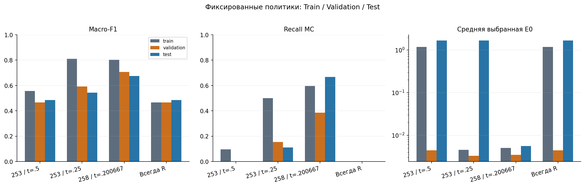

Рисунок 2. Train — in-sample предсказание сохранённых CBM. Политика 258 диагностическая, не выбранная глобально по Validation. [PDF](figures/02_ML_split_metrics.pdf). Источники и параметры визуализации: [figure_manifest.json](figure_manifest.json), [plot_evidence.py](plot_evidence.py).

### 3.2. Веса, регрессии и устойчивость по family-CV

| ВесMC | Config | t | Val regret | Val TP/FP | Test regret | Test TP/FP |
|---|---|---|---|---|---|---|
| 1 | baseline | 0.25 | 0.000710351281 | 2/1 | 1.65589914 | 1/5 |
| 2 | medium | 0.256347765 | 0.00184542654 | 5/10 | 1.65650192 | 3/18 |
| 3 | baseline | 0.564601802 | 0.00185777915 | 0/0 | 1.655066 | 0/0 |
| 5 | baseline | 0.587828472 | 0.00185777915 | 0/0 | 1.65520413 | 2/6 |
| 8 | baseline | 0.746436578 | 0.00185777915 | 0/0 | 1.65489088 | 1/0 |
| 12 | baseline | 0.846723331 | 0.00185777915 | 0/0 | 1.655066 | 0/0 |

Для каждого веса показана конфигурация original253/new, ранее выбранная по Val среди сохранённых политик. Это не подбор по текущему Test. Источник: [weights_new253_val_selected.csv](tables/weights_new253_val_selected.csv) и исходные validation_metrics/test_metrics. Regret и TP/FP зависят от выбранного порога, не только от веса.

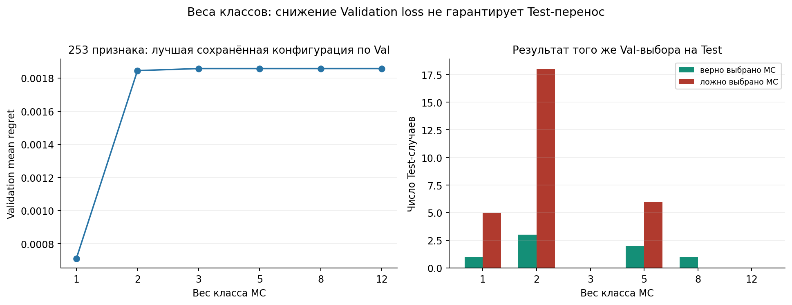

Рисунок 8. Никаких новых fit. Показанные строки извлечены из ранее сохранённых Val-optimal политик; Test не использован для их выбора. [PDF](figures/08_class_weights.pdf). Источники и параметры визуализации: [figure_manifest.json](figure_manifest.json), [plot_evidence.py](plot_evidence.py).

| Target | Features | Val-selected saved ID | t | Val regret | Test regret | Test TP/FP |
|---|---|---|---|---|---|---|
| raw | X | new__X__raw__w1__baseline | 0.034679661 | 0.00185777915 | 1.65745718 | 0/2 |
| raw | augmented | new__augmented__raw__w1__baseline | 0.0348039731 | 0.00185777915 | 1.65745718 | 0/2 |
| asinh | X | new__X__asinh__w1__baseline | 0.0154951025 | 0.00185777915 | 1.655066 | 0/0 |
| asinh | augmented | new__augmented__asinh__w1__baseline | 0.0166998671 | 0.00185777915 | 1.655066 | 0/0 |

Исходные и asinh-регрессии не показали переноса преимущества над always-R. Эта таблица лишь извлекает зафиксированный Val-выбор из сохранённой сетки; все остальные результаты доступны в [model_policy_metrics_all.csv](tables/model_policy_metrics_all.csv).

| Scenario | OOF policy | n | Accuracy | MacroF1 | TP/FP/FN | Pooled regret | Fold regret mean ± SD |
|---|---|---|---|---|---|---|---|
| new | always_monte_carlo | 747 | 0.12583668 | 0.1117717 | 94/653/0 | 0.0145934993 | 0.0145554562 ± 0.00280025152 |
| new | always_remizov | 747 | 0.87416332 | 0.466428571 | 0/0/94 | 1.16603007 | 1.17020376 ± 2.50663254 |
| new | asinh | 747 | 0.860776439 | 0.471969985 | 1/11/93 | 1.16695325 | 1.17111718 ± 2.50613967 |
| new | classifier_w1 | 747 | 0.868808568 | 0.474849354 | 1/5/93 | 1.16623734 | 1.17040733 ± 2.50650029 |
| new | classifier_w12 | 747 | 0.603748327 | 0.47400373 | 40/242/54 | 1.1709309 | 1.17508448 ± 2.50663575 |
| new | classifier_w2 | 747 | 0.860776439 | 0.481000481 | 2/12/92 | 1.16634496 | 1.17051332 ± 2.50648741 |
| new | classifier_w3 | 747 | 0.838018742 | 0.486685408 | 4/31/90 | 1.16679534 | 1.17096183 ± 2.50666546 |
| new | classifier_w5 | 747 | 0.795180723 | 0.52361481 | 15/74/79 | 1.16733328 | 1.17149951 ± 2.50652485 |
| new | classifier_w8 | 747 | 0.698795181 | 0.506898868 | 28/159/66 | 1.16924347 | 1.17340192 ± 2.50622167 |
| new | nested_selection | 747 | 0.661311914 | 0.468393205 | 22/181/72 | 1.17082676 | 1.17500115 ± 2.5038525 |
| new | raw | 747 | 0.534136546 | 0.427005819 | 38/292/56 | 1.17215173 | 1.17623503 ± 2.50316687 |
| old | always_monte_carlo | 697 | 0.1276901 | 0.113231552 | 89/608/0 | 0.0133521772 | 0.0133731272 ± 0.00262765322 |
| old | always_remizov | 697 | 0.8723099 | 0.465900383 | 0/0/89 | 1.24972544 | 1.25303244 ± 2.68742064 |
| old | asinh | 697 | 0.868005739 | 0.464669739 | 0/3/89 | 1.24979637 | 1.25310358 ± 2.68739212 |
| old | classifier_w1 | 697 | 0.866571019 | 0.464258263 | 0/4/89 | 1.24992454 | 1.25323529 ± 2.68730251 |
| old | classifier_w12 | 697 | 0.644189383 | 0.511761383 | 43/202/46 | 0.00579441039 | 0.00581443078 ± 0.00216243264 |
| old | classifier_w2 | 697 | 0.857962697 | 0.471617927 | 1/11/88 | 1.25012019 | 1.25343225 ± 2.68733363 |
| old | classifier_w3 | 697 | 0.847919656 | 0.5016324 | 5/22/84 | 1.25059458 | 1.25390866 ± 2.68783436 |
| old | classifier_w5 | 697 | 0.804878049 | 0.514604072 | 11/58/78 | 1.21065454 | 1.21414508 ± 2.70900698 |
| old | classifier_w8 | 697 | 0.723098996 | 0.531110902 | 29/133/60 | 1.21221721 | 1.21571628 ± 2.70950439 |
| old | nested_selection | 697 | 0.764705882 | 0.47689914 | 8/83/81 | 1.2516742 | 1.25499183 ± 2.68628157 |
| old | raw | 697 | 0.426111908 | 0.379517858 | 53/364/36 | 1.25659904 | 1.25991911 ± 2.68398856 |

Источники: [results/ml_selector_hypotheses_2026-10-31/cv_summary.json](../../results/ml_selector_hypotheses_2026-10-31/cv_summary.json), [results/ml_selector_hypotheses_2026-10-31/cv_folds.csv](../../results/ml_selector_hypotheses_2026-10-31/cv_folds.csv), [results/ml_selector_hypotheses_2026-10-31/cv_predictions.csv](../../results/ml_selector_hypotheses_2026-10-31/cv_predictions.csv), [cv_policies_22.csv](tables/cv_policies_22.csv). Current audit проверил арифметику110fold-строк/22pooled; исходный [results/ml_selector_hypotheses_2026-10-31/independent_verification.json](../../results/ml_selector_hypotheses_2026-10-31/independent_verification.json) подтверждает family separation и ranking сохранённых inner-кандидатов. Inner scores не сохранены, поэтому **оптимальность внутренних порогов независимо не устанавливается** без нового fit; в этой работе он запрещён. Fixed classifier threshold=.5; raw/asinh threshold0; nested выбирает внутри outer Train. Описательные mean±SD пяти коррелированных folds не являются CI.

Old fixed weight12 имеет pooled regret≈.00579441, значительно ниже always-R≈1.24972544, но new weight12≈1.17093090 vs R≈1.16603007; nested old/new≈1.25167420/1.17082676 также не улучшает R. Нестабильность выбора между семейными folds и зависимость от редких выбросов не поддерживают вывод о надёжном общем выигрыше. Сравнивать абсолютные pooled old/new напрямую как одинаковые samples нельзя.

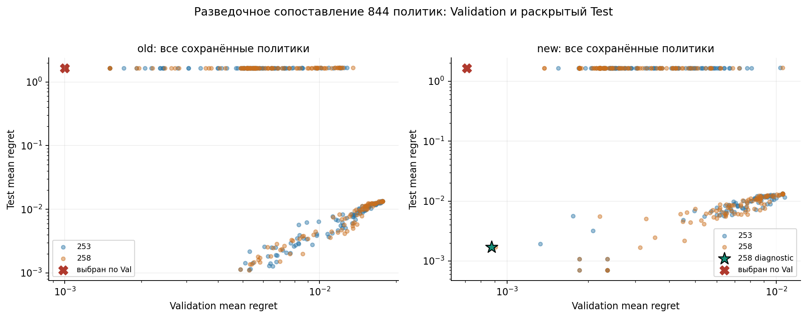

Рисунок 7. График не является новым выбором по Test; показывает множественность просмотренных вариантов. [PDF](figures/07_all_policy_results.pdf). Источники и параметры визуализации: [figure_manifest.json](figure_manifest.json), [plot_evidence.py](plot_evidence.py).

## 4. CatBoost с258 признаками: точная диагностическая политика и все ошибки

Сохранённый candidate: **`new__augmented__classifier__w1__baseline`**. [Файл CBM](../../results/ml_selector_hypotheses_2026-10-31/models/new__augmented__classifier__w1__baseline.cbm); SHA-256 `255c29a2caa087538ae2b589cd0fdc2ae693c7f73de3babe4ac7803ff9e46c18`. Обучен прежде на747 Train-строках,258input-only признаках. Class order=[remizov,monte_carlo], score=P_model(MC), действие MC iff **score>.2006671072130637**; равенство→R.

Гиперпараметры: iterations120 (tree_count120), depth2, learning_rate=.05 (в CBM float32≈.05000000074505806), l2_leaf_reg10, Logloss, seed2488, bootstrap_typeNo, random_strength0, thread_count1, allow_const_labelTrue, allow_writing_filesFalse, verboseFalse. При weight1 `class_weights` не передавался, auto_class_weightsNone. Нет scaler, ранней остановки или новых fit калибровки. CBM также хранит border_count254, leaf_estimation_iterations10, boosting_typePlain, grow_policySymmetricTree. Полный перечень сериализованных параметров: [model258_all_parameters.json](model258_all_parameters.json); metadata/имена/число деревьев: [model258_metadata.json](model258_metadata.json). `thread_count` отсутствует в get_all_params: значение1 подтверждается plan и [fit_model](../../diagnostics/run_selector_hypotheses.py#L169), а не выводится из CBM.

| Split | n | CM: [[TN,FP],[FN,TP]] | Accuracy | Balanced acc | MacroF1 | P_MC | R_MC | F1_MC | MeanE | MedianE | Meanregret | ε-success |
|---|---|---|---|---|---|---|---|---|---|---|---|---|
| train | 747 | [[631, 22], [38, 56]] | 0.919678714859 | 0.781027011176 | 0.802888505788 | 0.717948717949 | 0.595744680851 | 0.651162790698 | 0.00505733430334 | 0.00121429306326 | 0.000747064234377 | 733/747 |
| validation | 100 | [[84, 3], [8, 5]] | 0.89 | 0.675066312997 | 0.707368981112 | 0.625 | 0.384615384615 | 0.47619047619 | 0.00347470268698 | 0.00104689596994 | 0.00087603013096 | 99/100 |
| test | 150 | [[127, 14], [3, 6]] | 0.886666666667 | 0.783687943262 | 0.675531238071 | 0.3 | 0.666666666667 | 0.413793103448 | 0.00560405237695 | 0.00114528758171 | 0.00170794020351 | 145/150 |

Строки CM — истинный winner R/MC, столбцы — выбор R/MC. Test:130R+20MC choices; из 20 MC только6 правильных,14ложных; из 9 истинных MC-побед3пропущены. 127TN. Accuracy ниже always-R94%, но средняя ошибка намного ниже из-за обнаруженного большого R-выброса. Это различные критерии, противоречия нет. Train показан с тем же Val-порогом и не является оценкой обобщения.

Дополнительные сохранённые вероятностные метрики diagnostic258 на Validation: Brier=.10617309246414589, logloss=.35977853406730176, ECE=.059394761427063285. Это описательные scores на100строках, не гарантия calibration или вероятности ошибки решения; источник: [results/ml_selector_hypotheses_2026-10-31/calibration.json](../../results/ml_selector_hypotheses_2026-10-31/calibration.json).

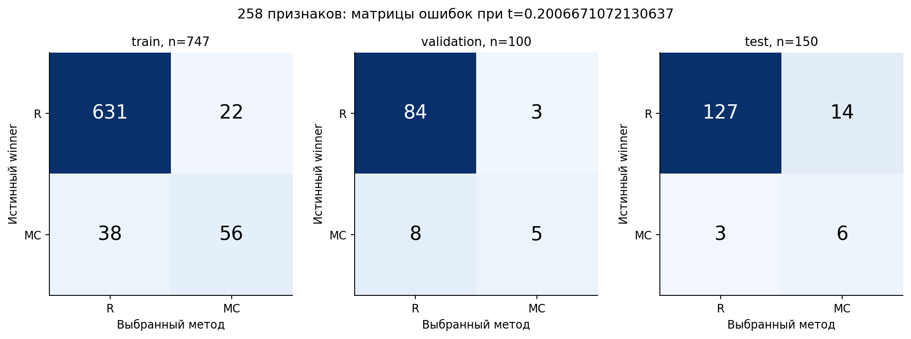

Рисунок 3. Строки — истинный метод минимальной ошибки; столбцы — выбор. Train не является OOF. [PDF](figures/03_258_confusion.pdf). Источники и параметры визуализации: [figure_manifest.json](figure_manifest.json), [plot_evidence.py](plot_evidence.py).

### 4.1. Все6 найденных,14 ложных и3 пропущенных MC-победы Test

В следующей таблице **Δ=E_R−E_MC**: плюс означает преимущество MC. Regret выбранного метода равен abs(Δ) только при FP/FN, при TP он0. Последний столбец показывает **обе** ошибки относительно ε=.05, чтобы не путать ошибку классификации с недопустимой численной ошибкой. Все23 строки относятся только к неизменному Test150. Полная точность чисел в [diagnostic_258_cases.csv](tables/diagnostic_258_cases.csv); scores и все 997 строк — [diagnostic_258_all_splits.csv](tables/diagnostic_258_all_splits.csv).

#### Найденные MC:6

| ID → исходная R-запись | E_R | E_MC | Δ=R−MC | Regret выбора | Отношение к .05 |
|---|---|---|---|---|---|
| [AMV1_F0029_S00](../../results/chernov_solve1000_2026-10-18/solutions/AMV1_F0029_S00.json) | 0.0016036707291959829 | 4.3258258274503358e-05 | 0.0015604124709214795 | 0 | оба≤.05 |
| [AMV1_F0046_S01](../../results/chernov_solve1000_2026-10-18/solutions/AMV1_F0046_S01.json) | 0.0070506972457660185 | 0.0045280368182653262 | 0.0025226604275006923 | 0 | оба≤.05 |
| [AMV1_F0070_S04](../../results/chernov_solve1000_2026-10-18/solutions/AMV1_F0070_S04.json) | 0.082587622078456047 | 0.056319537549601506 | 0.026268084528854541 | 0 | оба>.05 |
| [AMV1_F0094_S03](../../results/chernov_solve1000_2026-10-18/solutions/AMV1_F0094_S03.json) | 0.0043684467684053097 | 0.0029187966077703908 | 0.0014496501606349188 | 0 | оба≤.05 |
| [AMV1_F0098_S01](../../results/chernov_solve1000_2026-10-18/solutions/AMV1_F0098_S01.json) | 0.0081348862200307792 | 0.0075765627933808144 | 0.00055832342664996482 | 0 | оба≤.05 |
| [AMV1_F0180_S04](../../results/chernov_solve1000_2026-10-18/solutions/AMV1_F0180_S04.json) | 248.32307672784063 | 0.10308096210860278 | 248.21999576573202 | 0 | оба>.05 |

#### Ложные MC:14

| ID → исходная R-запись | E_R | E_MC | Δ=R−MC | Regret выбора | Отношение к .05 |
|---|---|---|---|---|---|
| [AMV1_F0036_S03](../../results/chernov_solve1000_2026-10-18/solutions/AMV1_F0036_S03.json) | 0.0012717970528161038 | 0.0035813400314479438 | -0.00230954297863184 | 0.00230954297863184 | оба≤.05 |
| [AMV1_F0084_S00](../../results/chernov_solve1000_2026-10-18/solutions/AMV1_F0084_S00.json) | 0.0052600291921330866 | 0.014186773799316432 | -0.0089267446071833456 | 0.0089267446071833456 | оба≤.05 |
| [AMV1_F0084_S03](../../results/chernov_solve1000_2026-10-18/solutions/AMV1_F0084_S03.json) | 0.0055345332295758665 | 0.012527810217437541 | -0.0069932769878616741 | 0.0069932769878616741 | оба≤.05 |
| [AMV1_F0094_S01](../../results/chernov_solve1000_2026-10-18/solutions/AMV1_F0094_S01.json) | 0.00077475453778952375 | 0.022119097177131009 | -0.021344342639341485 | 0.021344342639341485 | оба≤.05 |
| [AMV1_F0098_S02](../../results/chernov_solve1000_2026-10-18/solutions/AMV1_F0098_S02.json) | 0.00085992699738191014 | 0.0033621603897696639 | -0.0025022333923877538 | 0.0025022333923877538 | оба≤.05 |
| [AMV1_F0098_S04](../../results/chernov_solve1000_2026-10-18/solutions/AMV1_F0098_S04.json) | 0.0019812603389341987 | 0.017016720086747483 | -0.015035459747813285 | 0.015035459747813285 | оба≤.05 |
| [AMV1_F0100_S04](../../results/chernov_solve1000_2026-10-18/solutions/AMV1_F0100_S04.json) | 0.00049188050890458523 | 0.0060075990242223209 | -0.0055157185153177357 | 0.0055157185153177357 | оба≤.05 |
| [AMV1_F0164_S01](../../results/chernov_solve1000_2026-10-18/solutions/AMV1_F0164_S01.json) | 0.00020263768834027918 | 0.0041066205235059661 | -0.0039039828351656869 | 0.0039039828351656869 | оба≤.05 |
| [AMV1_F0179_S03](../../results/chernov_solve1000_2026-10-18/solutions/AMV1_F0179_S03.json) | 0.0082905436205078023 | 0.010095418896255627 | -0.0018048752757478248 | 0.0018048752757478248 | оба≤.05 |
| [AMV1_F0180_S01](../../results/chernov_solve1000_2026-10-18/solutions/AMV1_F0180_S01.json) | 0.031748401436679452 | 0.096548374989776864 | -0.064799973553097412 | 0.064799973553097412 | R≤.05; MC>.05 — новый отказ по ε |
| [AMV1_F0180_S02](../../results/chernov_solve1000_2026-10-18/solutions/AMV1_F0180_S02.json) | 0.0033794860707024033 | 0.060414563427738335 | -0.057035077357035932 | 0.057035077357035932 | R≤.05; MC>.05 — новый отказ по ε |
| [AMV1_F0190_S01](../../results/chernov_solve1000_2026-10-18/solutions/AMV1_F0190_S01.json) | 0.0092664543448114367 | 0.045330874346218936 | -0.036064420001407499 | 0.036064420001407499 | оба≤.05 |
| [AMV1_F0191_S03](../../results/chernov_solve1000_2026-10-18/solutions/AMV1_F0191_S03.json) | 0.0012273336328844919 | 0.0022769737673685175 | -0.0010496401344840256 | 0.0010496401344840256 | оба≤.05 |
| [AMV1_F0191_S04](../../results/chernov_solve1000_2026-10-18/solutions/AMV1_F0191_S04.json) | 0.010136165742770972 | 0.031496618636414508 | -0.021360452893643536 | 0.021360452893643536 | оба≤.05 |

#### Пропущенные MC:3

| ID → исходная R-запись | E_R | E_MC | Δ=R−MC | Regret выбора | Отношение к .05 |
|---|---|---|---|---|---|
| [AMV1_F0070_S02](../../results/chernov_solve1000_2026-10-18/solutions/AMV1_F0070_S02.json) | 0.0021241858445083528 | 0.0013121096646598884 | 0.00081207617984846436 | 0.00081207617984846436 | оба≤.05 |
| [AMV1_F0190_S04](../../results/chernov_solve1000_2026-10-18/solutions/AMV1_F0190_S04.json) | 0.0039050309568987723 | 0.00040514520543900173 | 0.0034998857514597706 | 0.0034998857514597706 | оба≤.05 |
| [AMV1_F0191_S01](../../results/chernov_solve1000_2026-10-18/solutions/AMV1_F0191_S01.json) | 0.0053474859776860839 | 0.0021141583009540721 | 0.0032333276767320118 | 0.0032333276767320118 | оба≤.05 |

Источники для каждой строки: указанный R JSON (`target_x[16]=0`, `result.f[16]`, `y_exact[16]`); четыре MC-записи `results/mc1000_x0_2026-10-25/attempts/<ID>_seed0…3.json` (`result.f[0]`, scalar y_exact); [results/ml_mean_mc_selector_2026-10-31/run/coverage.csv](../../results/ml_mean_mc_selector_2026-10-31/run/coverage.csv) и [results/ml_selector_hypotheses_2026-10-31/test_predictions.csv](../../results/ml_selector_hypotheses_2026-10-31/test_predictions.csv), фильтр candidate+policy=`validation_optimal`. Текущее чтение первичных записей подтвердило ошибки без вычисления нового exact или численного решения.

**Существенность:** TP дают сумму уменьшений против R248.2523548967466; почти всё приходится на `AMV1_F0180_S04` (248.21999576573202). У этого случая E_R≈248.323, E_MC≈.103081: даже удачный выбор winner **не достигает .05**. Второй такой TP `AMV1_F0070_S04`: .082588→.056320, также выше допуска. Остальные4TP оба метода точны по .05. Во всех3FN обе ошибки≤.05; сумма упущенных улучшений=.007545289608040247, наибольшее≈.003499886.

У14FP суммарный ущерб=.248645740919119. В12 случаях оба ответа остаются≤.05, хотя MC хуже. Два новых нарушения: `AMV1_F0180_S01` .0317484014→.0965483750 (regret .06479997355309741) и `AMV1_F0180_S02` .0033794861→.0604145634 (regret .05703507735703593). Новых спасений порога0. Поэтому selected145/150 против R147/150. Общий regret=.2561910305271593, /150=.0017079402035143952. Это численная величина ущерба, а не только17неверных меток.

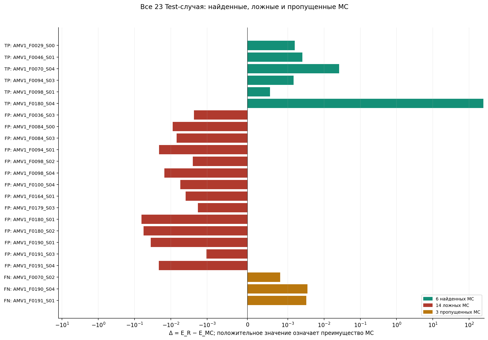

Рисунок 4. Симметричная логарифмическая шкала сохраняет знак и малые Δ; крупный выброс не удалён. [PDF](figures/04_258_all_23_cases.pdf). Источники и параметры визуализации: [figure_manifest.json](figure_manifest.json), [plot_evidence.py](plot_evidence.py).

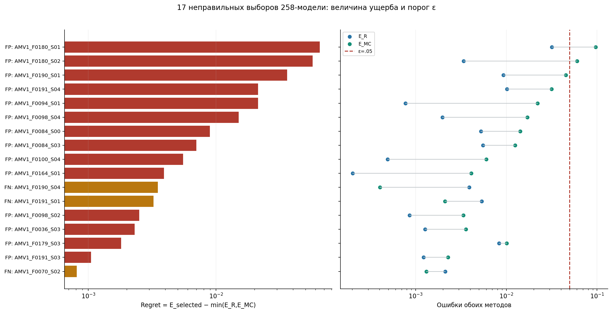

Рисунок 5. Два FP вызывают дополнительное нарушение ε; остальные неправильные winner-метки не равны нарушениям точности. [PDF](figures/05_wrong_choice_severity.pdf). Источники и параметры визуализации: [figure_manifest.json](figure_manifest.json), [plot_evidence.py](plot_evidence.py).

### 4.2. Чувствительность среднего и объяснение выброса

Для всех150 Test always-R meanE=1.6589621134157981, diagnostic258=.005604052376948204. Только для описательного post-hoc sensitivity исключим крупнейшую R-ошибку `F0180/S04`: на остальных149 always-R meanE=.0034982569431481238, diagnostic258=.004949844929084751 — преимущество меняет знак. **Основные результаты остаются на 150**, строка не удаляется и новая политика по этому анализу не выбирается. Среднее обладает другой чувствительностью, чем медиана/доля ε-success; нельзя описывать улучшение средней как одинаковое улучшение всех задач.

Причина конкретного исторического R-выброса частично исследована ранее, не устанавливается заново ML-важностью. В сохранённой boundary-диагностике смена только cubic/taper→cubic/zero на четырёх известных задачах устранила три катастрофических E_grid33-выброса. Для F0180/S04 E_grid33≈19134.4052→.07045189 при том же n/T/dx/квадратуре. Это сильное свидетельство роли граничного продолжения в **том** профиле; величина19134 — максимум на 33 узлах, не E_R(0)=248.323. Последующее padding12→24 изменило ответ лишь≈1.08e-13, квадратура513→1025 —≈1.355e-4 в zero-профиле. Эти controls не разрешают заменять старые R-метки исправленными значениями и не доказывают точность R для всех уравнений. Остаточные доли ошибки по n/h/квадратуре глобально не установлены.

Источники: [checks/case_summary.json](checks/case_summary.json), [figure06_sensitivity.csv](tables/figure06_sensitivity.csv); [results/chernov_boundary_diagnosis_2026-10-24/REPORT.md](../../results/chernov_boundary_diagnosis_2026-10-24/REPORT.md); [results/chernov_window_padding24_2026-10-24/REPORT.md](../../results/chernov_window_padding24_2026-10-24/REPORT.md); [results/chernov_time_quadrature1025_2026-10-24/REPORT.md](../../results/chernov_time_quadrature1025_2026-10-24/REPORT.md).

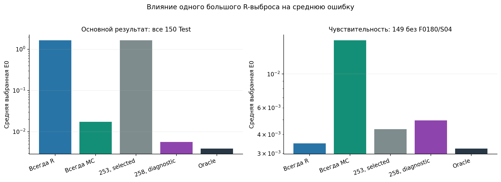

Рисунок 6. Постфактум анализ чувствительности. F0180/S04 остаётся во всех основных метриках; исключение не используется для выбора модели. [PDF](figures/06_outlier_sensitivity.pdf). Источники и параметры визуализации: [figure_manifest.json](figure_manifest.json), [plot_evidence.py](plot_evidence.py).

## 5. Полный каталог258 признаков: определения и источники

Порядок взят из **augmented_names** сохранённого [results/ml_selector_hypotheses_2026-10-31/features.npz](../../results/ml_selector_hypotheses_2026-10-31/features.npz); feature_names_ в CBM совпадают. Первые253 — отсортированный словарь `coefficient_features`, затем5 `FEATURE_NAMES` в заданном порядке. Ничего не опущено:5cert+10pre+4×14stat+4×32sample+6corr+3×16AST+5research=258. Машиночитаемый каталог: [all_258_features.csv](tables/all_258_features.csv); проверка полноты: [checks/feature_catalog.json](checks/feature_catalog.json). Все257226 значений на 997 строках восстановлены из реального X/whitelist и **побитово** равны сохранённой матрице.

### 5.1. Общие обозначения и соглашения

`x_i` — реальная256-точечная входная сетка [-1,1]; математически −1+2i/255. Каналы для исходных253: `a`, `b`, **`cR=c+λ`**, **`gR=−g`**. Это преобразование **ML-дескрипторов**; оно не означает подмену входов RK4/PI, которым передавались исходные c,g. `A_minus`, `A_plus`, `B`, `C`, `λ` — сохранённые глобальные сертификаты. pre_T — legacy-формула с1e-8, без множителя G; это описательный признак прежнего профиля, не универсальная граница полной ошибки.

Для статистик `d1_i=(v_(i+1)−v_i)/(x_(i+1)−x_i)` (255 значений), `d2` — разность d1, делённая на расстояния между серединами соседних интервалов (254). RMS и std невзвешенные, std ddof0. `P_k=abs(rfft(v−mean(v)))²`; spectral_high_fraction использует bins8…128 и0 при нулевой энергии. Strict zero_crossings не считает переход через точный нулевой отсчёт. Samples берут **индексы** `linspace(0,255,32,dtype=int)`, без интерполяции; для каждого имени ниже указан индекс и фактическая координата. Corr — центрированный скалярный product/произведение норм,0 при нулевом знаменателе.

AST-дескрипторы относятся к **сырому** coefficient-tree до tanh, не к exact/y_shape. Для каждого из a_raw/b_raw/c_raw: nodes, root-depth1 и14counts операций. Подробные формулы безопасных операций: [_evaluate_array](../../src/all_methods_expressions.py#L455). Константные параметры узлов сами не становятся отдельными AST-признаками.

Для research5: `q=−c>0`, `F=−g`, значения a0,b0,q0 получены **линейной интерполяцией коэффициентов** в0; это не интерполяция ответа и не exact как вход. `G(v)=np.gradient(v,x,edge_order=2)`, `G2=G(G(v))`. RMS реализован через масштабирование на absmax для устойчивости. F предварительно нормирован на RMS(F); записанные ниже формулы математически эквивалентны реализации, но буквальная последовательность float-операций — в коде. Интегралы — составные трапеции по входной сетке. При F=0 три forcing-признака равны0. Есть проверки increasing grid, four finite channels, interval[-1,1], a>0,q>0 и конечности результата.

Exact, y_shape, y0/v0, solution derivatives, ID/family/split/seed, solver outputs, errors/success/time и postdiagnostics в258 не входят. g допустим как заданный input, хотя manufactured-происхождение g связано с exact. Такая связь — свойство генерации; перенос на иную RHS-distribution отдельно не проверен. Сертификаты/коэффициентные AST доступны нынешнему датасету; на внешнем наборе одного списка sampled-значений может быть недостаточно для253-ветки.

### 5.2. Все258 строк в порядке CBM

| № | Точное имя | Математический смысл | Вычисление | Код |
|---:|---|---|---|---|
| 1 | `a_absmax` | Максимальный модуль отсчётов; v=a | `max_i(abs(v_i))` | [ml/remizov_features.py:53, coefficient_features](../../ml/remizov_features.py#L53) |
| 2 | `a_d1_absmax` | Максимальный модуль первых разделённых разностей; v=a | `max_i(abs(d1_i))` | [ml/remizov_features.py:55, coefficient_features](../../ml/remizov_features.py#L55) |
| 3 | `a_d1_rms` | RMS первых разделённых разностей d1, 255 значений; v=a | `sqrt(mean_i(d1_i^2))` | [ml/remizov_features.py:54, coefficient_features](../../ml/remizov_features.py#L54) |
| 4 | `a_d2_rms` | RMS вторых разделённых разностей по серединам соседних интервалов, 254 значения; v=a | `sqrt(mean_i(d2_i^2))` | [ml/remizov_features.py:55, coefficient_features](../../ml/remizov_features.py#L55) |
| 5 | `a_max` | Максимум отсчётов; v=a | `max_i(v_i)` | [ml/remizov_features.py:52, coefficient_features](../../ml/remizov_features.py#L52) |
| 6 | `a_mean` | Невзвешенное арифметическое среднее; v=a | `mean_i(v_i)` | [ml/remizov_features.py:52, coefficient_features](../../ml/remizov_features.py#L52) |
| 7 | `a_median` | Медиана; NumPy усредняет два средних значения при чётной длине; v=a | `median_i(v_i)` | [ml/remizov_features.py:53, coefficient_features](../../ml/remizov_features.py#L53) |
| 8 | `a_min` | Минимум отсчётов; v=a | `min_i(v_i)` | [ml/remizov_features.py:52, coefficient_features](../../ml/remizov_features.py#L52) |
| 9 | `a_negative_fraction` | Доля строго отрицательных отсчётов; нулевые не входят; v=a | `mean_i(v_i<0)` | [ml/remizov_features.py:56, coefficient_features](../../ml/remizov_features.py#L56) |
| 10 | `a_rms` | Среднеквадратическая амплитуда отсчётов; v=a | `sqrt(mean_i(v_i^2))` | [ml/remizov_features.py:53, coefficient_features](../../ml/remizov_features.py#L53) |
| 11 | `a_sample_00` | Отсчёт #00 канала a в точном выбранном индексе входной сетки; не интерполяция | `a at j=0, x_j=-1+2*0/255=-1` | [ml/remizov_features.py:59, coefficient_features](../../ml/remizov_features.py#L59) |
| 12 | `a_sample_01` | Отсчёт #01 канала a в точном выбранном индексе входной сетки; не интерполяция | `a at j=8, x_j=-1+2*8/255=-0.93725490196078431` | [ml/remizov_features.py:59, coefficient_features](../../ml/remizov_features.py#L59) |
| 13 | `a_sample_02` | Отсчёт #02 канала a в точном выбранном индексе входной сетки; не интерполяция | `a at j=16, x_j=-1+2*16/255=-0.87450980392156863` | [ml/remizov_features.py:59, coefficient_features](../../ml/remizov_features.py#L59) |
| 14 | `a_sample_03` | Отсчёт #03 канала a в точном выбранном индексе входной сетки; не интерполяция | `a at j=24, x_j=-1+2*24/255=-0.81176470588235294` | [ml/remizov_features.py:59, coefficient_features](../../ml/remizov_features.py#L59) |
| 15 | `a_sample_04` | Отсчёт #04 канала a в точном выбранном индексе входной сетки; не интерполяция | `a at j=32, x_j=-1+2*32/255=-0.74901960784313726` | [ml/remizov_features.py:59, coefficient_features](../../ml/remizov_features.py#L59) |
| 16 | `a_sample_05` | Отсчёт #05 канала a в точном выбранном индексе входной сетки; не интерполяция | `a at j=41, x_j=-1+2*41/255=-0.67843137254901964` | [ml/remizov_features.py:59, coefficient_features](../../ml/remizov_features.py#L59) |
| 17 | `a_sample_06` | Отсчёт #06 канала a в точном выбранном индексе входной сетки; не интерполяция | `a at j=49, x_j=-1+2*49/255=-0.61568627450980395` | [ml/remizov_features.py:59, coefficient_features](../../ml/remizov_features.py#L59) |
| 18 | `a_sample_07` | Отсчёт #07 канала a в точном выбранном индексе входной сетки; не интерполяция | `a at j=57, x_j=-1+2*57/255=-0.55294117647058827` | [ml/remizov_features.py:59, coefficient_features](../../ml/remizov_features.py#L59) |
| 19 | `a_sample_08` | Отсчёт #08 канала a в точном выбранном индексе входной сетки; не интерполяция | `a at j=65, x_j=-1+2*65/255=-0.49019607843137258` | [ml/remizov_features.py:59, coefficient_features](../../ml/remizov_features.py#L59) |
| 20 | `a_sample_09` | Отсчёт #09 канала a в точном выбранном индексе входной сетки; не интерполяция | `a at j=74, x_j=-1+2*74/255=-0.41960784313725497` | [ml/remizov_features.py:59, coefficient_features](../../ml/remizov_features.py#L59) |
| 21 | `a_sample_10` | Отсчёт #10 канала a в точном выбранном индексе входной сетки; не интерполяция | `a at j=82, x_j=-1+2*82/255=-0.35686274509803928` | [ml/remizov_features.py:59, coefficient_features](../../ml/remizov_features.py#L59) |
| 22 | `a_sample_11` | Отсчёт #11 канала a в точном выбранном индексе входной сетки; не интерполяция | `a at j=90, x_j=-1+2*90/255=-0.29411764705882359` | [ml/remizov_features.py:59, coefficient_features](../../ml/remizov_features.py#L59) |
| 23 | `a_sample_12` | Отсчёт #12 канала a в точном выбранном индексе входной сетки; не интерполяция | `a at j=98, x_j=-1+2*98/255=-0.23137254901960791` | [ml/remizov_features.py:59, coefficient_features](../../ml/remizov_features.py#L59) |
| 24 | `a_sample_13` | Отсчёт #13 канала a в точном выбранном индексе входной сетки; не интерполяция | `a at j=106, x_j=-1+2*106/255=-0.16862745098039222` | [ml/remizov_features.py:59, coefficient_features](../../ml/remizov_features.py#L59) |
| 25 | `a_sample_14` | Отсчёт #14 канала a в точном выбранном индексе входной сетки; не интерполяция | `a at j=115, x_j=-1+2*115/255=-0.098039215686274495` | [ml/remizov_features.py:59, coefficient_features](../../ml/remizov_features.py#L59) |
| 26 | `a_sample_15` | Отсчёт #15 канала a в точном выбранном индексе входной сетки; не интерполяция | `a at j=123, x_j=-1+2*123/255=-0.035294117647058809` | [ml/remizov_features.py:59, coefficient_features](../../ml/remizov_features.py#L59) |
| 27 | `a_sample_16` | Отсчёт #16 канала a в точном выбранном индексе входной сетки; не интерполяция | `a at j=131, x_j=-1+2*131/255=0.027450980392156765` | [ml/remizov_features.py:59, coefficient_features](../../ml/remizov_features.py#L59) |
| 28 | `a_sample_17` | Отсчёт #17 канала a в точном выбранном индексе входной сетки; не интерполяция | `a at j=139, x_j=-1+2*139/255=0.090196078431372451` | [ml/remizov_features.py:59, coefficient_features](../../ml/remizov_features.py#L59) |
| 29 | `a_sample_18` | Отсчёт #18 канала a в точном выбранном индексе входной сетки; не интерполяция | `a at j=148, x_j=-1+2*148/255=0.16078431372549007` | [ml/remizov_features.py:59, coefficient_features](../../ml/remizov_features.py#L59) |
| 30 | `a_sample_19` | Отсчёт #19 канала a в точном выбранном индексе входной сетки; не интерполяция | `a at j=156, x_j=-1+2*156/255=0.22352941176470598` | [ml/remizov_features.py:59, coefficient_features](../../ml/remizov_features.py#L59) |
| 31 | `a_sample_20` | Отсчёт #20 канала a в точном выбранном индексе входной сетки; не интерполяция | `a at j=164, x_j=-1+2*164/255=0.28627450980392144` | [ml/remizov_features.py:59, coefficient_features](../../ml/remizov_features.py#L59) |
| 32 | `a_sample_21` | Отсчёт #21 канала a в точном выбранном индексе входной сетки; не интерполяция | `a at j=172, x_j=-1+2*172/255=0.34901960784313735` | [ml/remizov_features.py:59, coefficient_features](../../ml/remizov_features.py#L59) |
| 33 | `a_sample_22` | Отсчёт #22 канала a в точном выбранном индексе входной сетки; не интерполяция | `a at j=180, x_j=-1+2*180/255=0.41176470588235281` | [ml/remizov_features.py:59, coefficient_features](../../ml/remizov_features.py#L59) |
| 34 | `a_sample_23` | Отсчёт #23 канала a в точном выбранном индексе входной сетки; не интерполяция | `a at j=189, x_j=-1+2*189/255=0.48235294117647065` | [ml/remizov_features.py:59, coefficient_features](../../ml/remizov_features.py#L59) |
| 35 | `a_sample_24` | Отсчёт #24 канала a в точном выбранном индексе входной сетки; не интерполяция | `a at j=197, x_j=-1+2*197/255=0.54509803921568634` | [ml/remizov_features.py:59, coefficient_features](../../ml/remizov_features.py#L59) |
| 36 | `a_sample_25` | Отсчёт #25 канала a в точном выбранном индексе входной сетки; не интерполяция | `a at j=205, x_j=-1+2*205/255=0.60784313725490202` | [ml/remizov_features.py:59, coefficient_features](../../ml/remizov_features.py#L59) |
| 37 | `a_sample_26` | Отсчёт #26 канала a в точном выбранном индексе входной сетки; не интерполяция | `a at j=213, x_j=-1+2*213/255=0.67058823529411771` | [ml/remizov_features.py:59, coefficient_features](../../ml/remizov_features.py#L59) |
| 38 | `a_sample_27` | Отсчёт #27 канала a в точном выбранном индексе входной сетки; не интерполяция | `a at j=222, x_j=-1+2*222/255=0.74117647058823533` | [ml/remizov_features.py:59, coefficient_features](../../ml/remizov_features.py#L59) |
| 39 | `a_sample_28` | Отсчёт #28 канала a в точном выбранном индексе входной сетки; не интерполяция | `a at j=230, x_j=-1+2*230/255=0.80392156862745101` | [ml/remizov_features.py:59, coefficient_features](../../ml/remizov_features.py#L59) |
| 40 | `a_sample_29` | Отсчёт #29 канала a в точном выбранном индексе входной сетки; не интерполяция | `a at j=238, x_j=-1+2*238/255=0.8666666666666667` | [ml/remizov_features.py:59, coefficient_features](../../ml/remizov_features.py#L59) |
| 41 | `a_sample_30` | Отсчёт #30 канала a в точном выбранном индексе входной сетки; не интерполяция | `a at j=246, x_j=-1+2*246/255=0.92941176470588238` | [ml/remizov_features.py:59, coefficient_features](../../ml/remizov_features.py#L59) |
| 42 | `a_sample_31` | Отсчёт #31 канала a в точном выбранном индексе входной сетки; не интерполяция | `a at j=255, x_j=-1+2*255/255=1` | [ml/remizov_features.py:59, coefficient_features](../../ml/remizov_features.py#L59) |
| 43 | `a_spectral_high_fraction` | Доля мощности rFFT по индексам от 8; это индексный, не универсальный физический cutoff; v=a | `sum(P_k,k>=8)/sum(P_k); 0 if sum(P_k)=0` | [ml/remizov_features.py:57, coefficient_features](../../ml/remizov_features.py#L57) |
| 44 | `a_std` | Стандартное отклонение ddof=0; v=a | `sqrt(mean_i((v_i-mean(v))^2))` | [ml/remizov_features.py:52, coefficient_features](../../ml/remizov_features.py#L52) |
| 45 | `a_total_variation` | Дискретная полная вариация без деления на длину интервала; v=a | `sum_i(abs(v[i+1]-v[i]))` | [ml/remizov_features.py:54, coefficient_features](../../ml/remizov_features.py#L54) |
| 46 | `a_zero_crossings` | Число строгих смен знака; переход через точный нулевой отсчёт не учитывается; v=a | `count_i(v[i]*v[i+1]<0)` | [ml/remizov_features.py:56, coefficient_features](../../ml/remizov_features.py#L56) |
| 47 | `ast_a_raw_depth` | Максимальная глубина сырого коэффициентного AST, корень имеет глубину 1 | `max_node_depth(a_raw), root_depth=1` | [ml/remizov_features.py:21, ast_features](../../ml/remizov_features.py#L21) |
| 48 | `ast_a_raw_nodes` | Общее число узлов сырого дерева коэффициента до tanh-преобразования | `number_of_nodes(a_raw)` | [ml/remizov_features.py:21, ast_features](../../ml/remizov_features.py#L21) |
| 49 | `ast_a_raw_op_constant` | Число узлов операции: константный лист value; численные параметры узлов в счётчик не входят | `count_nodes(op='constant', tree=a_raw)` | [ml/remizov_features.py:21, ast_features](../../ml/remizov_features.py#L21) |
| 50 | `ast_a_raw_op_cos` | Число узлов операции: унарный cos(u); численные параметры узлов в счётчик не входят | `count_nodes(op='cos', tree=a_raw)` | [ml/remizov_features.py:21, ast_features](../../ml/remizov_features.py#L21) |
| 51 | `ast_a_raw_op_cos_affine` | Число узлов операции: лист cos(omega*x+phi); численные параметры узлов в счётчик не входят | `count_nodes(op='cos_affine', tree=a_raw)` | [ml/remizov_features.py:21, ast_features](../../ml/remizov_features.py#L21) |
| 52 | `ast_a_raw_op_exp_neg_square` | Число узлов операции: унарный exp(-u^2); численные параметры узлов в счётчик не входят | `count_nodes(op='exp_neg_square', tree=a_raw)` | [ml/remizov_features.py:21, ast_features](../../ml/remizov_features.py#L21) |
| 53 | `ast_a_raw_op_gaussian` | Число узлов операции: лист exp(-alpha*(x-mu)^2); численные параметры узлов в счётчик не входят | `count_nodes(op='gaussian', tree=a_raw)` | [ml/remizov_features.py:21, ast_features](../../ml/remizov_features.py#L21) |
| 54 | `ast_a_raw_op_lincomb` | Число узлов операции: бинарный alpha*u+beta*v; численные параметры узлов в счётчик не входят | `count_nodes(op='lincomb', tree=a_raw)` | [ml/remizov_features.py:21, ast_features](../../ml/remizov_features.py#L21) |
| 55 | `ast_a_raw_op_lorentz` | Число узлов операции: лист 1/(1+alpha*(x-mu)^2); численные параметры узлов в счётчик не входят | `count_nodes(op='lorentz', tree=a_raw)` | [ml/remizov_features.py:21, ast_features](../../ml/remizov_features.py#L21) |
| 56 | `ast_a_raw_op_mul` | Число узлов операции: бинарный u*v; численные параметры узлов в счётчик не входят | `count_nodes(op='mul', tree=a_raw)` | [ml/remizov_features.py:21, ast_features](../../ml/remizov_features.py#L21) |
| 57 | `ast_a_raw_op_rational_saturate` | Число узлов операции: унарный u/(1+u^2); численные параметры узлов в счётчик не входят | `count_nodes(op='rational_saturate', tree=a_raw)` | [ml/remizov_features.py:21, ast_features](../../ml/remizov_features.py#L21) |
| 58 | `ast_a_raw_op_saturating` | Число узлов операции: лист (x-mu)/sqrt(1+(x-mu)^2); численные параметры узлов в счётчик не входят | `count_nodes(op='saturating', tree=a_raw)` | [ml/remizov_features.py:21, ast_features](../../ml/remizov_features.py#L21) |
| 59 | `ast_a_raw_op_sin` | Число узлов операции: унарный sin(u); численные параметры узлов в счётчик не входят | `count_nodes(op='sin', tree=a_raw)` | [ml/remizov_features.py:21, ast_features](../../ml/remizov_features.py#L21) |
| 60 | `ast_a_raw_op_sin_affine` | Число узлов операции: лист sin(omega*x+phi); численные параметры узлов в счётчик не входят | `count_nodes(op='sin_affine', tree=a_raw)` | [ml/remizov_features.py:21, ast_features](../../ml/remizov_features.py#L21) |
| 61 | `ast_a_raw_op_tanh` | Число узлов операции: унарный tanh(u); численные параметры узлов в счётчик не входят | `count_nodes(op='tanh', tree=a_raw)` | [ml/remizov_features.py:21, ast_features](../../ml/remizov_features.py#L21) |
| 62 | `ast_a_raw_op_tanh_affine` | Число узлов операции: лист tanh(omega*x+phi); численные параметры узлов в счётчик не входят | `count_nodes(op='tanh_affine', tree=a_raw)` | [ml/remizov_features.py:21, ast_features](../../ml/remizov_features.py#L21) |
| 63 | `ast_b_raw_depth` | Максимальная глубина сырого коэффициентного AST, корень имеет глубину 1 | `max_node_depth(b_raw), root_depth=1` | [ml/remizov_features.py:21, ast_features](../../ml/remizov_features.py#L21) |
| 64 | `ast_b_raw_nodes` | Общее число узлов сырого дерева коэффициента до tanh-преобразования | `number_of_nodes(b_raw)` | [ml/remizov_features.py:21, ast_features](../../ml/remizov_features.py#L21) |
| 65 | `ast_b_raw_op_constant` | Число узлов операции: константный лист value; численные параметры узлов в счётчик не входят | `count_nodes(op='constant', tree=b_raw)` | [ml/remizov_features.py:21, ast_features](../../ml/remizov_features.py#L21) |
| 66 | `ast_b_raw_op_cos` | Число узлов операции: унарный cos(u); численные параметры узлов в счётчик не входят | `count_nodes(op='cos', tree=b_raw)` | [ml/remizov_features.py:21, ast_features](../../ml/remizov_features.py#L21) |
| 67 | `ast_b_raw_op_cos_affine` | Число узлов операции: лист cos(omega*x+phi); численные параметры узлов в счётчик не входят | `count_nodes(op='cos_affine', tree=b_raw)` | [ml/remizov_features.py:21, ast_features](../../ml/remizov_features.py#L21) |
| 68 | `ast_b_raw_op_exp_neg_square` | Число узлов операции: унарный exp(-u^2); численные параметры узлов в счётчик не входят | `count_nodes(op='exp_neg_square', tree=b_raw)` | [ml/remizov_features.py:21, ast_features](../../ml/remizov_features.py#L21) |
| 69 | `ast_b_raw_op_gaussian` | Число узлов операции: лист exp(-alpha*(x-mu)^2); численные параметры узлов в счётчик не входят | `count_nodes(op='gaussian', tree=b_raw)` | [ml/remizov_features.py:21, ast_features](../../ml/remizov_features.py#L21) |
| 70 | `ast_b_raw_op_lincomb` | Число узлов операции: бинарный alpha*u+beta*v; численные параметры узлов в счётчик не входят | `count_nodes(op='lincomb', tree=b_raw)` | [ml/remizov_features.py:21, ast_features](../../ml/remizov_features.py#L21) |
| 71 | `ast_b_raw_op_lorentz` | Число узлов операции: лист 1/(1+alpha*(x-mu)^2); численные параметры узлов в счётчик не входят | `count_nodes(op='lorentz', tree=b_raw)` | [ml/remizov_features.py:21, ast_features](../../ml/remizov_features.py#L21) |
| 72 | `ast_b_raw_op_mul` | Число узлов операции: бинарный u*v; численные параметры узлов в счётчик не входят | `count_nodes(op='mul', tree=b_raw)` | [ml/remizov_features.py:21, ast_features](../../ml/remizov_features.py#L21) |
| 73 | `ast_b_raw_op_rational_saturate` | Число узлов операции: унарный u/(1+u^2); численные параметры узлов в счётчик не входят | `count_nodes(op='rational_saturate', tree=b_raw)` | [ml/remizov_features.py:21, ast_features](../../ml/remizov_features.py#L21) |
| 74 | `ast_b_raw_op_saturating` | Число узлов операции: лист (x-mu)/sqrt(1+(x-mu)^2); численные параметры узлов в счётчик не входят | `count_nodes(op='saturating', tree=b_raw)` | [ml/remizov_features.py:21, ast_features](../../ml/remizov_features.py#L21) |
| 75 | `ast_b_raw_op_sin` | Число узлов операции: унарный sin(u); численные параметры узлов в счётчик не входят | `count_nodes(op='sin', tree=b_raw)` | [ml/remizov_features.py:21, ast_features](../../ml/remizov_features.py#L21) |
| 76 | `ast_b_raw_op_sin_affine` | Число узлов операции: лист sin(omega*x+phi); численные параметры узлов в счётчик не входят | `count_nodes(op='sin_affine', tree=b_raw)` | [ml/remizov_features.py:21, ast_features](../../ml/remizov_features.py#L21) |
| 77 | `ast_b_raw_op_tanh` | Число узлов операции: унарный tanh(u); численные параметры узлов в счётчик не входят | `count_nodes(op='tanh', tree=b_raw)` | [ml/remizov_features.py:21, ast_features](../../ml/remizov_features.py#L21) |
| 78 | `ast_b_raw_op_tanh_affine` | Число узлов операции: лист tanh(omega*x+phi); численные параметры узлов в счётчик не входят | `count_nodes(op='tanh_affine', tree=b_raw)` | [ml/remizov_features.py:21, ast_features](../../ml/remizov_features.py#L21) |
| 79 | `ast_c_raw_depth` | Максимальная глубина сырого коэффициентного AST, корень имеет глубину 1 | `max_node_depth(c_raw), root_depth=1` | [ml/remizov_features.py:21, ast_features](../../ml/remizov_features.py#L21) |
| 80 | `ast_c_raw_nodes` | Общее число узлов сырого дерева коэффициента до tanh-преобразования | `number_of_nodes(c_raw)` | [ml/remizov_features.py:21, ast_features](../../ml/remizov_features.py#L21) |
| 81 | `ast_c_raw_op_constant` | Число узлов операции: константный лист value; численные параметры узлов в счётчик не входят | `count_nodes(op='constant', tree=c_raw)` | [ml/remizov_features.py:21, ast_features](../../ml/remizov_features.py#L21) |
| 82 | `ast_c_raw_op_cos` | Число узлов операции: унарный cos(u); численные параметры узлов в счётчик не входят | `count_nodes(op='cos', tree=c_raw)` | [ml/remizov_features.py:21, ast_features](../../ml/remizov_features.py#L21) |
| 83 | `ast_c_raw_op_cos_affine` | Число узлов операции: лист cos(omega*x+phi); численные параметры узлов в счётчик не входят | `count_nodes(op='cos_affine', tree=c_raw)` | [ml/remizov_features.py:21, ast_features](../../ml/remizov_features.py#L21) |
| 84 | `ast_c_raw_op_exp_neg_square` | Число узлов операции: унарный exp(-u^2); численные параметры узлов в счётчик не входят | `count_nodes(op='exp_neg_square', tree=c_raw)` | [ml/remizov_features.py:21, ast_features](../../ml/remizov_features.py#L21) |
| 85 | `ast_c_raw_op_gaussian` | Число узлов операции: лист exp(-alpha*(x-mu)^2); численные параметры узлов в счётчик не входят | `count_nodes(op='gaussian', tree=c_raw)` | [ml/remizov_features.py:21, ast_features](../../ml/remizov_features.py#L21) |
| 86 | `ast_c_raw_op_lincomb` | Число узлов операции: бинарный alpha*u+beta*v; численные параметры узлов в счётчик не входят | `count_nodes(op='lincomb', tree=c_raw)` | [ml/remizov_features.py:21, ast_features](../../ml/remizov_features.py#L21) |
| 87 | `ast_c_raw_op_lorentz` | Число узлов операции: лист 1/(1+alpha*(x-mu)^2); численные параметры узлов в счётчик не входят | `count_nodes(op='lorentz', tree=c_raw)` | [ml/remizov_features.py:21, ast_features](../../ml/remizov_features.py#L21) |
| 88 | `ast_c_raw_op_mul` | Число узлов операции: бинарный u*v; численные параметры узлов в счётчик не входят | `count_nodes(op='mul', tree=c_raw)` | [ml/remizov_features.py:21, ast_features](../../ml/remizov_features.py#L21) |
| 89 | `ast_c_raw_op_rational_saturate` | Число узлов операции: унарный u/(1+u^2); численные параметры узлов в счётчик не входят | `count_nodes(op='rational_saturate', tree=c_raw)` | [ml/remizov_features.py:21, ast_features](../../ml/remizov_features.py#L21) |
| 90 | `ast_c_raw_op_saturating` | Число узлов операции: лист (x-mu)/sqrt(1+(x-mu)^2); численные параметры узлов в счётчик не входят | `count_nodes(op='saturating', tree=c_raw)` | [ml/remizov_features.py:21, ast_features](../../ml/remizov_features.py#L21) |
| 91 | `ast_c_raw_op_sin` | Число узлов операции: унарный sin(u); численные параметры узлов в счётчик не входят | `count_nodes(op='sin', tree=c_raw)` | [ml/remizov_features.py:21, ast_features](../../ml/remizov_features.py#L21) |
| 92 | `ast_c_raw_op_sin_affine` | Число узлов операции: лист sin(omega*x+phi); численные параметры узлов в счётчик не входят | `count_nodes(op='sin_affine', tree=c_raw)` | [ml/remizov_features.py:21, ast_features](../../ml/remizov_features.py#L21) |
| 93 | `ast_c_raw_op_tanh` | Число узлов операции: унарный tanh(u); численные параметры узлов в счётчик не входят | `count_nodes(op='tanh', tree=c_raw)` | [ml/remizov_features.py:21, ast_features](../../ml/remizov_features.py#L21) |
| 94 | `ast_c_raw_op_tanh_affine` | Число узлов операции: лист tanh(omega*x+phi); численные параметры узлов в счётчик не входят | `count_nodes(op='tanh_affine', tree=c_raw)` | [ml/remizov_features.py:21, ast_features](../../ml/remizov_features.py#L21) |
| 95 | `b_absmax` | Максимальный модуль отсчётов; v=b | `max_i(abs(v_i))` | [ml/remizov_features.py:53, coefficient_features](../../ml/remizov_features.py#L53) |
| 96 | `b_d1_absmax` | Максимальный модуль первых разделённых разностей; v=b | `max_i(abs(d1_i))` | [ml/remizov_features.py:55, coefficient_features](../../ml/remizov_features.py#L55) |
| 97 | `b_d1_rms` | RMS первых разделённых разностей d1, 255 значений; v=b | `sqrt(mean_i(d1_i^2))` | [ml/remizov_features.py:54, coefficient_features](../../ml/remizov_features.py#L54) |
| 98 | `b_d2_rms` | RMS вторых разделённых разностей по серединам соседних интервалов, 254 значения; v=b | `sqrt(mean_i(d2_i^2))` | [ml/remizov_features.py:55, coefficient_features](../../ml/remizov_features.py#L55) |
| 99 | `b_max` | Максимум отсчётов; v=b | `max_i(v_i)` | [ml/remizov_features.py:52, coefficient_features](../../ml/remizov_features.py#L52) |
| 100 | `b_mean` | Невзвешенное арифметическое среднее; v=b | `mean_i(v_i)` | [ml/remizov_features.py:52, coefficient_features](../../ml/remizov_features.py#L52) |
| 101 | `b_median` | Медиана; NumPy усредняет два средних значения при чётной длине; v=b | `median_i(v_i)` | [ml/remizov_features.py:53, coefficient_features](../../ml/remizov_features.py#L53) |
| 102 | `b_min` | Минимум отсчётов; v=b | `min_i(v_i)` | [ml/remizov_features.py:52, coefficient_features](../../ml/remizov_features.py#L52) |
| 103 | `b_negative_fraction` | Доля строго отрицательных отсчётов; нулевые не входят; v=b | `mean_i(v_i<0)` | [ml/remizov_features.py:56, coefficient_features](../../ml/remizov_features.py#L56) |
| 104 | `b_rms` | Среднеквадратическая амплитуда отсчётов; v=b | `sqrt(mean_i(v_i^2))` | [ml/remizov_features.py:53, coefficient_features](../../ml/remizov_features.py#L53) |
| 105 | `b_sample_00` | Отсчёт #00 канала b в точном выбранном индексе входной сетки; не интерполяция | `b at j=0, x_j=-1+2*0/255=-1` | [ml/remizov_features.py:59, coefficient_features](../../ml/remizov_features.py#L59) |
| 106 | `b_sample_01` | Отсчёт #01 канала b в точном выбранном индексе входной сетки; не интерполяция | `b at j=8, x_j=-1+2*8/255=-0.93725490196078431` | [ml/remizov_features.py:59, coefficient_features](../../ml/remizov_features.py#L59) |
| 107 | `b_sample_02` | Отсчёт #02 канала b в точном выбранном индексе входной сетки; не интерполяция | `b at j=16, x_j=-1+2*16/255=-0.87450980392156863` | [ml/remizov_features.py:59, coefficient_features](../../ml/remizov_features.py#L59) |
| 108 | `b_sample_03` | Отсчёт #03 канала b в точном выбранном индексе входной сетки; не интерполяция | `b at j=24, x_j=-1+2*24/255=-0.81176470588235294` | [ml/remizov_features.py:59, coefficient_features](../../ml/remizov_features.py#L59) |
| 109 | `b_sample_04` | Отсчёт #04 канала b в точном выбранном индексе входной сетки; не интерполяция | `b at j=32, x_j=-1+2*32/255=-0.74901960784313726` | [ml/remizov_features.py:59, coefficient_features](../../ml/remizov_features.py#L59) |
| 110 | `b_sample_05` | Отсчёт #05 канала b в точном выбранном индексе входной сетки; не интерполяция | `b at j=41, x_j=-1+2*41/255=-0.67843137254901964` | [ml/remizov_features.py:59, coefficient_features](../../ml/remizov_features.py#L59) |
| 111 | `b_sample_06` | Отсчёт #06 канала b в точном выбранном индексе входной сетки; не интерполяция | `b at j=49, x_j=-1+2*49/255=-0.61568627450980395` | [ml/remizov_features.py:59, coefficient_features](../../ml/remizov_features.py#L59) |
| 112 | `b_sample_07` | Отсчёт #07 канала b в точном выбранном индексе входной сетки; не интерполяция | `b at j=57, x_j=-1+2*57/255=-0.55294117647058827` | [ml/remizov_features.py:59, coefficient_features](../../ml/remizov_features.py#L59) |
| 113 | `b_sample_08` | Отсчёт #08 канала b в точном выбранном индексе входной сетки; не интерполяция | `b at j=65, x_j=-1+2*65/255=-0.49019607843137258` | [ml/remizov_features.py:59, coefficient_features](../../ml/remizov_features.py#L59) |
| 114 | `b_sample_09` | Отсчёт #09 канала b в точном выбранном индексе входной сетки; не интерполяция | `b at j=74, x_j=-1+2*74/255=-0.41960784313725497` | [ml/remizov_features.py:59, coefficient_features](../../ml/remizov_features.py#L59) |
| 115 | `b_sample_10` | Отсчёт #10 канала b в точном выбранном индексе входной сетки; не интерполяция | `b at j=82, x_j=-1+2*82/255=-0.35686274509803928` | [ml/remizov_features.py:59, coefficient_features](../../ml/remizov_features.py#L59) |
| 116 | `b_sample_11` | Отсчёт #11 канала b в точном выбранном индексе входной сетки; не интерполяция | `b at j=90, x_j=-1+2*90/255=-0.29411764705882359` | [ml/remizov_features.py:59, coefficient_features](../../ml/remizov_features.py#L59) |
| 117 | `b_sample_12` | Отсчёт #12 канала b в точном выбранном индексе входной сетки; не интерполяция | `b at j=98, x_j=-1+2*98/255=-0.23137254901960791` | [ml/remizov_features.py:59, coefficient_features](../../ml/remizov_features.py#L59) |
| 118 | `b_sample_13` | Отсчёт #13 канала b в точном выбранном индексе входной сетки; не интерполяция | `b at j=106, x_j=-1+2*106/255=-0.16862745098039222` | [ml/remizov_features.py:59, coefficient_features](../../ml/remizov_features.py#L59) |
| 119 | `b_sample_14` | Отсчёт #14 канала b в точном выбранном индексе входной сетки; не интерполяция | `b at j=115, x_j=-1+2*115/255=-0.098039215686274495` | [ml/remizov_features.py:59, coefficient_features](../../ml/remizov_features.py#L59) |
| 120 | `b_sample_15` | Отсчёт #15 канала b в точном выбранном индексе входной сетки; не интерполяция | `b at j=123, x_j=-1+2*123/255=-0.035294117647058809` | [ml/remizov_features.py:59, coefficient_features](../../ml/remizov_features.py#L59) |
| 121 | `b_sample_16` | Отсчёт #16 канала b в точном выбранном индексе входной сетки; не интерполяция | `b at j=131, x_j=-1+2*131/255=0.027450980392156765` | [ml/remizov_features.py:59, coefficient_features](../../ml/remizov_features.py#L59) |
| 122 | `b_sample_17` | Отсчёт #17 канала b в точном выбранном индексе входной сетки; не интерполяция | `b at j=139, x_j=-1+2*139/255=0.090196078431372451` | [ml/remizov_features.py:59, coefficient_features](../../ml/remizov_features.py#L59) |
| 123 | `b_sample_18` | Отсчёт #18 канала b в точном выбранном индексе входной сетки; не интерполяция | `b at j=148, x_j=-1+2*148/255=0.16078431372549007` | [ml/remizov_features.py:59, coefficient_features](../../ml/remizov_features.py#L59) |
| 124 | `b_sample_19` | Отсчёт #19 канала b в точном выбранном индексе входной сетки; не интерполяция | `b at j=156, x_j=-1+2*156/255=0.22352941176470598` | [ml/remizov_features.py:59, coefficient_features](../../ml/remizov_features.py#L59) |
| 125 | `b_sample_20` | Отсчёт #20 канала b в точном выбранном индексе входной сетки; не интерполяция | `b at j=164, x_j=-1+2*164/255=0.28627450980392144` | [ml/remizov_features.py:59, coefficient_features](../../ml/remizov_features.py#L59) |
| 126 | `b_sample_21` | Отсчёт #21 канала b в точном выбранном индексе входной сетки; не интерполяция | `b at j=172, x_j=-1+2*172/255=0.34901960784313735` | [ml/remizov_features.py:59, coefficient_features](../../ml/remizov_features.py#L59) |
| 127 | `b_sample_22` | Отсчёт #22 канала b в точном выбранном индексе входной сетки; не интерполяция | `b at j=180, x_j=-1+2*180/255=0.41176470588235281` | [ml/remizov_features.py:59, coefficient_features](../../ml/remizov_features.py#L59) |
| 128 | `b_sample_23` | Отсчёт #23 канала b в точном выбранном индексе входной сетки; не интерполяция | `b at j=189, x_j=-1+2*189/255=0.48235294117647065` | [ml/remizov_features.py:59, coefficient_features](../../ml/remizov_features.py#L59) |
| 129 | `b_sample_24` | Отсчёт #24 канала b в точном выбранном индексе входной сетки; не интерполяция | `b at j=197, x_j=-1+2*197/255=0.54509803921568634` | [ml/remizov_features.py:59, coefficient_features](../../ml/remizov_features.py#L59) |
| 130 | `b_sample_25` | Отсчёт #25 канала b в точном выбранном индексе входной сетки; не интерполяция | `b at j=205, x_j=-1+2*205/255=0.60784313725490202` | [ml/remizov_features.py:59, coefficient_features](../../ml/remizov_features.py#L59) |
| 131 | `b_sample_26` | Отсчёт #26 канала b в точном выбранном индексе входной сетки; не интерполяция | `b at j=213, x_j=-1+2*213/255=0.67058823529411771` | [ml/remizov_features.py:59, coefficient_features](../../ml/remizov_features.py#L59) |
| 132 | `b_sample_27` | Отсчёт #27 канала b в точном выбранном индексе входной сетки; не интерполяция | `b at j=222, x_j=-1+2*222/255=0.74117647058823533` | [ml/remizov_features.py:59, coefficient_features](../../ml/remizov_features.py#L59) |
| 133 | `b_sample_28` | Отсчёт #28 канала b в точном выбранном индексе входной сетки; не интерполяция | `b at j=230, x_j=-1+2*230/255=0.80392156862745101` | [ml/remizov_features.py:59, coefficient_features](../../ml/remizov_features.py#L59) |
| 134 | `b_sample_29` | Отсчёт #29 канала b в точном выбранном индексе входной сетки; не интерполяция | `b at j=238, x_j=-1+2*238/255=0.8666666666666667` | [ml/remizov_features.py:59, coefficient_features](../../ml/remizov_features.py#L59) |
| 135 | `b_sample_30` | Отсчёт #30 канала b в точном выбранном индексе входной сетки; не интерполяция | `b at j=246, x_j=-1+2*246/255=0.92941176470588238` | [ml/remizov_features.py:59, coefficient_features](../../ml/remizov_features.py#L59) |
| 136 | `b_sample_31` | Отсчёт #31 канала b в точном выбранном индексе входной сетки; не интерполяция | `b at j=255, x_j=-1+2*255/255=1` | [ml/remizov_features.py:59, coefficient_features](../../ml/remizov_features.py#L59) |
| 137 | `b_spectral_high_fraction` | Доля мощности rFFT по индексам от 8; это индексный, не универсальный физический cutoff; v=b | `sum(P_k,k>=8)/sum(P_k); 0 if sum(P_k)=0` | [ml/remizov_features.py:57, coefficient_features](../../ml/remizov_features.py#L57) |
| 138 | `b_std` | Стандартное отклонение ddof=0; v=b | `sqrt(mean_i((v_i-mean(v))^2))` | [ml/remizov_features.py:52, coefficient_features](../../ml/remizov_features.py#L52) |
| 139 | `b_total_variation` | Дискретная полная вариация без деления на длину интервала; v=b | `sum_i(abs(v[i+1]-v[i]))` | [ml/remizov_features.py:54, coefficient_features](../../ml/remizov_features.py#L54) |
| 140 | `b_zero_crossings` | Число строгих смен знака; переход через точный нулевой отсчёт не учитывается; v=b | `count_i(v[i]*v[i+1]<0)` | [ml/remizov_features.py:56, coefficient_features](../../ml/remizov_features.py#L56) |
| 141 | `cR_absmax` | Максимальный модуль отсчётов; v=c_R=c+lambda | `max_i(abs(v_i))` | [ml/remizov_features.py:53, coefficient_features](../../ml/remizov_features.py#L53) |
| 142 | `cR_d1_absmax` | Максимальный модуль первых разделённых разностей; v=c_R=c+lambda | `max_i(abs(d1_i))` | [ml/remizov_features.py:55, coefficient_features](../../ml/remizov_features.py#L55) |
| 143 | `cR_d1_rms` | RMS первых разделённых разностей d1, 255 значений; v=c_R=c+lambda | `sqrt(mean_i(d1_i^2))` | [ml/remizov_features.py:54, coefficient_features](../../ml/remizov_features.py#L54) |
| 144 | `cR_d2_rms` | RMS вторых разделённых разностей по серединам соседних интервалов, 254 значения; v=c_R=c+lambda | `sqrt(mean_i(d2_i^2))` | [ml/remizov_features.py:55, coefficient_features](../../ml/remizov_features.py#L55) |
| 145 | `cR_max` | Максимум отсчётов; v=c_R=c+lambda | `max_i(v_i)` | [ml/remizov_features.py:52, coefficient_features](../../ml/remizov_features.py#L52) |
| 146 | `cR_mean` | Невзвешенное арифметическое среднее; v=c_R=c+lambda | `mean_i(v_i)` | [ml/remizov_features.py:52, coefficient_features](../../ml/remizov_features.py#L52) |
| 147 | `cR_median` | Медиана; NumPy усредняет два средних значения при чётной длине; v=c_R=c+lambda | `median_i(v_i)` | [ml/remizov_features.py:53, coefficient_features](../../ml/remizov_features.py#L53) |
| 148 | `cR_min` | Минимум отсчётов; v=c_R=c+lambda | `min_i(v_i)` | [ml/remizov_features.py:52, coefficient_features](../../ml/remizov_features.py#L52) |
| 149 | `cR_negative_fraction` | Доля строго отрицательных отсчётов; нулевые не входят; v=c_R=c+lambda | `mean_i(v_i<0)` | [ml/remizov_features.py:56, coefficient_features](../../ml/remizov_features.py#L56) |
| 150 | `cR_rms` | Среднеквадратическая амплитуда отсчётов; v=c_R=c+lambda | `sqrt(mean_i(v_i^2))` | [ml/remizov_features.py:53, coefficient_features](../../ml/remizov_features.py#L53) |
| 151 | `cR_sample_00` | Отсчёт #00 канала c_R=c+lambda в точном выбранном индексе входной сетки; не интерполяция | `c_R=c+lambda at j=0, x_j=-1+2*0/255=-1` | [ml/remizov_features.py:59, coefficient_features](../../ml/remizov_features.py#L59) |
| 152 | `cR_sample_01` | Отсчёт #01 канала c_R=c+lambda в точном выбранном индексе входной сетки; не интерполяция | `c_R=c+lambda at j=8, x_j=-1+2*8/255=-0.93725490196078431` | [ml/remizov_features.py:59, coefficient_features](../../ml/remizov_features.py#L59) |
| 153 | `cR_sample_02` | Отсчёт #02 канала c_R=c+lambda в точном выбранном индексе входной сетки; не интерполяция | `c_R=c+lambda at j=16, x_j=-1+2*16/255=-0.87450980392156863` | [ml/remizov_features.py:59, coefficient_features](../../ml/remizov_features.py#L59) |
| 154 | `cR_sample_03` | Отсчёт #03 канала c_R=c+lambda в точном выбранном индексе входной сетки; не интерполяция | `c_R=c+lambda at j=24, x_j=-1+2*24/255=-0.81176470588235294` | [ml/remizov_features.py:59, coefficient_features](../../ml/remizov_features.py#L59) |
| 155 | `cR_sample_04` | Отсчёт #04 канала c_R=c+lambda в точном выбранном индексе входной сетки; не интерполяция | `c_R=c+lambda at j=32, x_j=-1+2*32/255=-0.74901960784313726` | [ml/remizov_features.py:59, coefficient_features](../../ml/remizov_features.py#L59) |
| 156 | `cR_sample_05` | Отсчёт #05 канала c_R=c+lambda в точном выбранном индексе входной сетки; не интерполяция | `c_R=c+lambda at j=41, x_j=-1+2*41/255=-0.67843137254901964` | [ml/remizov_features.py:59, coefficient_features](../../ml/remizov_features.py#L59) |
| 157 | `cR_sample_06` | Отсчёт #06 канала c_R=c+lambda в точном выбранном индексе входной сетки; не интерполяция | `c_R=c+lambda at j=49, x_j=-1+2*49/255=-0.61568627450980395` | [ml/remizov_features.py:59, coefficient_features](../../ml/remizov_features.py#L59) |
| 158 | `cR_sample_07` | Отсчёт #07 канала c_R=c+lambda в точном выбранном индексе входной сетки; не интерполяция | `c_R=c+lambda at j=57, x_j=-1+2*57/255=-0.55294117647058827` | [ml/remizov_features.py:59, coefficient_features](../../ml/remizov_features.py#L59) |
| 159 | `cR_sample_08` | Отсчёт #08 канала c_R=c+lambda в точном выбранном индексе входной сетки; не интерполяция | `c_R=c+lambda at j=65, x_j=-1+2*65/255=-0.49019607843137258` | [ml/remizov_features.py:59, coefficient_features](../../ml/remizov_features.py#L59) |
| 160 | `cR_sample_09` | Отсчёт #09 канала c_R=c+lambda в точном выбранном индексе входной сетки; не интерполяция | `c_R=c+lambda at j=74, x_j=-1+2*74/255=-0.41960784313725497` | [ml/remizov_features.py:59, coefficient_features](../../ml/remizov_features.py#L59) |
| 161 | `cR_sample_10` | Отсчёт #10 канала c_R=c+lambda в точном выбранном индексе входной сетки; не интерполяция | `c_R=c+lambda at j=82, x_j=-1+2*82/255=-0.35686274509803928` | [ml/remizov_features.py:59, coefficient_features](../../ml/remizov_features.py#L59) |
| 162 | `cR_sample_11` | Отсчёт #11 канала c_R=c+lambda в точном выбранном индексе входной сетки; не интерполяция | `c_R=c+lambda at j=90, x_j=-1+2*90/255=-0.29411764705882359` | [ml/remizov_features.py:59, coefficient_features](../../ml/remizov_features.py#L59) |
| 163 | `cR_sample_12` | Отсчёт #12 канала c_R=c+lambda в точном выбранном индексе входной сетки; не интерполяция | `c_R=c+lambda at j=98, x_j=-1+2*98/255=-0.23137254901960791` | [ml/remizov_features.py:59, coefficient_features](../../ml/remizov_features.py#L59) |
| 164 | `cR_sample_13` | Отсчёт #13 канала c_R=c+lambda в точном выбранном индексе входной сетки; не интерполяция | `c_R=c+lambda at j=106, x_j=-1+2*106/255=-0.16862745098039222` | [ml/remizov_features.py:59, coefficient_features](../../ml/remizov_features.py#L59) |
| 165 | `cR_sample_14` | Отсчёт #14 канала c_R=c+lambda в точном выбранном индексе входной сетки; не интерполяция | `c_R=c+lambda at j=115, x_j=-1+2*115/255=-0.098039215686274495` | [ml/remizov_features.py:59, coefficient_features](../../ml/remizov_features.py#L59) |
| 166 | `cR_sample_15` | Отсчёт #15 канала c_R=c+lambda в точном выбранном индексе входной сетки; не интерполяция | `c_R=c+lambda at j=123, x_j=-1+2*123/255=-0.035294117647058809` | [ml/remizov_features.py:59, coefficient_features](../../ml/remizov_features.py#L59) |
| 167 | `cR_sample_16` | Отсчёт #16 канала c_R=c+lambda в точном выбранном индексе входной сетки; не интерполяция | `c_R=c+lambda at j=131, x_j=-1+2*131/255=0.027450980392156765` | [ml/remizov_features.py:59, coefficient_features](../../ml/remizov_features.py#L59) |
| 168 | `cR_sample_17` | Отсчёт #17 канала c_R=c+lambda в точном выбранном индексе входной сетки; не интерполяция | `c_R=c+lambda at j=139, x_j=-1+2*139/255=0.090196078431372451` | [ml/remizov_features.py:59, coefficient_features](../../ml/remizov_features.py#L59) |
| 169 | `cR_sample_18` | Отсчёт #18 канала c_R=c+lambda в точном выбранном индексе входной сетки; не интерполяция | `c_R=c+lambda at j=148, x_j=-1+2*148/255=0.16078431372549007` | [ml/remizov_features.py:59, coefficient_features](../../ml/remizov_features.py#L59) |
| 170 | `cR_sample_19` | Отсчёт #19 канала c_R=c+lambda в точном выбранном индексе входной сетки; не интерполяция | `c_R=c+lambda at j=156, x_j=-1+2*156/255=0.22352941176470598` | [ml/remizov_features.py:59, coefficient_features](../../ml/remizov_features.py#L59) |
| 171 | `cR_sample_20` | Отсчёт #20 канала c_R=c+lambda в точном выбранном индексе входной сетки; не интерполяция | `c_R=c+lambda at j=164, x_j=-1+2*164/255=0.28627450980392144` | [ml/remizov_features.py:59, coefficient_features](../../ml/remizov_features.py#L59) |
| 172 | `cR_sample_21` | Отсчёт #21 канала c_R=c+lambda в точном выбранном индексе входной сетки; не интерполяция | `c_R=c+lambda at j=172, x_j=-1+2*172/255=0.34901960784313735` | [ml/remizov_features.py:59, coefficient_features](../../ml/remizov_features.py#L59) |
| 173 | `cR_sample_22` | Отсчёт #22 канала c_R=c+lambda в точном выбранном индексе входной сетки; не интерполяция | `c_R=c+lambda at j=180, x_j=-1+2*180/255=0.41176470588235281` | [ml/remizov_features.py:59, coefficient_features](../../ml/remizov_features.py#L59) |
| 174 | `cR_sample_23` | Отсчёт #23 канала c_R=c+lambda в точном выбранном индексе входной сетки; не интерполяция | `c_R=c+lambda at j=189, x_j=-1+2*189/255=0.48235294117647065` | [ml/remizov_features.py:59, coefficient_features](../../ml/remizov_features.py#L59) |
| 175 | `cR_sample_24` | Отсчёт #24 канала c_R=c+lambda в точном выбранном индексе входной сетки; не интерполяция | `c_R=c+lambda at j=197, x_j=-1+2*197/255=0.54509803921568634` | [ml/remizov_features.py:59, coefficient_features](../../ml/remizov_features.py#L59) |
| 176 | `cR_sample_25` | Отсчёт #25 канала c_R=c+lambda в точном выбранном индексе входной сетки; не интерполяция | `c_R=c+lambda at j=205, x_j=-1+2*205/255=0.60784313725490202` | [ml/remizov_features.py:59, coefficient_features](../../ml/remizov_features.py#L59) |
| 177 | `cR_sample_26` | Отсчёт #26 канала c_R=c+lambda в точном выбранном индексе входной сетки; не интерполяция | `c_R=c+lambda at j=213, x_j=-1+2*213/255=0.67058823529411771` | [ml/remizov_features.py:59, coefficient_features](../../ml/remizov_features.py#L59) |
| 178 | `cR_sample_27` | Отсчёт #27 канала c_R=c+lambda в точном выбранном индексе входной сетки; не интерполяция | `c_R=c+lambda at j=222, x_j=-1+2*222/255=0.74117647058823533` | [ml/remizov_features.py:59, coefficient_features](../../ml/remizov_features.py#L59) |
| 179 | `cR_sample_28` | Отсчёт #28 канала c_R=c+lambda в точном выбранном индексе входной сетки; не интерполяция | `c_R=c+lambda at j=230, x_j=-1+2*230/255=0.80392156862745101` | [ml/remizov_features.py:59, coefficient_features](../../ml/remizov_features.py#L59) |
| 180 | `cR_sample_29` | Отсчёт #29 канала c_R=c+lambda в точном выбранном индексе входной сетки; не интерполяция | `c_R=c+lambda at j=238, x_j=-1+2*238/255=0.8666666666666667` | [ml/remizov_features.py:59, coefficient_features](../../ml/remizov_features.py#L59) |
| 181 | `cR_sample_30` | Отсчёт #30 канала c_R=c+lambda в точном выбранном индексе входной сетки; не интерполяция | `c_R=c+lambda at j=246, x_j=-1+2*246/255=0.92941176470588238` | [ml/remizov_features.py:59, coefficient_features](../../ml/remizov_features.py#L59) |
| 182 | `cR_sample_31` | Отсчёт #31 канала c_R=c+lambda в точном выбранном индексе входной сетки; не интерполяция | `c_R=c+lambda at j=255, x_j=-1+2*255/255=1` | [ml/remizov_features.py:59, coefficient_features](../../ml/remizov_features.py#L59) |
| 183 | `cR_spectral_high_fraction` | Доля мощности rFFT по индексам от 8; это индексный, не универсальный физический cutoff; v=c_R=c+lambda | `sum(P_k,k>=8)/sum(P_k); 0 if sum(P_k)=0` | [ml/remizov_features.py:57, coefficient_features](../../ml/remizov_features.py#L57) |
| 184 | `cR_std` | Стандартное отклонение ddof=0; v=c_R=c+lambda | `sqrt(mean_i((v_i-mean(v))^2))` | [ml/remizov_features.py:52, coefficient_features](../../ml/remizov_features.py#L52) |
| 185 | `cR_total_variation` | Дискретная полная вариация без деления на длину интервала; v=c_R=c+lambda | `sum_i(abs(v[i+1]-v[i]))` | [ml/remizov_features.py:54, coefficient_features](../../ml/remizov_features.py#L54) |
| 186 | `cR_zero_crossings` | Число строгих смен знака; переход через точный нулевой отсчёт не учитывается; v=c_R=c+lambda | `count_i(v[i]*v[i+1]<0)` | [ml/remizov_features.py:56, coefficient_features](../../ml/remizov_features.py#L56) |
| 187 | `cert_a_lower_cert` | Аналитический глобальный нижний сертификат a(x), не sampled min и не guard a_min | `A_minus` | [ml/remizov_features.py:38, coefficient_features](../../ml/remizov_features.py#L38) |
| 188 | `cert_a_upper_cert` | Аналитический глобальный верхний сертификат a(x) | `A_plus` | [ml/remizov_features.py:38, coefficient_features](../../ml/remizov_features.py#L38) |
| 189 | `cert_b_abs_cert` | Глобальный сертификат abs(b(x)) <= B | `B` | [ml/remizov_features.py:38, coefficient_features](../../ml/remizov_features.py#L38) |
| 190 | `cert_remizov_c_abs_cert` | Глобальный сертификат abs(c_R(x)) <= C | `C` | [ml/remizov_features.py:38, coefficient_features](../../ml/remizov_features.py#L38) |
| 191 | `cert_remizov_lambda` | Заданный параметр резольвенты, c=c_R-lambda | `lambda` | [ml/remizov_features.py:38, coefficient_features](../../ml/remizov_features.py#L38) |
| 192 | `corr_a_b` | Корреляция отсчётов каналов a и b; ноль для константного канала — соглашение кода | `sum(center(a)*center(b))/sqrt(sum(center(a)^2)*sum(center(b)^2)); 0 if denominator=0` | [ml/remizov_features.py:60, coefficient_features](../../ml/remizov_features.py#L60) |
| 193 | `corr_a_cR` | Корреляция отсчётов каналов a и c_R=c+lambda; ноль для константного канала — соглашение кода | `sum(center(a)*center(cR))/sqrt(sum(center(a)^2)*sum(center(cR)^2)); 0 if denominator=0` | [ml/remizov_features.py:60, coefficient_features](../../ml/remizov_features.py#L60) |
| 194 | `corr_a_gR` | Корреляция отсчётов каналов a и g_R=-g; ноль для константного канала — соглашение кода | `sum(center(a)*center(gR))/sqrt(sum(center(a)^2)*sum(center(gR)^2)); 0 if denominator=0` | [ml/remizov_features.py:60, coefficient_features](../../ml/remizov_features.py#L60) |
| 195 | `corr_b_cR` | Корреляция отсчётов каналов b и c_R=c+lambda; ноль для константного канала — соглашение кода | `sum(center(b)*center(cR))/sqrt(sum(center(b)^2)*sum(center(cR)^2)); 0 if denominator=0` | [ml/remizov_features.py:60, coefficient_features](../../ml/remizov_features.py#L60) |
| 196 | `corr_b_gR` | Корреляция отсчётов каналов b и g_R=-g; ноль для константного канала — соглашение кода | `sum(center(b)*center(gR))/sqrt(sum(center(b)^2)*sum(center(gR)^2)); 0 if denominator=0` | [ml/remizov_features.py:60, coefficient_features](../../ml/remizov_features.py#L60) |
| 197 | `corr_cR_gR` | Корреляция отсчётов каналов c_R=c+lambda и g_R=-g; ноль для константного канала — соглашение кода | `sum(center(cR)*center(gR))/sqrt(sum(center(cR)^2)*sum(center(gR)^2)); 0 if denominator=0` | [ml/remizov_features.py:60, coefficient_features](../../ml/remizov_features.py#L60) |
| 198 | `gR_absmax` | Максимальный модуль отсчётов; v=g_R=-g | `max_i(abs(v_i))` | [ml/remizov_features.py:53, coefficient_features](../../ml/remizov_features.py#L53) |
| 199 | `gR_d1_absmax` | Максимальный модуль первых разделённых разностей; v=g_R=-g | `max_i(abs(d1_i))` | [ml/remizov_features.py:55, coefficient_features](../../ml/remizov_features.py#L55) |
| 200 | `gR_d1_rms` | RMS первых разделённых разностей d1, 255 значений; v=g_R=-g | `sqrt(mean_i(d1_i^2))` | [ml/remizov_features.py:54, coefficient_features](../../ml/remizov_features.py#L54) |
| 201 | `gR_d2_rms` | RMS вторых разделённых разностей по серединам соседних интервалов, 254 значения; v=g_R=-g | `sqrt(mean_i(d2_i^2))` | [ml/remizov_features.py:55, coefficient_features](../../ml/remizov_features.py#L55) |
| 202 | `gR_max` | Максимум отсчётов; v=g_R=-g | `max_i(v_i)` | [ml/remizov_features.py:52, coefficient_features](../../ml/remizov_features.py#L52) |
| 203 | `gR_mean` | Невзвешенное арифметическое среднее; v=g_R=-g | `mean_i(v_i)` | [ml/remizov_features.py:52, coefficient_features](../../ml/remizov_features.py#L52) |
| 204 | `gR_median` | Медиана; NumPy усредняет два средних значения при чётной длине; v=g_R=-g | `median_i(v_i)` | [ml/remizov_features.py:53, coefficient_features](../../ml/remizov_features.py#L53) |
| 205 | `gR_min` | Минимум отсчётов; v=g_R=-g | `min_i(v_i)` | [ml/remizov_features.py:52, coefficient_features](../../ml/remizov_features.py#L52) |
| 206 | `gR_negative_fraction` | Доля строго отрицательных отсчётов; нулевые не входят; v=g_R=-g | `mean_i(v_i<0)` | [ml/remizov_features.py:56, coefficient_features](../../ml/remizov_features.py#L56) |
| 207 | `gR_rms` | Среднеквадратическая амплитуда отсчётов; v=g_R=-g | `sqrt(mean_i(v_i^2))` | [ml/remizov_features.py:53, coefficient_features](../../ml/remizov_features.py#L53) |
| 208 | `gR_sample_00` | Отсчёт #00 канала g_R=-g в точном выбранном индексе входной сетки; не интерполяция | `g_R=-g at j=0, x_j=-1+2*0/255=-1` | [ml/remizov_features.py:59, coefficient_features](../../ml/remizov_features.py#L59) |
| 209 | `gR_sample_01` | Отсчёт #01 канала g_R=-g в точном выбранном индексе входной сетки; не интерполяция | `g_R=-g at j=8, x_j=-1+2*8/255=-0.93725490196078431` | [ml/remizov_features.py:59, coefficient_features](../../ml/remizov_features.py#L59) |
| 210 | `gR_sample_02` | Отсчёт #02 канала g_R=-g в точном выбранном индексе входной сетки; не интерполяция | `g_R=-g at j=16, x_j=-1+2*16/255=-0.87450980392156863` | [ml/remizov_features.py:59, coefficient_features](../../ml/remizov_features.py#L59) |
| 211 | `gR_sample_03` | Отсчёт #03 канала g_R=-g в точном выбранном индексе входной сетки; не интерполяция | `g_R=-g at j=24, x_j=-1+2*24/255=-0.81176470588235294` | [ml/remizov_features.py:59, coefficient_features](../../ml/remizov_features.py#L59) |
| 212 | `gR_sample_04` | Отсчёт #04 канала g_R=-g в точном выбранном индексе входной сетки; не интерполяция | `g_R=-g at j=32, x_j=-1+2*32/255=-0.74901960784313726` | [ml/remizov_features.py:59, coefficient_features](../../ml/remizov_features.py#L59) |
| 213 | `gR_sample_05` | Отсчёт #05 канала g_R=-g в точном выбранном индексе входной сетки; не интерполяция | `g_R=-g at j=41, x_j=-1+2*41/255=-0.67843137254901964` | [ml/remizov_features.py:59, coefficient_features](../../ml/remizov_features.py#L59) |
| 214 | `gR_sample_06` | Отсчёт #06 канала g_R=-g в точном выбранном индексе входной сетки; не интерполяция | `g_R=-g at j=49, x_j=-1+2*49/255=-0.61568627450980395` | [ml/remizov_features.py:59, coefficient_features](../../ml/remizov_features.py#L59) |
| 215 | `gR_sample_07` | Отсчёт #07 канала g_R=-g в точном выбранном индексе входной сетки; не интерполяция | `g_R=-g at j=57, x_j=-1+2*57/255=-0.55294117647058827` | [ml/remizov_features.py:59, coefficient_features](../../ml/remizov_features.py#L59) |
| 216 | `gR_sample_08` | Отсчёт #08 канала g_R=-g в точном выбранном индексе входной сетки; не интерполяция | `g_R=-g at j=65, x_j=-1+2*65/255=-0.49019607843137258` | [ml/remizov_features.py:59, coefficient_features](../../ml/remizov_features.py#L59) |
| 217 | `gR_sample_09` | Отсчёт #09 канала g_R=-g в точном выбранном индексе входной сетки; не интерполяция | `g_R=-g at j=74, x_j=-1+2*74/255=-0.41960784313725497` | [ml/remizov_features.py:59, coefficient_features](../../ml/remizov_features.py#L59) |
| 218 | `gR_sample_10` | Отсчёт #10 канала g_R=-g в точном выбранном индексе входной сетки; не интерполяция | `g_R=-g at j=82, x_j=-1+2*82/255=-0.35686274509803928` | [ml/remizov_features.py:59, coefficient_features](../../ml/remizov_features.py#L59) |
| 219 | `gR_sample_11` | Отсчёт #11 канала g_R=-g в точном выбранном индексе входной сетки; не интерполяция | `g_R=-g at j=90, x_j=-1+2*90/255=-0.29411764705882359` | [ml/remizov_features.py:59, coefficient_features](../../ml/remizov_features.py#L59) |
| 220 | `gR_sample_12` | Отсчёт #12 канала g_R=-g в точном выбранном индексе входной сетки; не интерполяция | `g_R=-g at j=98, x_j=-1+2*98/255=-0.23137254901960791` | [ml/remizov_features.py:59, coefficient_features](../../ml/remizov_features.py#L59) |
| 221 | `gR_sample_13` | Отсчёт #13 канала g_R=-g в точном выбранном индексе входной сетки; не интерполяция | `g_R=-g at j=106, x_j=-1+2*106/255=-0.16862745098039222` | [ml/remizov_features.py:59, coefficient_features](../../ml/remizov_features.py#L59) |
| 222 | `gR_sample_14` | Отсчёт #14 канала g_R=-g в точном выбранном индексе входной сетки; не интерполяция | `g_R=-g at j=115, x_j=-1+2*115/255=-0.098039215686274495` | [ml/remizov_features.py:59, coefficient_features](../../ml/remizov_features.py#L59) |
| 223 | `gR_sample_15` | Отсчёт #15 канала g_R=-g в точном выбранном индексе входной сетки; не интерполяция | `g_R=-g at j=123, x_j=-1+2*123/255=-0.035294117647058809` | [ml/remizov_features.py:59, coefficient_features](../../ml/remizov_features.py#L59) |
| 224 | `gR_sample_16` | Отсчёт #16 канала g_R=-g в точном выбранном индексе входной сетки; не интерполяция | `g_R=-g at j=131, x_j=-1+2*131/255=0.027450980392156765` | [ml/remizov_features.py:59, coefficient_features](../../ml/remizov_features.py#L59) |
| 225 | `gR_sample_17` | Отсчёт #17 канала g_R=-g в точном выбранном индексе входной сетки; не интерполяция | `g_R=-g at j=139, x_j=-1+2*139/255=0.090196078431372451` | [ml/remizov_features.py:59, coefficient_features](../../ml/remizov_features.py#L59) |
| 226 | `gR_sample_18` | Отсчёт #18 канала g_R=-g в точном выбранном индексе входной сетки; не интерполяция | `g_R=-g at j=148, x_j=-1+2*148/255=0.16078431372549007` | [ml/remizov_features.py:59, coefficient_features](../../ml/remizov_features.py#L59) |
| 227 | `gR_sample_19` | Отсчёт #19 канала g_R=-g в точном выбранном индексе входной сетки; не интерполяция | `g_R=-g at j=156, x_j=-1+2*156/255=0.22352941176470598` | [ml/remizov_features.py:59, coefficient_features](../../ml/remizov_features.py#L59) |
| 228 | `gR_sample_20` | Отсчёт #20 канала g_R=-g в точном выбранном индексе входной сетки; не интерполяция | `g_R=-g at j=164, x_j=-1+2*164/255=0.28627450980392144` | [ml/remizov_features.py:59, coefficient_features](../../ml/remizov_features.py#L59) |
| 229 | `gR_sample_21` | Отсчёт #21 канала g_R=-g в точном выбранном индексе входной сетки; не интерполяция | `g_R=-g at j=172, x_j=-1+2*172/255=0.34901960784313735` | [ml/remizov_features.py:59, coefficient_features](../../ml/remizov_features.py#L59) |
| 230 | `gR_sample_22` | Отсчёт #22 канала g_R=-g в точном выбранном индексе входной сетки; не интерполяция | `g_R=-g at j=180, x_j=-1+2*180/255=0.41176470588235281` | [ml/remizov_features.py:59, coefficient_features](../../ml/remizov_features.py#L59) |
| 231 | `gR_sample_23` | Отсчёт #23 канала g_R=-g в точном выбранном индексе входной сетки; не интерполяция | `g_R=-g at j=189, x_j=-1+2*189/255=0.48235294117647065` | [ml/remizov_features.py:59, coefficient_features](../../ml/remizov_features.py#L59) |
| 232 | `gR_sample_24` | Отсчёт #24 канала g_R=-g в точном выбранном индексе входной сетки; не интерполяция | `g_R=-g at j=197, x_j=-1+2*197/255=0.54509803921568634` | [ml/remizov_features.py:59, coefficient_features](../../ml/remizov_features.py#L59) |
| 233 | `gR_sample_25` | Отсчёт #25 канала g_R=-g в точном выбранном индексе входной сетки; не интерполяция | `g_R=-g at j=205, x_j=-1+2*205/255=0.60784313725490202` | [ml/remizov_features.py:59, coefficient_features](../../ml/remizov_features.py#L59) |
| 234 | `gR_sample_26` | Отсчёт #26 канала g_R=-g в точном выбранном индексе входной сетки; не интерполяция | `g_R=-g at j=213, x_j=-1+2*213/255=0.67058823529411771` | [ml/remizov_features.py:59, coefficient_features](../../ml/remizov_features.py#L59) |
| 235 | `gR_sample_27` | Отсчёт #27 канала g_R=-g в точном выбранном индексе входной сетки; не интерполяция | `g_R=-g at j=222, x_j=-1+2*222/255=0.74117647058823533` | [ml/remizov_features.py:59, coefficient_features](../../ml/remizov_features.py#L59) |
| 236 | `gR_sample_28` | Отсчёт #28 канала g_R=-g в точном выбранном индексе входной сетки; не интерполяция | `g_R=-g at j=230, x_j=-1+2*230/255=0.80392156862745101` | [ml/remizov_features.py:59, coefficient_features](../../ml/remizov_features.py#L59) |
| 237 | `gR_sample_29` | Отсчёт #29 канала g_R=-g в точном выбранном индексе входной сетки; не интерполяция | `g_R=-g at j=238, x_j=-1+2*238/255=0.8666666666666667` | [ml/remizov_features.py:59, coefficient_features](../../ml/remizov_features.py#L59) |
| 238 | `gR_sample_30` | Отсчёт #30 канала g_R=-g в точном выбранном индексе входной сетки; не интерполяция | `g_R=-g at j=246, x_j=-1+2*246/255=0.92941176470588238` | [ml/remizov_features.py:59, coefficient_features](../../ml/remizov_features.py#L59) |
| 239 | `gR_sample_31` | Отсчёт #31 канала g_R=-g в точном выбранном индексе входной сетки; не интерполяция | `g_R=-g at j=255, x_j=-1+2*255/255=1` | [ml/remizov_features.py:59, coefficient_features](../../ml/remizov_features.py#L59) |
| 240 | `gR_spectral_high_fraction` | Доля мощности rFFT по индексам от 8; это индексный, не универсальный физический cutoff; v=g_R=-g | `sum(P_k,k>=8)/sum(P_k); 0 if sum(P_k)=0` | [ml/remizov_features.py:57, coefficient_features](../../ml/remizov_features.py#L57) |
| 241 | `gR_std` | Стандартное отклонение ddof=0; v=g_R=-g | `sqrt(mean_i((v_i-mean(v))^2))` | [ml/remizov_features.py:52, coefficient_features](../../ml/remizov_features.py#L52) |
| 242 | `gR_total_variation` | Дискретная полная вариация без деления на длину интервала; v=g_R=-g | `sum_i(abs(v[i+1]-v[i]))` | [ml/remizov_features.py:54, coefficient_features](../../ml/remizov_features.py#L54) |
| 243 | `gR_zero_crossings` | Число строгих смен знака; переход через точный нулевой отсчёт не учитывается; v=g_R=-g | `count_i(v[i]*v[i+1]<0)` | [ml/remizov_features.py:56, coefficient_features](../../ml/remizov_features.py#L56) |
| 244 | `pre_C_T` | Сертификат потенциала, умноженный на исторический горизонт | `C*T` | [ml/remizov_features.py:39, coefficient_features](../../ml/remizov_features.py#L39) |
| 245 | `pre_T` | Предвычисленный исторический горизонт R128; не полная погрешность и не G-нормированная граница | `T=max(0,(ln(2)-ln(gap)-ln(1e-8))/gap)` | [ml/remizov_features.py:39, coefficient_features](../../ml/remizov_features.py#L39) |
| 246 | `pre_T_over_n` | Шаг искусственного времени для конечной аппроксимации Чернова n=128; не шаг RK4 по x | `T/128` | [ml/remizov_features.py:39, coefficient_features](../../ml/remizov_features.py#L39) |
| 247 | `pre_a_contrast` | Контраст аналитических сертификатов диффузии | `A_plus/A_minus` | [ml/remizov_features.py:39, coefficient_features](../../ml/remizov_features.py#L39) |
| 248 | `pre_diffusive_length` | Описательный диффузионный масштаб на горизонте T | `sqrt(2*A_plus*T)` | [ml/remizov_features.py:39, coefficient_features](../../ml/remizov_features.py#L39) |
| 249 | `pre_diffusive_shift` | Предвычисленная максимальная диффузионная трансляция оператора при tau=T/128 | `2*sqrt(A_plus*T/128)` | [ml/remizov_features.py:39, coefficient_features](../../ml/remizov_features.py#L39) |
| 250 | `pre_drift_length` | Описательный дрейфовый масштаб на горизонте T | `B*T` | [ml/remizov_features.py:39, coefficient_features](../../ml/remizov_features.py#L39) |
| 251 | `pre_drift_shift` | Предвычисленная максимальная дрейфовая трансляция при tau=T/128 | `2*B*T/128` | [ml/remizov_features.py:39, coefficient_features](../../ml/remizov_features.py#L39) |
| 252 | `pre_gap` | Сертифицированный положительный реакционный зазор | `gap=lambda-C` | [ml/remizov_features.py:39, coefficient_features](../../ml/remizov_features.py#L39) |
| 253 | `pre_lambda_T` | Масштаб затухания резольвентного веса на горизонте T | `lambda*T` | [ml/remizov_features.py:39, coefficient_features](../../ml/remizov_features.py#L39) |
| 254 | `research_local_peclet` | Локальный дрейф относительно диффузионно-реакционного масштаба; не стандартный Pe с заданной длиной L | `abs(b0)/sqrt(a0*q0)` | [ml/selector_research_features.py:63, additional_coefficient_features](../../ml/selector_research_features.py#L63) |
| 255 | `research_forcing_curvature_ratio` | Кривизна заданного forcing относительно реакционного масштаба; в коде F предварительно нормирован на RMS | `a0*RMS(G2(F))/(q0*RMS(F)); 0 if F=0` | [ml/selector_research_features.py:68, additional_coefficient_features](../../ml/selector_research_features.py#L68) |
| 256 | `research_diffusion_gradient_ratio` | Изменчивость диффузии относительно локального масштаба | `RMS(G(a))/sqrt(a0*q0)` | [ml/selector_research_features.py:65, additional_coefficient_features](../../ml/selector_research_features.py#L65) |
| 257 | `research_forcing_cancellation` | Компенсация положительной и отрицательной частей forcing на входной сетке | `abs(trapz(F))/trapz(abs(F)); 0 if F=0` | [ml/selector_research_features.py:74, additional_coefficient_features](../../ml/selector_research_features.py#L74) |
| 258 | `research_reaction_proxy_defect` | Дифференциальный дефект реакционного proxy u=F/q; решение ОДУ не вычисляется | `RMS(a*G2(F/q)+b*G(F/q))/RMS(F); 0 if F=0` | [ml/selector_research_features.py:79, additional_coefficient_features](../../ml/selector_research_features.py#L79) |

### 5.3. Что можно сказать о полезности признаков

| Research feature | PredictionValuesChange | Позиция в отсортированном списке258 |
|---|---|---|
| research_diffusion_gradient_ratio | 2.58505177 | 9 |
| research_forcing_cancellation | 1.17306087 | 25 |
| research_local_peclet | 0 | 115 |
| research_forcing_curvature_ratio | 0 | 116 |
| research_reaction_proxy_defect | 0 | 258 |

Три research-признака имеют нулевую сохранённую важность этой модели; номера среди нулевых — технический порядок сортировки, не доказательство разных эффектов. Diffusion-gradient≈2.58505 и forcing-cancellation≈1.17306 участвуют в деревьях, но отдельное причинное улучшение ими не доказано. Исходный drift-сигнал описательно различает классы: Train/new AUC `b_absmax`≈.670, `b_rms`≈.669; классы перекрываются. AUC здесь исходный roc_auc(MC=1, feature), без разворота знака; ranking в feature_analysis использовал удалённость от.5. Это однофакторный анализ Train/Val, не доказательство физического критерия применимости. Источники: [results/ml_selector_hypotheses_2026-10-31/feature_importance.csv](../../results/ml_selector_hypotheses_2026-10-31/feature_importance.csv), [results/ml_selector_hypotheses_2026-10-31/feature_analysis.json](../../results/ml_selector_hypotheses_2026-10-31/feature_analysis.json), [features](../../diagnostics/analyze_selector_hypotheses.py#L41).

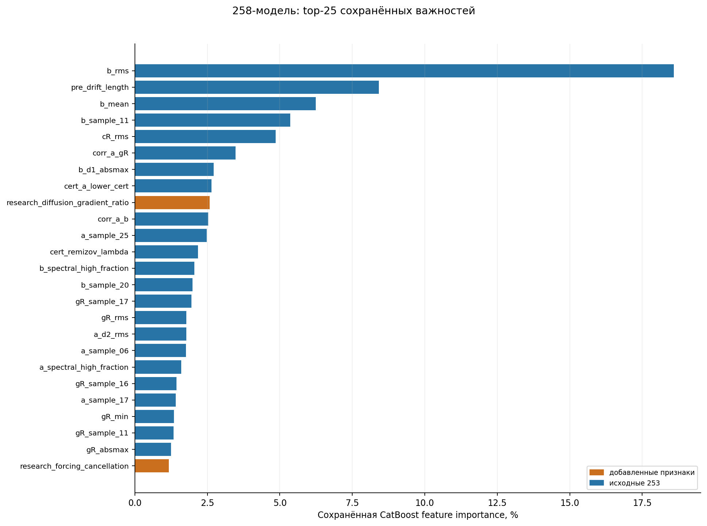

Рисунок 9. PredictionValuesChange — описательная важность модели, не причинный эффект и не доказательство независимого вклада признака. [PDF](figures/09_feature_importance.pdf). Источники и параметры визуализации: [figure_manifest.json](figure_manifest.json), [plot_evidence.py](plot_evidence.py).

## 6. Существующий эксперимент четырёх методов: протокол, ошибки и997 побед RK4

Используется завершённая серия [results/four_method_accuracy_1000_2026-11-01/REPORT.md](../../results/four_method_accuracy_1000_2026-11-01/REPORT.md), а не новый запуск. План до расчёта: [results/four_method_accuracy_1000_2026-11-01/plan.json](../../results/four_method_accuracy_1000_2026-11-01/plan.json).2000production-вызовов,1000RK4+1000PI, **один фиксированный шаговый профиль**; R и MC заново не считались. Current arithmetic audit прочитал все7000первичных JSON и подтвердил записи/НУ/значения/ошибки, не оценивая exact заново.

### 6.1. Четыре математических профиля

| Метод | Алгоритм/данные | Фиксированные параметры | Источник |
|---|---|---|---|
| R | bounded resolvent через конечные аппроксимации Чернова, историческое cubic/taper, значение узла0 из grid33 | n128, Q513 quadratic, dx=.0125, padding12, legacy auto-T, tail_eps1e-8 | [chernov_solver.py](../../chernov_solver.py); [results/chernov_solve1000_2026-10-18/plan.json](../../results/chernov_solve1000_2026-10-18/plan.json) |
| MC mean4 | среднее4 независимых сохранённых EM/Feynman–Kac ответов; два trapezoidal накопления; G-normalized auto-T | M1024×4, dt1/128, seeds202610250101…104, tail_eps1e-4, target0 | [mc_optimized.py](../../mc_optimized.py); [results/mc1000_x0_2026-10-25/plan.json](../../results/mc1000_x0_2026-10-25/plan.json) |
| RK4 | U=(y,v), U′=(v,(g−bv−cy)/a); классические k1,k2,k3,k4 и веса1/6,1/3,1/3,1/6; точки x,x+h/2,x+h/2,x+h | [-1,1], N128, h1/64, a_min.001;129узлов, index64=0; исходныеa,b,c,g,y0,v0 | [solve_rk4](../../src/numerical_methods/rk4_solver.py#L35) |
| PI | Z=(y,v,1); Z′=B(x)Z, B=[[0,1,0],[-c/a,-b/a,g/a],[0,0,0]]; Z_(k+1)=expm(hB(x_k))Z_k | тот же интервал/N/guard/НУ; коэффициенты строго в левой точке; scipy.linalg.expm3×3 | [solve_product_integral_left_exponential](../../src/numerical_methods/product_integral_solver.py#L262) |

RK4 действительно классический четырёхстадийный порядок4; это свойство схемы при достаточной гладкости/устойчивости, а не оценённый по одному N порядок. Левый экспоненциальный PI в переменных коэффициентах обычно даёт первый порядок глобальной ошибки: точная expm решает замороженный локальный B, не устраняет ошибку заморозки. Теоретическая оценка порядка не является измеренной сходимостью данной серии. Даже regime=constant имеет переменную g, поэтому расширенная B с forcing в общем случае не постоянна и PI не обязан быть точным. Численные формулы не менялись в интеграции; исходные переносимые файлы и сравнение: [docs/NUMERICAL_METHODS.md](../../docs/NUMERICAL_METHODS.md), [results/rk4_product_integral_integration_2026-11-01/REPORT.md](../../results/rk4_product_integral_integration_2026-11-01/REPORT.md).

Ошибки: `E0=abs(result.y[64]−saved_exact0)` для RK4/PI; x[64] точно0. Для R target_x[16]=0; для MC target_x=[0], ошибка среднего ответов. Нет ближайшего NPZ-отсчёта, интерполяции численного ответа, нового восстановления НУ или exact в solver state. Сохранённый safe-loader до solver по прежнему проверяет manufactured-контракт; g как вход вычисляется из исходного представления задачи. Winner — минимум E0 по четырём пригодным ответам; точные равенства float64 развязываются порядком[R,MC,RK4,PI], но в997строках равенств0. ε=.05 не изменён.

Ресурсы прежней серии: один процесс, BLAS/OpenMP1, Python3.10.11, NumPy2.2.6, SciPy1.15.3. Цикл с расчетом/оценкой/записью308.432394с без первоначальной загрузки, peakRSS219.578125MiB. Счётчики512000RK4-RHS и128000PI-expm. Resume прочитал2000завершённых записей и сделал0вызовов, сохранив bytes/mtime. Источники: [results/four_method_accuracy_1000_2026-11-01/execution.log](../../results/four_method_accuracy_1000_2026-11-01/execution.log), [results/four_method_accuracy_1000_2026-11-01/resume_verification.json](../../results/four_method_accuracy_1000_2026-11-01/resume_verification.json), [results/four_method_accuracy_1000_2026-11-01/independent_verification.json](../../results/four_method_accuracy_1000_2026-11-01/independent_verification.json). Эти исторические времена разных профилей/эпох/числа точек **не являются** новым честным сравнением скорости.

### 6.2. Полное доступное покрытие и общее пересечение

| Scope | Метод | n | E≤.05 | MeanE0 | MedianE0 | q90 | q95 | q99 | MaxE0 |
|---|---|---|---|---|---|---|---|---|---|
| available | remizov | 997 | 982 | 1.12691494438 | 0.00118625431425 | 0.0076080778374 | 0.0135206567217 | 0.0829244021737 | 842.086581014 |
| available | monte_carlo | 1000 | 938 | 0.0180639158198 | 0.00918753330859 | 0.0389002394546 | 0.0581635996891 | 0.149595964233 | 0.569763734798 |
| available | rk4 | 1000 | 1000 | 1.78438522245e-07 | 6.19101168421e-09 | 1.56804530471e-07 | 3.87633458407e-07 | 3.25580822444e-06 | 4.58731650572e-05 |
| available | product_integral | 1000 | 760 | 0.0456149048191 | 0.0173781312869 | 0.10085527448 | 0.161963474145 | 0.408820358229 | 1.98527418616 |
| common997 | remizov | 997 | 982 | 1.12691494438 | 0.00118625431425 | 0.0076080778374 | 0.0135206567217 | 0.0829244021737 | 842.086581014 |
| common997 | monte_carlo | 997 | 935 | 0.0180833605632 | 0.00919246130152 | 0.0391481058093 | 0.0582840023276 | 0.149844731341 | 0.569763734798 |
| common997 | rk4 | 997 | 997 | 1.78751796929e-07 | 6.24209051114e-09 | 1.55208326524e-07 | 3.88946527619e-07 | 3.25696379248e-06 | 4.58731650572e-05 |
| common997 | product_integral | 997 | 758 | 0.0456124373274 | 0.0173795206124 | 0.100557692439 | 0.162541635873 | 0.408881985192 | 1.98527418616 |

Источник значений: [results/four_method_accuracy_1000_2026-11-01/release/coverage_all1000.csv](../../results/four_method_accuracy_1000_2026-11-01/release/coverage_all1000.csv) и [results/four_method_accuracy_1000_2026-11-01/release/ml_four_methods.csv](../../results/four_method_accuracy_1000_2026-11-01/release/ml_four_methods.csv), пересчёт [four_method_distributions.csv](tables/four_method_distributions.csv) содержит также min,q01,q05,q25,q75,std_population,zero_count. Quantiles — NumPy linear interpolation; это описательные квантили задач, не CI. У всех E0>0, floor/замена нулей для логарифмических графиков не применялись. На доступных1000RK4 имеет1000точных, PI760; на общих997—997/758; R982/997, MC935/997. Сравнивать доли из разных scopes как парные нельзя.

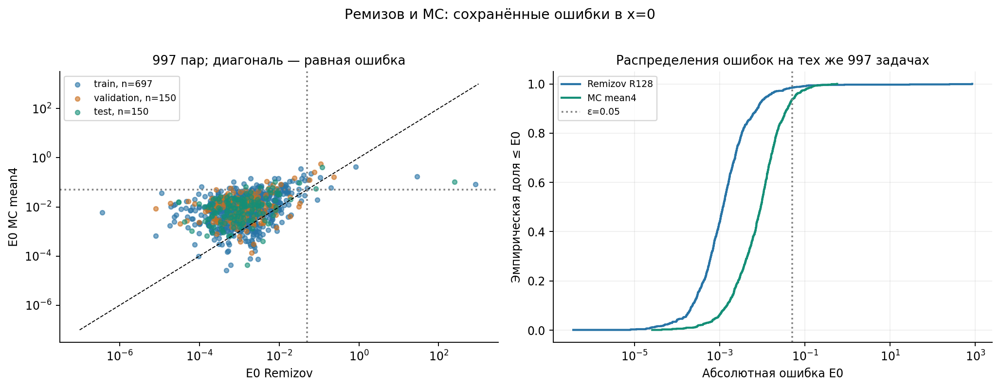

Рисунок 1. Исходный split. Все точки сохранены, выбросы не удалялись. Не является новым расчётом. [PDF](figures/01_R_MC_error_comparison.pdf). Источники и параметры визуализации: [figure_manifest.json](figure_manifest.json), [plot_evidence.py](plot_evidence.py).

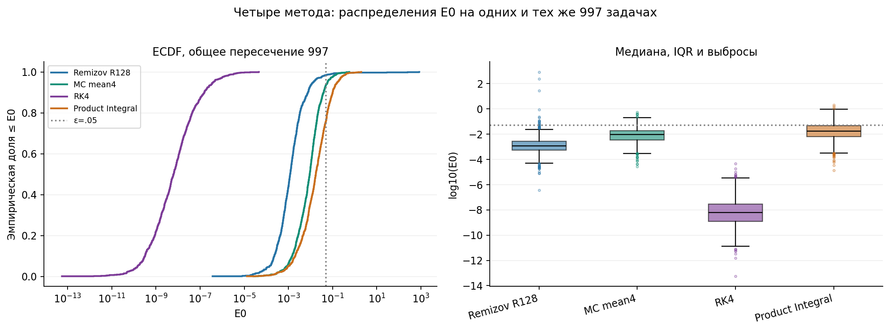

Рисунок 10. Данные положительны; логарифм используется только для отображения. Все выбросы сохранены. [PDF](figures/10_four_method_distributions.pdf). Источники и параметры визуализации: [figure_manifest.json](figure_manifest.json), [plot_evidence.py](plot_evidence.py).

### 6.3. Сложность, режимы, семейства и победители

Уровни L1…L4 задают диапазоны глубины/узлов AST и максимальной частоты примитивов: L1(1–2,3–7,1.5), L2(2–3,6–12,3), L3(3–4,10–18,5), L4(4–5,14–24,8). В constant-режиме коэффициентные деревья принудительно константные, но y_shape остаётся структурно богатым. Поэтому L — категориальная конструкция генератора, а не измеренная stiffness или универсальная трудность ОДУ. Источники: [_COMPLEXITY_SPECS](../../src/all_methods_dataset_v1.py#L76), [_generate_families](../../src/all_methods_dataset_v1.py#L439).

#### Сложность: общее пересечение997

| Группа | Метод | n | MedianE0 | IQR[q25,q75] | MeanE0 | MaxE0 | E≤.05 |
|---|---|---|---|---|---|---|---|
| L1 | remizov | 250 | 0.000956304213 | [0.000488625593, 0.00183612254] | 0.0018605061 | 0.0329761755 | 250 |
| L1 | monte_carlo | 250 | 0.00705825331 | [0.00273440925, 0.0138105515] | 0.0100918198 | 0.104971879 | 249 |
| L1 | rk4 | 250 | 1.80526669e-09 | [4.97737601e-10, 8.17736634e-09] | 1.21635776e-08 | 2.55941529e-07 | 250 |
| L1 | product_integral | 250 | 0.0121575034 | [0.00492120319, 0.0258065665] | 0.0203125801 | 0.150931044 | 225 |
| L2 | remizov | 250 | 0.00129336401 | [0.000578644116, 0.00254879701] | 0.00284587921 | 0.0825876221 | 248 |
| L2 | monte_carlo | 250 | 0.0082085738 | [0.00339567928, 0.0170152378] | 0.0129494684 | 0.125239964 | 244 |
| L2 | rk4 | 250 | 5.36830391e-09 | [1.36242148e-09, 1.55354378e-08] | 2.74672961e-08 | 1.25089248e-06 | 250 |
| L2 | product_integral | 250 | 0.0169923466 | [0.00638848732, 0.0417401945] | 0.0316470748 | 0.388705321 | 199 |
| L3 | remizov | 247 | 0.00120011736 | [0.000486944922, 0.00285384041] | 3.41179688 | 842.086581 | 246 |
| L3 | monte_carlo | 247 | 0.00922475346 | [0.00365176831, 0.0180806655] | 0.0159585978 | 0.146653172 | 233 |
| L3 | rk4 | 247 | 8.19776103e-09 | [1.78768808e-09, 4.08484396e-08] | 7.4468648e-08 | 2.41828269e-06 | 247 |
| L3 | product_integral | 247 | 0.0176959023 | [0.00598535551, 0.0536657683] | 0.0495808761 | 1.13914516 | 180 |
| L4 | remizov | 250 | 0.00136720889 | [0.000590888064, 0.00447675788] | 1.11857509 | 248.323077 | 238 |
| L4 | monte_carlo | 250 | 0.013484704 | [0.00529258209, 0.0303587304] | 0.033308059 | 0.569763735 | 209 |
| L4 | rk4 | 250 | 2.18085551e-08 | [3.95118098e-09, 1.44734982e-07] | 5.99656268e-07 | 4.58731651e-05 | 250 |
| L4 | product_integral | 250 | 0.0291963219 | [0.00886008428, 0.0830189023] | 0.0809568395 | 1.98527419 | 154 |

#### Режим: общее пересечение997

| Группа | Метод | n | MedianE0 | IQR[q25,q75] | MeanE0 | MaxE0 | E≤.05 |
|---|---|---|---|---|---|---|---|
| constant | remizov | 200 | 0.00086237454 | [0.000470219208, 0.00160651191] | 0.00223611762 | 0.196203122 | 199 |
| constant | monte_carlo | 200 | 0.00929768147 | [0.0036097556, 0.0191356733] | 0.0133285182 | 0.0666906544 | 194 |
| constant | rk4 | 200 | 5.06187913e-09 | [1.44469253e-09, 1.69928535e-08] | 3.03119042e-08 | 1.03503395e-06 | 200 |
| constant | product_integral | 200 | 0.0191058922 | [0.00654908721, 0.0425067778] | 0.0378263825 | 0.613265213 | 158 |
| high_contrast | remizov | 200 | 0.00199818429 | [0.000794463741, 0.00465723461] | 4.21414073 | 842.086581 | 199 |
| high_contrast | monte_carlo | 200 | 0.00918392823 | [0.00401276603, 0.0188520678] | 0.017207348 | 0.140593565 | 183 |
| high_contrast | rk4 | 200 | 1.75776806e-08 | [4.72954076e-09, 9.17541438e-08] | 1.17471717e-07 | 2.41828269e-06 | 200 |
| high_contrast | product_integral | 200 | 0.0276286097 | [0.00981623769, 0.0649030098] | 0.0591720842 | 1.13914516 | 129 |
| moderate_varying | remizov | 200 | 0.00124874288 | [0.000578080436, 0.00273518552] | 0.00294520523 | 0.0825876221 | 199 |
| moderate_varying | monte_carlo | 200 | 0.00971107934 | [0.00408639224, 0.0183121158] | 0.0138177868 | 0.14060077 | 195 |
| moderate_varying | rk4 | 200 | 6.7149419e-09 | [1.75282183e-09, 1.93184403e-08] | 2.9377894e-08 | 1.12240756e-06 | 200 |
| moderate_varying | product_integral | 200 | 0.0180852711 | [0.00719276435, 0.0510118128] | 0.0344124831 | 0.296318227 | 148 |
| oscillatory | remizov | 197 | 0.00227583823 | [0.000766306177, 0.00785404506] | 1.41869581 | 248.323077 | 185 |
| oscillatory | monte_carlo | 197 | 0.0128894014 | [0.00449867063, 0.0388176173] | 0.0372455839 | 0.569763735 | 164 |
| oscillatory | rk4 | 197 | 2.19964293e-08 | [4.05505918e-09, 1.13426111e-07] | 7.1957775e-07 | 4.58731651e-05 | 197 |
| oscillatory | product_integral | 197 | 0.0317431133 | [0.0119836072, 0.0794800234] | 0.0861969137 | 1.98527419 | 128 |
| slow_varying | remizov | 200 | 0.000715351427 | [0.000321267298, 0.00129274237] | 0.000933580201 | 0.00680217133 | 200 |
| slow_varying | monte_carlo | 200 | 0.00591531784 | [0.00237998972, 0.011693953] | 0.00910499929 | 0.086518695 | 199 |
| slow_varying | rk4 | 200 | 8.40920555e-10 | [2.8688571e-10, 3.24296662e-09] | 5.13210851e-09 | 1.04927721e-07 | 200 |
| slow_varying | product_integral | 200 | 0.00754976823 | [0.00301163082, 0.0138322114] | 0.0110630903 | 0.120876733 | 195 |

Суммы RK4-побед: L1=250,L2=250,L3=247,L4=250; constant/slow/moderate/high_contrast по200, oscillatory197. Во всех20ячейках сложности×режима winnerRK4; по200структурным семействам —197семей×5 иF0134/F0136/F0139×4, все RK4. По original split697/150/150, latest747/100/150 — также только RK4. Источники: [results/four_method_accuracy_1000_2026-11-01/release/winners_by_complexity.csv](../../results/four_method_accuracy_1000_2026-11-01/release/winners_by_complexity.csv), [results/four_method_accuracy_1000_2026-11-01/release/winners_by_regime.csv](../../results/four_method_accuracy_1000_2026-11-01/release/winners_by_regime.csv), [results/four_method_accuracy_1000_2026-11-01/release/winners_by_complexity_regime.csv](../../results/four_method_accuracy_1000_2026-11-01/release/winners_by_complexity_regime.csv), [results/four_method_accuracy_1000_2026-11-01/release/winners_by_family.csv](../../results/four_method_accuracy_1000_2026-11-01/release/winners_by_family.csv), [results/four_method_accuracy_1000_2026-11-01/release/winners_by_original_split.csv](../../results/four_method_accuracy_1000_2026-11-01/release/winners_by_original_split.csv), [results/four_method_accuracy_1000_2026-11-01/release/winners_by_latest_split.csv](../../results/four_method_accuracy_1000_2026-11-01/release/winners_by_latest_split.csv).

Полные распределения всех 200семейств без пропусков: [four_method_group_distributions.csv](tables/four_method_group_distributions.csv), group_type=family_id. Их медианы показаны на рисунке13; статусы/все E0/идентичности всех 1000 — исходная coverage. Список997индивидуальных winner — [results/four_method_accuracy_1000_2026-11-01/release/winners.csv](../../results/four_method_accuracy_1000_2026-11-01/release/winners.csv). На трёх неполных случаях RK4 также лучший из доступных трёх ответов, но четырёхметодная метка им не назначается из-за отсутствия R.

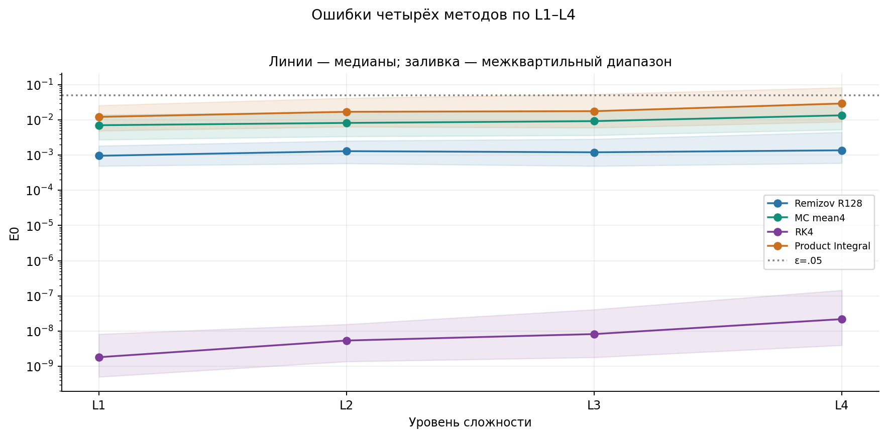

Рисунок 11. IQR описывает задачи, а не доверительный интервал; группы: 250/250/247/250. [PDF](figures/11_four_complexity.pdf). Источники и параметры визуализации: [figure_manifest.json](figure_manifest.json), [plot_evidence.py](plot_evidence.py).

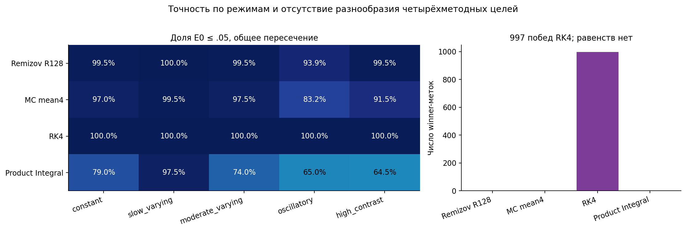

Рисунок 12. В каждой клетке все методы сравниваются на одинаковых ID; oscillatory n=197, остальные n=200. [PDF](figures/12_regime_accuracy_and_winners.pdf). Источники и параметры визуализации: [figure_manifest.json](figure_manifest.json), [plot_evidence.py](plot_evidence.py).

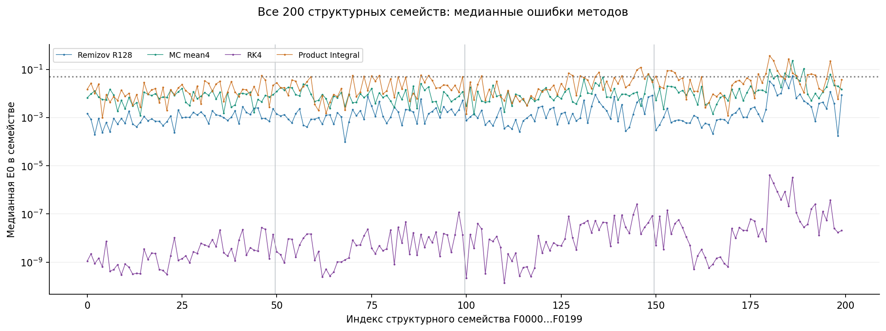

Рисунок 13. В каждом семействе 5 параметризаций; F0134/F0136/F0139 содержат 4 общих ответа. Линии соединяют категории только для читаемости. [PDF](figures/13_family_median_errors.pdf). Источники и параметры визуализации: [figure_manifest.json](figure_manifest.json), [plot_evidence.py](plot_evidence.py).

### 6.4. Худшие ошибки и33 сохранённых узла

| Метод сортировки | ID | L | Режим | E0 метода | E_R0 | E_MC0 |
|---|---|---|---|---|---|---|
| rk4 | AMV1_F0181_S04 | L4 | oscillatory | 4.58731650572e-05 | 0.00460703748824 | 0.0252996549376 |
| rk4 | AMV1_F0182_S00 | L4 | oscillatory | 1.84749941557e-05 | 0.0241927027791 | 0.149513041863 |
| rk4 | AMV1_F0186_S01 | L4 | oscillatory | 1.01044608306e-05 | 0.034447835583 | 0.348761134227 |
| product_integral | AMV1_F0180_S00 | L4 | oscillatory | 1.98527418616 | 0.11943922737 | 0.413316709173 |
| product_integral | AMV1_F0181_S04 | L4 | oscillatory | 1.44262628283 | 0.00460703748824 | 0.0252996549376 |
| product_integral | AMV1_F0148_S02 | L3 | high_contrast | 1.13914516179 | 0.0111338584711 | 0.0493050097833 |

Источник: [four_method_common997.csv](tables/four_method_common997.csv); полный top10 каждого нового метода и исходные отказы — [results/four_method_accuracy_1000_2026-11-01/release/problem_equations.csv](../../results/four_method_accuracy_1000_2026-11-01/release/problem_equations.csv).

| Метод | n | E_grid33≤.05 | MeanE_grid33 | MedianE_grid33 | MaxE_grid33 |
|---|---|---|---|---|---|
| rk4 | 1000 | 1000 | 1.20494201634e-06 | 2.98453448067e-08 | 0.000457804959517 |
| product_integral | 1000 | 404 | 0.273512460218 | 0.0694232206736 | 14.3836188199 |

Вспомогательная E_grid33 — max abs ошибки на каждом четвёртом из 129 узлов, не непрерывная E∞. У PI эта метрика существенно хуже точки0:760/1000 точны в0 и404/1000 на 33узлах. У RK4 худший E0≈4.59e-5, но max grid33≈4.58e-4. Нельзя из одной точки заключать равномерную точность. Существующие trajectories и exact_grid33 повторно прочитаны, новых exact-вычислений нет. Для MC имеется только x0 на 1000, поэтому общего четырёхметодного E_grid33-сравнения на 1000 не существует.

Большие PI-ошибки согласуются с ограничением левой заморозки при переменной RHS/коэффициентах и возможным усилением ошибки в IVP. Но один N не разделяет локальную погрешность заморозки, чувствительность IVP и накопленное округление; причинная декомпозиция для каждого случая не установлена. Для RK4 найденные малые ошибки не доказывают устойчивость при другом масштабе, stiffness или длине интервала. Никакие параметры не подбирались для улучшения этих значений.

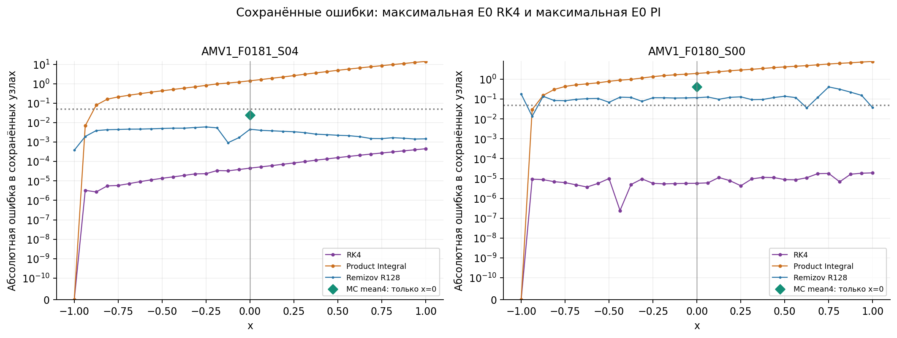

Рисунок 14. Только существующие 33 узла и MC в нуле. Symlog с линейной областью до 1e-10 сохраняет нулевую ошибку НУ без подстановки floor. Междуузловая точность не установлена; новых exact/solver вызовов нет. [PDF](figures/14_saved_worst_trajectories.pdf). Источники и параметры визуализации: [figure_manifest.json](figure_manifest.json), [plot_evidence.py](plot_evidence.py).

### 6.5. Что означает997/997

Это **эмпирический факт для этих997задач, данных НУ, фиксированных реализаций и бюджетов, метрики E0**. Он не доказывает универсального превосходства RK4, не оценивает порядки сходимости по N, оптимальные бюджеты и стоимость достижения заданного допуска, не сравнивает среднюю будущую ошибку случайного нового MC-seed. Mean4MC — один конкретный агрегат конечных seed. R использует глобальное условие, IVP-методы дополнительно используют сохранённые НУ; для иной постановки этого может не быть.

Все997 four-method labels — один классRK4. Обучение многоклассового ML на такой цели не даст проверки распознавания областей применимости: константа always-RK4 уже воспроизводит100% этих меток. Валидный следующий научный вопрос — отдельное, заранее спроектированное исследование точности/бюджетов/устойчивости и иной области задач, а не объявление ML-селектора доказанным. В настоящей работе новые N/задачи/подборы не запускались.

## 7. Реестр подтверждённых выводов и границ доказательств

| Утверждение | Статус | Основание / чего недостаёт |
|---|---|---|
| 997пар и3пропуска R | Подтверждено | coverage +7000raw-записей; пропуски не отрицательные классы |
| 258признаков доступны до solve | Подтверждено в нынешнем контракте | whitelist+точное восстановление997×258; внешним данным нужны certificates/AST |
| 258 на Test находит6MC,14FP,3FN | Подтверждено | сохранённые scores+CBM+23строки; это diagnostic, не глобальный Val-winner |
| 258 лучше во всех смыслах | Не подтверждено | winner accuracy и ε-success хуже R; mean определяется крупным выбросом |
| Дополнительные5 обеспечивают переносимое улучшение | Гипотеза | нет свежего независимого подтверждения и покомпонентной ablation |
| Веса/пороги/большая глубина устойчиво улучшают селектор | Не подтверждено | Val выигрыш не переносится стабильно; CV нестабилен |
| Nested thresholds независимо проверены | Частично | outer metrics и inner ranking да; inner scores отсутствуют |
| Final140 был выполнен | Подтверждено | 140raw records, final_summary, FINAL_REPORT; первоначальный720 план не выполнен |
| Final140 доказал качество выбора MC | Не подтверждено | 0MC-actions; MC0/20,40неизмерены |
| Общее четырёхметодное сравнение на 997:RK4winner | Подтверждено | все индивидуальные E0,997argmin без ties |
| RK4 универсально лучше PI/R/MC | Не подтверждено | один N/набор/метрика; бюджеты и условия различаются |
| Четырёхметодные E_grid33 на 1000 | Отсутствуют | MC сохранён только в0 |
| Полная ошибка MC ограничена CI/stderr/tail_eps | Не подтверждено | CI sampling-only; tail отдельно; EM bias и whole-grid error не покрыты |
| Старый Test снова независим после новой заморозки | Нет | повторное раскрытие и множество просмотренных моделей/политик |
| Перспективная четырёхклассовая ML-цель уже готова | Нет информативной проверки классов | 997одинаковыхwinnerRK4 |

Семейства являются единицами группировки и неопределённости; пять параметризаций и четыре MC-seed не независимы как новые семьи. Сохранённые bootstrap-интервалы воспроизведены как исторические результаты, новые bootstrap-эксперименты или проверки статистической значимости не проводились. Ни один Test-оптимум по844политикам не объявляется новой выбранной моделью. Просмотр всех политик, ошибок и feature-важностей увеличивает риск дальнейшей адаптации к этому Test; для подтверждения будущего решения нужен новый независимо отобранный и заранее замороженный набор.

Для итоговой статьи допустимы описания зафиксированных наблюдений с указанными контрактами и отрицательными результатами. Недопустимы заявления о95%надёжности любого нового solver-call, универсальной применимости learned selector, причинном влиянии признаков, одинаковой стоимости профилей или непрерывной точности всего интервала, если требуемых источников нет.

## Приложение A. Все96 сохранённых моделей A–E: сопоставление трёх split

Для каждой модели здесь её **собственный ранее определённый Val-optimal порог**, не новый выбор по Test. Это не сравнение всех моделей на одном Train: old/new разные. Train in-sample; Val использован для порога; Test уже раскрыт. Fixed .05… .50 политики также доступны без пропусков в [полной2532-строчной таблице](tables/model_policy_metrics_all.csv). Точные config/SHA/model paths — [models_96.csv](tables/models_96.csv). В ID X=253, augmented=258; w — вес MC; baseline/medium/deeper определены в разделе3.

| ID | t | Train regret | Val regret | Test regret | Train MacroF1 | Val MacroF1 | Test MacroF1 | Test TP/FP/FN | Test ε-success |
|---|---|---|---|---|---|---|---|---|---|
| new__X__asinh__w1__baseline | 0.0154951025 | 0.00106489597 | 0.00185777915 | 1.655066 | 0.487929185 | 0.465240642 | 0.484536082 | 0/0/9 | 147/150 |
| new__X__asinh__w1__deeper | 0.00288492739 | 0.000400067423 | 0.00185777915 | 0.000698029295 | 0.50858137 | 0.465240642 | 0.575338157 | 1/1/8 | 146/150 |
| new__X__asinh__w1__medium | 0.00546215374 | 0.000400067423 | 0.00185777915 | 0.00107826314 | 0.50858137 | 0.465240642 | 0.565972222 | 1/2/8 | 145/150 |
| new__X__classifier__w12__baseline | 0.846723331 | 1.16589308 | 0.00185777915 | 1.655066 | 0.583668642 | 0.465240642 | 0.484536082 | 0/0/9 | 147/150 |
| new__X__classifier__w12__deeper | 0.855241842 | 9.10626039e-08 | 0.00185777915 | 1.655066 | 0.996943648 | 0.465240642 | 0.484536082 | 0/0/9 | 147/150 |
| new__X__classifier__w12__medium | 0.795009612 | 0 | 0.00185777915 | 1.655066 | 1 | 0.465240642 | 0.484536082 | 0/0/9 | 147/150 |
| new__X__classifier__w1__baseline | 0.25 | 0.000256510293 | 0.000710351281 | 1.65589914 | 0.810536614 | 0.592391304 | 0.543859649 | 1/5/8 | 146/150 |
| new__X__classifier__w1__deeper | 0.535593971 | 0.0379939642 | 0.00185777915 | 1.655066 | 0.826003013 | 0.465240642 | 0.484536082 | 0/0/9 | 147/150 |
| new__X__classifier__w1__medium | 0.174326435 | 0.000168499754 | 0.00155203777 | 1.65710279 | 0.960980098 | 0.611428571 | 0.545242537 | 3/20/6 | 145/150 |
| new__X__classifier__w2__baseline | 0.507148359 | 1.16576943 | 0.00185777915 | 1.655066 | 0.705455719 | 0.465240642 | 0.484536082 | 0/0/9 | 147/150 |
| new__X__classifier__w2__deeper | 0.5 | 0 | 0.00185777915 | 1.655066 | 1 | 0.465240642 | 0.484536082 | 0/0/9 | 147/150 |
| new__X__classifier__w2__medium | 0.256347765 | 5.09242214e-05 | 0.00184542654 | 1.65650192 | 0.98222839 | 0.626245847 | 0.555555556 | 3/18/6 | 146/150 |
| new__X__classifier__w3__baseline | 0.564601802 | 0.0385801797 | 0.00185777915 | 1.655066 | 0.743663067 | 0.465240642 | 0.484536082 | 0/0/9 | 147/150 |
| new__X__classifier__w3__deeper | 0.602390622 | 0 | 0.00185777915 | 1.655066 | 1 | 0.465240642 | 0.484536082 | 0/0/9 | 147/150 |
| new__X__classifier__w3__medium | 0.562065692 | 2.39958607e-06 | 0.00185777915 | 1.65530643 | 0.987603717 | 0.465240642 | 0.482758621 | 0/1/9 | 147/150 |
| new__X__classifier__w5__baseline | 0.587828472 | 0.000103963574 | 0.00185777915 | 1.65520413 | 0.847964722 | 0.465240642 | 0.594678861 | 2/6/7 | 147/150 |
| new__X__classifier__w5__deeper | 0.637436358 | 0 | 0.00185777915 | 1.655066 | 1 | 0.465240642 | 0.484536082 | 0/0/9 | 147/150 |
| new__X__classifier__w5__medium | 0.673188863 | 2.332952e-06 | 0.00185777915 | 1.65489088 | 0.990745979 | 0.465240642 | 0.586206897 | 1/0/8 | 147/150 |
| new__X__classifier__w8__baseline | 0.746436578 | 0.0385800515 | 0.00185777915 | 1.65489088 | 0.737530888 | 0.465240642 | 0.586206897 | 1/0/8 | 147/150 |
| new__X__classifier__w8__deeper | 0.750760637 | 0 | 0.00185777915 | 1.65490291 | 1 | 0.465240642 | 0.575338157 | 1/1/8 | 147/150 |
| new__X__classifier__w8__medium | 0.664760111 | 0 | 0.00185777915 | 1.65513192 | 1 | 0.465240642 | 0.565972222 | 1/2/8 | 147/150 |
| new__X__raw__w1__baseline | 0.034679661 | 0.0395672446 | 0.00185777915 | 1.65745718 | 0.484985038 | 0.465240642 | 0.480968858 | 0/2/9 | 146/150 |
| new__X__raw__w1__deeper | 0.0934584763 | 0.00173148629 | 0.00185777915 | 1.65775772 | 0.524248826 | 0.465240642 | 0.477351916 | 0/4/9 | 146/150 |
| new__X__raw__w1__medium | 0.00217228542 | 0.00228132576 | 0.00185777915 | 1.65751217 | 0.489700473 | 0.465240642 | 0.479166667 | 0/3/9 | 146/150 |
| new__augmented__asinh__w1__baseline | 0.0166998671 | 0.00106489597 | 0.00185777915 | 1.655066 | 0.487929185 | 0.465240642 | 0.484536082 | 0/0/9 | 147/150 |
| new__augmented__asinh__w1__deeper | 0.000657488334 | 0.000304456709 | 0.00185777915 | 0.000698029295 | 0.518605409 | 0.465240642 | 0.575338157 | 1/1/8 | 146/150 |
| new__augmented__asinh__w1__medium | 0.00232185317 | 0.000400067423 | 0.00185777915 | 0.00107826314 | 0.50858137 | 0.465240642 | 0.565972222 | 1/2/8 | 145/150 |
| new__augmented__classifier__w12__baseline | 0.84047749 | 1.16583604 | 0.00185777915 | 1.655066 | 0.609094823 | 0.465240642 | 0.484536082 | 0/0/9 | 147/150 |
| new__augmented__classifier__w12__deeper | 0.873761569 | 3.32462568e-06 | 0.00185777915 | 1.655066 | 0.987603717 | 0.465240642 | 0.484536082 | 0/0/9 | 147/150 |
| new__augmented__classifier__w12__medium | 0.830033491 | 8.69562452e-06 | 0.00185777915 | 1.65489088 | 0.96811072 | 0.465240642 | 0.586206897 | 1/0/8 | 147/150 |
| new__augmented__classifier__w1__baseline | 0.200667107 | 0.000747064234 | 0.000876030131 | 0.0017079402 | 0.802888506 | 0.707368981 | 0.675531238 | 6/14/3 | 145/150 |
| new__augmented__classifier__w1__deeper | 0.2 | 5.36663669e-05 | 0.00137397084 | 1.65632806 | 0.978605534 | 0.654163341 | 0.501811594 | 1/14/8 | 146/150 |
| new__augmented__classifier__w1__medium | 0.701008773 | 1.16586682 | 0.00185777915 | 1.655066 | 0.583668642 | 0.465240642 | 0.484536082 | 0/0/9 | 147/150 |
| new__augmented__classifier__w2__baseline | 0.545615297 | 1.1658048 | 0.00185777915 | 1.655066 | 0.65614024 | 0.465240642 | 0.484536082 | 0/0/9 | 147/150 |
| new__augmented__classifier__w2__deeper | 0.566419511 | 1.85632349e-06 | 0.00185777915 | 1.655066 | 0.987603717 | 0.465240642 | 0.484536082 | 0/0/9 | 147/150 |
| new__augmented__classifier__w2__medium | 0.5 | 4.16185656e-06 | 0.00185777915 | 1.65509472 | 0.96811072 | 0.465240642 | 0.480968858 | 0/2/9 | 147/150 |
| new__augmented__classifier__w3__baseline | 0.592701782 | 0.0385971594 | 0.00185777915 | 1.655066 | 0.691921397 | 0.465240642 | 0.484536082 | 0/0/9 | 147/150 |
| new__augmented__classifier__w3__deeper | 0.620788655 | 0 | 0.00185777915 | 1.655066 | 1 | 0.465240642 | 0.484536082 | 0/0/9 | 147/150 |
| new__augmented__classifier__w3__medium | 0.54973857 | 1.90788198e-06 | 0.00185777915 | 1.65530643 | 0.99385913 | 0.465240642 | 0.482758621 | 0/1/9 | 147/150 |
| new__augmented__classifier__w5__baseline | 0.612083243 | 0.000131435664 | 0.00185777915 | 1.65496554 | 0.822689878 | 0.465240642 | 0.55044955 | 1/4/8 | 147/150 |
| new__augmented__classifier__w5__deeper | 0.714553537 | 0 | 0.00185777915 | 1.655066 | 1 | 0.465240642 | 0.484536082 | 0/0/9 | 147/150 |
| new__augmented__classifier__w5__medium | 0.557436221 | 0 | 0.00185777915 | 1.65491049 | 1 | 0.465240642 | 0.565972222 | 1/2/8 | 147/150 |
| new__augmented__classifier__w8__baseline | 0.759224045 | 0.0386214489 | 0.00185777915 | 1.655066 | 0.691921397 | 0.465240642 | 0.484536082 | 0/0/9 | 147/150 |
| new__augmented__classifier__w8__deeper | 0.842367464 | 1.26660873e-06 | 0.00185777915 | 1.655066 | 0.99385913 | 0.465240642 | 0.484536082 | 0/0/9 | 147/150 |
| new__augmented__classifier__w8__medium | 0.715060069 | 0 | 0.00185777915 | 1.655066 | 1 | 0.465240642 | 0.484536082 | 0/0/9 | 147/150 |
| new__augmented__raw__w1__baseline | 0.0348039731 | 0.0393667853 | 0.00185777915 | 1.65745718 | 0.485566714 | 0.465240642 | 0.480968858 | 0/2/9 | 146/150 |
| new__augmented__raw__w1__deeper | 0.0920164395 | 0.00158294972 | 0.00185777915 | 1.65795955 | 0.522428915 | 0.465240642 | 0.475524476 | 0/5/9 | 146/150 |
| new__augmented__raw__w1__medium | 0.00119329479 | 0.00225709996 | 0.00185777915 | 1.65751217 | 0.498798147 | 0.465240642 | 0.479166667 | 0/3/9 | 146/150 |
| old__X__asinh__w1__baseline | 0.322389123 | 0.0416850085 | 0.00101074937 | 1.655066 | 0.47736878 | 0.468085106 | 0.484536082 | 0/0/9 | 147/150 |
| old__X__asinh__w1__deeper | 0.289683967 | 0.00119030531 | 0.00101074937 | 1.655066 | 0.488593525 | 0.468085106 | 0.484536082 | 0/0/9 | 147/150 |
| old__X__asinh__w1__medium | 0.624726744 | 0.00119030531 | 0.00101074937 | 1.655066 | 0.488593525 | 0.468085106 | 0.484536082 | 0/0/9 | 147/150 |
| old__X__classifier__w12__baseline | 0.786828324 | 1.24934682 | 0.00101074937 | 1.65524073 | 0.779736812 | 0.468085106 | 0.479166667 | 0/3/9 | 147/150 |
| old__X__classifier__w12__deeper | 0.777872341 | 0 | 0.00101074937 | 1.65512551 | 1 | 0.468085106 | 0.482758621 | 0/1/9 | 147/150 |
| old__X__classifier__w12__medium | 0.778774727 | 0 | 0.00101074937 | 1.65508098 | 1 | 0.468085106 | 0.482758621 | 0/1/9 | 147/150 |
| old__X__classifier__w1__baseline | 0.593434645 | 1.24970258 | 0.00101074937 | 1.655066 | 0.488593525 | 0.468085106 | 0.484536082 | 0/0/9 | 147/150 |
| old__X__classifier__w1__deeper | 0.726110923 | 1.24944935 | 0.00101074937 | 1.655066 | 0.632427048 | 0.468085106 | 0.484536082 | 0/0/9 | 147/150 |
| old__X__classifier__w1__medium | 0.760684189 | 1.20859436 | 0.00101074937 | 1.655066 | 0.551248321 | 0.468085106 | 0.484536082 | 0/0/9 | 147/150 |
| old__X__classifier__w2__baseline | 0.591822503 | 1.24933704 | 0.00101074937 | 1.655066 | 0.66442934 | 0.468085106 | 0.484536082 | 0/0/9 | 147/150 |
| old__X__classifier__w2__deeper | 0.699958885 | 2.6434731e-05 | 0.00101074937 | 1.655066 | 0.940311214 | 0.468085106 | 0.484536082 | 0/0/9 | 147/150 |
| old__X__classifier__w2__medium | 0.801330379 | 1.24938731 | 0.00101074937 | 1.655066 | 0.589036166 | 0.468085106 | 0.484536082 | 0/0/9 | 147/150 |
| old__X__classifier__w3__baseline | 0.666413815 | 1.24945596 | 0.00101074937 | 1.65508098 | 0.624064428 | 0.468085106 | 0.482758621 | 0/1/9 | 147/150 |
| old__X__classifier__w3__deeper | 0.660527421 | 0 | 0.00101074937 | 1.65524893 | 1 | 0.468085106 | 0.557759314 | 1/3/8 | 147/150 |
| old__X__classifier__w3__medium | 0.80503393 | 0.000734487252 | 0.00101074937 | 1.655066 | 0.754786258 | 0.468085106 | 0.484536082 | 0/0/9 | 147/150 |
| old__X__classifier__w5__baseline | 0.684653224 | 0.000259847822 | 0.00101074937 | 1.65508098 | 0.733024741 | 0.468085106 | 0.482758621 | 0/1/9 | 147/150 |
| old__X__classifier__w5__deeper | 0.731067965 | 0 | 0.00101074937 | 1.655066 | 1 | 0.468085106 | 0.484536082 | 0/0/9 | 147/150 |
| old__X__classifier__w5__medium | 0.733139733 | 4.60276006e-06 | 0.00101074937 | 1.655066 | 0.980103148 | 0.468085106 | 0.484536082 | 0/0/9 | 147/150 |
| old__X__classifier__w8__baseline | 0.752706432 | 0.0413211786 | 0.00101074937 | 1.65514049 | 0.73949634 | 0.468085106 | 0.480968858 | 0/2/9 | 147/150 |
| old__X__classifier__w8__deeper | 0.709324992 | 0 | 0.00101074937 | 1.655066 | 1 | 0.468085106 | 0.484536082 | 0/0/9 | 147/150 |
| old__X__classifier__w8__medium | 0.739756364 | 7.14141369e-08 | 0.00101074937 | 1.65508098 | 0.996764295 | 0.468085106 | 0.482758621 | 0/1/9 | 147/150 |
| old__X__raw__w1__baseline | 276.722841 | 0.0416850085 | 0.00101074937 | 1.655066 | 0.47736878 | 0.468085106 | 0.484536082 | 0/0/9 | 147/150 |
| old__X__raw__w1__deeper | 268.910723 | 0.0416850085 | 0.00101074937 | 1.655066 | 0.47736878 | 0.468085106 | 0.484536082 | 0/0/9 | 147/150 |
| old__X__raw__w1__medium | 251.311306 | 0.0416850085 | 0.00101074937 | 1.655066 | 0.47736878 | 0.468085106 | 0.484536082 | 0/0/9 | 147/150 |
| old__augmented__asinh__w1__baseline | 0.256255079 | 0.0416850085 | 0.00101074937 | 1.655066 | 0.47736878 | 0.468085106 | 0.484536082 | 0/0/9 | 147/150 |
| old__augmented__asinh__w1__deeper | 0.247295907 | 0.00119030531 | 0.00101074937 | 1.655066 | 0.488593525 | 0.468085106 | 0.484536082 | 0/0/9 | 147/150 |
| old__augmented__asinh__w1__medium | 0.63867699 | 0.00119030531 | 0.00101074937 | 1.655066 | 0.488593525 | 0.468085106 | 0.484536082 | 0/0/9 | 147/150 |
| old__augmented__classifier__w12__baseline | 0.813097428 | 1.24957837 | 0.000999071979 | 1.65514049 | 0.694476914 | 0.522382469 | 0.480968858 | 0/2/9 | 147/150 |
| old__augmented__classifier__w12__deeper | 0.840802144 | 0 | 0.00101074937 | 1.655066 | 1 | 0.468085106 | 0.484536082 | 0/0/9 | 147/150 |
| old__augmented__classifier__w12__medium | 0.810371238 | 3.93553594e-06 | 0.00101074937 | 1.65512551 | 0.983501631 | 0.468085106 | 0.482758621 | 0/1/9 | 147/150 |
| old__augmented__classifier__w1__baseline | 0.615835415 | 1.24970258 | 0.00101074937 | 1.655066 | 0.488593525 | 0.468085106 | 0.484536082 | 0/0/9 | 147/150 |
| old__augmented__classifier__w1__deeper | 0.734055679 | 1.20916193 | 0.00101074937 | 1.655066 | 0.598039216 | 0.468085106 | 0.484536082 | 0/0/9 | 147/150 |
| old__augmented__classifier__w1__medium | 0.80396583 | 1.24969969 | 0.00101074937 | 1.655066 | 0.499582582 | 0.468085106 | 0.484536082 | 0/0/9 | 147/150 |
| old__augmented__classifier__w2__baseline | 0.65294113 | 1.24946992 | 0.00101074937 | 1.65512551 | 0.570508171 | 0.468085106 | 0.482758621 | 0/1/9 | 147/150 |
| old__augmented__classifier__w2__deeper | 0.716562092 | 2.56106051e-05 | 0.00101074937 | 1.65512551 | 0.928618246 | 0.468085106 | 0.482758621 | 0/1/9 | 147/150 |
| old__augmented__classifier__w2__medium | 0.766681674 | 1.20880371 | 0.00101074937 | 1.65512551 | 0.735570382 | 0.468085106 | 0.482758621 | 0/1/9 | 147/150 |
| old__augmented__classifier__w3__baseline | 0.64290354 | 1.24941414 | 0.00101074937 | 1.65514049 | 0.67208752 | 0.468085106 | 0.480968858 | 0/2/9 | 147/150 |
| old__augmented__classifier__w3__deeper | 0.753822007 | 2.7725928e-06 | 0.00101074937 | 1.655066 | 0.983501631 | 0.468085106 | 0.484536082 | 0/0/9 | 147/150 |
| old__augmented__classifier__w3__medium | 0.790785936 | 0.000688582883 | 0.00101074937 | 1.655066 | 0.796397274 | 0.468085106 | 0.484536082 | 0/0/9 | 147/150 |
| old__augmented__classifier__w5__baseline | 0.675749386 | 0.0407289763 | 0.00101074937 | 1.65538092 | 0.745869394 | 0.468085106 | 0.479166667 | 0/3/9 | 147/150 |
| old__augmented__classifier__w5__deeper | 0.748205451 | 0 | 0.00101074937 | 1.655066 | 1 | 0.468085106 | 0.484536082 | 0/0/9 | 147/150 |
| old__augmented__classifier__w5__medium | 0.799158857 | 3.59930051e-05 | 0.00101074937 | 1.655066 | 0.912400503 | 0.468085106 | 0.484536082 | 0/0/9 | 147/150 |
| old__augmented__classifier__w8__baseline | 0.741696169 | 0.0409129113 | 0.00101074937 | 1.65514049 | 0.745869394 | 0.468085106 | 0.480968858 | 0/2/9 | 147/150 |
| old__augmented__classifier__w8__deeper | 0.822238988 | 0 | 0.00101074937 | 1.655066 | 1 | 0.468085106 | 0.484536082 | 0/0/9 | 147/150 |
| old__augmented__classifier__w8__medium | 0.858375399 | 0.000155060812 | 0.00101074937 | 1.655066 | 0.872996328 | 0.468085106 | 0.484536082 | 0/0/9 | 147/150 |
| old__augmented__raw__w1__baseline | 276.916583 | 0.0416850085 | 0.00101074937 | 1.655066 | 0.47736878 | 0.468085106 | 0.484536082 | 0/0/9 | 147/150 |
| old__augmented__raw__w1__deeper | 274.22172 | 0.0416850085 | 0.00101074937 | 1.655066 | 0.47736878 | 0.468085106 | 0.484536082 | 0/0/9 | 147/150 |
| old__augmented__raw__w1__medium | 251.311306 | 0.0416850085 | 0.00101074937 | 1.655066 | 0.47736878 | 0.468085106 | 0.484536082 | 0/0/9 | 147/150 |

Источник: [results/ml_selector_hypotheses_2026-10-31/candidates.json](../../results/ml_selector_hypotheses_2026-10-31/candidates.json), [results/ml_selector_hypotheses_2026-10-31/validation_metrics.csv](../../results/ml_selector_hypotheses_2026-10-31/validation_metrics.csv), [results/ml_selector_hypotheses_2026-10-31/test_metrics.csv](../../results/ml_selector_hypotheses_2026-10-31/test_metrics.csv), [checks/model_scores.json](checks/model_scores.json). Train получен исключительно inference сохранённых моделей; обучения и новой настройки нет.

## Приложение B. Все63 сохранённые split-метрики первоначальных quality/time-моделей

Перенесены все 63строки [results/ml_research_closure_2026-10-25/ml_metrics.csv](../../results/ml_research_closure_2026-10-25/ml_metrics.csv), без отбора удачных. Исходники целевых таблиц: [results/remizov_ml_v1_2026-10-25/metrics.json](../../results/remizov_ml_v1_2026-10-25/metrics.json), [results/mc1000_x0_2026-10-25/ml/metrics.json](../../results/mc1000_x0_2026-10-25/ml/metrics.json). Здесь AUC/logloss относятся к вероятностному качеству; MAE_seconds — к стоимости; MAE_log10 и MAE_error — к регрессии численной ошибки. «—» означает неприменимо/отсутствует. Rows=n для данного target, а MC single-seed n600 не равно600независимым уравнениям. В historical_taper_grid33 classifier accuracy/recall/threshold в полном CSV относятся к прежнему Validation-порогу (не MC winner). В таблице сохранены все модели; поле selected и остальные метрики — в CSV. Тренировочные оценки не считаются OOF.

| Scope | Target | Model | Split | n | AUC | Logloss | Brier | MAE_seconds | MAE_log10 | MAE_error |
|---|---|---|---|---|---|---|---|---|---|---|
| historical_taper_grid33 | accuracy | catboost | train | 697 | 0.990459935 | 0.127076816 | 0.0307347264 | — | — | — |
| historical_taper_grid33 | accuracy | catboost | validation | 150 | 0.857744108 | 0.248950878 | 0.0694245059 | — | — | — |
| historical_taper_grid33 | accuracy | catboost | test | 150 | 0.880130597 | 0.232171764 | 0.0678835538 | — | — | — |
| historical_taper_grid33 | accuracy | dummy_prior | train | 697 | 0.5 | 0.390160208 | 0.114571776 | — | — | — |
| historical_taper_grid33 | accuracy | dummy_prior | validation | 150 | 0.5 | 0.367569738 | 0.105743862 | — | — | — |
| historical_taper_grid33 | accuracy | dummy_prior | test | 150 | 0.5 | 0.342457207 | 0.0959303759 | — | — | — |
| historical_taper_grid33 | accuracy | logistic | train | 697 | 0.96122889 | 0.151443865 | 0.041656735 | — | — | — |
| historical_taper_grid33 | accuracy | logistic | validation | 150 | 0.816498316 | 0.291304468 | 0.0782276711 | — | — | — |
| historical_taper_grid33 | accuracy | logistic | test | 150 | 0.88386194 | 0.276322604 | 0.0835910205 | — | — | — |
| historical_taper_grid33 | runtime | catboost_coeff | train | 697 | — | — | — | 0.711454867 | — | — |
| historical_taper_grid33 | runtime | catboost_coeff | validation | 150 | — | — | — | 0.829628137 | — | — |
| historical_taper_grid33 | runtime | catboost_coeff | test | 150 | — | — | — | 0.91501146 | — | — |
| historical_taper_grid33 | runtime | catboost_context | train | 697 | — | — | — | 0.609976965 | — | — |
| historical_taper_grid33 | runtime | catboost_context | validation | 150 | — | — | — | 0.560804865 | — | — |
| historical_taper_grid33 | runtime | catboost_context | test | 150 | — | — | — | 0.651882773 | — | — |
| historical_taper_grid33 | runtime | dummy_context | train | 697 | — | — | — | 0.692528655 | — | — |
| historical_taper_grid33 | runtime | dummy_context | validation | 150 | — | — | — | 0.555329259 | — | — |
| historical_taper_grid33 | runtime | dummy_context | test | 150 | — | — | — | 0.676655282 | — | — |
| historical_taper_grid33 | runtime | dummy_median | train | 697 | — | — | — | 1.42454573 | — | — |
| historical_taper_grid33 | runtime | dummy_median | validation | 150 | — | — | — | 1.29029562 | — | — |
| historical_taper_grid33 | runtime | dummy_median | test | 150 | — | — | — | 1.37922959 | — | — |
| historical_taper_grid33 | runtime | ridge_coeff | train | 697 | — | — | — | 0.901695916 | — | — |
| historical_taper_grid33 | runtime | ridge_coeff | validation | 150 | — | — | — | 1.03893535 | — | — |
| historical_taper_grid33 | runtime | ridge_coeff | test | 150 | — | — | — | 1.46289496 | — | — |
| historical_taper_grid33 | runtime | ridge_context | train | 697 | — | — | — | 0.603758729 | — | — |
| historical_taper_grid33 | runtime | ridge_context | validation | 150 | — | — | — | 0.682794558 | — | — |
| historical_taper_grid33 | runtime | ridge_context | test | 150 | — | — | — | 0.846325055 | — | — |
| x0 | mc_single_seed_accuracy | catboost | train | 2800 | 0.812990146 | 0.510378705 | 0.168986367 | — | — | — |
| x0 | mc_single_seed_accuracy | catboost | validation | 600 | 0.698710998 | 0.587708521 | 0.201596214 | — | — | — |
| x0 | mc_single_seed_accuracy | catboost | test | 600 | 0.735006519 | 0.586306127 | 0.201470263 | — | — | — |
| x0 | mc_single_seed_accuracy | dummy | train | 2800 | 0.5 | 0.647225273 | 0.22739273 | — | — | — |
| x0 | mc_single_seed_accuracy | dummy | validation | 600 | 0.5 | 0.648481269 | 0.228001318 | — | — | — |
| x0 | mc_single_seed_accuracy | dummy | test | 600 | 0.5 | 0.674339995 | 0.24053108 | — | — | — |
| x0 | mc_single_seed_accuracy | logistic | train | 2800 | 0.758788765 | 0.547636418 | 0.185141994 | — | — | — |
| x0 | mc_single_seed_accuracy | logistic | validation | 600 | 0.683603601 | 0.603600498 | 0.207929571 | — | — | — |
| x0 | mc_single_seed_accuracy | logistic | test | 600 | 0.655662134 | 0.678968236 | 0.229287256 | — | — | — |
| x0 | remizov_point_accuracy | catboost | train | 697 | 0.995872033 | 0.0671544694 | 0.0150772771 | — | — | — |
| x0 | remizov_point_accuracy | catboost | validation | 150 | 0.909285714 | 0.175521414 | 0.0495113688 | — | — | — |
| x0 | remizov_point_accuracy | catboost | test | 150 | 0.894675926 | 0.118239837 | 0.0296081156 | — | — | — |
| x0 | remizov_point_accuracy | dummy | train | 697 | 0.5 | 0.261764483 | 0.0678167757 | — | — | — |
| x0 | remizov_point_accuracy | dummy | validation | 150 | 0.5 | 0.245250832 | 0.0622645251 | — | — | — |
| x0 | remizov_point_accuracy | dummy | test | 150 | 0.5 | 0.177544862 | 0.0395002974 | — | — | — |
| x0 | remizov_point_accuracy | logistic | train | 697 | 0.986887634 | 0.0709024912 | 0.0183218231 | — | — | — |
| x0 | remizov_point_accuracy | logistic | validation | 150 | 0.795714286 | 0.240889348 | 0.0489286423 | — | — | — |
| x0 | remizov_point_accuracy | logistic | test | 150 | 0.744212963 | 0.218466991 | 0.0472634082 | — | — | — |
| x0 | mc_aggregate_log_error | catboost | train | 700 | — | — | — | — | 0.334153436 | 0.00985717532 |
| x0 | mc_aggregate_log_error | catboost | validation | 150 | — | — | — | — | 0.372811108 | 0.0162191198 |
| x0 | mc_aggregate_log_error | catboost | test | 150 | — | — | — | — | 0.362436707 | 0.0116346752 |
| x0 | mc_aggregate_log_error | dummy | train | 700 | — | — | — | — | 0.456917646 | 0.0135213119 |
| x0 | mc_aggregate_log_error | dummy | validation | 150 | — | — | — | — | 0.422047023 | 0.0179110883 |
| x0 | mc_aggregate_log_error | dummy | test | 150 | — | — | — | — | 0.412119964 | 0.0130547165 |
| x0 | mc_aggregate_log_error | ridge | train | 700 | — | — | — | — | 0.369402051 | 0.0101565861 |
| x0 | mc_aggregate_log_error | ridge | validation | 150 | — | — | — | — | 0.394661859 | 0.028437997 |
| x0 | mc_aggregate_log_error | ridge | test | 150 | — | — | — | — | 0.399227769 | 0.0190139405 |
| x0 | remizov_point_log_error | catboost | train | 697 | — | — | — | — | 0.270204574 | 1.20439618 |
| x0 | remizov_point_log_error | catboost | validation | 150 | — | — | — | — | 0.404432834 | 0.00500407275 |
| x0 | remizov_point_log_error | catboost | test | 150 | — | — | — | — | 0.357941753 | 1.65801049 |
| x0 | remizov_point_log_error | dummy | train | 697 | — | — | — | — | 0.482571632 | 1.25312817 |
| x0 | remizov_point_log_error | dummy | validation | 150 | — | — | — | — | 0.48638673 | 0.00524478609 |
| x0 | remizov_point_log_error | dummy | test | 150 | — | — | — | — | 0.48439569 | 1.6584729 |
| x0 | remizov_point_log_error | ridge | train | 697 | — | — | — | — | 0.344295879 | 1.2504119 |
| x0 | remizov_point_log_error | ridge | validation | 150 | — | — | — | — | 0.429538947 | 0.0874419335 |
| x0 | remizov_point_log_error | ridge | test | 150 | — | — | — | — | 0.361752675 | 1.59871667 |

## Приложение C. Источники, воспроизведение анализа и сохранность

Все новые материалы находятся в этом каталоге. Вне него обновлён только PROJECT_STATUS.md по AGENTS.md; исходник прежнего статуса сохранён в [PROJECT_STATUS.before.md](PROJECT_STATUS.before.md). Старые исходники, датасеты, модели и результаты не заменены. Контроль SHA всех24897 прежних файлов и перечень допустимых изменений — [checks/integrity.json](checks/integrity.json); хеши математического ядра/manifest также проверены. Соседний generator_DE не используется.

Точное соответствие источников текущему срезу:

- [used_sources.json](used_sources.json): SHA-256 прочитанных источников, включая7000raw-записей, модели, исходники и таблицы; ссылки в этом документе ведут к конкретным артефактам/функциям.
- [repository_inventory.csv](repository_inventory.csv), [code_index.csv](code_index.csv), [report_index.json](report_index.json): карта репозитория и истории.
- [historical_metrics_ledger.csv](tables/historical_metrics_ledger.csv), [historical_sources.json](historical_sources.json): машинный реестр скалярных JSON-метрик и JSON pointers; отсутствие поля не восстанавливается предположением.
- [figure_manifest.json](figure_manifest.json):14названий,источников,оговорок; PNG и PDF — в figures/. Контактные листы и visual QA — в checks/.

Скрипты нового каталога воспроизводят только анализ существующих данных:

```bash
PYTHONDONTWRITEBYTECODE=1 .venv/bin/python -B results/scientific_evidence_2026-11-01/collect_evidence.py
PYTHONDONTWRITEBYTECODE=1 .venv/bin/python -B results/scientific_evidence_2026-11-01/audit_saved_tables.py
PYTHONDONTWRITEBYTECODE=1 .venv/bin/python -B results/scientific_evidence_2026-11-01/build_feature_catalog.py
PYTHONDONTWRITEBYTECODE=1 .venv/bin/python -B results/scientific_evidence_2026-11-01/plot_evidence.py
PYTHONDONTWRITEBYTECODE=1 .venv/bin/python -B results/scientific_evidence_2026-11-01/build_dossier.py
PYTHONDONTWRITEBYTECODE=1 .venv/bin/python -B results/scientific_evidence_2026-11-01/verify_dossier.py
```

collect_evidence запрещает импорт solver/generator/training-driver и подменяет CatBoost.fit запретом. Разрешены только load_model/predict, чтение входных признаков и арифметика метрик. audit_saved_tables не импортирует solver/ML вообще. Эти команды не являются командами повторного обучения/решения; не следует запускать старые train/solve-команды из прежних REPORT.md ради этого документа. Полный pytest в этой работе не запускался, поскольку он содержит численные и обучающие проверки; отсутствие нового запуска тестов не подменяется историческим результатом. Текущие проверки относятся к целостности доказательной базы и существующей арифметике, их результат — [checks/report_validation.json](checks/report_validation.json).

Все запрошенные разделы либо снабжены источниками, либо имеют явную отметку недостаточности данных. Новые гипотезы не переведены в подтверждённые выводы.
