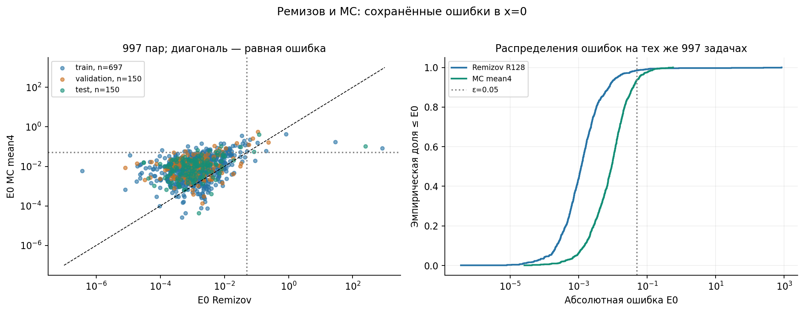
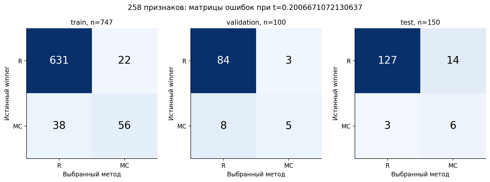
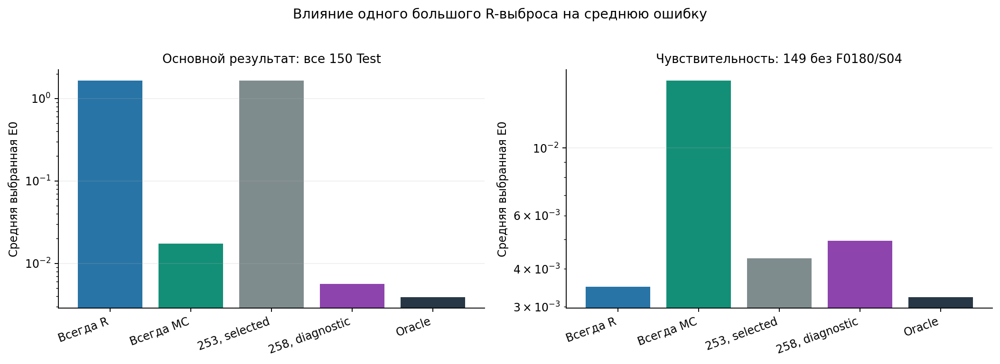
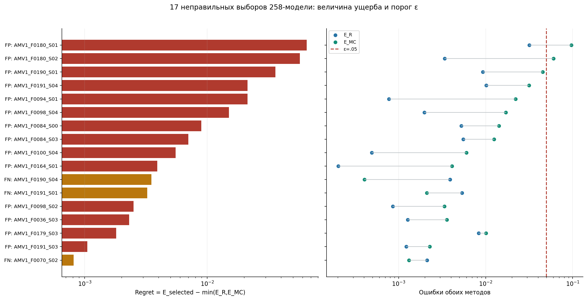
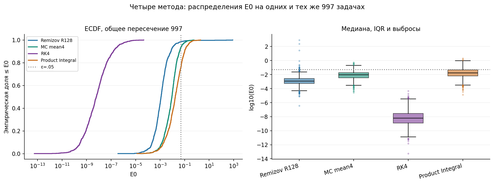
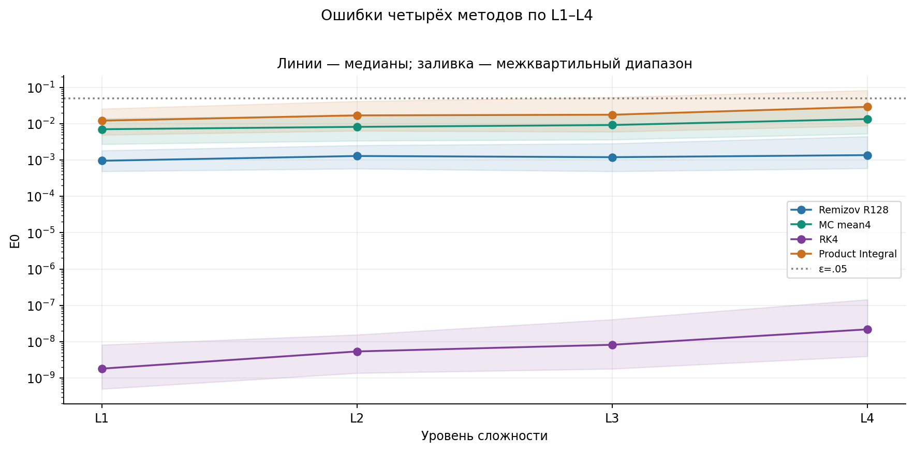

# Исследование точности численных методов решения линейных ОДУ второго порядка с применением машинного обучения

**Научно-технический отчёт**  
Проект `ode-generator-remizov` · 1 ноября 2026 г.

## Аннотация

Исследуется возможность выбора наиболее точного численного метода по характеристикам коэффициентов линейного ОДУ второго порядка. Использован набор из 1000 уравнений с известными точными решениями. Для 997 задач сопоставлены метод Ремизова, Монте-Карло, классический RK4 и метод мультипликативного интеграла. Диагностическая модель CatBoost с 258 признаками обнаружила на Test шесть из девяти преимуществ Монте-Карло, но допустила 17 неправильных выборов, включая две потери допустимой точности. Её низкая средняя ошибка существенно зависит от одного крупного выброса Ремизова. В четырёхметодном сравнении RK4 оказался наиболее точным на всех 997 общих задачах. Обсуждаются границы этих результатов и последствия для построения ML-селектора.

## 1. Постановка задачи и формирование набора уравнений

Рассматриваются уравнения

$$
a(x)y''(x)+b(x)y'(x)+c(x)y(x)=g(x),\qquad x\in[-1,1].
$$

Цель работы — оценить точность фиксированных реализаций численных методов и проверить, можно ли до решения уравнения предсказать метод с меньшей ошибкой. Основной критерий — абсолютная погрешность в точке ноль:

$$
E_m=\left|y_m(0)-y_{\mathrm{exact}}(0)\right|,\qquad
E_m\leq\varepsilon,\quad\varepsilon=0.05.
$$

Наиболее точным считается метод с минимальным $E_m$. Победа по этому критерию не обязательно означает выполнение допуска: оба сравниваемых ответа могут быть неточными.

Датасет `all_methods_v1` содержит 200 структурных семейств, каждое представлено пятью параметризациями. Предусмотрены четыре уровня сложности L1–L4 и пять режимов коэффициентов: постоянный, медленно и умеренно меняющийся, осциллирующий и высококонтрастный. На каждый уровень приходится 250 уравнений, на каждый режим — 200. Исходное разбиение — 700/150/150 задач, или 140/30/30 семейств. Семейства определяются структурой деревьев выражений; их параметризации не разделяются между обучающими и контрольными выборками.

Уравнения строятся методом заданного решения. Сначала формируется гладкая функция с компактным носителем, затем вычисляется $g=ay''+by'+cy$. Коэффициенты задаются преобразованиями ограниченных выражений:

$$
a=A_{\mathrm{mid}}+A_{\mathrm{half}}\tanh T_a,\quad
b=B\tanh T_b,\quad c_R=C\tanh T_c,\quad
\lambda=C+\mathrm{gap},\quad c=c_R-\lambda.
$$

Конструкция обеспечивает положительность $a$ и зазора $\lambda-C$ на всей прямой. Точное решение и начальные условия $y(-1)$, $y'(-1)$ сохранены. Ремизов и MC используют глобальную резольвентную постановку $(\lambda-L)y=g_R$, где $L=a\partial_x^2+b\partial_x+c_R$, $g_R=-g$. RK4 и Product Integral решают задачу Коши. На данном наборе постановки согласованы сохранёнными начальными условиями; для произвольного нового уравнения такие условия должны быть доступны независимо от точного ответа. [Источники: генератор и описание данных](../../data/all_methods_v1_1000_2026-10-18/README.md), [код построения](../../src/all_methods_dataset_v1.py#L567).

Для MC используются средние четырёх ранее сохранённых независимых ответов по 1024 траектории:

$$
E_{MC}=\left|\frac14\sum_{s=1}^{4}y_{MC,s}(0)-y_{\mathrm{exact}}(0)\right|.
$$

Это ошибка среднего ответа, а не средняя или медианная абсолютная ошибка отдельных запусков. Из 1000 задач три не имеют пригодного исторического ответа Ремизова: `AMV1_F0134_S03`, `AMV1_F0136_S01`, `AMV1_F0139_S00`; сохранён статус `worker_exception`. Поэтому общее сравнение и ML-разметка содержат 997 строк. Пропуски не трактуются как математическая неприменимость метода. [Источник покрытия](../four_method_accuracy_1000_2026-11-01/release/incomplete_coverage.csv).

*Рисунок 1 — Погрешности Ремизова и MC на 997 общих задачах. Ремизов чаще точнее, однако имеет редкие крупные выбросы. Цвета соответствуют исходному разбиению. Источник: [таблица ошибок](../four_method_accuracy_1000_2026-11-01/release/ml_four_methods.csv); [PDF](../scientific_evidence_2026-11-01/figures/01_R_MC_error_comparison.pdf).*

## 2. Исходная бинарная ML-модель и проверенные улучшения

Бинарная цель определяется сравнением $E_R$ и $E_{MC}$: класс MC назначается при $E_{MC}<E_R$, при равенстве выбирается Ремизов. На 997 задачах получено 881 преимущество Ремизова и 116 преимуществ MC. Исходный CatBoost со 120 деревьями глубины 2 использовал 253 признака коэффициентов, их сертификатов и структуры выражений; после исключения трёх пропусков Train содержал 697 задач. При стандартном пороге 0.5 он выбирал Ремизова на всех 150 Test-задачах: accuracy составила 94%, macro-F1 — 0.484536. При дисбалансе классов высокая accuracy сама по себе не означает полезного выбора метода.

Предшествующий вариант с медианой абсолютных MC-ошибок имел другую разметку — 976/21. Его показатели нельзя напрямую считать результатом для ошибки среднего ответа. Более ранние модели вероятности точности и стоимости также решали иную задачу: достижение допуска 0.01 на 33 узлах. В настоящем отчёте они не объединяются с критерием $E(0)$ и $\varepsilon=0.05$. [Источники исходных моделей](../ml_mean_mc_selector_2026-10-31/run/REPORT.md), [разграничение постановок](../scientific_evidence_2026-11-01/EVIDENCE.md).

В проверенном исследовании улучшений сопоставлены веса класса MC из набора {1, 2, 3, 5, 8, 12}, пороги решения, три конфигурации глубины и числа деревьев, регрессии разности ошибок и пять дополнительных признаков. Регрессии обучались на $\Delta=E_R-E_{MC}$ и на её преобразовании $\operatorname{asinh}(\Delta/s)$ с масштабом, определённым по Train. Дополнительные признаки описывали дрейф, изменчивость диффузии, кривизну и компенсацию правой части, дефект реакционного приближения. Проверены исходное и обновлённое семейные разбиения; для 253 признаков выполнена семейная перекрёстная проверка.

Основная сетка включала 96 моделей. Устойчивого улучшения выбранной политики над постоянным Ремизовым не подтверждено: выигрыш на Validation не переносился стабильно на Test. Повышение веса MC увеличивало и число ложных переключений. Модель с дополнительными признаками дала сильный диагностический результат, рассмотренный далее. [Протокол и результаты улучшений](../ml_selector_hypotheses_2026-10-31/REPORT.md).

## 3. CatBoost с 258 признаками

### 3.1. Конфигурация и порядок оценки

Модель содержит 120 деревьев глубины 2, использует Logloss, learning rate 0.05, L2-регуляризацию 10 и seed 2488. Веса классов равны; bootstrap и ранняя остановка не применялись, `random_strength=0`, обучение выполнялось в один поток. Решение MC принимается при score строго выше 0.2006671072130637; порог определён по Validation. Score не является сертификатом точности численного решения. Сохранённая модель — `new__augmented__classifier__w1__baseline`. [Конфигурация](../ml_selector_hypotheses_2026-10-31/plan.json), [параметры CBM](../scientific_evidence_2026-11-01/model258_all_parameters.json).

Из 258 признаков 253 исходных дополнены пятью коэффициентными взаимодействиями. Точное решение, его производные, численные ответы, ошибки, фактическое время, идентификаторы и принадлежность к выборке в признаки не входят. Полные определения приведены в приложении А.

Обновлённое разбиение содержит Train 747, Validation 100 и Test 150 задач; число преимуществ MC — 94, 13 и 9 соответственно. Семейства между выборками не пересекаются. Test сохранён от прежнего разбиения. Основной критерий выбора модели — средняя избыточная ошибка, далее *mean regret*:

$$
r_i=E_{\mathrm{selected},i}-\min(E_{R,i},E_{MC,i}),\qquad
\overline r=\frac1N\sum_{i=1}^{N}r_i.
$$

При фиксированной выборке минимизация mean regret эквивалентна минимизации средней ошибки выбранного метода. Train-метрики являются оценками на обучающих данных; они восстановлены из сохранённой модели без переобучения.

**Таблица 1 — Результаты диагностической CatBoost258.** $P_{MC}$ — precision, $R_{MC}$ — recall класса MC.

| Выборка (n) | Accuracy, % | Macro-F1 | P_MC | R_MC | Mean E(0) | Mean regret | E(0)≤0.05 |
|---|---|---|---|---|---|---|---|
| Train (747) | 91.97 | 0.802889 | 0.717949 | 0.595745 | 0.0050573343 | 0.00074706423 | 733/747 |
| Validation (100) | 89.00 | 0.707369 | 0.625 | 0.384615 | 0.0034747027 | 0.00087603013 | 99/100 |
| Test (150) | 88.67 | 0.675531 | 0.3 | 0.666667 | 0.0056040524 | 0.0017079402 | 145/150 |

Источник: [проверенные метрики трёх выборок](../scientific_evidence_2026-11-01/tables/main_model_comparisons.csv).

*Рисунок 2 — Матрицы ошибок CatBoost258 при одном Validation-пороге. Строки — фактический метод с меньшей ошибкой, столбцы — выбор модели. Train не является перекрёстной проверкой. Источник: таблица 1; [PDF](../scientific_evidence_2026-11-01/figures/03_258_confusion.pdf).*

### 3.2. Сравнение с базовыми политиками

**Таблица 2 — Validation-критерий и результаты на общем Test из 150 задач.** TP/FP/FN — найденные, ложные и пропущенные преимущества MC. Oracle — недоступный до решения выбор по известным ошибкам.

| Политика | Val regret | Test mean E(0) | Test mean regret | Test TP/FP/FN | Test E(0)≤0.05 |
|---|---|---|---|---|---|
| Базовая, 253, t=0.5 | 0.0018577791 | 1.6589621 | 1.655066 | 0/0/9 | 147/150 |
| Выбрана по Validation, 253, t=0.25 | 0.00071035128 | 1.6597953 | 1.6558991 | 1/5/8 | 146/150 |
| Диагностическая, 258 | 0.00087603013 | 0.0056040524 | 0.0017079402 | 6/14/3 | 145/150 |
| Всегда MC | 0.010568204 | 0.01727538 | 0.013379268 | 9/141/0 | 141/150 |
| Oracle | 0 | 0.0038961122 | 0 | 9/0/0 | 147/150 |

Источник: [таблица сравнения политик](../scientific_evidence_2026-11-01/tables/main_model_comparisons.csv). Базовая модель в таблице обучена на том же Train из 747 задач; её Test-ответы совпадают с постоянным Ремизовым.

По Validation выбрана **253-признаковая модель с порогом 0.25**: её mean regret 0.000710351 меньше 0.000876030 у CatBoost258. Следовательно, CatBoost258 остаётся диагностическим кандидатом. На Test она находит 6 из 9 преимуществ MC, но точность её MC-предсказаний составляет лишь 30%: из 20 переключений 14 ложные. Число ответов в допуске снижается с 147 у постоянного Ремизова до 145. Выбранная по Validation модель имеет Test accuracy 91.33% и macro-F1 0.543860; она также не улучшает Test mean regret относительно постоянного Ремизова. [Зафиксированный выбор](../ml_selector_hypotheses_2026-10-31/selection_lock.json).

Сильное снижение средней ошибки CatBoost258 требует отдельной оговорки. Для `AMV1_F0180_S04` ошибка Ремизова равна 248.323077, MC — 0.103081. Модель правильно переключается на MC, но допуск 0.05 всё равно нарушен. Если только для анализа чувствительности исключить эту строку, на остальных 149 задачах mean error постоянного Ремизова составляет 0.003498257, CatBoost258 — 0.004949845: преимущество меняет знак. Строка сохраняется во всех основных результатах; исключение не используется для выбора модели.

*Рисунок 3 — Средняя ошибка на полном Test и описательная чувствительность к исключению одного выброса. Обозначения 253/258 соответствуют выбранной и диагностической моделям. Источник: [сохранённый анализ чувствительности](../scientific_evidence_2026-11-01/tables/figure06_sensitivity.csv); [PDF](../scientific_evidence_2026-11-01/figures/06_outlier_sensitivity.pdf).*

Test ранее анализировался в других исследованиях проекта. Поэтому приведённые результаты являются ретроспективными; фиксация текущих порогов до итоговой оценки не делает этот Test новым независимым подтверждением. Отдельный вклад каждого из пяти дополнительных признаков и переносимость результата на новые семейства не установлены.

## 4. Анализ всех 17 неправильных выборов

На Test ошибочные решения CatBoost258 состоят из 14 ложных переключений на MC (FP) и трёх пропущенных преимуществ MC (FN). В таблице используется $\Delta=E_R-E_{MC}$: отрицательное значение означает преимущество Ремизова. Для каждого неправильного выбора regret равен $|\Delta|$.

**Таблица 3 — Все неправильные выборы CatBoost258 на Test.** Значения округлены для представления; исходная разметка использует полные значения ошибок.

| ID уравнения | Тип | E_R | E_MC | Δ=E_R−E_MC | Относительно ε=0.05 |
|---|---|---|---|---|---|
| `AMV1_F0036_S03` | FP | 0.0012717971 | 0.00358134 | -0.002309543 | Оба допустимы |
| `AMV1_F0084_S00` | FP | 0.0052600292 | 0.014186774 | -0.0089267446 | Оба допустимы |
| `AMV1_F0084_S03` | FP | 0.0055345332 | 0.01252781 | -0.006993277 | Оба допустимы |
| `AMV1_F0094_S01` | FP | 0.00077475454 | 0.022119097 | -0.021344343 | Оба допустимы |
| `AMV1_F0098_S02` | FP | 0.000859927 | 0.0033621604 | -0.0025022334 | Оба допустимы |
| `AMV1_F0098_S04` | FP | 0.0019812603 | 0.01701672 | -0.01503546 | Оба допустимы |
| `AMV1_F0100_S04` | FP | 0.00049188051 | 0.006007599 | -0.0055157185 | Оба допустимы |
| `AMV1_F0164_S01` | FP | 0.00020263769 | 0.0041066205 | -0.0039039828 | Оба допустимы |
| `AMV1_F0179_S03` | FP | 0.0082905436 | 0.010095419 | -0.0018048753 | Оба допустимы |
| `AMV1_F0180_S01` | FP | 0.031748401 | 0.096548375 | -0.064799974 | **Потеря допуска** |
| `AMV1_F0180_S02` | FP | 0.0033794861 | 0.060414563 | -0.057035077 | **Потеря допуска** |
| `AMV1_F0190_S01` | FP | 0.0092664543 | 0.045330874 | -0.03606442 | Оба допустимы |
| `AMV1_F0191_S03` | FP | 0.0012273336 | 0.0022769738 | -0.0010496401 | Оба допустимы |
| `AMV1_F0191_S04` | FP | 0.010136166 | 0.031496619 | -0.021360453 | Оба допустимы |
| `AMV1_F0070_S02` | FN | 0.0021241858 | 0.0013121097 | 0.00081207618 | Оба допустимы |
| `AMV1_F0190_S04` | FN | 0.003905031 | 0.00040514521 | 0.0034998858 | Оба допустимы |
| `AMV1_F0191_S01` | FN | 0.005347486 | 0.0021141583 | 0.0032333277 | Оба допустимы |

Источник: [пообъектные ошибки и решения модели](../scientific_evidence_2026-11-01/tables/diagnostic_258_cases.csv). Полные выражения уравнений доступны по ID в [исходном CSV](../../data/all_methods_v1_1000_2026-10-18/all_methods_equations_v1.csv); их параметры и точные решения — в [метаданных](../../data/all_methods_v1_1000_2026-10-18/all_methods_equations_v1_metadata.jsonl).

В 12 из 14 FP оба метода остаются в допуске, однако их различия не следует автоматически считать несущественными. Например, для `AMV1_F0190_S01` ошибка возрастает с 0.00926645 до 0.04533087, почти достигая предельного значения. Два случая вызывают **потерю допустимой точности**: для `AMV1_F0180_S01` ошибка увеличивается с 0.03174840 до 0.09654837, для `AMV1_F0180_S02` — с 0.00337949 до 0.06041456. Их дополнительные ошибки составляют 0.06479997 и 0.05703508.

Во всех трёх FN оба ответа допустимы; упущенное уменьшение ошибки находится между 0.00081208 и 0.00349989. Суммарный regret 14 FP равен 0.24864574, трёх FN — 0.00754529; общий regret 0.25619103 даёт среднее 0.00170794 на 150 задачах. Новых переходов от недопустимой ошибки Ремизова к допустимой ошибке MC модель не обеспечивает. Две найденные MC-победы — `AMV1_F0070_S04` и `AMV1_F0180_S04` — оставляют ошибки 0.05631954 и 0.10308096, обе выше 0.05. Таким образом, качество распознавания побед и соблюдение допуска — разные характеристики. [Сводка существенности ошибок](../scientific_evidence_2026-11-01/checks/case_summary.json).

*Рисунок 4 — Regret всех 17 неправильных выборов и ошибки обоих методов относительно допуска. Два крупнейших FP приводят к дополнительным нарушениям точности. Источник: таблица 3; [PDF](../scientific_evidence_2026-11-01/figures/05_wrong_choice_severity.pdf).*

## 5. Сравнение четырёх численных методов

К сохранённым результатам Ремизова и MC добавлены результаты одной завершённой серии RK4 и Product Integral. RK4 использует классическую четырёхстадийную схему четвёртого порядка для системы $(y,v)$, где $v'=(g-bv-cy)/a$. Product Integral использует расширенное состояние $Z=(y,v,1)^T$ и шаг

$$
Z_{k+1}=\exp\!\left(hB(x_k)\right)Z_k,\qquad
B(x)=\begin{pmatrix}0&1&0\\-c/a&-b/a&g/a\\0&0&0\end{pmatrix}.
$$

Коэффициенты фиксируются в левой точке. Точная матричная экспонента не устраняет ошибку этой заморозки при переменных коэффициентах и правой части. [Реализации RK4](../../src/numerical_methods/rk4_solver.py#L35) и [Product Integral](../../src/numerical_methods/product_integral_solver.py#L262).

**Таблица 4 — Фиксированные профили сравнения.**

| Метод | Настройки и входные данные |
|---|---|
| Ремизов | Исторический R128; 513 узлов временной квадратуры, пространственный шаг 0.0125, продолжение cubic/taper |
| MC | Среднее четырёх сохранённых ответов по 1024 траектории; шаг EM 1/128; значение в нуле |
| RK4 | 128 шагов на [-1,1], h=1/64; исходные a,b,c,g и сохранённые y0,v0 |
| Product Integral | Та же сетка и начальные условия; левая заморозка расширенной матрицы 3×3 |

У RK4 и Product Integral сетка содержит 129 узлов, включая $x_{64}=0$; ближайший отсчёт входного NPZ вместо нуля не используется. Начальные условия не восстанавливались заново из exact, а $c,g$ не заменялись на $c_R,g_R$. Параметры не подбирались для отдельных уравнений. Разные смыслы шагов и разные условия постановок не позволяют считать вычислительные бюджеты одинаковыми. [План серии](../four_method_accuracy_1000_2026-11-01/plan.json).

**Таблица 5 — Абсолютные погрешности в нуле на общем пересечении из 997 задач.** $q_{0.95}$ — эмпирический 95-й процентиль, не доверительная граница.

| Метод | Среднее E(0) | Медиана | q_0.95 | Максимум | E(0)≤0.05 |
|---|---|---|---|---|---|
| Ремизов | 1.1269149 | 0.0011862543 | 0.013520657 | 842.08658 | 982/997 |
| MC, среднее четырёх | 0.018083361 | 0.0091924613 | 0.058284002 | 0.56976373 | 935/997 |
| RK4 | 1.787518e-07 | 6.2420905e-09 | 3.8894653e-07 | 4.5873165e-05 | 997/997 |
| Product Integral | 0.045612437 | 0.017379521 | 0.16254164 | 1.9852742 | 758/997 |

Источник: [проверенные распределения ошибок](../scientific_evidence_2026-11-01/tables/four_method_distributions.csv), строки `common997`.

*Рисунок 5 — Эмпирические распределения и диаграммы размаха ошибок на одинаковых 997 задачах. Логарифмическая шкала сохраняет все положительные наблюдения и выбросы. Источник: таблица 5; [PDF](../scientific_evidence_2026-11-01/figures/10_four_method_distributions.pdf).*

На всех 997 задачах минимальное $E(0)$ имеет **RK4**; точных равенств нет. Победы по уровням L1–L4 распределены как 250/250/247/250. На полном доступном покрытии RK4 удовлетворяет допуску на 1000 из 1000 задач, MC — на 938 из 1000, Product Integral — на 760 из 1000; Ремизов — на 982 из 997. Эти доли имеют разные знаменатели, поэтому парное сравнение проводится только по таблице 5. [Победители](../four_method_accuracy_1000_2026-11-01/release/winners.csv), [группы сложности](../four_method_accuracy_1000_2026-11-01/release/winners_by_complexity.csv).

*Рисунок 6 — Медиана и межквартильный диапазон ошибок по L1–L4. Полосы характеризуют разброс задач, а не неопределённость среднего. Источник: [групповые распределения](../scientific_evidence_2026-11-01/tables/four_method_group_distributions.csv); [PDF](../scientific_evidence_2026-11-01/figures/11_four_complexity.pdf).*

Результат относится к фиксированным реализациям, настройкам и точке ноль. Например, Product Integral точен на 760 задачах в нуле, но только на 404 — по максимальной ошибке на 33 сохранённых узлах; это также не непрерывная верхняя граница ошибки. Один уровень шага не устанавливает наблюдаемый порядок сходимости, устойчивость при иных условиях или стоимость достижения допуска. Исторические времена методов не образуют нового сопоставимого скоростного теста. [Вспомогательная сеточная метрика](../scientific_evidence_2026-11-01/tables/new_methods_grid33_summary.csv).

Для ML следствие однозначно: все 997 четырёхметодных меток принадлежат одному классу RK4. Константный выбор RK4 уже воспроизводит их полностью. На таком наборе нельзя содержательно проверить многоклассовое распознавание областей преимущества разных методов; требуются отдельно обоснованные задачи и бюджеты, а не обучение ради формального показателя accuracy.

## 6. Заключение

Исследование подтвердило различие между распознаванием более точного метода, средней численной ошибкой и выполнением допуска. Исходный бинарный селектор при пороге 0.5 воспроизводил постоянный выбор Ремизова. Проверенные изменения весов, порогов, регрессионных целей и признаков не дали устойчивого подтверждения превосходства выбранной по Validation политики на Test.

CatBoost258 обнаружила шесть преимуществ MC из девяти, но допустила 14 ложных переключений и три пропуска. Два переключения привели к потере допуска 0.05; крупный выигрыш средней ошибки определяется прежде всего одним выбросом Ремизова. Эта модель остаётся диагностической. Повторное использование раскрытого Test и малое число MC-побед ограничивают выводы о переносимости.

В четырёхметодной серии RK4 показал минимальную ошибку на всех 997 сопоставимых задачах и выполнил допуск на всех 1000 доступных задачах. Это сильный результат для исследованного набора и фиксированных профилей, но не доказательство универсального превосходства. Дальнейшее исследование должно проверять точность и устойчивость при заранее заданных изменениях задач и бюджетов, сохраняя независимую контрольную выборку. Настоящий отчёт подготовлен исключительно по проверенным сохранённым артефактам; новые эксперименты, обучение и изменение существующих результатов не выполнялись. [Полная доказательная база](../scientific_evidence_2026-11-01/EVIDENCE.md).

---

## Использованные источники

1. [Проверенная доказательная база исследования](../scientific_evidence_2026-11-01/EVIDENCE.md). Срез репозитория и артефактов от 01.11.2026.
2. [Описание production-датасета all_methods_v1](../../data/all_methods_v1_1000_2026-10-18/README.md) и [отчёт о его формировании](../../data/all_methods_v1_1000_2026-10-18/all_methods_equations_v1_report.json).
3. [Исходный селектор по ошибке среднего MC-ответа](../ml_mean_mc_selector_2026-10-31/run/REPORT.md). Постановка и результаты от 31.10.2026.
4. [Проверка пяти гипотез улучшения селектора](../ml_selector_hypotheses_2026-10-31/REPORT.md) и [зафиксированный выбор по Validation](../ml_selector_hypotheses_2026-10-31/selection_lock.json).
5. [Сравнение четырёх методов при фиксированном N=128](../four_method_accuracy_1000_2026-11-01/REPORT.md). Результаты от 01.11.2026.
6. [Источники и пояснения к рисункам](../scientific_evidence_2026-11-01/figure_manifest.json). В отчёте использованы шесть ранее построенных графиков.

---

## Приложение А. Полный каталог 258 признаков

### А.1. Обозначения и правила вычисления

Каталог приведён полностью, в порядке входов сохранённой CatBoost258: первые 253 признака отсортированы по имени, последние пять добавлены в порядке `FEATURE_NAMES`. Состав: 5 сертификатов, 10 предвычисленных характеристик, 56 статистик каналов, 128 отсчётов, 6 корреляций, 48 характеристик деревьев выражений и 5 дополнительных взаимодействий. Итого — 258. Имена и значения проверены для всех 997 строк: 257226 значений совпали с сохранённой матрицей. [Матрица и порядок имён](../ml_selector_hypotheses_2026-10-31/features.npz), [проверка значений](../scientific_evidence_2026-11-01/checks/feature_values.json), [каталог CSV](../scientific_evidence_2026-11-01/tables/all_258_features.csv).

Входная сетка содержит 256 узлов $x_i=-1+2i/255$, $i=0,\ldots,255$. Для исходных 253 признаков используются каналы $a,b,c_R=c+\lambda,g_R=-g$. Такое преобразование относится к признакам; численные IVP-методы получают исходные $c,g$.

В таблице `A_minus`, `A_plus`, `B`, `C`, `lambda` обозначают сохранённые глобальные сертификаты $0<A_-\leq a\leq A_+$, $|b|\leq B$, $|c_R|\leq C$ и параметр $\lambda$. `gap=lambda-C`. `pre_T` вычисляется по исторической формуле с параметром хвоста $10^{-8}$; это характеристика профиля, не универсальная граница полной ошибки.

Для канала $v$ первые разделённые разности заданы как $d1_i=(v_{i+1}-v_i)/(x_{i+1}-x_i)$, вторые — как разности `d1`, делённые на расстояния между серединами соответствующих интервалов. Их длины — 255 и 254. RMS — корень среднего квадрата, стандартное отклонение вычисляется с `ddof=0`. Полная вариация — сумма модулей соседних разностей без нормировки на длину интервала. Смена знака считается только при строго отрицательном произведении соседних отсчётов; точный нуль не образует такую пару.

Спектральный признак использует $P_k=|\operatorname{rFFT}(v-\overline v)_k|^2$: доля мощности по индексам $k\geq8$ равна нулю при нулевой суммарной мощности. Это отсечка по индексам, не универсальная физическая частота. 32 отсчёта каждого канала берутся в индексах `np.linspace(0,255,32,dtype=int)`, без интерполяции; конкретные индексы указаны ниже. Корреляция — скалярное произведение центрированных каналов, делённое на произведение их евклидовых норм; при нулевом знаменателе возвращается нуль.

Дескрипторы `ast_*` относятся к исходным деревьям $T_a,T_b,T_c$ до преобразования tanh. Для каждого дерева учитываются число узлов, максимальная глубина при глубине корня 1 и количества 14 операций. Дерево точного решения в признаки не входит. Формулы операций приведены в строках каталога; их исполнение определяет [безопасная реализация выражений](../../src/all_methods_expressions.py#L455).

Для дополнительных признаков положены $q=-c>0$, $F=-g$. Величины $a_0,b_0,q_0$ получены линейной интерполяцией **коэффициентов** в нуле. Оператор $G$ обозначает `numpy.gradient(v,x,edge_order=2)`, $G2=G(G(v))$; интегралы вычисляются составной формулой трапеций. В реализации $F$ предварительно нормируется на RMS, а RMS вычисляется с масштабированием на максимальный модуль. Поэтому формулы каталога математически эквивалентны вычислению, хотя порядок операций с плавающей точкой задаётся кодом. При $F=0$ три признака правой части равны нулю. `research_local_peclet` — локальное отношение дрейфа к диффузионно-реакционному масштабу, а не стандартное число Пекле с заданной длиной.

Точное решение, его начальные условия и производные, ошибки методов, время, ID, seed и split не используются. Правая часть $g$ допустима как известный вход уравнения. Для применения исходной 253-признаковой части к внешним данным необходимы также предусмотренные контрактом сертификаты и коэффициентные деревья. [Исходные 253 признака](../../ml/remizov_features.py#L32), [пять дополнительных](../../ml/selector_research_features.py#L45).

### А.2. Все признаки в порядке модели

| № | Точное имя | Математический смысл | Вычисление | Код |
|---:|---|---|---|---|
| 1 | `a_absmax` | Максимальный модуль отсчётов; v=a | `max_i(abs(v_i))` | [ml/remizov_features.py:53, coefficient_features](../../ml/remizov_features.py#L53) |
| 2 | `a_d1_absmax` | Максимальный модуль первых разделённых разностей; v=a | `max_i(abs(d1_i))` | [ml/remizov_features.py:55, coefficient_features](../../ml/remizov_features.py#L55) |
| 3 | `a_d1_rms` | RMS первых разделённых разностей d1, 255 значений; v=a | `sqrt(mean_i(d1_i^2))` | [ml/remizov_features.py:54, coefficient_features](../../ml/remizov_features.py#L54) |
| 4 | `a_d2_rms` | RMS вторых разделённых разностей по серединам соседних интервалов, 254 значения; v=a | `sqrt(mean_i(d2_i^2))` | [ml/remizov_features.py:55, coefficient_features](../../ml/remizov_features.py#L55) |
| 5 | `a_max` | Максимум отсчётов; v=a | `max_i(v_i)` | [ml/remizov_features.py:52, coefficient_features](../../ml/remizov_features.py#L52) |
| 6 | `a_mean` | Невзвешенное арифметическое среднее; v=a | `mean_i(v_i)` | [ml/remizov_features.py:52, coefficient_features](../../ml/remizov_features.py#L52) |
| 7 | `a_median` | Медиана; NumPy усредняет два средних значения при чётной длине; v=a | `median_i(v_i)` | [ml/remizov_features.py:53, coefficient_features](../../ml/remizov_features.py#L53) |
| 8 | `a_min` | Минимум отсчётов; v=a | `min_i(v_i)` | [ml/remizov_features.py:52, coefficient_features](../../ml/remizov_features.py#L52) |
| 9 | `a_negative_fraction` | Доля строго отрицательных отсчётов; нулевые не входят; v=a | `mean_i(v_i<0)` | [ml/remizov_features.py:56, coefficient_features](../../ml/remizov_features.py#L56) |
| 10 | `a_rms` | Среднеквадратическая амплитуда отсчётов; v=a | `sqrt(mean_i(v_i^2))` | [ml/remizov_features.py:53, coefficient_features](../../ml/remizov_features.py#L53) |
| 11 | `a_sample_00` | Отсчёт #00 канала a в точном выбранном индексе входной сетки; не интерполяция | `a at j=0, x_j=-1+2*0/255=-1` | [ml/remizov_features.py:59, coefficient_features](../../ml/remizov_features.py#L59) |
| 12 | `a_sample_01` | Отсчёт #01 канала a в точном выбранном индексе входной сетки; не интерполяция | `a at j=8, x_j=-1+2*8/255=-0.93725490196078431` | [ml/remizov_features.py:59, coefficient_features](../../ml/remizov_features.py#L59) |
| 13 | `a_sample_02` | Отсчёт #02 канала a в точном выбранном индексе входной сетки; не интерполяция | `a at j=16, x_j=-1+2*16/255=-0.87450980392156863` | [ml/remizov_features.py:59, coefficient_features](../../ml/remizov_features.py#L59) |
| 14 | `a_sample_03` | Отсчёт #03 канала a в точном выбранном индексе входной сетки; не интерполяция | `a at j=24, x_j=-1+2*24/255=-0.81176470588235294` | [ml/remizov_features.py:59, coefficient_features](../../ml/remizov_features.py#L59) |
| 15 | `a_sample_04` | Отсчёт #04 канала a в точном выбранном индексе входной сетки; не интерполяция | `a at j=32, x_j=-1+2*32/255=-0.74901960784313726` | [ml/remizov_features.py:59, coefficient_features](../../ml/remizov_features.py#L59) |
| 16 | `a_sample_05` | Отсчёт #05 канала a в точном выбранном индексе входной сетки; не интерполяция | `a at j=41, x_j=-1+2*41/255=-0.67843137254901964` | [ml/remizov_features.py:59, coefficient_features](../../ml/remizov_features.py#L59) |
| 17 | `a_sample_06` | Отсчёт #06 канала a в точном выбранном индексе входной сетки; не интерполяция | `a at j=49, x_j=-1+2*49/255=-0.61568627450980395` | [ml/remizov_features.py:59, coefficient_features](../../ml/remizov_features.py#L59) |
| 18 | `a_sample_07` | Отсчёт #07 канала a в точном выбранном индексе входной сетки; не интерполяция | `a at j=57, x_j=-1+2*57/255=-0.55294117647058827` | [ml/remizov_features.py:59, coefficient_features](../../ml/remizov_features.py#L59) |
| 19 | `a_sample_08` | Отсчёт #08 канала a в точном выбранном индексе входной сетки; не интерполяция | `a at j=65, x_j=-1+2*65/255=-0.49019607843137258` | [ml/remizov_features.py:59, coefficient_features](../../ml/remizov_features.py#L59) |
| 20 | `a_sample_09` | Отсчёт #09 канала a в точном выбранном индексе входной сетки; не интерполяция | `a at j=74, x_j=-1+2*74/255=-0.41960784313725497` | [ml/remizov_features.py:59, coefficient_features](../../ml/remizov_features.py#L59) |
| 21 | `a_sample_10` | Отсчёт #10 канала a в точном выбранном индексе входной сетки; не интерполяция | `a at j=82, x_j=-1+2*82/255=-0.35686274509803928` | [ml/remizov_features.py:59, coefficient_features](../../ml/remizov_features.py#L59) |
| 22 | `a_sample_11` | Отсчёт #11 канала a в точном выбранном индексе входной сетки; не интерполяция | `a at j=90, x_j=-1+2*90/255=-0.29411764705882359` | [ml/remizov_features.py:59, coefficient_features](../../ml/remizov_features.py#L59) |
| 23 | `a_sample_12` | Отсчёт #12 канала a в точном выбранном индексе входной сетки; не интерполяция | `a at j=98, x_j=-1+2*98/255=-0.23137254901960791` | [ml/remizov_features.py:59, coefficient_features](../../ml/remizov_features.py#L59) |
| 24 | `a_sample_13` | Отсчёт #13 канала a в точном выбранном индексе входной сетки; не интерполяция | `a at j=106, x_j=-1+2*106/255=-0.16862745098039222` | [ml/remizov_features.py:59, coefficient_features](../../ml/remizov_features.py#L59) |
| 25 | `a_sample_14` | Отсчёт #14 канала a в точном выбранном индексе входной сетки; не интерполяция | `a at j=115, x_j=-1+2*115/255=-0.098039215686274495` | [ml/remizov_features.py:59, coefficient_features](../../ml/remizov_features.py#L59) |
| 26 | `a_sample_15` | Отсчёт #15 канала a в точном выбранном индексе входной сетки; не интерполяция | `a at j=123, x_j=-1+2*123/255=-0.035294117647058809` | [ml/remizov_features.py:59, coefficient_features](../../ml/remizov_features.py#L59) |
| 27 | `a_sample_16` | Отсчёт #16 канала a в точном выбранном индексе входной сетки; не интерполяция | `a at j=131, x_j=-1+2*131/255=0.027450980392156765` | [ml/remizov_features.py:59, coefficient_features](../../ml/remizov_features.py#L59) |
| 28 | `a_sample_17` | Отсчёт #17 канала a в точном выбранном индексе входной сетки; не интерполяция | `a at j=139, x_j=-1+2*139/255=0.090196078431372451` | [ml/remizov_features.py:59, coefficient_features](../../ml/remizov_features.py#L59) |
| 29 | `a_sample_18` | Отсчёт #18 канала a в точном выбранном индексе входной сетки; не интерполяция | `a at j=148, x_j=-1+2*148/255=0.16078431372549007` | [ml/remizov_features.py:59, coefficient_features](../../ml/remizov_features.py#L59) |
| 30 | `a_sample_19` | Отсчёт #19 канала a в точном выбранном индексе входной сетки; не интерполяция | `a at j=156, x_j=-1+2*156/255=0.22352941176470598` | [ml/remizov_features.py:59, coefficient_features](../../ml/remizov_features.py#L59) |
| 31 | `a_sample_20` | Отсчёт #20 канала a в точном выбранном индексе входной сетки; не интерполяция | `a at j=164, x_j=-1+2*164/255=0.28627450980392144` | [ml/remizov_features.py:59, coefficient_features](../../ml/remizov_features.py#L59) |
| 32 | `a_sample_21` | Отсчёт #21 канала a в точном выбранном индексе входной сетки; не интерполяция | `a at j=172, x_j=-1+2*172/255=0.34901960784313735` | [ml/remizov_features.py:59, coefficient_features](../../ml/remizov_features.py#L59) |
| 33 | `a_sample_22` | Отсчёт #22 канала a в точном выбранном индексе входной сетки; не интерполяция | `a at j=180, x_j=-1+2*180/255=0.41176470588235281` | [ml/remizov_features.py:59, coefficient_features](../../ml/remizov_features.py#L59) |
| 34 | `a_sample_23` | Отсчёт #23 канала a в точном выбранном индексе входной сетки; не интерполяция | `a at j=189, x_j=-1+2*189/255=0.48235294117647065` | [ml/remizov_features.py:59, coefficient_features](../../ml/remizov_features.py#L59) |
| 35 | `a_sample_24` | Отсчёт #24 канала a в точном выбранном индексе входной сетки; не интерполяция | `a at j=197, x_j=-1+2*197/255=0.54509803921568634` | [ml/remizov_features.py:59, coefficient_features](../../ml/remizov_features.py#L59) |
| 36 | `a_sample_25` | Отсчёт #25 канала a в точном выбранном индексе входной сетки; не интерполяция | `a at j=205, x_j=-1+2*205/255=0.60784313725490202` | [ml/remizov_features.py:59, coefficient_features](../../ml/remizov_features.py#L59) |
| 37 | `a_sample_26` | Отсчёт #26 канала a в точном выбранном индексе входной сетки; не интерполяция | `a at j=213, x_j=-1+2*213/255=0.67058823529411771` | [ml/remizov_features.py:59, coefficient_features](../../ml/remizov_features.py#L59) |
| 38 | `a_sample_27` | Отсчёт #27 канала a в точном выбранном индексе входной сетки; не интерполяция | `a at j=222, x_j=-1+2*222/255=0.74117647058823533` | [ml/remizov_features.py:59, coefficient_features](../../ml/remizov_features.py#L59) |
| 39 | `a_sample_28` | Отсчёт #28 канала a в точном выбранном индексе входной сетки; не интерполяция | `a at j=230, x_j=-1+2*230/255=0.80392156862745101` | [ml/remizov_features.py:59, coefficient_features](../../ml/remizov_features.py#L59) |
| 40 | `a_sample_29` | Отсчёт #29 канала a в точном выбранном индексе входной сетки; не интерполяция | `a at j=238, x_j=-1+2*238/255=0.8666666666666667` | [ml/remizov_features.py:59, coefficient_features](../../ml/remizov_features.py#L59) |
| 41 | `a_sample_30` | Отсчёт #30 канала a в точном выбранном индексе входной сетки; не интерполяция | `a at j=246, x_j=-1+2*246/255=0.92941176470588238` | [ml/remizov_features.py:59, coefficient_features](../../ml/remizov_features.py#L59) |
| 42 | `a_sample_31` | Отсчёт #31 канала a в точном выбранном индексе входной сетки; не интерполяция | `a at j=255, x_j=-1+2*255/255=1` | [ml/remizov_features.py:59, coefficient_features](../../ml/remizov_features.py#L59) |
| 43 | `a_spectral_high_fraction` | Доля мощности rFFT по индексам от 8; это индексный, не универсальный физический cutoff; v=a | `sum(P_k,k>=8)/sum(P_k); 0 if sum(P_k)=0` | [ml/remizov_features.py:57, coefficient_features](../../ml/remizov_features.py#L57) |
| 44 | `a_std` | Стандартное отклонение ddof=0; v=a | `sqrt(mean_i((v_i-mean(v))^2))` | [ml/remizov_features.py:52, coefficient_features](../../ml/remizov_features.py#L52) |
| 45 | `a_total_variation` | Дискретная полная вариация без деления на длину интервала; v=a | `sum_i(abs(v[i+1]-v[i]))` | [ml/remizov_features.py:54, coefficient_features](../../ml/remizov_features.py#L54) |
| 46 | `a_zero_crossings` | Число строгих смен знака; переход через точный нулевой отсчёт не учитывается; v=a | `count_i(v[i]*v[i+1]<0)` | [ml/remizov_features.py:56, coefficient_features](../../ml/remizov_features.py#L56) |
| 47 | `ast_a_raw_depth` | Максимальная глубина сырого коэффициентного AST, корень имеет глубину 1 | `max_node_depth(a_raw), root_depth=1` | [ml/remizov_features.py:21, ast_features](../../ml/remizov_features.py#L21) |
| 48 | `ast_a_raw_nodes` | Общее число узлов сырого дерева коэффициента до tanh-преобразования | `number_of_nodes(a_raw)` | [ml/remizov_features.py:21, ast_features](../../ml/remizov_features.py#L21) |
| 49 | `ast_a_raw_op_constant` | Число узлов операции: константный лист value; численные параметры узлов в счётчик не входят | `count_nodes(op='constant', tree=a_raw)` | [ml/remizov_features.py:21, ast_features](../../ml/remizov_features.py#L21) |
| 50 | `ast_a_raw_op_cos` | Число узлов операции: унарный cos(u); численные параметры узлов в счётчик не входят | `count_nodes(op='cos', tree=a_raw)` | [ml/remizov_features.py:21, ast_features](../../ml/remizov_features.py#L21) |
| 51 | `ast_a_raw_op_cos_affine` | Число узлов операции: лист cos(omega*x+phi); численные параметры узлов в счётчик не входят | `count_nodes(op='cos_affine', tree=a_raw)` | [ml/remizov_features.py:21, ast_features](../../ml/remizov_features.py#L21) |
| 52 | `ast_a_raw_op_exp_neg_square` | Число узлов операции: унарный exp(-u^2); численные параметры узлов в счётчик не входят | `count_nodes(op='exp_neg_square', tree=a_raw)` | [ml/remizov_features.py:21, ast_features](../../ml/remizov_features.py#L21) |
| 53 | `ast_a_raw_op_gaussian` | Число узлов операции: лист exp(-alpha*(x-mu)^2); численные параметры узлов в счётчик не входят | `count_nodes(op='gaussian', tree=a_raw)` | [ml/remizov_features.py:21, ast_features](../../ml/remizov_features.py#L21) |
| 54 | `ast_a_raw_op_lincomb` | Число узлов операции: бинарный alpha*u+beta*v; численные параметры узлов в счётчик не входят | `count_nodes(op='lincomb', tree=a_raw)` | [ml/remizov_features.py:21, ast_features](../../ml/remizov_features.py#L21) |
| 55 | `ast_a_raw_op_lorentz` | Число узлов операции: лист 1/(1+alpha*(x-mu)^2); численные параметры узлов в счётчик не входят | `count_nodes(op='lorentz', tree=a_raw)` | [ml/remizov_features.py:21, ast_features](../../ml/remizov_features.py#L21) |
| 56 | `ast_a_raw_op_mul` | Число узлов операции: бинарный u*v; численные параметры узлов в счётчик не входят | `count_nodes(op='mul', tree=a_raw)` | [ml/remizov_features.py:21, ast_features](../../ml/remizov_features.py#L21) |
| 57 | `ast_a_raw_op_rational_saturate` | Число узлов операции: унарный u/(1+u^2); численные параметры узлов в счётчик не входят | `count_nodes(op='rational_saturate', tree=a_raw)` | [ml/remizov_features.py:21, ast_features](../../ml/remizov_features.py#L21) |
| 58 | `ast_a_raw_op_saturating` | Число узлов операции: лист (x-mu)/sqrt(1+(x-mu)^2); численные параметры узлов в счётчик не входят | `count_nodes(op='saturating', tree=a_raw)` | [ml/remizov_features.py:21, ast_features](../../ml/remizov_features.py#L21) |
| 59 | `ast_a_raw_op_sin` | Число узлов операции: унарный sin(u); численные параметры узлов в счётчик не входят | `count_nodes(op='sin', tree=a_raw)` | [ml/remizov_features.py:21, ast_features](../../ml/remizov_features.py#L21) |
| 60 | `ast_a_raw_op_sin_affine` | Число узлов операции: лист sin(omega*x+phi); численные параметры узлов в счётчик не входят | `count_nodes(op='sin_affine', tree=a_raw)` | [ml/remizov_features.py:21, ast_features](../../ml/remizov_features.py#L21) |
| 61 | `ast_a_raw_op_tanh` | Число узлов операции: унарный tanh(u); численные параметры узлов в счётчик не входят | `count_nodes(op='tanh', tree=a_raw)` | [ml/remizov_features.py:21, ast_features](../../ml/remizov_features.py#L21) |
| 62 | `ast_a_raw_op_tanh_affine` | Число узлов операции: лист tanh(omega*x+phi); численные параметры узлов в счётчик не входят | `count_nodes(op='tanh_affine', tree=a_raw)` | [ml/remizov_features.py:21, ast_features](../../ml/remizov_features.py#L21) |
| 63 | `ast_b_raw_depth` | Максимальная глубина сырого коэффициентного AST, корень имеет глубину 1 | `max_node_depth(b_raw), root_depth=1` | [ml/remizov_features.py:21, ast_features](../../ml/remizov_features.py#L21) |
| 64 | `ast_b_raw_nodes` | Общее число узлов сырого дерева коэффициента до tanh-преобразования | `number_of_nodes(b_raw)` | [ml/remizov_features.py:21, ast_features](../../ml/remizov_features.py#L21) |
| 65 | `ast_b_raw_op_constant` | Число узлов операции: константный лист value; численные параметры узлов в счётчик не входят | `count_nodes(op='constant', tree=b_raw)` | [ml/remizov_features.py:21, ast_features](../../ml/remizov_features.py#L21) |
| 66 | `ast_b_raw_op_cos` | Число узлов операции: унарный cos(u); численные параметры узлов в счётчик не входят | `count_nodes(op='cos', tree=b_raw)` | [ml/remizov_features.py:21, ast_features](../../ml/remizov_features.py#L21) |
| 67 | `ast_b_raw_op_cos_affine` | Число узлов операции: лист cos(omega*x+phi); численные параметры узлов в счётчик не входят | `count_nodes(op='cos_affine', tree=b_raw)` | [ml/remizov_features.py:21, ast_features](../../ml/remizov_features.py#L21) |
| 68 | `ast_b_raw_op_exp_neg_square` | Число узлов операции: унарный exp(-u^2); численные параметры узлов в счётчик не входят | `count_nodes(op='exp_neg_square', tree=b_raw)` | [ml/remizov_features.py:21, ast_features](../../ml/remizov_features.py#L21) |
| 69 | `ast_b_raw_op_gaussian` | Число узлов операции: лист exp(-alpha*(x-mu)^2); численные параметры узлов в счётчик не входят | `count_nodes(op='gaussian', tree=b_raw)` | [ml/remizov_features.py:21, ast_features](../../ml/remizov_features.py#L21) |
| 70 | `ast_b_raw_op_lincomb` | Число узлов операции: бинарный alpha*u+beta*v; численные параметры узлов в счётчик не входят | `count_nodes(op='lincomb', tree=b_raw)` | [ml/remizov_features.py:21, ast_features](../../ml/remizov_features.py#L21) |
| 71 | `ast_b_raw_op_lorentz` | Число узлов операции: лист 1/(1+alpha*(x-mu)^2); численные параметры узлов в счётчик не входят | `count_nodes(op='lorentz', tree=b_raw)` | [ml/remizov_features.py:21, ast_features](../../ml/remizov_features.py#L21) |
| 72 | `ast_b_raw_op_mul` | Число узлов операции: бинарный u*v; численные параметры узлов в счётчик не входят | `count_nodes(op='mul', tree=b_raw)` | [ml/remizov_features.py:21, ast_features](../../ml/remizov_features.py#L21) |
| 73 | `ast_b_raw_op_rational_saturate` | Число узлов операции: унарный u/(1+u^2); численные параметры узлов в счётчик не входят | `count_nodes(op='rational_saturate', tree=b_raw)` | [ml/remizov_features.py:21, ast_features](../../ml/remizov_features.py#L21) |
| 74 | `ast_b_raw_op_saturating` | Число узлов операции: лист (x-mu)/sqrt(1+(x-mu)^2); численные параметры узлов в счётчик не входят | `count_nodes(op='saturating', tree=b_raw)` | [ml/remizov_features.py:21, ast_features](../../ml/remizov_features.py#L21) |
| 75 | `ast_b_raw_op_sin` | Число узлов операции: унарный sin(u); численные параметры узлов в счётчик не входят | `count_nodes(op='sin', tree=b_raw)` | [ml/remizov_features.py:21, ast_features](../../ml/remizov_features.py#L21) |
| 76 | `ast_b_raw_op_sin_affine` | Число узлов операции: лист sin(omega*x+phi); численные параметры узлов в счётчик не входят | `count_nodes(op='sin_affine', tree=b_raw)` | [ml/remizov_features.py:21, ast_features](../../ml/remizov_features.py#L21) |
| 77 | `ast_b_raw_op_tanh` | Число узлов операции: унарный tanh(u); численные параметры узлов в счётчик не входят | `count_nodes(op='tanh', tree=b_raw)` | [ml/remizov_features.py:21, ast_features](../../ml/remizov_features.py#L21) |
| 78 | `ast_b_raw_op_tanh_affine` | Число узлов операции: лист tanh(omega*x+phi); численные параметры узлов в счётчик не входят | `count_nodes(op='tanh_affine', tree=b_raw)` | [ml/remizov_features.py:21, ast_features](../../ml/remizov_features.py#L21) |
| 79 | `ast_c_raw_depth` | Максимальная глубина сырого коэффициентного AST, корень имеет глубину 1 | `max_node_depth(c_raw), root_depth=1` | [ml/remizov_features.py:21, ast_features](../../ml/remizov_features.py#L21) |
| 80 | `ast_c_raw_nodes` | Общее число узлов сырого дерева коэффициента до tanh-преобразования | `number_of_nodes(c_raw)` | [ml/remizov_features.py:21, ast_features](../../ml/remizov_features.py#L21) |
| 81 | `ast_c_raw_op_constant` | Число узлов операции: константный лист value; численные параметры узлов в счётчик не входят | `count_nodes(op='constant', tree=c_raw)` | [ml/remizov_features.py:21, ast_features](../../ml/remizov_features.py#L21) |
| 82 | `ast_c_raw_op_cos` | Число узлов операции: унарный cos(u); численные параметры узлов в счётчик не входят | `count_nodes(op='cos', tree=c_raw)` | [ml/remizov_features.py:21, ast_features](../../ml/remizov_features.py#L21) |
| 83 | `ast_c_raw_op_cos_affine` | Число узлов операции: лист cos(omega*x+phi); численные параметры узлов в счётчик не входят | `count_nodes(op='cos_affine', tree=c_raw)` | [ml/remizov_features.py:21, ast_features](../../ml/remizov_features.py#L21) |
| 84 | `ast_c_raw_op_exp_neg_square` | Число узлов операции: унарный exp(-u^2); численные параметры узлов в счётчик не входят | `count_nodes(op='exp_neg_square', tree=c_raw)` | [ml/remizov_features.py:21, ast_features](../../ml/remizov_features.py#L21) |
| 85 | `ast_c_raw_op_gaussian` | Число узлов операции: лист exp(-alpha*(x-mu)^2); численные параметры узлов в счётчик не входят | `count_nodes(op='gaussian', tree=c_raw)` | [ml/remizov_features.py:21, ast_features](../../ml/remizov_features.py#L21) |
| 86 | `ast_c_raw_op_lincomb` | Число узлов операции: бинарный alpha*u+beta*v; численные параметры узлов в счётчик не входят | `count_nodes(op='lincomb', tree=c_raw)` | [ml/remizov_features.py:21, ast_features](../../ml/remizov_features.py#L21) |
| 87 | `ast_c_raw_op_lorentz` | Число узлов операции: лист 1/(1+alpha*(x-mu)^2); численные параметры узлов в счётчик не входят | `count_nodes(op='lorentz', tree=c_raw)` | [ml/remizov_features.py:21, ast_features](../../ml/remizov_features.py#L21) |
| 88 | `ast_c_raw_op_mul` | Число узлов операции: бинарный u*v; численные параметры узлов в счётчик не входят | `count_nodes(op='mul', tree=c_raw)` | [ml/remizov_features.py:21, ast_features](../../ml/remizov_features.py#L21) |
| 89 | `ast_c_raw_op_rational_saturate` | Число узлов операции: унарный u/(1+u^2); численные параметры узлов в счётчик не входят | `count_nodes(op='rational_saturate', tree=c_raw)` | [ml/remizov_features.py:21, ast_features](../../ml/remizov_features.py#L21) |
| 90 | `ast_c_raw_op_saturating` | Число узлов операции: лист (x-mu)/sqrt(1+(x-mu)^2); численные параметры узлов в счётчик не входят | `count_nodes(op='saturating', tree=c_raw)` | [ml/remizov_features.py:21, ast_features](../../ml/remizov_features.py#L21) |
| 91 | `ast_c_raw_op_sin` | Число узлов операции: унарный sin(u); численные параметры узлов в счётчик не входят | `count_nodes(op='sin', tree=c_raw)` | [ml/remizov_features.py:21, ast_features](../../ml/remizov_features.py#L21) |
| 92 | `ast_c_raw_op_sin_affine` | Число узлов операции: лист sin(omega*x+phi); численные параметры узлов в счётчик не входят | `count_nodes(op='sin_affine', tree=c_raw)` | [ml/remizov_features.py:21, ast_features](../../ml/remizov_features.py#L21) |
| 93 | `ast_c_raw_op_tanh` | Число узлов операции: унарный tanh(u); численные параметры узлов в счётчик не входят | `count_nodes(op='tanh', tree=c_raw)` | [ml/remizov_features.py:21, ast_features](../../ml/remizov_features.py#L21) |
| 94 | `ast_c_raw_op_tanh_affine` | Число узлов операции: лист tanh(omega*x+phi); численные параметры узлов в счётчик не входят | `count_nodes(op='tanh_affine', tree=c_raw)` | [ml/remizov_features.py:21, ast_features](../../ml/remizov_features.py#L21) |
| 95 | `b_absmax` | Максимальный модуль отсчётов; v=b | `max_i(abs(v_i))` | [ml/remizov_features.py:53, coefficient_features](../../ml/remizov_features.py#L53) |
| 96 | `b_d1_absmax` | Максимальный модуль первых разделённых разностей; v=b | `max_i(abs(d1_i))` | [ml/remizov_features.py:55, coefficient_features](../../ml/remizov_features.py#L55) |
| 97 | `b_d1_rms` | RMS первых разделённых разностей d1, 255 значений; v=b | `sqrt(mean_i(d1_i^2))` | [ml/remizov_features.py:54, coefficient_features](../../ml/remizov_features.py#L54) |
| 98 | `b_d2_rms` | RMS вторых разделённых разностей по серединам соседних интервалов, 254 значения; v=b | `sqrt(mean_i(d2_i^2))` | [ml/remizov_features.py:55, coefficient_features](../../ml/remizov_features.py#L55) |
| 99 | `b_max` | Максимум отсчётов; v=b | `max_i(v_i)` | [ml/remizov_features.py:52, coefficient_features](../../ml/remizov_features.py#L52) |
| 100 | `b_mean` | Невзвешенное арифметическое среднее; v=b | `mean_i(v_i)` | [ml/remizov_features.py:52, coefficient_features](../../ml/remizov_features.py#L52) |
| 101 | `b_median` | Медиана; NumPy усредняет два средних значения при чётной длине; v=b | `median_i(v_i)` | [ml/remizov_features.py:53, coefficient_features](../../ml/remizov_features.py#L53) |
| 102 | `b_min` | Минимум отсчётов; v=b | `min_i(v_i)` | [ml/remizov_features.py:52, coefficient_features](../../ml/remizov_features.py#L52) |
| 103 | `b_negative_fraction` | Доля строго отрицательных отсчётов; нулевые не входят; v=b | `mean_i(v_i<0)` | [ml/remizov_features.py:56, coefficient_features](../../ml/remizov_features.py#L56) |
| 104 | `b_rms` | Среднеквадратическая амплитуда отсчётов; v=b | `sqrt(mean_i(v_i^2))` | [ml/remizov_features.py:53, coefficient_features](../../ml/remizov_features.py#L53) |
| 105 | `b_sample_00` | Отсчёт #00 канала b в точном выбранном индексе входной сетки; не интерполяция | `b at j=0, x_j=-1+2*0/255=-1` | [ml/remizov_features.py:59, coefficient_features](../../ml/remizov_features.py#L59) |
| 106 | `b_sample_01` | Отсчёт #01 канала b в точном выбранном индексе входной сетки; не интерполяция | `b at j=8, x_j=-1+2*8/255=-0.93725490196078431` | [ml/remizov_features.py:59, coefficient_features](../../ml/remizov_features.py#L59) |
| 107 | `b_sample_02` | Отсчёт #02 канала b в точном выбранном индексе входной сетки; не интерполяция | `b at j=16, x_j=-1+2*16/255=-0.87450980392156863` | [ml/remizov_features.py:59, coefficient_features](../../ml/remizov_features.py#L59) |
| 108 | `b_sample_03` | Отсчёт #03 канала b в точном выбранном индексе входной сетки; не интерполяция | `b at j=24, x_j=-1+2*24/255=-0.81176470588235294` | [ml/remizov_features.py:59, coefficient_features](../../ml/remizov_features.py#L59) |
| 109 | `b_sample_04` | Отсчёт #04 канала b в точном выбранном индексе входной сетки; не интерполяция | `b at j=32, x_j=-1+2*32/255=-0.74901960784313726` | [ml/remizov_features.py:59, coefficient_features](../../ml/remizov_features.py#L59) |
| 110 | `b_sample_05` | Отсчёт #05 канала b в точном выбранном индексе входной сетки; не интерполяция | `b at j=41, x_j=-1+2*41/255=-0.67843137254901964` | [ml/remizov_features.py:59, coefficient_features](../../ml/remizov_features.py#L59) |
| 111 | `b_sample_06` | Отсчёт #06 канала b в точном выбранном индексе входной сетки; не интерполяция | `b at j=49, x_j=-1+2*49/255=-0.61568627450980395` | [ml/remizov_features.py:59, coefficient_features](../../ml/remizov_features.py#L59) |
| 112 | `b_sample_07` | Отсчёт #07 канала b в точном выбранном индексе входной сетки; не интерполяция | `b at j=57, x_j=-1+2*57/255=-0.55294117647058827` | [ml/remizov_features.py:59, coefficient_features](../../ml/remizov_features.py#L59) |
| 113 | `b_sample_08` | Отсчёт #08 канала b в точном выбранном индексе входной сетки; не интерполяция | `b at j=65, x_j=-1+2*65/255=-0.49019607843137258` | [ml/remizov_features.py:59, coefficient_features](../../ml/remizov_features.py#L59) |
| 114 | `b_sample_09` | Отсчёт #09 канала b в точном выбранном индексе входной сетки; не интерполяция | `b at j=74, x_j=-1+2*74/255=-0.41960784313725497` | [ml/remizov_features.py:59, coefficient_features](../../ml/remizov_features.py#L59) |
| 115 | `b_sample_10` | Отсчёт #10 канала b в точном выбранном индексе входной сетки; не интерполяция | `b at j=82, x_j=-1+2*82/255=-0.35686274509803928` | [ml/remizov_features.py:59, coefficient_features](../../ml/remizov_features.py#L59) |
| 116 | `b_sample_11` | Отсчёт #11 канала b в точном выбранном индексе входной сетки; не интерполяция | `b at j=90, x_j=-1+2*90/255=-0.29411764705882359` | [ml/remizov_features.py:59, coefficient_features](../../ml/remizov_features.py#L59) |
| 117 | `b_sample_12` | Отсчёт #12 канала b в точном выбранном индексе входной сетки; не интерполяция | `b at j=98, x_j=-1+2*98/255=-0.23137254901960791` | [ml/remizov_features.py:59, coefficient_features](../../ml/remizov_features.py#L59) |
| 118 | `b_sample_13` | Отсчёт #13 канала b в точном выбранном индексе входной сетки; не интерполяция | `b at j=106, x_j=-1+2*106/255=-0.16862745098039222` | [ml/remizov_features.py:59, coefficient_features](../../ml/remizov_features.py#L59) |
| 119 | `b_sample_14` | Отсчёт #14 канала b в точном выбранном индексе входной сетки; не интерполяция | `b at j=115, x_j=-1+2*115/255=-0.098039215686274495` | [ml/remizov_features.py:59, coefficient_features](../../ml/remizov_features.py#L59) |
| 120 | `b_sample_15` | Отсчёт #15 канала b в точном выбранном индексе входной сетки; не интерполяция | `b at j=123, x_j=-1+2*123/255=-0.035294117647058809` | [ml/remizov_features.py:59, coefficient_features](../../ml/remizov_features.py#L59) |
| 121 | `b_sample_16` | Отсчёт #16 канала b в точном выбранном индексе входной сетки; не интерполяция | `b at j=131, x_j=-1+2*131/255=0.027450980392156765` | [ml/remizov_features.py:59, coefficient_features](../../ml/remizov_features.py#L59) |
| 122 | `b_sample_17` | Отсчёт #17 канала b в точном выбранном индексе входной сетки; не интерполяция | `b at j=139, x_j=-1+2*139/255=0.090196078431372451` | [ml/remizov_features.py:59, coefficient_features](../../ml/remizov_features.py#L59) |
| 123 | `b_sample_18` | Отсчёт #18 канала b в точном выбранном индексе входной сетки; не интерполяция | `b at j=148, x_j=-1+2*148/255=0.16078431372549007` | [ml/remizov_features.py:59, coefficient_features](../../ml/remizov_features.py#L59) |
| 124 | `b_sample_19` | Отсчёт #19 канала b в точном выбранном индексе входной сетки; не интерполяция | `b at j=156, x_j=-1+2*156/255=0.22352941176470598` | [ml/remizov_features.py:59, coefficient_features](../../ml/remizov_features.py#L59) |
| 125 | `b_sample_20` | Отсчёт #20 канала b в точном выбранном индексе входной сетки; не интерполяция | `b at j=164, x_j=-1+2*164/255=0.28627450980392144` | [ml/remizov_features.py:59, coefficient_features](../../ml/remizov_features.py#L59) |
| 126 | `b_sample_21` | Отсчёт #21 канала b в точном выбранном индексе входной сетки; не интерполяция | `b at j=172, x_j=-1+2*172/255=0.34901960784313735` | [ml/remizov_features.py:59, coefficient_features](../../ml/remizov_features.py#L59) |
| 127 | `b_sample_22` | Отсчёт #22 канала b в точном выбранном индексе входной сетки; не интерполяция | `b at j=180, x_j=-1+2*180/255=0.41176470588235281` | [ml/remizov_features.py:59, coefficient_features](../../ml/remizov_features.py#L59) |
| 128 | `b_sample_23` | Отсчёт #23 канала b в точном выбранном индексе входной сетки; не интерполяция | `b at j=189, x_j=-1+2*189/255=0.48235294117647065` | [ml/remizov_features.py:59, coefficient_features](../../ml/remizov_features.py#L59) |
| 129 | `b_sample_24` | Отсчёт #24 канала b в точном выбранном индексе входной сетки; не интерполяция | `b at j=197, x_j=-1+2*197/255=0.54509803921568634` | [ml/remizov_features.py:59, coefficient_features](../../ml/remizov_features.py#L59) |
| 130 | `b_sample_25` | Отсчёт #25 канала b в точном выбранном индексе входной сетки; не интерполяция | `b at j=205, x_j=-1+2*205/255=0.60784313725490202` | [ml/remizov_features.py:59, coefficient_features](../../ml/remizov_features.py#L59) |
| 131 | `b_sample_26` | Отсчёт #26 канала b в точном выбранном индексе входной сетки; не интерполяция | `b at j=213, x_j=-1+2*213/255=0.67058823529411771` | [ml/remizov_features.py:59, coefficient_features](../../ml/remizov_features.py#L59) |
| 132 | `b_sample_27` | Отсчёт #27 канала b в точном выбранном индексе входной сетки; не интерполяция | `b at j=222, x_j=-1+2*222/255=0.74117647058823533` | [ml/remizov_features.py:59, coefficient_features](../../ml/remizov_features.py#L59) |
| 133 | `b_sample_28` | Отсчёт #28 канала b в точном выбранном индексе входной сетки; не интерполяция | `b at j=230, x_j=-1+2*230/255=0.80392156862745101` | [ml/remizov_features.py:59, coefficient_features](../../ml/remizov_features.py#L59) |
| 134 | `b_sample_29` | Отсчёт #29 канала b в точном выбранном индексе входной сетки; не интерполяция | `b at j=238, x_j=-1+2*238/255=0.8666666666666667` | [ml/remizov_features.py:59, coefficient_features](../../ml/remizov_features.py#L59) |
| 135 | `b_sample_30` | Отсчёт #30 канала b в точном выбранном индексе входной сетки; не интерполяция | `b at j=246, x_j=-1+2*246/255=0.92941176470588238` | [ml/remizov_features.py:59, coefficient_features](../../ml/remizov_features.py#L59) |
| 136 | `b_sample_31` | Отсчёт #31 канала b в точном выбранном индексе входной сетки; не интерполяция | `b at j=255, x_j=-1+2*255/255=1` | [ml/remizov_features.py:59, coefficient_features](../../ml/remizov_features.py#L59) |
| 137 | `b_spectral_high_fraction` | Доля мощности rFFT по индексам от 8; это индексный, не универсальный физический cutoff; v=b | `sum(P_k,k>=8)/sum(P_k); 0 if sum(P_k)=0` | [ml/remizov_features.py:57, coefficient_features](../../ml/remizov_features.py#L57) |
| 138 | `b_std` | Стандартное отклонение ddof=0; v=b | `sqrt(mean_i((v_i-mean(v))^2))` | [ml/remizov_features.py:52, coefficient_features](../../ml/remizov_features.py#L52) |
| 139 | `b_total_variation` | Дискретная полная вариация без деления на длину интервала; v=b | `sum_i(abs(v[i+1]-v[i]))` | [ml/remizov_features.py:54, coefficient_features](../../ml/remizov_features.py#L54) |
| 140 | `b_zero_crossings` | Число строгих смен знака; переход через точный нулевой отсчёт не учитывается; v=b | `count_i(v[i]*v[i+1]<0)` | [ml/remizov_features.py:56, coefficient_features](../../ml/remizov_features.py#L56) |
| 141 | `cR_absmax` | Максимальный модуль отсчётов; v=c_R=c+lambda | `max_i(abs(v_i))` | [ml/remizov_features.py:53, coefficient_features](../../ml/remizov_features.py#L53) |
| 142 | `cR_d1_absmax` | Максимальный модуль первых разделённых разностей; v=c_R=c+lambda | `max_i(abs(d1_i))` | [ml/remizov_features.py:55, coefficient_features](../../ml/remizov_features.py#L55) |
| 143 | `cR_d1_rms` | RMS первых разделённых разностей d1, 255 значений; v=c_R=c+lambda | `sqrt(mean_i(d1_i^2))` | [ml/remizov_features.py:54, coefficient_features](../../ml/remizov_features.py#L54) |
| 144 | `cR_d2_rms` | RMS вторых разделённых разностей по серединам соседних интервалов, 254 значения; v=c_R=c+lambda | `sqrt(mean_i(d2_i^2))` | [ml/remizov_features.py:55, coefficient_features](../../ml/remizov_features.py#L55) |
| 145 | `cR_max` | Максимум отсчётов; v=c_R=c+lambda | `max_i(v_i)` | [ml/remizov_features.py:52, coefficient_features](../../ml/remizov_features.py#L52) |
| 146 | `cR_mean` | Невзвешенное арифметическое среднее; v=c_R=c+lambda | `mean_i(v_i)` | [ml/remizov_features.py:52, coefficient_features](../../ml/remizov_features.py#L52) |
| 147 | `cR_median` | Медиана; NumPy усредняет два средних значения при чётной длине; v=c_R=c+lambda | `median_i(v_i)` | [ml/remizov_features.py:53, coefficient_features](../../ml/remizov_features.py#L53) |
| 148 | `cR_min` | Минимум отсчётов; v=c_R=c+lambda | `min_i(v_i)` | [ml/remizov_features.py:52, coefficient_features](../../ml/remizov_features.py#L52) |
| 149 | `cR_negative_fraction` | Доля строго отрицательных отсчётов; нулевые не входят; v=c_R=c+lambda | `mean_i(v_i<0)` | [ml/remizov_features.py:56, coefficient_features](../../ml/remizov_features.py#L56) |
| 150 | `cR_rms` | Среднеквадратическая амплитуда отсчётов; v=c_R=c+lambda | `sqrt(mean_i(v_i^2))` | [ml/remizov_features.py:53, coefficient_features](../../ml/remizov_features.py#L53) |
| 151 | `cR_sample_00` | Отсчёт #00 канала c_R=c+lambda в точном выбранном индексе входной сетки; не интерполяция | `c_R=c+lambda at j=0, x_j=-1+2*0/255=-1` | [ml/remizov_features.py:59, coefficient_features](../../ml/remizov_features.py#L59) |
| 152 | `cR_sample_01` | Отсчёт #01 канала c_R=c+lambda в точном выбранном индексе входной сетки; не интерполяция | `c_R=c+lambda at j=8, x_j=-1+2*8/255=-0.93725490196078431` | [ml/remizov_features.py:59, coefficient_features](../../ml/remizov_features.py#L59) |
| 153 | `cR_sample_02` | Отсчёт #02 канала c_R=c+lambda в точном выбранном индексе входной сетки; не интерполяция | `c_R=c+lambda at j=16, x_j=-1+2*16/255=-0.87450980392156863` | [ml/remizov_features.py:59, coefficient_features](../../ml/remizov_features.py#L59) |
| 154 | `cR_sample_03` | Отсчёт #03 канала c_R=c+lambda в точном выбранном индексе входной сетки; не интерполяция | `c_R=c+lambda at j=24, x_j=-1+2*24/255=-0.81176470588235294` | [ml/remizov_features.py:59, coefficient_features](../../ml/remizov_features.py#L59) |
| 155 | `cR_sample_04` | Отсчёт #04 канала c_R=c+lambda в точном выбранном индексе входной сетки; не интерполяция | `c_R=c+lambda at j=32, x_j=-1+2*32/255=-0.74901960784313726` | [ml/remizov_features.py:59, coefficient_features](../../ml/remizov_features.py#L59) |
| 156 | `cR_sample_05` | Отсчёт #05 канала c_R=c+lambda в точном выбранном индексе входной сетки; не интерполяция | `c_R=c+lambda at j=41, x_j=-1+2*41/255=-0.67843137254901964` | [ml/remizov_features.py:59, coefficient_features](../../ml/remizov_features.py#L59) |
| 157 | `cR_sample_06` | Отсчёт #06 канала c_R=c+lambda в точном выбранном индексе входной сетки; не интерполяция | `c_R=c+lambda at j=49, x_j=-1+2*49/255=-0.61568627450980395` | [ml/remizov_features.py:59, coefficient_features](../../ml/remizov_features.py#L59) |
| 158 | `cR_sample_07` | Отсчёт #07 канала c_R=c+lambda в точном выбранном индексе входной сетки; не интерполяция | `c_R=c+lambda at j=57, x_j=-1+2*57/255=-0.55294117647058827` | [ml/remizov_features.py:59, coefficient_features](../../ml/remizov_features.py#L59) |
| 159 | `cR_sample_08` | Отсчёт #08 канала c_R=c+lambda в точном выбранном индексе входной сетки; не интерполяция | `c_R=c+lambda at j=65, x_j=-1+2*65/255=-0.49019607843137258` | [ml/remizov_features.py:59, coefficient_features](../../ml/remizov_features.py#L59) |
| 160 | `cR_sample_09` | Отсчёт #09 канала c_R=c+lambda в точном выбранном индексе входной сетки; не интерполяция | `c_R=c+lambda at j=74, x_j=-1+2*74/255=-0.41960784313725497` | [ml/remizov_features.py:59, coefficient_features](../../ml/remizov_features.py#L59) |
| 161 | `cR_sample_10` | Отсчёт #10 канала c_R=c+lambda в точном выбранном индексе входной сетки; не интерполяция | `c_R=c+lambda at j=82, x_j=-1+2*82/255=-0.35686274509803928` | [ml/remizov_features.py:59, coefficient_features](../../ml/remizov_features.py#L59) |
| 162 | `cR_sample_11` | Отсчёт #11 канала c_R=c+lambda в точном выбранном индексе входной сетки; не интерполяция | `c_R=c+lambda at j=90, x_j=-1+2*90/255=-0.29411764705882359` | [ml/remizov_features.py:59, coefficient_features](../../ml/remizov_features.py#L59) |
| 163 | `cR_sample_12` | Отсчёт #12 канала c_R=c+lambda в точном выбранном индексе входной сетки; не интерполяция | `c_R=c+lambda at j=98, x_j=-1+2*98/255=-0.23137254901960791` | [ml/remizov_features.py:59, coefficient_features](../../ml/remizov_features.py#L59) |
| 164 | `cR_sample_13` | Отсчёт #13 канала c_R=c+lambda в точном выбранном индексе входной сетки; не интерполяция | `c_R=c+lambda at j=106, x_j=-1+2*106/255=-0.16862745098039222` | [ml/remizov_features.py:59, coefficient_features](../../ml/remizov_features.py#L59) |
| 165 | `cR_sample_14` | Отсчёт #14 канала c_R=c+lambda в точном выбранном индексе входной сетки; не интерполяция | `c_R=c+lambda at j=115, x_j=-1+2*115/255=-0.098039215686274495` | [ml/remizov_features.py:59, coefficient_features](../../ml/remizov_features.py#L59) |
| 166 | `cR_sample_15` | Отсчёт #15 канала c_R=c+lambda в точном выбранном индексе входной сетки; не интерполяция | `c_R=c+lambda at j=123, x_j=-1+2*123/255=-0.035294117647058809` | [ml/remizov_features.py:59, coefficient_features](../../ml/remizov_features.py#L59) |
| 167 | `cR_sample_16` | Отсчёт #16 канала c_R=c+lambda в точном выбранном индексе входной сетки; не интерполяция | `c_R=c+lambda at j=131, x_j=-1+2*131/255=0.027450980392156765` | [ml/remizov_features.py:59, coefficient_features](../../ml/remizov_features.py#L59) |
| 168 | `cR_sample_17` | Отсчёт #17 канала c_R=c+lambda в точном выбранном индексе входной сетки; не интерполяция | `c_R=c+lambda at j=139, x_j=-1+2*139/255=0.090196078431372451` | [ml/remizov_features.py:59, coefficient_features](../../ml/remizov_features.py#L59) |
| 169 | `cR_sample_18` | Отсчёт #18 канала c_R=c+lambda в точном выбранном индексе входной сетки; не интерполяция | `c_R=c+lambda at j=148, x_j=-1+2*148/255=0.16078431372549007` | [ml/remizov_features.py:59, coefficient_features](../../ml/remizov_features.py#L59) |
| 170 | `cR_sample_19` | Отсчёт #19 канала c_R=c+lambda в точном выбранном индексе входной сетки; не интерполяция | `c_R=c+lambda at j=156, x_j=-1+2*156/255=0.22352941176470598` | [ml/remizov_features.py:59, coefficient_features](../../ml/remizov_features.py#L59) |
| 171 | `cR_sample_20` | Отсчёт #20 канала c_R=c+lambda в точном выбранном индексе входной сетки; не интерполяция | `c_R=c+lambda at j=164, x_j=-1+2*164/255=0.28627450980392144` | [ml/remizov_features.py:59, coefficient_features](../../ml/remizov_features.py#L59) |
| 172 | `cR_sample_21` | Отсчёт #21 канала c_R=c+lambda в точном выбранном индексе входной сетки; не интерполяция | `c_R=c+lambda at j=172, x_j=-1+2*172/255=0.34901960784313735` | [ml/remizov_features.py:59, coefficient_features](../../ml/remizov_features.py#L59) |
| 173 | `cR_sample_22` | Отсчёт #22 канала c_R=c+lambda в точном выбранном индексе входной сетки; не интерполяция | `c_R=c+lambda at j=180, x_j=-1+2*180/255=0.41176470588235281` | [ml/remizov_features.py:59, coefficient_features](../../ml/remizov_features.py#L59) |
| 174 | `cR_sample_23` | Отсчёт #23 канала c_R=c+lambda в точном выбранном индексе входной сетки; не интерполяция | `c_R=c+lambda at j=189, x_j=-1+2*189/255=0.48235294117647065` | [ml/remizov_features.py:59, coefficient_features](../../ml/remizov_features.py#L59) |
| 175 | `cR_sample_24` | Отсчёт #24 канала c_R=c+lambda в точном выбранном индексе входной сетки; не интерполяция | `c_R=c+lambda at j=197, x_j=-1+2*197/255=0.54509803921568634` | [ml/remizov_features.py:59, coefficient_features](../../ml/remizov_features.py#L59) |
| 176 | `cR_sample_25` | Отсчёт #25 канала c_R=c+lambda в точном выбранном индексе входной сетки; не интерполяция | `c_R=c+lambda at j=205, x_j=-1+2*205/255=0.60784313725490202` | [ml/remizov_features.py:59, coefficient_features](../../ml/remizov_features.py#L59) |
| 177 | `cR_sample_26` | Отсчёт #26 канала c_R=c+lambda в точном выбранном индексе входной сетки; не интерполяция | `c_R=c+lambda at j=213, x_j=-1+2*213/255=0.67058823529411771` | [ml/remizov_features.py:59, coefficient_features](../../ml/remizov_features.py#L59) |
| 178 | `cR_sample_27` | Отсчёт #27 канала c_R=c+lambda в точном выбранном индексе входной сетки; не интерполяция | `c_R=c+lambda at j=222, x_j=-1+2*222/255=0.74117647058823533` | [ml/remizov_features.py:59, coefficient_features](../../ml/remizov_features.py#L59) |
| 179 | `cR_sample_28` | Отсчёт #28 канала c_R=c+lambda в точном выбранном индексе входной сетки; не интерполяция | `c_R=c+lambda at j=230, x_j=-1+2*230/255=0.80392156862745101` | [ml/remizov_features.py:59, coefficient_features](../../ml/remizov_features.py#L59) |
| 180 | `cR_sample_29` | Отсчёт #29 канала c_R=c+lambda в точном выбранном индексе входной сетки; не интерполяция | `c_R=c+lambda at j=238, x_j=-1+2*238/255=0.8666666666666667` | [ml/remizov_features.py:59, coefficient_features](../../ml/remizov_features.py#L59) |
| 181 | `cR_sample_30` | Отсчёт #30 канала c_R=c+lambda в точном выбранном индексе входной сетки; не интерполяция | `c_R=c+lambda at j=246, x_j=-1+2*246/255=0.92941176470588238` | [ml/remizov_features.py:59, coefficient_features](../../ml/remizov_features.py#L59) |
| 182 | `cR_sample_31` | Отсчёт #31 канала c_R=c+lambda в точном выбранном индексе входной сетки; не интерполяция | `c_R=c+lambda at j=255, x_j=-1+2*255/255=1` | [ml/remizov_features.py:59, coefficient_features](../../ml/remizov_features.py#L59) |
| 183 | `cR_spectral_high_fraction` | Доля мощности rFFT по индексам от 8; это индексный, не универсальный физический cutoff; v=c_R=c+lambda | `sum(P_k,k>=8)/sum(P_k); 0 if sum(P_k)=0` | [ml/remizov_features.py:57, coefficient_features](../../ml/remizov_features.py#L57) |
| 184 | `cR_std` | Стандартное отклонение ddof=0; v=c_R=c+lambda | `sqrt(mean_i((v_i-mean(v))^2))` | [ml/remizov_features.py:52, coefficient_features](../../ml/remizov_features.py#L52) |
| 185 | `cR_total_variation` | Дискретная полная вариация без деления на длину интервала; v=c_R=c+lambda | `sum_i(abs(v[i+1]-v[i]))` | [ml/remizov_features.py:54, coefficient_features](../../ml/remizov_features.py#L54) |
| 186 | `cR_zero_crossings` | Число строгих смен знака; переход через точный нулевой отсчёт не учитывается; v=c_R=c+lambda | `count_i(v[i]*v[i+1]<0)` | [ml/remizov_features.py:56, coefficient_features](../../ml/remizov_features.py#L56) |
| 187 | `cert_a_lower_cert` | Аналитический глобальный нижний сертификат a(x), не sampled min и не guard a_min | `A_minus` | [ml/remizov_features.py:38, coefficient_features](../../ml/remizov_features.py#L38) |
| 188 | `cert_a_upper_cert` | Аналитический глобальный верхний сертификат a(x) | `A_plus` | [ml/remizov_features.py:38, coefficient_features](../../ml/remizov_features.py#L38) |
| 189 | `cert_b_abs_cert` | Глобальный сертификат abs(b(x)) <= B | `B` | [ml/remizov_features.py:38, coefficient_features](../../ml/remizov_features.py#L38) |
| 190 | `cert_remizov_c_abs_cert` | Глобальный сертификат abs(c_R(x)) <= C | `C` | [ml/remizov_features.py:38, coefficient_features](../../ml/remizov_features.py#L38) |
| 191 | `cert_remizov_lambda` | Заданный параметр резольвенты, c=c_R-lambda | `lambda` | [ml/remizov_features.py:38, coefficient_features](../../ml/remizov_features.py#L38) |
| 192 | `corr_a_b` | Корреляция отсчётов каналов a и b; ноль для константного канала — соглашение кода | `sum(center(a)*center(b))/sqrt(sum(center(a)^2)*sum(center(b)^2)); 0 if denominator=0` | [ml/remizov_features.py:60, coefficient_features](../../ml/remizov_features.py#L60) |
| 193 | `corr_a_cR` | Корреляция отсчётов каналов a и c_R=c+lambda; ноль для константного канала — соглашение кода | `sum(center(a)*center(cR))/sqrt(sum(center(a)^2)*sum(center(cR)^2)); 0 if denominator=0` | [ml/remizov_features.py:60, coefficient_features](../../ml/remizov_features.py#L60) |
| 194 | `corr_a_gR` | Корреляция отсчётов каналов a и g_R=-g; ноль для константного канала — соглашение кода | `sum(center(a)*center(gR))/sqrt(sum(center(a)^2)*sum(center(gR)^2)); 0 if denominator=0` | [ml/remizov_features.py:60, coefficient_features](../../ml/remizov_features.py#L60) |
| 195 | `corr_b_cR` | Корреляция отсчётов каналов b и c_R=c+lambda; ноль для константного канала — соглашение кода | `sum(center(b)*center(cR))/sqrt(sum(center(b)^2)*sum(center(cR)^2)); 0 if denominator=0` | [ml/remizov_features.py:60, coefficient_features](../../ml/remizov_features.py#L60) |
| 196 | `corr_b_gR` | Корреляция отсчётов каналов b и g_R=-g; ноль для константного канала — соглашение кода | `sum(center(b)*center(gR))/sqrt(sum(center(b)^2)*sum(center(gR)^2)); 0 if denominator=0` | [ml/remizov_features.py:60, coefficient_features](../../ml/remizov_features.py#L60) |
| 197 | `corr_cR_gR` | Корреляция отсчётов каналов c_R=c+lambda и g_R=-g; ноль для константного канала — соглашение кода | `sum(center(cR)*center(gR))/sqrt(sum(center(cR)^2)*sum(center(gR)^2)); 0 if denominator=0` | [ml/remizov_features.py:60, coefficient_features](../../ml/remizov_features.py#L60) |
| 198 | `gR_absmax` | Максимальный модуль отсчётов; v=g_R=-g | `max_i(abs(v_i))` | [ml/remizov_features.py:53, coefficient_features](../../ml/remizov_features.py#L53) |
| 199 | `gR_d1_absmax` | Максимальный модуль первых разделённых разностей; v=g_R=-g | `max_i(abs(d1_i))` | [ml/remizov_features.py:55, coefficient_features](../../ml/remizov_features.py#L55) |
| 200 | `gR_d1_rms` | RMS первых разделённых разностей d1, 255 значений; v=g_R=-g | `sqrt(mean_i(d1_i^2))` | [ml/remizov_features.py:54, coefficient_features](../../ml/remizov_features.py#L54) |
| 201 | `gR_d2_rms` | RMS вторых разделённых разностей по серединам соседних интервалов, 254 значения; v=g_R=-g | `sqrt(mean_i(d2_i^2))` | [ml/remizov_features.py:55, coefficient_features](../../ml/remizov_features.py#L55) |
| 202 | `gR_max` | Максимум отсчётов; v=g_R=-g | `max_i(v_i)` | [ml/remizov_features.py:52, coefficient_features](../../ml/remizov_features.py#L52) |
| 203 | `gR_mean` | Невзвешенное арифметическое среднее; v=g_R=-g | `mean_i(v_i)` | [ml/remizov_features.py:52, coefficient_features](../../ml/remizov_features.py#L52) |
| 204 | `gR_median` | Медиана; NumPy усредняет два средних значения при чётной длине; v=g_R=-g | `median_i(v_i)` | [ml/remizov_features.py:53, coefficient_features](../../ml/remizov_features.py#L53) |
| 205 | `gR_min` | Минимум отсчётов; v=g_R=-g | `min_i(v_i)` | [ml/remizov_features.py:52, coefficient_features](../../ml/remizov_features.py#L52) |
| 206 | `gR_negative_fraction` | Доля строго отрицательных отсчётов; нулевые не входят; v=g_R=-g | `mean_i(v_i<0)` | [ml/remizov_features.py:56, coefficient_features](../../ml/remizov_features.py#L56) |
| 207 | `gR_rms` | Среднеквадратическая амплитуда отсчётов; v=g_R=-g | `sqrt(mean_i(v_i^2))` | [ml/remizov_features.py:53, coefficient_features](../../ml/remizov_features.py#L53) |
| 208 | `gR_sample_00` | Отсчёт #00 канала g_R=-g в точном выбранном индексе входной сетки; не интерполяция | `g_R=-g at j=0, x_j=-1+2*0/255=-1` | [ml/remizov_features.py:59, coefficient_features](../../ml/remizov_features.py#L59) |
| 209 | `gR_sample_01` | Отсчёт #01 канала g_R=-g в точном выбранном индексе входной сетки; не интерполяция | `g_R=-g at j=8, x_j=-1+2*8/255=-0.93725490196078431` | [ml/remizov_features.py:59, coefficient_features](../../ml/remizov_features.py#L59) |
| 210 | `gR_sample_02` | Отсчёт #02 канала g_R=-g в точном выбранном индексе входной сетки; не интерполяция | `g_R=-g at j=16, x_j=-1+2*16/255=-0.87450980392156863` | [ml/remizov_features.py:59, coefficient_features](../../ml/remizov_features.py#L59) |
| 211 | `gR_sample_03` | Отсчёт #03 канала g_R=-g в точном выбранном индексе входной сетки; не интерполяция | `g_R=-g at j=24, x_j=-1+2*24/255=-0.81176470588235294` | [ml/remizov_features.py:59, coefficient_features](../../ml/remizov_features.py#L59) |
| 212 | `gR_sample_04` | Отсчёт #04 канала g_R=-g в точном выбранном индексе входной сетки; не интерполяция | `g_R=-g at j=32, x_j=-1+2*32/255=-0.74901960784313726` | [ml/remizov_features.py:59, coefficient_features](../../ml/remizov_features.py#L59) |
| 213 | `gR_sample_05` | Отсчёт #05 канала g_R=-g в точном выбранном индексе входной сетки; не интерполяция | `g_R=-g at j=41, x_j=-1+2*41/255=-0.67843137254901964` | [ml/remizov_features.py:59, coefficient_features](../../ml/remizov_features.py#L59) |
| 214 | `gR_sample_06` | Отсчёт #06 канала g_R=-g в точном выбранном индексе входной сетки; не интерполяция | `g_R=-g at j=49, x_j=-1+2*49/255=-0.61568627450980395` | [ml/remizov_features.py:59, coefficient_features](../../ml/remizov_features.py#L59) |
| 215 | `gR_sample_07` | Отсчёт #07 канала g_R=-g в точном выбранном индексе входной сетки; не интерполяция | `g_R=-g at j=57, x_j=-1+2*57/255=-0.55294117647058827` | [ml/remizov_features.py:59, coefficient_features](../../ml/remizov_features.py#L59) |
| 216 | `gR_sample_08` | Отсчёт #08 канала g_R=-g в точном выбранном индексе входной сетки; не интерполяция | `g_R=-g at j=65, x_j=-1+2*65/255=-0.49019607843137258` | [ml/remizov_features.py:59, coefficient_features](../../ml/remizov_features.py#L59) |
| 217 | `gR_sample_09` | Отсчёт #09 канала g_R=-g в точном выбранном индексе входной сетки; не интерполяция | `g_R=-g at j=74, x_j=-1+2*74/255=-0.41960784313725497` | [ml/remizov_features.py:59, coefficient_features](../../ml/remizov_features.py#L59) |
| 218 | `gR_sample_10` | Отсчёт #10 канала g_R=-g в точном выбранном индексе входной сетки; не интерполяция | `g_R=-g at j=82, x_j=-1+2*82/255=-0.35686274509803928` | [ml/remizov_features.py:59, coefficient_features](../../ml/remizov_features.py#L59) |
| 219 | `gR_sample_11` | Отсчёт #11 канала g_R=-g в точном выбранном индексе входной сетки; не интерполяция | `g_R=-g at j=90, x_j=-1+2*90/255=-0.29411764705882359` | [ml/remizov_features.py:59, coefficient_features](../../ml/remizov_features.py#L59) |
| 220 | `gR_sample_12` | Отсчёт #12 канала g_R=-g в точном выбранном индексе входной сетки; не интерполяция | `g_R=-g at j=98, x_j=-1+2*98/255=-0.23137254901960791` | [ml/remizov_features.py:59, coefficient_features](../../ml/remizov_features.py#L59) |
| 221 | `gR_sample_13` | Отсчёт #13 канала g_R=-g в точном выбранном индексе входной сетки; не интерполяция | `g_R=-g at j=106, x_j=-1+2*106/255=-0.16862745098039222` | [ml/remizov_features.py:59, coefficient_features](../../ml/remizov_features.py#L59) |
| 222 | `gR_sample_14` | Отсчёт #14 канала g_R=-g в точном выбранном индексе входной сетки; не интерполяция | `g_R=-g at j=115, x_j=-1+2*115/255=-0.098039215686274495` | [ml/remizov_features.py:59, coefficient_features](../../ml/remizov_features.py#L59) |
| 223 | `gR_sample_15` | Отсчёт #15 канала g_R=-g в точном выбранном индексе входной сетки; не интерполяция | `g_R=-g at j=123, x_j=-1+2*123/255=-0.035294117647058809` | [ml/remizov_features.py:59, coefficient_features](../../ml/remizov_features.py#L59) |
| 224 | `gR_sample_16` | Отсчёт #16 канала g_R=-g в точном выбранном индексе входной сетки; не интерполяция | `g_R=-g at j=131, x_j=-1+2*131/255=0.027450980392156765` | [ml/remizov_features.py:59, coefficient_features](../../ml/remizov_features.py#L59) |
| 225 | `gR_sample_17` | Отсчёт #17 канала g_R=-g в точном выбранном индексе входной сетки; не интерполяция | `g_R=-g at j=139, x_j=-1+2*139/255=0.090196078431372451` | [ml/remizov_features.py:59, coefficient_features](../../ml/remizov_features.py#L59) |
| 226 | `gR_sample_18` | Отсчёт #18 канала g_R=-g в точном выбранном индексе входной сетки; не интерполяция | `g_R=-g at j=148, x_j=-1+2*148/255=0.16078431372549007` | [ml/remizov_features.py:59, coefficient_features](../../ml/remizov_features.py#L59) |
| 227 | `gR_sample_19` | Отсчёт #19 канала g_R=-g в точном выбранном индексе входной сетки; не интерполяция | `g_R=-g at j=156, x_j=-1+2*156/255=0.22352941176470598` | [ml/remizov_features.py:59, coefficient_features](../../ml/remizov_features.py#L59) |
| 228 | `gR_sample_20` | Отсчёт #20 канала g_R=-g в точном выбранном индексе входной сетки; не интерполяция | `g_R=-g at j=164, x_j=-1+2*164/255=0.28627450980392144` | [ml/remizov_features.py:59, coefficient_features](../../ml/remizov_features.py#L59) |
| 229 | `gR_sample_21` | Отсчёт #21 канала g_R=-g в точном выбранном индексе входной сетки; не интерполяция | `g_R=-g at j=172, x_j=-1+2*172/255=0.34901960784313735` | [ml/remizov_features.py:59, coefficient_features](../../ml/remizov_features.py#L59) |
| 230 | `gR_sample_22` | Отсчёт #22 канала g_R=-g в точном выбранном индексе входной сетки; не интерполяция | `g_R=-g at j=180, x_j=-1+2*180/255=0.41176470588235281` | [ml/remizov_features.py:59, coefficient_features](../../ml/remizov_features.py#L59) |
| 231 | `gR_sample_23` | Отсчёт #23 канала g_R=-g в точном выбранном индексе входной сетки; не интерполяция | `g_R=-g at j=189, x_j=-1+2*189/255=0.48235294117647065` | [ml/remizov_features.py:59, coefficient_features](../../ml/remizov_features.py#L59) |
| 232 | `gR_sample_24` | Отсчёт #24 канала g_R=-g в точном выбранном индексе входной сетки; не интерполяция | `g_R=-g at j=197, x_j=-1+2*197/255=0.54509803921568634` | [ml/remizov_features.py:59, coefficient_features](../../ml/remizov_features.py#L59) |
| 233 | `gR_sample_25` | Отсчёт #25 канала g_R=-g в точном выбранном индексе входной сетки; не интерполяция | `g_R=-g at j=205, x_j=-1+2*205/255=0.60784313725490202` | [ml/remizov_features.py:59, coefficient_features](../../ml/remizov_features.py#L59) |
| 234 | `gR_sample_26` | Отсчёт #26 канала g_R=-g в точном выбранном индексе входной сетки; не интерполяция | `g_R=-g at j=213, x_j=-1+2*213/255=0.67058823529411771` | [ml/remizov_features.py:59, coefficient_features](../../ml/remizov_features.py#L59) |
| 235 | `gR_sample_27` | Отсчёт #27 канала g_R=-g в точном выбранном индексе входной сетки; не интерполяция | `g_R=-g at j=222, x_j=-1+2*222/255=0.74117647058823533` | [ml/remizov_features.py:59, coefficient_features](../../ml/remizov_features.py#L59) |
| 236 | `gR_sample_28` | Отсчёт #28 канала g_R=-g в точном выбранном индексе входной сетки; не интерполяция | `g_R=-g at j=230, x_j=-1+2*230/255=0.80392156862745101` | [ml/remizov_features.py:59, coefficient_features](../../ml/remizov_features.py#L59) |
| 237 | `gR_sample_29` | Отсчёт #29 канала g_R=-g в точном выбранном индексе входной сетки; не интерполяция | `g_R=-g at j=238, x_j=-1+2*238/255=0.8666666666666667` | [ml/remizov_features.py:59, coefficient_features](../../ml/remizov_features.py#L59) |
| 238 | `gR_sample_30` | Отсчёт #30 канала g_R=-g в точном выбранном индексе входной сетки; не интерполяция | `g_R=-g at j=246, x_j=-1+2*246/255=0.92941176470588238` | [ml/remizov_features.py:59, coefficient_features](../../ml/remizov_features.py#L59) |
| 239 | `gR_sample_31` | Отсчёт #31 канала g_R=-g в точном выбранном индексе входной сетки; не интерполяция | `g_R=-g at j=255, x_j=-1+2*255/255=1` | [ml/remizov_features.py:59, coefficient_features](../../ml/remizov_features.py#L59) |
| 240 | `gR_spectral_high_fraction` | Доля мощности rFFT по индексам от 8; это индексный, не универсальный физический cutoff; v=g_R=-g | `sum(P_k,k>=8)/sum(P_k); 0 if sum(P_k)=0` | [ml/remizov_features.py:57, coefficient_features](../../ml/remizov_features.py#L57) |
| 241 | `gR_std` | Стандартное отклонение ddof=0; v=g_R=-g | `sqrt(mean_i((v_i-mean(v))^2))` | [ml/remizov_features.py:52, coefficient_features](../../ml/remizov_features.py#L52) |
| 242 | `gR_total_variation` | Дискретная полная вариация без деления на длину интервала; v=g_R=-g | `sum_i(abs(v[i+1]-v[i]))` | [ml/remizov_features.py:54, coefficient_features](../../ml/remizov_features.py#L54) |
| 243 | `gR_zero_crossings` | Число строгих смен знака; переход через точный нулевой отсчёт не учитывается; v=g_R=-g | `count_i(v[i]*v[i+1]<0)` | [ml/remizov_features.py:56, coefficient_features](../../ml/remizov_features.py#L56) |
| 244 | `pre_C_T` | Сертификат потенциала, умноженный на исторический горизонт | `C*T` | [ml/remizov_features.py:39, coefficient_features](../../ml/remizov_features.py#L39) |
| 245 | `pre_T` | Предвычисленный исторический горизонт R128; не полная погрешность и не G-нормированная граница | `T=max(0,(ln(2)-ln(gap)-ln(1e-8))/gap)` | [ml/remizov_features.py:39, coefficient_features](../../ml/remizov_features.py#L39) |
| 246 | `pre_T_over_n` | Шаг искусственного времени для конечной аппроксимации Чернова n=128; не шаг RK4 по x | `T/128` | [ml/remizov_features.py:39, coefficient_features](../../ml/remizov_features.py#L39) |
| 247 | `pre_a_contrast` | Контраст аналитических сертификатов диффузии | `A_plus/A_minus` | [ml/remizov_features.py:39, coefficient_features](../../ml/remizov_features.py#L39) |
| 248 | `pre_diffusive_length` | Описательный диффузионный масштаб на горизонте T | `sqrt(2*A_plus*T)` | [ml/remizov_features.py:39, coefficient_features](../../ml/remizov_features.py#L39) |
| 249 | `pre_diffusive_shift` | Предвычисленная максимальная диффузионная трансляция оператора при tau=T/128 | `2*sqrt(A_plus*T/128)` | [ml/remizov_features.py:39, coefficient_features](../../ml/remizov_features.py#L39) |
| 250 | `pre_drift_length` | Описательный дрейфовый масштаб на горизонте T | `B*T` | [ml/remizov_features.py:39, coefficient_features](../../ml/remizov_features.py#L39) |
| 251 | `pre_drift_shift` | Предвычисленная максимальная дрейфовая трансляция при tau=T/128 | `2*B*T/128` | [ml/remizov_features.py:39, coefficient_features](../../ml/remizov_features.py#L39) |
| 252 | `pre_gap` | Сертифицированный положительный реакционный зазор | `gap=lambda-C` | [ml/remizov_features.py:39, coefficient_features](../../ml/remizov_features.py#L39) |
| 253 | `pre_lambda_T` | Масштаб затухания резольвентного веса на горизонте T | `lambda*T` | [ml/remizov_features.py:39, coefficient_features](../../ml/remizov_features.py#L39) |
| 254 | `research_local_peclet` | Локальный дрейф относительно диффузионно-реакционного масштаба; не стандартный Pe с заданной длиной L | `abs(b0)/sqrt(a0*q0)` | [ml/selector_research_features.py:63, additional_coefficient_features](../../ml/selector_research_features.py#L63) |
| 255 | `research_forcing_curvature_ratio` | Кривизна заданного forcing относительно реакционного масштаба; в коде F предварительно нормирован на RMS | `a0*RMS(G2(F))/(q0*RMS(F)); 0 if F=0` | [ml/selector_research_features.py:68, additional_coefficient_features](../../ml/selector_research_features.py#L68) |
| 256 | `research_diffusion_gradient_ratio` | Изменчивость диффузии относительно локального масштаба | `RMS(G(a))/sqrt(a0*q0)` | [ml/selector_research_features.py:65, additional_coefficient_features](../../ml/selector_research_features.py#L65) |
| 257 | `research_forcing_cancellation` | Компенсация положительной и отрицательной частей forcing на входной сетке | `abs(trapz(F))/trapz(abs(F)); 0 if F=0` | [ml/selector_research_features.py:74, additional_coefficient_features](../../ml/selector_research_features.py#L74) |
| 258 | `research_reaction_proxy_defect` | Дифференциальный дефект реакционного proxy u=F/q; решение ОДУ не вычисляется | `RMS(a*G2(F/q)+b*G(F/q))/RMS(F); 0 if F=0` | [ml/selector_research_features.py:79, additional_coefficient_features](../../ml/selector_research_features.py#L79) |
